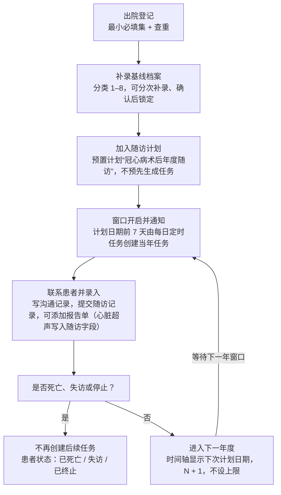
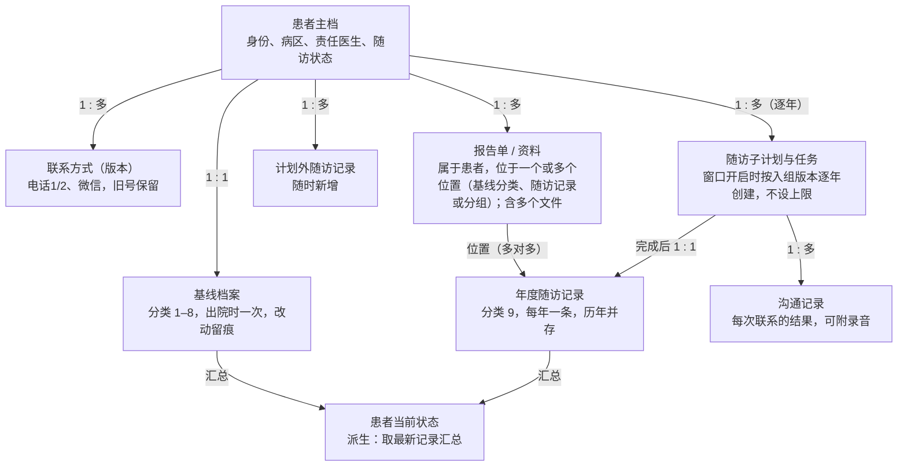
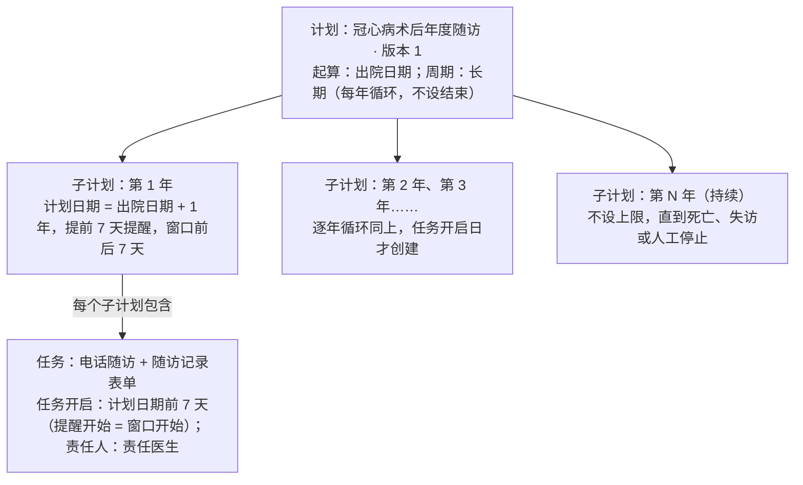
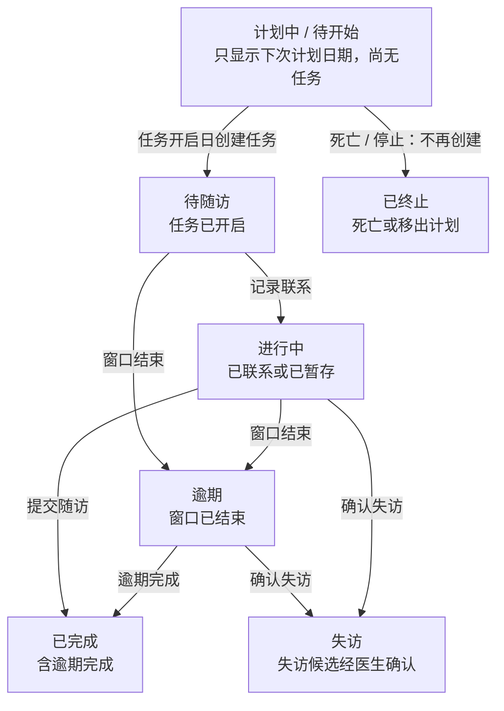

# 医院 A 重症冠心病患者随访需求规格说明 V0.3（含第 14 章医院 B）

> 转换说明：本文由需求页面“医院 A 需求规格说明 V0.3”于 2026-10-31 转为 Markdown，是交给开发的**唯一需求依据**之一。保留全部需求编号、表格与验收标准；删除了修订记录与讨论过程，末尾只留“决策记录（精简）”。原页面中的交互控件（筛选、切换）已展开为默认的全部内容。凡与仓库现状或其他文档不一致的地方，以 `docs/open-questions.md` 的结论为准，未列出的请先问人。

> 说明：医院 B 的需求见本文第 14 章（B 与 A 需求相同，作为独立租户由 A 的配置模板初始化）。附录 A 为 266 个字段的结构（字段名、类型、取值），不含任何患者数据。示例中的姓名、编号、日期均为虚构。

> 定义医院 A 重症冠心病患者从出院登记到长期年度随访（不设结束年度）的系统需求：患者档案与检索、按年区分的数据模型、字段字典、随访计划模板与任务、病区隔离、通知、报告单与资料（添加报告单模式，与医院 C 共用）、首页（含每年随访率，以及分别计算的基线资料完整度与随访资料完整度）。V0.3 写入医院对 Q01–Q41 的全部答复（含录入时与上次随访对比标红 A-FU-027 的默认规则 Q41）；第 14 章列出医院 B 的配置差异（需求与 A 相同、独立租户、由 A 的配置模板初始化、以手术日期起算的预置计划，不做随机化、盲法与质疑流程），医院 B 的问题 Q42–Q44 已确认；目前无待确认问题；不纳入首期的预警等内容见附录 B。

## 0. 文档说明

| 项目 | 内容 |
|---|---|
| 版本 | V0.3，写入医院确认的待确认问题，供医院 A 与开发团队评审 |
| 更新日期 | 2026-10-31 |
| 范围 | 患者随访模块在医院 A 的落地：重症冠心病患者登记与年度随访；医院 B 需求与 A 相同，配置差异见第 14 章 |
| 上位文档 | 平台底座需求规格说明 V0.3：`docs/requirements/platform-spec.md` |
| 字段来源 | 医院提供的《重症冠心病患者登记系统 · 患者信息字段清单》，9 个分类共 266 个字段 |
| 沿用平台能力 | 租户隔离、角色与权限、敏感字段与明文权限、通知渠道（短信、站内信、Webhook）、审计日志、导出审批、平台租户视角 |

> **五个关键设计** 一是把数据按时间分层：出院时采集一次的“基线档案”与每年一条的“年度随访记录”分开保存，历年记录并存、互不覆盖；二是字段字典驱动：266 个字段的显示名、编码选项、单位、校验统一配置；三是病区隔离：医生只能看到自己负责病区的患者，由后端强制执行；四是任务驱动随访：长期逐年随访、不设结束年度，任务在每年窗口开启时才创建（不预先生成），到窗口自动提醒、逾期自动通知；五是随访规则配置为“计划 → 子计划 → 任务”三层的计划模板，发布后锁定版本，调整须复制出新版本。

### 术语

| 术语 | 含义 |
|---|---|
| 基线档案 | 出院时采集一次的资料，即字段表分类 1 至 8 |
| 年度随访记录 | 每年随访时填写的资料，即字段表分类 9；第 N 年一条 |
| 计划日期 | 起算日期加上节点偏移的那一天；A 医院为出院日期满 N 年的那一天 |
| 随访窗口 | 计划日期前后若干天（按计划设置，A 医院前后 7 天），在此期间完成随访 |
| 提醒提前量 / 任务开启日 | 计划日期前多久开始提醒；任务在提醒开始日与窗口开始日中较早的一天创建 |
| 逾期 | 窗口结束仍未完成随访 |
| 失访 | 多次尝试仍联系不上患者 |
| 病区/中心 | 患者所属的病区或中心，独立的可配置字典，不挂在科室下；医生按负责病区查看患者 |
| 脱敏 | 只显示部分内容，如“张*”“138****5678” |

### 优先级定义

| 优先级 | 含义 |
|---|---|
| P0 | 首期上线必须具备 |
| P1 | 首期建议具备，可紧随上线迭代 |
| P2 | 后续规划，或依赖待确认事项 |

### 首期范围

| 内容 | 首期 | 说明 |
|---|---|---|
| 医生端：患者档案、随访计划与任务、病区、通知、报告单与资料、首页 | 做 | 本文第 3–9 章 |
| 报告单 AI 识别（OCR）与图片文字检索 | 不做 | 见附录 B |
| 预警规则、异常提醒面板、预警通知 | 不做 | 医院确认暂不需要（Q30），见附录 B；录入时对比标红（A-FU-027）只是表单内提示，不属于预警 |
| 在组患者迁移到计划新版本 | 不做 | 另行规划（Q31），见附录 B |
| 患者端推送与自填（小程序、企业微信、公众号） | 不做 | 可作为后续版本 |
| 患者邀请码入组 | 不做 | 依赖患者端 |
| 患者教育内容推送 | 不做 | 依赖患者端 |
| 向患者发送短信 | 不做 | 医院已确认首期短信只发医生或随访员（Q04） |
| 通用表单设计器（题型、子题目、计分、公式、阈值事件） | 不做 | A 医院使用固定字段字典；为其他医院预留，见 A-FLD-011 |
| 医院 B（独立租户，复用 A 的全部功能与配置） | 做 | 第 14 章 |
| 随机化、盲法、质疑（Query）流程等 RCT 功能 | 不做 | 医院 B 不需要（第 14 章） |
| 首页自由拖拽布局、BI 式自定义指标与图表 | 不做 | 首期为固定卡片目录 + 按角色配置（A-DASH-013），见附录 B |

### 我们保留的差异点

| 差异点 | 说明 |
|---|---|
| 病区隔离 | 医生只看负责病区的患者，后端强制执行（第 6 章）；竞品未见同类设计 |
| 字段级变更历史 | 每个字段的修改都记录旧值、新值、修改人、时间、原因（A-PAT-005） |
| 计划版本锁定 | 已发布计划不可修改，只能复制出新版本；患者沿用入组时的版本，按需创建的任务也按该版本（A-FU-019） |

## 1. 业务流程概览

患者出院时登记并采集基线；患者加入随访计划后，系统按计划模板（A 医院：以出院日期起算、每年一次、长期不设结束年度）在每年窗口开启时创建当年随访任务，未来年度不预先生成；每年在窗口内联系患者并填写随访记录，直到患者死亡、失访或被人工停止。

## 2. 数据模型与时间区分（核心设计）

需求 3 要求区分资料在不同年份的变化。建议不在一张表上反复覆盖，而是按“什么时候产生”把数据分成几层：一次性的基线、每年一条的随访记录、按版本保存的联系方式，再由系统汇总出“患者当前状态”。

### 数据结构关系

### 各层如何区分时间

| 数据层 | 内容 | 何时产生 | 时间区分方式 |
|---|---|---|---|
| 患者主档 | 姓名、病案号、性别、病区、责任医生、随访状态 | 出院登记 | 修改留痕；转病区有历史 |
| 基线档案 | 分类 1–8 共 212 个字段（电话除外） | 出院时一次，可补录 | 不随年度覆盖；每个字段的修改都记录旧值、新值、人、时间、原因 |
| 年度随访记录 | 分类 9 共 54 个字段 | 每年一条，窗口开启时创建（历史导入为过去年度直接生成） | 每条带随访年度 N、计划日期、窗口、实际随访日期；历年并存 |
| 计划外随访记录 | 同分类 9 | 随时 | 记录类型为计划外，按实际日期排序 |
| 报告单 / 资料 | 超声、造影、心电图、检验、出院小结、同意书、通话录音等，含附件文件 | 随时添加 | 每份带报告时间，至少一个位置（基线分类、第 N 年随访或其中分组，可多个）；心脏超声的参数写入映射目标记录本身 |
| 联系方式 | 电话1、电话2、是否已加微信 | 出院登记，随访中可更新 | 换号时新增一条并保留旧号，记录生效日期与来源（哪次随访） |
| 患者当前状态 | 生存状态、最近随访日期、最近 EF、当前用药、是否发生过各类终点事件、下次窗口 | 每次提交后自动重算 | 不可直接修改；永远取最新一条已提交记录 |

### 示例：同一患者的数据随时间排列（示意）

| 时间 | 数据层 | 记录内容（示意） |
|---|---|---|
| 2025-03-15 | 基线档案 | 出院前最后一次 EF 38%；出院带药：阿司匹林、他汀 |
| 2025-03-15 | 联系方式 | 电话1 138****1234（版本 1） |
| 2026-03-18 | 第 1 年随访 | 存活；复查超声 EF 45%；用药：β受体阻滞剂 |
| 2026-11-02 | 计划外随访 | 因心衰再住院，上传出院小结 |
| 2027-03-25 | 第 2 年随访（逾期完成） | 存活；EF 47%；更换号码 |
| 2027-03-25 | 联系方式 | 电话1 139****8888（版本 2，旧号保留） |
| 当前状态 | 派生 | 存活；最近随访 2027-03-25；最近 EF 47%；曾心血管再住院；下次窗口 2028-03-08 至 03-22 |

> **为什么这样分** 医生看“这个病人现在怎么样”时看当前状态；科研统计“出院时 EF 与第 3 年 EF 的变化”时，基线和每年的记录都完整保留，不会被后来的数据覆盖。纠正录入错误走字段留痕，与“病情随时间变化”是两回事，不混在一起。

### 规则

- 基线档案只描述出院时的情况；之后的变化只记在随访记录里，不回写基线。
- 随访记录提交后仍可修改，修改留痕；如医院需要，可对随访记录启用锁定（与基线锁定同一机制）。
- 当前状态中的“最新”指实际随访日期最晚的已提交记录（年度与计划外都算）；终点事件按“任一记录发生过”汇总。
- 联系方式更新不改动历史沟通记录中引用的号码，便于回溯当时拨打的是哪个号码。
- 年度随访中的事件字段（心梗、再住院等）一律指“自上次随访以来”发生的情况（医院已确认）；一年内多次事件的明细子表后续增加。

## 3. 字段字典与配置

把医院表格转换为系统可用的字段字典：表格里的“吸烟史(否=0，是=1)”拆成显示名“吸烟史”和选项“0=否、1=是”，并补充类型、单位、范围与必填规则。全部 266 个字段的初步解析见附录 A。

### 9 个分类概览

| 分类 | 字段数 | 数据层 | 采集时机 |
|---|---|---|---|
| 基本信息 | 12 | 患者主档 + 基线（电话进联系方式） | 出院登记 |
| 病例基本信息 | 37 | 基线档案 | 出院时 |
| 实验室检查 | 18 | 基线档案 | 出院时 |
| 超声检查 | 49 | 基线档案（术前 + 出院前） | 出院时 |
| 术前造影 | 18 | 基线档案 | 出院时 |
| 手术信息 | 42 | 基线档案 | 出院时 |
| 围手术期 | 16 | 基线档案 | 出院时 |
| 出院带药 | 20 | 基线档案 | 出院时 |
| 随访 | 54 | 年度随访记录 | 每年 |

### 字段类型（按初步解析统计）

| 类型 | 录入方式 | 示例 | 字段数 |
|---|---|---|---|
| 是否 | 单选“否 / 是”或“无 / 有” | 糖尿病、CABG | 94 |
| 单选 | 下拉选择 | NYHA 心功能分级、他汀类、室性心律失常、再住院类型 | 43 |
| 数值 | 数字 + 单位，含范围校验 | EF %、LA 前后径 mm | 77 |
| 整数 | 整数 | 病变支数、动脉桥数量 | 4 |
| 数值 × 2 | 长 × 宽两个数 | 室壁瘤大小 | 3 |
| 日期 | 日期选择 | 出院日期、随访日期 | 18 |
| 日期时间 | 日期 + 时间 | 手术开始时间、进 ICU 时间 | 4 |
| 文本 | 自由填写 | 诊断信息、死亡原因 | 11 |
| 文本（敏感） | 加密存储、默认脱敏 | 姓名、病案号、电话1、电话2 | 4 |
| 引用 | 从字典选 | 病区、术者 | 2 |
| 派生 | 系统计算、只读 | BMI、手术时长 | 6 |

### 派生字段计算规则

| 字段 | 计算方法 |
|---|---|
| 手术年龄 | 手术日期 − 出生日期，取周岁（新增出生日期字段，A-FLD-013） |
| BMI | 体重 Kg ÷ (身高cm ÷ 100)²，保留 1 位小数（用户已确认） |
| 术后住院天数 | 出院日期 − 手术日期 + 1（含当天；出院≥手术才计算）（用户已确认） |
| 手术时长min | 手术结束时间 − 手术开始时间（分钟，向下取整）（用户已确认） |
| ICU时间h | 出ICU时间 − 进ICU时间（小时，保留 1 位小数，如 160小时54分→160.9）（用户已确认） |
| 桥血管数量 | 动脉桥数量 + 静脉桥数量 |
| 随访年度 N（系统） | 由随访计划确定，从 1 起逐年递增，不设上限 |
| 随访年限（系统） | （死亡日期或今天）− 出院日期，以年计，不设上限（可超过 10 年），用于统计 |

### 功能清单

| 编号 | 功能 | 说明 | 优先级 |
|---|---|---|---|
| A-FLD-001 | 字段字典 | 把医院表格的 266 个字段整理为字典：编码、显示名、分类、库列名、类型、单位、选项、范围、必填、条件必填、敏感标记、派生公式、帮助说明、排序 | P0 |
| A-FLD-002 | 显示名与编码分离 | 把字段名里的“(否=0，是=1)”等编码拆出来，页面只显示“吸烟史”和下拉选项“否 / 是”，数据库存编码 0 / 1 | P0 |
| A-FLD-003 | 类型与范围校验 | 按类型渲染控件；数值有单位与合理范围，超出合理范围提示但可保存，超出硬范围不可保存 | P0 |
| A-FLD-004 | 条件显示与条件必填 | 表单按答案显示后续字段：“是否死亡=是”才显示并必填死亡日期、死亡原因；选了再住院类型才显示再住院日期；“复查超声=是”才显示超声指标；“体外循环=有”才显示体外循环时间 | P0 |
| A-FLD-005 | 派生字段自动计算 | 表单自动计算字段：术后住院天数、手术时长min、ICU时间h、BMI 按下方“表单自动计算字段”表（公式已由用户确认）计算，依赖字段改动时实时重算，输入缺失或结果无效时留空并提示；手术年龄、桥血管数量、随访年度、随访年限同样自动计算；计算字段默认只读，批量导入与历史导入也重算 | P0 |
| A-FLD-006 | 跨字段逻辑校验 | 入院 ≤ 手术 ≤ 出院；手术开始 < 结束；进 ICU < 出 ICU；死亡日期 ≥ 出院日期；随访事件日期在出院日期与本次随访日期之间 | P1 |
| A-FLD-007 | 分类表单布局 | 按 9 个分类分页签展示；随访表单再分为“联系与生存、终点事件、复查超声、用药”四组 | P0 |
| A-FLD-008 | 字典维护页 | 租户管理员可调整显示名、帮助说明、范围、必填、选项显示名、排序，可新增选项；已有数据的字段不能删除，编码不可改 | P1 |
| A-FLD-009 | 字典变更记录 | 记录每次字典调整的前后值、操作人、时间 | P1 |
| A-FLD-010 | 医院自助新增字段 | 医院自行新增字段而不需要发版；医院已确认首期不需要，新增字段随版本发布 | P2 |
| A-FLD-011 | 通用表单设计器 | 为其他医院预留：7 种题型、子题目、计分、公式、按阈值触发事件；A 医院首期不做 | P2 |
| A-FLD-012 | 可配置业务字典 | “患者类型”“术者”“病区/中心”为租户可配置字典，由租户管理员维护取值（新增、停用、排序、别名）；病区/中心字典即第 6 章病区字典 | P0 |
| A-FLD-013 | 新增出生日期字段 | 在基本信息中新增“出生日期”（日期），用于自动计算手术年龄；不采集身份证号 | P0 |
| A-FLD-014 | 租户配置模板 | 把一个租户的配置保存为配置模板：字段字典（含显示名、选项、范围、必填、条件显示、派生公式）、业务字典“患者类型”的取值、报告单类型与字段集 / 指标模板 / 映射、统计口径、首页布局、角色模板与权限点、通知设置、录入时对比提示规则、随访计划模板；新建租户时选择模板初始化，之后各租户独立修改、互不影响；只复制配置，不复制任何患者、基线档案、随访记录与任务、沟通记录、报告单文件、审计日志、用户账号，“术者”“病区/中心”字典只复制结构、不复制取值；医院 B 由医院 A 的配置模板初始化（第 14 章） | P0 |

### 主要页面

1. **字段字典（租户管理员）**：按分类列出字段，可搜索；编辑显示名、帮助说明、范围、必填、选项显示名与排序；查看变更记录。
2. **患者表单**：基线档案 8 个分类页签 + 随访记录表单，控件、单位、选项、校验全部来自字典；派生字段灰底只读并显示公式提示。

### 关键字段 · 字段字典每个字段的属性

| 字段 | 类型 | 必填 | 说明 |
|---|---|---|---|
| 字段编码 | 字符串 | 是 | 系统内唯一，建议取库列名；创建后不可改 |
| 显示名 | 字符串 | 是 | 去掉编码说明后的简洁名称，如“吸烟史” |
| 分类 | 枚举 | 是 | 9 个分类之一，决定所在页签与数据层 |
| 类型 | 枚举 | 是 | 见下方“字段类型”表 |
| 单位 | 字符串 | 否 | 如 mm、ml、%、mmol/L |
| 选项 | 清单 | 单选 / 多选必填 | 编码 + 显示名 + 排序 + 是否停用 |
| 合理范围 / 硬范围 | 数值 | 否 | 合理范围外黄色提示，硬范围外不可保存 |
| 必填 / 条件必填 | 规则 | 否 | 如“前项为是时必填” |
| 敏感 | 布尔 | 是 | 姓名、病案号、电话1、电话2 为是 |
| 派生公式 | 表达式 | 派生字段必填 | 由系统计算，前端只读 |
| 帮助说明 | 文本 | 否 | 保留原表里的判定口径，如肾功能不全的判定标准 |

### 关键字段 · 表单自动计算字段（公式已由用户确认）

| # | 计算字段 | 公式 | 触发依赖（改动哪个字段会重算） | 写入分类 |
|---|---|---|---|---|
| 1 | 术后住院天数 | 出院日期 − 手术日期 + 1（含当天，向上取整；出院≥手术才计算） | 手术日期（含主表单 `form.surgery_date` 或 `basic_info.手术日期`）、出院日期 | 病例基本信息 |
| 2 | 手术时长min | 手术结束时间 − 手术开始时间（分钟，向下取整） | 手术开始/结束时间（YYYYMMDDHHmm） | 手术信息 |
| 3 | ICU时间h | 出ICU时间 − 进ICU时间（小时，保留 1 位小数，如 160小时54分→160.9） | 进/出ICU时间（YYYYMMDDHHmm） | 围手术期 |
| 4 | BMI（非日期，同机制） | 体重 ÷ 身高²，1 位小数 | 身高cm、体重 Kg | 病例基本信息 |

### 业务规则与边界情况

- 字典是表单、校验、导入模板、导出表头、统计维度的唯一来源，四处不各自维护。
- 单选、是否类字段在数据库存编码，页面显示显示名；导出时可选“编码”或“显示名”，供统计分析或人工阅读。
- 原表中未写编码的是否类字段（既往PCI、肾功能不全、4 个搭桥靶点）按 0=否、1=是 处理，需医院确认。
- “室壁瘤大小 mm*mm”拆成长、宽两个数值保存，页面显示为“长 × 宽”。
- 计算字段在任一触发依赖字段改动时实时重算，不需要保存后才更新。
- 输入缺失或结果无效时计算字段留空并在字段旁提示原因，如“出院日期早于手术日期”“出ICU时间早于进ICU时间”“缺少身高”；手术结束时间早于手术开始时间同样视为无效。
- BMI 计算时身高换算为米（身高cm ÷ 100），即 BMI = 体重 Kg ÷ (身高cm ÷ 100)²，保留 1 位小数。
- 计算字段默认只读，不能覆盖计算值。保留原有规则：只有来源字段缺失时（多见于历史数据）允许手工录入，并标记“手工录入”；来源齐全后以计算值为准并提示差异。结果无效（如出院早于手术）时不允许手工录入，应先修正来源字段。
- 批量导入与历史导入（含宽表导入）同样重算计算字段；导入文件中的值与计算值不一致时以计算值为准，并在校验报告中列为警告（行、列、导入值、计算值）；来源字段缺失时导入值按“手工录入”保留。
- 计算字段重算后值发生变化时写入字段变更记录：旧值、新值、触发的依赖字段、修改人、时间，来源标为“系统重算”。
- “术后住院天数”从手术日期算起，不是从入院日期算起的“住院天数”。字段字典中没有单独的“住院天数”字段，因此不存在冲突；如以后需要“出院日期 − 入院日期”的总住院天数，应另设字段，不复用本字段。
- 选项停用后不出现在新录入的下拉中，历史数据照常显示。
- 条件显示规则写在字段字典里（“当某字段等于某值时显示 / 必填”），不写死在页面中；被隐藏字段的已有值在提交时清空并留痕。
- 原表笔误已按附录 A 处理：术前最后一次肌酐单位按 μmol/L（医院已确认）；“主动动脉瓣”按“主动脉瓣”。
- 瓣膜返流量 / 返流程度统一取值：无 / 微量 / 少量 / 中量 / 大量（医院已确认）。
- “死亡随访时间”（#217）记录患者死亡日期，不计算时长，与“死亡日期”（#216）含义相同，系统中合并为一个字段；导入时两列都有值且不一致的行报警告。

### 验收标准

- 附录 A 的 266 个字段全部可在表单中录入，选项显示名与编码对应正确。
- 录入身高 175、体重 70 后 BMI 自动显示 22.9；修改出院日期后术后住院天数随之更新。
- 手术日期 2026-03-01、出院日期 2026-03-08 时术后住院天数为 8；出院日期改为 2026-02-28 时字段变空并提示“出院日期早于手术日期”。
- 手术开始 202603010800、结束 202603011245 时手术时长为 285；进ICU与出ICU相差 160 小时 54 分时 ICU时间为 160.9。
- 导入一行 BMI 填 30、身高 175、体重 70 的数据时，系统保存 22.9，校验报告列出一条警告；重算产生的变化在变更记录中可查。
- 身高录入 300 时不可保存并提示范围；录入 215 时黄色提示但可保存。
- “是否死亡”选“否”时不显示死亡日期；选“是”时死亡日期与死亡原因必填。
- 随访表单中选择“术后因心血管疾病再住院类型”后才出现再住院日期，并为必填。
- 租户管理员修改某字段显示名后，表单、导入模板、导出表头同步变化，并留有变更记录。

## 4. 患者管理

覆盖患者的登记、查找（含高级检索）、患者档案、修改、导入、导出、批量入组与暂停 / 移出随访；一切操作只在本人可见病区内进行。

### 功能清单

| 编号 | 功能 | 说明 | 优先级 |
|---|---|---|---|
| A-PAT-001 | 患者列表 | 显示姓名（脱敏）、病案号（脱敏）、性别、手术年龄、病区、术者、手术日期、出院日期、随访状态、已完成 / 应完成次数、下次随访窗口、责任医生；只显示本人可见病区 | P0 |
| A-PAT-002 | 检索与筛选 | 病案号、姓名精确查找；按病区、术者、手术 / 出院日期范围、随访状态、患者类型、手术方式、出院状态、是否有逾期任务筛选 | P0 |
| A-PAT-003 | 新建患者（出院登记） | 先填最小必填集（病案号、姓名、性别、病区、手术日期、入院日期、出院日期、出院状态），其余分类可暂存草稿、陆续补录 | P0 |
| A-PAT-004 | 患者档案 | 打开即为概览页：个人信息（脱敏）、当前状态、最近一次随访关键指标（如生存状态、EF、终点事件）、备注；页签：概览 / 基线档案 / 年度随访 / 报告单 / 资料 / 时间轴；联系方式与变更记录从概览进入；基线档案、年度随访页签左栏为报告单导航（A-PAT-020），右侧内容顶部为分类 / 分组条（A-PAT-021） | P0 |
| A-PAT-005 | 编辑与字段级留痕 | 任何字段修改都记录旧值、新值、修改人、时间；锁定后修改须填写原因 | P0 |
| A-PAT-006 | 基线锁定与解锁 | 出院后 30 天内由病区医生确认无误后锁定（医院已确认）；解锁需专门权限并填写原因 | P1 |
| A-PAT-007 | 病案号查重 | 病案号在本院唯一；新建与导入时实时提示重复并可跳转到已有患者 | P0 |
| A-PAT-008 | Excel 批量导入 | 用于导入约 5000 名历史患者。模板按新规则重新设计，分“基线”“随访记录”两张表（见下方“导入格式说明”）；导入前出校验报告（错误、警告、重复），确认后导入；过去年度生成随访记录，窗口正在开启的年度创建当年任务，未来年度不预先创建（A-FU-001） | P0 |
| A-PAT-009 | 导出 | 按当前筛选导出基线与随访数据，可选编码或显示名；遵循平台导出审批与脱敏规则 | P0 |
| A-PAT-010 | 敏感字段明文查看 | 姓名、病案号、电话默认脱敏；持有明文权限者点“查看”逐个显示，每次查看记入审计 | P0 |
| A-PAT-011 | 暂停、移除与恢复随访 | 在随访计划中暂停或移除患者，须选原因（拒绝随访、外地随访、其他）；恢复后从下一个窗口起继续按需创建任务（见 A-FU-022） | P0 |
| A-PAT-012 | 删除患者 | 敏感权限，软删除并填写原因，可由租户管理员恢复 | P1 |
| A-PAT-013 | 患者时间轴 | 患者档案的“时间轴”页签：按时间顺序展示出院、每年随访、计划外随访、事件（心梗、再住院等）、死亡 | P1 |
| A-PAT-014 | 高级检索 | 条件构造器：可选字段字典中任一字段，选运算符（等于、不等于、大于、小于、介于、包含、为空、不为空）和取值；条件之间选“并且 / 或者”，可分组；下方实时显示逻辑表达式预览 | P0 |
| A-PAT-015 | 保存个人筛选 | 把高级检索条件保存为个人常用筛选，可命名、修改、删除；仅本人可见 | P1 |
| A-PAT-016 | 批量入组 | 按筛选条件（含高级检索）选出患者，批量加入一个已发布的随访计划；确认前显示将加入人数与将跳过人数 | P0 |
| A-PAT-017 | 批量指定责任医生 | 在患者列表或批量入组页为选中患者批量指定责任医生，只能选该病区的医生 | P0 |
| A-PAT-018 | 宽表历史数据导入 | 医院现有 Excel 为宽表（已确认），约 5000 名历史患者按此格式导入：识别“9 个前置列 + 212 个基线列 + N 组 × 54 个随访列（组数不限，医院样例为 10 组）”的布局，基线列按表头名匹配字段字典，随访年度按组的位置确定，全空的组跳过；转换 N/A、yyyymmdd / yyyymmddHHMM 日期；保留原系统编号；先预检、后正式导入，可按病案号重新导入（更新或跳过）；规则见下方“宽表历史数据导入流程” | P0 |
| A-PAT-019 | 数据完整度（基线资料 / 随访资料） | 按患者分两个模块分别计算：基线资料完整度 = 已填写的基线必填字段数 ÷ 基线必填字段数（分类 1–8，口径见 A-DASH-010）；随访资料完整度 = 该患者已完成年度随访记录完整度的平均值（分类 9，口径见 A-DASH-011，医院已确认 Q40）；两个值在患者列表中各占一列（可排序、筛选），并在患者档案概览页同时显示，不再显示单一的“数据完整度”；医院现有系统导出的“数据完整度”不导入，两个值都由系统重新计算 | P1 |
| A-PAT-020 | 基线 / 随访页签左栏：报告单导航 | 基线档案与年度随访页签的左栏只做报告单 / 附件导航（宽 240 px，可收起），不放其他内容：列出该患者全部已上传的文件与图片，按报告单类型分组，可按类型、日期筛选；每份报告单只出现一次，下方显示它的全部位置标签（如“基线 · 病例基本信息”“第 3 年随访 · 超声复查”），点标签跳到该位置，点报告单本身跳到第一个位置；年度随访页签按随访记录分组（新的在上）再按类型，位于多条记录的报告单在每条下各出现一次；没有位置的报告单进入“未指定位置”组（A-ATT-020）；图片缩略图同时显示在每个所在位置（分类或分组末尾）；平板收为“附件（n）”抽屉，手机为底部抽屉；水印、下载权限与脱敏规则不变 | P0 |
| A-PAT-021 | 分类条与分组条（填写进度导航） | 基线档案右侧内容顶部固定一条分类条（滚动时吸顶），取代原分类快捷导航：每个分类显示“已填 / 应填”（必填字段口径同 A-PAT-019，按条件实际显示的才计入），未填完显示橙色，有报告单的分类带 📎 数量；点击跳到该分类并高亮 2 秒，位置写入页面地址便于分享；展开的随访记录顶部有同样的分组条（分组名、已填 / 应填、标红数，标红见 A-FU-027）；平板横向滚动，手机改为下拉选择 | P0 |

### 主要页面

1. **患者列表**：顶部筛选区 + 列表（含“基线资料完整度”“随访资料完整度”两列，A-PAT-019；无已完成随访记录的患者随访资料完整度显示“—”）；操作：新建、导入、导出、批量改派责任医生；行内：详情、录入随访、查看明文（有权限时）。
2. **新建 / 编辑患者**：第一步填最小必填集并查重；保存后进入基线档案逐项补录，用顶部分类条（A-PAT-021）在 8 个分类间跳转，每个分类单独保存，分类条显示已填 / 应填。
3. **患者档案**：概览页：个人信息（脱敏）、当前状态、病区、责任医生、下次窗口、最近一次随访关键指标、基线资料完整度与随访资料完整度（两个值并列，点击可查看缺失字段；随访资料完整度可展开为各随访年度的值）、备注；页签：概览 / 基线档案 / 年度随访 / 报告单 / 资料 / 时间轴。
4. **患者档案 · 基线档案 / 年度随访页签**：左栏为报告单导航（A-PAT-020）：按类型分组，每份带位置标签，底部“未指定位置”组（橙色组名，有上传权限时显示“指定位置”）；右侧顶部吸顶分类条（基线）或分组条（随访记录），显示已填 / 应填，未填完为橙色（A-PAT-021）；分类、随访记录或分组末尾显示位于此处的报告单缩略图，可直接添加并自动预选该位置。
5. **高级检索**：在患者列表点“高级检索”展开条件构造器；可添加条件与条件组，切换并且 / 或者，预览逻辑表达式，如“（病区 = 心外一病区 并且 EF 射血分数 < 40）或者 再住院类型 不为空”；可保存为个人筛选。
6. **批量入组**：左侧筛选（普通筛选或高级检索）；中间结果列表可勾选；右侧选择目标随访计划与责任医生；确认后显示成功与跳过（已在组、已死亡、已移除）明细。
7. **导入向导**：下载模板 → 上传 → 校验报告 → 选择重复处理方式 → 确认导入 → 导入结果下载。

### 历史数据导入流程

1. **下载模板**：模板由字段字典生成，含两张表：“基线”表一个患者一行；“随访记录”表一次随访一行，用“病案号 + 随访年度”确定是哪位患者的第几年。单选列可填编码或显示名，表头附填写说明与选项。现有数据如为宽表，先做一次性转换（A-PAT-018）。
2. **上传与预校验**：逐行校验类型、范围、必填、选项、日期逻辑、病区是否存在、病案号是否重复，不写入数据。
3. **查看校验报告**：分错误（不可导入）、警告（可导入）、重复三类，可下载带标注的 Excel。
4. **选择重复处理**：跳过 / 只补空字段 / 覆盖（覆盖同样留痕）。
5. **确认导入**：错误行跳过，其余写入；“随访记录”表按病案号 + 随访年度归入对应子计划，同一病案号 + 随访年度出现两行时报重复。
6. **加入计划并写入历史记录**：患者加入“冠心病术后年度随访”；已有随访数据的过去年度生成随访记录并标为已完成；窗口已结束又没有数据的年度标为“历史未随访”，不计入逾期与通知，可补录；窗口正在开启中的年度由每日定时任务创建当年任务；未来年度不预先创建，只在时间轴上显示下次计划日期（A-FU-001）。

### 宽表历史数据导入流程（医院现有格式，A-PAT-018）

1. **上传医院现有 Excel**：一张工作表“患者数据”，一个患者一行，共 221 + 54 × N 列（医院样例 N = 10，共 761 列）。无需先手工转换格式。
2. **识别布局**：按位置识别三段：前 9 列为原系统导出列；接着 212 列为基线字段，按表头名与字段字典匹配（表头与字典显示名一致、顺序相同）；其后为若干组随访列，每组 54 列、表头相同且无“第N年”字样，第 1 组即第 1 年、第 2 组即第 2 年，依此类推；组数不设上限（医院样例为 10 组），总列数须为 221 + 54 × 组数。列数或表头对不上时整体报错，不做猜测。
3. **单元格转换**：所有单元格按文本读取：“N/A”转为空；yyyymmdd 转为日期，yyyymmddHHMM 转为日期时间；数值文本转为数值；编码字段按字典取编码。
4. **预检（不写入）**：按字典校验类型、范围、选项、日期逻辑，比对前置列与基线列是否冲突，生成校验报告：逐个列出问题单元格的行、列、原值和原因。
5. **处理问题后正式导入**：医院修正原表或接受建议处理后正式导入；同一病案号已存在时按选择“更新”或“跳过”，更新同样留痕。可多次重新导入。
6. **对应到随访计划**：每位患者加入预置计划“冠心病术后年度随访”；有数据的年度生成同一年度的子计划与随访记录并标为已完成；窗口已结束又没有数据的年度标为“历史未随访”（Q06）；未来年度不预先创建，到窗口开启时由每日定时任务创建（A-FU-001）。

### 关键字段 · 导入格式说明：宽表与长表

| 格式 | 样子 | 说明 |
|---|---|---|
| 宽表（一人一行、多年随访并排成列） | 一行就是一个患者；第 1 年、第 2 年……的随访内容放在同一行，用不同的列区分，如“第1年随访日期”“第1年EF”“第2年随访日期”“第2年EF”…… | 随访有 54 个字段，10 年就要约 540 列，列多、易错，每多一年就要加一批列；系统不直接导入宽表，需先转换 |
| 长表（一次随访一行） | 一行就是某个患者的某一年随访；列只有“病案号、随访年度、随访日期、EF……”这一套，第几年写在“随访年度”列里 | 新模板“随访记录”表采用此格式；同一患者随访了 3 年就是 3 行，列数固定不变 |

### 关键字段 · 示例：同一位虚构患者的两年随访（非真实数据）

| 格式 | 内容 |
|---|---|
| 宽表 · 1 行 | 病案号 X0001 ｜ 第1年随访日期 2026-03-18 ｜ 第1年是否死亡 否 ｜ 第1年EF 45 ｜ 第2年随访日期 2027-03-25 ｜ 第2年是否死亡 否 ｜ 第2年EF 47 |
| 长表 · 第 1 行 | 病案号 X0001 ｜ 随访年度 1 ｜ 随访日期 2026-03-18 ｜ 是否死亡 否 ｜ EF 45 |
| 长表 · 第 2 行 | 病案号 X0001 ｜ 随访年度 2 ｜ 随访日期 2027-03-25 ｜ 是否死亡 否 ｜ EF 47 |

### 关键字段 · 医院现有宽表的列结构（已据医院样例确认）

| 列段 | 列数 | 内容 | 导入处理 |
|---|---|---|---|
| 前置列 | 9 | 序号、患者编号、病案号、姓名、性别、手术年龄、入院日期、诊断分类、数据完整度（原系统导出） | 患者编号存为“原系统编号”；病案号、姓名、性别、手术年龄、入院日期与基线列重复，以基线列为准，两者不一致时报警告；数据完整度不导入，由系统重新计算基线资料完整度与随访资料完整度；序号忽略；诊断分类与基线“诊断信息”不一致时报警告 |
| 基线列 | 212 | 字段字典分类 1–8 的基线字段 | 按表头名匹配字段字典；匹配不上的列报错 |
| 随访列 | 54 × N | N 组随访字段，每组 54 列，表头相同；组数不限，医院样例为 10 组 | 第 N 组即第 N 年；全空的组跳过；不检查 ±7 天窗口，按实际随访日期记录并标为“历史导入” |

### 关键字段 · 原系统编号（新增患者字段）

| 字段 | 类型 | 必填 | 说明 |
|---|---|---|---|
| 原系统编号 | 文本 | 否 | 医院原系统的患者编号，仅用于追溯与重新导入时核对；只读，不参与查重与统计 |

### 关键字段 · 校验报告中的常见问题（前两类见于医院样例，其余为虚构示例）

| 问题 | 示例（不含真实患者信息） | 处理 |
|---|---|---|
| 是否类字段填了“0/1” | 某个“是/否”字段的单元格内容为“0/1” | 列入校验报告供人工复核，该单元格按空值导入；复核后可补录（已确认，Q36） |
| 编码字段填了“编码 + 文字” | 术后因心血管疾病再住院类型填“6颈动脉内剥”（6=外周血管疾病） | 取编码 6 导入，文字“颈动脉内剥”存入该字段备注，该字段无备注时存入“特殊情况备注”；在报告中列为警告（已确认，Q37） |
| 数值超出范围 | EF 填 150 | 超出合理范围报警告，超出硬范围报错 |
| 日期格式错误 | 20251345、2025-7-18 | 无法解析报错 |
| 前置列与基线列不一致 | 前置列手术年龄与基线手术年龄不同 | 以基线列为准，报警告 |
| 历史随访日期在窗口外 | 第 1 年随访日期比出院满 1 年早 17 天 | 不报错，按实际日期导入并标为“历史导入” |
| 必填字段为空 | 某必填字段为“N/A” | 历史导入时只报警告，在基线资料或随访资料完整度中按未填计算 |

### 关键字段 · 患者随访状态

| 状态 | 含义 | 如何进入 |
|---|---|---|
| 随访中 | 在随访计划中，按子计划开启任务 | 加入随访计划（出院登记后默认自动加入预置计划） |
| 已暂停 | 暂时不随访，任务不开启、不发通知 | 在随访计划中暂停该患者，须填原因 |
| 已死亡 | 后续任务全部终止 | 随访记录“是否死亡=是”，或出院状态=死亡 |
| 已终止 | 人为停止随访 | 从随访计划中移除，须填原因 |
| 失访 | 长期联系不上 | 连续 2 个年度失访时，系统提示后由医生改为失访（A-FU-012） |
| 随访结束 | 固定次数的计划已全部完成 | 仅适用于设了固定次数的计划；A 医院预置计划为长期，不会进入此状态，随访持续到死亡、失访或人工停止 |

### 业务规则与边界情况

- 列表、详情、检索、导出、导入全部受病区范围限制（第 6 章），看不到的患者按“不存在”处理。
- 姓名、病案号、电话加密存储；病案号和姓名支持精确查找（盲索引），不支持模糊查找密文。
- 同一病案号只能登记一次。患者再次手术不作为新登记，作为随访事件记录（医院已确认）。
- 出院登记后自动加入预置计划“冠心病术后年度随访”；出院状态=死亡的患者可建档但不加入；“病重自动出院”的患者照常加入（医院已确认）。
- 首页“患者总数”包含已死亡、已终止患者（医院已确认）。
- 患者与随访数据在服务期内长期保留，删除只做软删除（医院已确认）。
- 只记录“是否已加微信”，不对接微信（医院已确认）。
- 导出受平台规则约束：租户管理员本人导出无需审批，其他用户须租户管理员审批；无明文权限时敏感字段导出为脱敏值；导出文件加水印并记入审计。
- 导入只允许导入到本人可见的病区；病区值无法匹配的行报错。
- 宽表导入的随访记录不受 ±7 天窗口限制，按实际随访日期记录并标为“历史导入”，可在随访记录中筛选。
- 宽表导入的校验报告逐个列出问题单元格（行、列、原值、原因），可下载带标注的 Excel；预检不写入任何数据。
- 按病案号重新导入时，选择“更新”只改动有变化的字段并留痕，选择“跳过”则已存在的患者不动。
- 数据完整度分基线资料、随访资料两个模块分别计算，互不合并：基线资料只看分类 1–8，随访资料只看分类 9；条件必填字段只在条件成立、字段实际显示时计入分母；字段修改后实时更新。
- 是否类字段的单元格为“0/1”时，列入校验报告供人工复核，该字段按空值导入，复核后可补录（Q36）。
- 编码字段的单元格为“编码 + 文字”（如“6颈动脉内剥”）时，取编码导入，文字存入该字段备注，该字段无备注时存入“特殊情况备注”，并在校验报告中列为警告；编码不在字典选项内时报错（Q37）。
- 分类条、分组条上的已填 / 应填与完整度（A-PAT-019）同一口径，由表单引擎按分类、分组实时计算；分类与分组以模板中的固定标识区分，改显示名不影响跳转与报告单位置。
- 高级检索只在本人可见病区内查询；条件中只出现本人有权查看的字段；姓名、病案号、电话只支持“等于”精确匹配。
- 批量入组只处理本人可见病区的患者；已在该计划中、已死亡、已从该计划移除的患者跳过并在结果中列明。

### 验收标准

- 负责 A 病区的医生在列表、检索、导出中都看不到 B 病区患者；直接输入 B 病区患者链接返回无权访问。
- 新建时输入已存在的病案号，系统立即提示并给出已有患者链接。
- 修改任一基线字段后，变更记录显示旧值、新值、修改人、时间。
- 导入 100 行（含 3 行错误、2 行重复）时，校验报告准确列出 5 行问题，确认后导入 95 行或按选择处理重复行。
- “随访记录”表中同一病案号 + 随访年度出现两行时，校验报告标为重复；病案号在“基线”表中不存在的随访行报错。
- 导入医院样例格式的宽表（761 列、部分年度组有数据）后，有数据的年度生成随访记录并标为“历史导入”，对应子计划为已完成，全空的组不生成记录，窗口已结束且无数据的年度为历史未随访，未来年度不创建任务、时间轴只显示下次计划日期；原系统编号可查。
- 宽表中填“0/1”的是否类字段、填“6颈动脉内剥”的编码字段，都在预检报告中逐格列出行、列、原值与原因。
- 同一份宽表第二次导入并选择“跳过”时，已存在的患者不变；选择“更新”时只有改动过的字段产生变更记录。
- 患者列表的基线资料完整度、随访资料完整度两列与患者档案概览页一致；补填一个基线必填字段后只有基线资料完整度上升；补填某条已完成随访记录的必填字段后只有随访资料完整度上升。
- 导入含“数据完整度”前置列的宽表后，该列原值不出现在系统中，两个完整度均按系统口径重新计算。
- 无明文权限的用户导出文件中姓名、病案号、电话为脱敏值。
- 把患者移出计划后其未完成的任务变为已终止；恢复后剩余子计划重新开启。
- 高级检索“EF 射血分数 < 40 并且 术后因心血管疾病再住院类型 不为空”的结果与逐条核对一致，且只含本人可见病区的患者；表达式预览与所建条件一致。
- 批量选择 20 名患者加入计划，其中 2 名已在组，结果显示成功 18、跳过 2。
- 打开患者档案首先看到概览页，显示最近一次随访的生存状态与 EF。
- 基线档案分类条上“病例基本信息 3 / 5”显示为橙色；补填 2 个必填字段后变为“5 / 5”且不再是橙色，基线资料完整度同步上升。
- 在左栏点报告单的位置标签“第 3 年随访 · 超声复查”，页面切到该随访记录并展开，滚动到“超声复查”分组并高亮 2 秒，地址中带有该位置；平板上左栏为“附件（n）”抽屉，手机上分类条为下拉选择。

## 5. 随访计划与任务

随访规则不写死在系统里，而是配置成“随访计划”：计划下分子计划（A 医院为“第 N 年”持续循环，不设结束年度），子计划下是具体任务。患者加入计划后不预先生成任务，每日定时任务在任务开启日（提醒开始与窗口开始中较早的一天）按计划创建当年任务，逾期自动标记，每次联系写沟通记录，死亡、失访或人工停止后不再创建后续任务。

### 随访计划结构（A 医院预置）

### 任务状态流转

### 录入时对比提示规则（医院已确认 Q41）

以下为根据附录 A 分类 9（随访）字段制定的默认规则，医院已确认按此执行（Q41）；每条规则可单独开关、调整阈值。只在录入表单内标红提示，不发通知、不进入任何列表或首页，也不需要处理；附录 B 的预警（条件构造器、分级、通知、处理流程）首期仍不做。

| 规则 | 对比对象 | 默认条件 | 涉及字段 |
|---|---|---|---|
| 射血分数下降 | 上一次随访；无上一次时对比基线 #102 出院前最后一次EF | 下降 ≥ 10 个百分点（如 55% → 44%） | #248 EF 射血分数 |
| 新发死亡 | — | 本次“是否死亡”= 是 | #215 是否死亡 |
| 新发再住院 | 上一次随访 | 本次填写了再住院类型，且再住院日期晚于上一次随访日期（或上一次未填） | #223、#224 |
| 新发再血运重建 | 上一次随访 | 本次再次血运重建 ≠ 无，且日期晚于上一次随访日期（或上一次为无） | #225、#226 |
| 其他新发事件 | 上一次随访 | 同上：本次为“是 / 有”且日期晚于上一次随访 | #219 术后心肌梗死、#221 术后脑血管疾病、#227 再次瓣膜手术、#230 因心律失常再次手术、#233 术后出血 |
| 左室扩大 | 上一次随访；无上一次时对比基线 #103 | LVDd 增加 ≥ 5 mm | #249 LVDd 舒张末径 |
| 瓣膜返流加重 | 上一次随访 | 返流程度升高 ≥ 2 级，或达到中量 / 大量 | #239、#241、#243 |
| 新发心室血栓 | 上一次随访；无上一次时对比基线 #113 | 由否变为是 | #258 随访有无心室血栓 |
| 超出提示范围 | 字段字典中配置的提示范围 | 超出即标红；默认只给 EF ＜ 40%、LVDd ＞ 60 mm、LA ＞ 45 mm 三项默认值，其余数值字段默认不设范围 | 分类 9 数值字段 |

对比只用已提交的年度随访记录（含逾期完成、补录、历史导入），计划外随访与草稿不作对比对象；上一次该字段为空时跳过该条规则。提示范围与字段字典中的取值校验范围（如 EF 5–85）分开配置，校验范围仍用于拦截录入错误。

### 功能清单

| 编号 | 功能 | 说明 | 优先级 |
|---|---|---|---|
| A-FU-001 | 按任务开启日创建任务（按需生成） | 患者加入随访计划后不预先生成各节点任务；每日定时任务检查在组患者，在任务开启日（该节点提醒开始日与窗口开始日中较早的一天，见 A-FU-016；A 医院两者都是计划日期前 7 天）按患者所入计划版本创建该节点的子计划、任务与随访记录表单；A 医院计划日期 = 出院日期 + N 年，N 从 1 起逐年递增、不设上限；未来年度只在时间轴上显示下次计划日期（计划中 / 待开始），按当前起算日期实时计算 | P0 |
| A-FU-002 | 偏移、提醒、窗口与周期在计划中设置 | 每个子计划或节点的偏移、提醒提前量、窗口前 / 后（见 A-FU-016）以及管理周期（N 年或长期）都在计划模板中设置，A 医院为每年一次、提前 7 天提醒、窗口前后 7 天、长期（不设结束年度）；已发布后要调整须复制出新版本 | P0 |
| A-FU-003 | 任务状态流转 | 任务在任务开启日创建，初始为待随访；之后为进行中、已完成、逾期、失访、已终止，以及平台定义的“停用期间未执行”；“待开始”只是时间轴上下次计划日期的显示状态，不对应实际任务 | P0 |
| A-FU-004 | 我的任务与任务列表 | 按状态、病区、负责人、随访年度、窗口日期筛选；默认显示“我的待办” | P0 |
| A-FU-005 | 录入随访记录 | 从任务进入，填写随访分类 54 个字段；可暂存草稿，提交后任务完成 | P0 |
| A-FU-006 | 沟通记录 | 每次联系都记一条：联系结果（已联系 / 未联系到 / 号码错误 / 拒访 / 家属代答 / 告知已故）、沟通方式（电话 / 微信 / 面谈）、时间、所用号码、情况说明、下次联系时间 | P0 |
| A-FU-007 | 死亡自动终止 | 随访记录提交“是否死亡=是”后，患者状态改为已死亡，当期未完成的任务自动终止，之后不再创建任务 | P0 |
| A-FU-008 | 暂停、移除与恢复 | 单个患者在计划中暂停或移除须填原因；恢复后从下一个窗口起继续按需创建任务 | P0 |
| A-FU-009 | 责任分配与改派 | 任务模板指定责任人类型（责任医生 / 病区默认负责人）；找不到人时依次落到病区默认随访负责人、病区公共池；支持单个与批量改派、从公共池认领 | P0 |
| A-FU-010 | 逾期与逾期完成 | 窗口结束仍未完成即逾期；逾期后到下一节点任务开启前仍可直接录入，完成后标记为“逾期完成”；之后只能历史补录（医院已确认） | P0 |
| A-FU-011 | 起算日期变更重算 | 出院日期（以手术日期起算的计划为手术日期，如医院 B）修改后，下次计划日期按新日期实时重算，未来年度未预先创建、无需清理；已创建但尚无联系记录的当期任务按新日期重算窗口，新窗口尚未开启的撤回为计划中；已完成任务不变 | P0 |
| A-FU-012 | 失访判定 | 依据沟通记录：窗口内连续 3 次“未联系到 / 号码错误”且窗口已结束，任务标为“失访候选”，医生确认后标为失访；次数可配置；“拒访”不计入失访，改走移出计划；连续 2 个年度失访时提示把患者状态改为失访（医院已确认） | P0 |
| A-FU-013 | 临时添加任务 | 在子计划任务列表中临时添加任务（如再住院后加访），或新增计划外随访记录，不占用年度任务 | P1 |
| A-FU-014 | 历史补录 | 为过去年度补录随访记录，填写实际随访日期，标记为补录 | P1 |
| A-FU-015 | 带入上次值 | 用药等字段可一键带入上一次随访的值再修改 | P1 |
| A-FU-016 | 随访计划模板 | 三层结构：计划 > 子计划 > 任务。计划设名称、起算日期（出院日期 / 手术日期 / 建档日期 / 自定义）、管理周期（N 年或长期）；子计划是里程碑（如第 1 年、第 2 年……），可设固定次数，也可设“无固定结束 / 持续循环”（按周期重复，直到患者死亡、失访或人工停止）；每个子计划或节点可分别设置：偏移（起算日期后 N 天 / 周 / 月 / 年，或持续循环的周期；基准可选计划起算日期或上次实际随访日期）、提醒提前量（计划日期前 N 天 / 周 / 月开始提醒，0 表示当天）、窗口前 / 窗口后（N 天 / 周 / 月，可不对称）；任务设事件类型、责任人、提醒时间（所有随访任务都用完整随访记录表单）；任务开启日 = 提醒开始日与窗口开始日中较早的一天；A 医院预置（+N 年、提前 7 天、前后 7 天）、医院 B 预置（第 14 章）和医院 C 的节点表（含植入日至植入后 7 天这类不对称窗口、按上次实际随访滚动的常规随访）都用这套设置表达 | P0 |
| A-FU-017 | 预置 A 医院计划 | 预置“冠心病术后年度随访”：以出院日期起算，每年一次，提前 7 天提醒，窗口前后 7 天，长期随访、不设结束年度（子计划为持续循环）；每个子计划含一项“电话随访 + 随访记录表单”任务 | P0 |
| A-FU-018 | 计划状态 | 未发布 / 已发布 / 随访中（已有患者入组）/ 已暂停（不开启新任务、不发通知）/ 已停用（不再允许入组） | P0 |
| A-FU-019 | 计划版本 | 已发布的计划不可修改，只能“复制”出新版本再发布；患者沿用入组时的版本，之后按需创建的任务也按该版本 | P0 |
| A-FU-021 | 计划变更审计 | 计划的创建、修改、发布、复制、暂停、停用都记录操作人、时间与前后内容 | P0 |
| A-FU-022 | 计划患者列表 | 每个计划列出入组患者：加入时间、随访完成次数、状态（已启动 / 已暂停 / 已移除）；可对单个患者暂停、恢复、移除并填写原因 | P0 |
| A-FU-023 | 患者随访页签（时间轴） | 左侧子计划时间轴（已创建年度的窗口日期、状态、完成进度 x/y，末尾显示下次计划日期“计划中 / 待开始”）；中间该子计划的任务列表，可临时添加任务；右侧任务详情：沟通记录与已填写的随访记录 | P0 |
| A-FU-024 | 未联系到自动跟进 | 沟通结果为“未联系到”时，次日自动生成一项跟进任务（间隔天数可配置），每个窗口最多 5 次，窗口结束后不再生成（医院已确认） | P1 |
| A-FU-025 | 录音附件 | 医生在沟通记录中手工上传通话录音（以 MP3 为主，另接受 M4A、WAV、AMR，单个不超过 50 MB），MP3、M4A、WAV 用浏览器原生在线播放，不转码；AMR 浏览器不能直接播放，只保存与下载；下载需报告单下载权限；录音同时显示为一份“通话记录”报告单，为同一数据（A-ATT-017）；首期不对接医院电话系统（医院已确认） | P1 |
| A-FU-026 | 站内提醒类任务 | 任务事件类型可选“站内提醒”：到点只提醒责任人、无需填表，如“第 5 年随访前核对联系方式” | P1 |
| A-FU-027 | 录入时对比标红 | 录入或补录随访记录时，与该患者上一次已提交的年度随访记录对比（第 1 年或此前无随访时与基线出院前超声对比），满足提示规则的字段标红，并在旁边显示对比值与变化量；规则开关与阈值由租户管理员配置，默认见本章“录入时对比提示规则（医院已确认 Q41）”；只是表单内提示，不发通知、不生成待办、不需要处理，不影响提交；与附录 B 的预警不同（Q41） | P0 |

### 主要页面

1. **随访任务列表**：页签：我的待办、本病区、全部（可见范围内）；列：患者（脱敏）、病区、第 N 年、计划日期、窗口、状态、负责人、最近联系结果；批量改派。
2. **随访工作台（单个任务）**：左侧：患者摘要、当前联系方式（可查看明文时显示拨号按钮）、历次沟通记录；右侧：随访表单（含条件显示）。底部：写沟通记录、暂存、提交、确认失访。
3. **患者档案 · 年度随访页签**：左侧子计划时间轴（已过去和已开启的年度，显示窗口日期、状态、进度 x/y；末尾一项为下次计划日期，显示“计划中 / 待开始”，实时计算）；中间所选子计划的任务列表与“添加任务”；右侧任务详情：沟通记录与随访记录。
4. **随访计划管理**：计划列表（名称、版本、起算日期、周期、状态、在组人数）；新建、编辑（仅未发布）、发布、复制为新版本、暂停、停用；查看变更记录。
5. **计划详情 · 患者列表**：入组患者的加入时间、随访完成次数、状态（已启动 / 已暂停 / 已移除）；单个暂停、恢复、移除并填写原因；入口可跳到批量入组。

### 年度随访流程

1. **加入计划**：出院登记后自动加入（或批量入组）“冠心病术后年度随访”，不预先生成各年度任务；时间轴显示第 1 年的下次计划日期（计划中 / 待开始）。
2. **任务开启**：提醒开始日与窗口开始日中较早的一天（A 医院两者都是计划日期前 7 天），每日定时任务创建当年任务与随访记录表单，状态为待随访，并通知负责人（第 7 章）。
3. **联系患者**：负责人打电话或通过微信、面谈联系，每次都写沟通记录；未联系到则次日自动生成跟进任务；有记录后状态变为进行中。
4. **录入并提交**：填写随访表单并提交，任务变为已完成；患者当前状态随之更新。
5. **逾期处理**：窗口结束仍未完成则变为逾期，并通知；之后仍可录入，完成后标为逾期完成。
6. **终止条件**：不设结束年度，逐年循环；记录死亡、患者改为失访或人工停止（移出计划 / 终止）后，不再创建后续任务。

### 计划发布与版本流程

1. **新建计划（未发布）**：设置名称、起算日期、管理周期，添加子计划与任务；未发布前可随意修改。
2. **发布**：发布后计划内容锁定，可以入组；有患者入组后状态变为随访中。
3. **需要调整时复制**：在已发布计划上点“复制”，生成新版本（未发布），修改后发布。
4. **新老版本并存**：新入组患者使用新版本；已入组患者保持原版本；把在组患者迁移到新版本另行规划（附录 B）。
5. **暂停或停用**：暂停：不开启新任务、不发通知；停用：不再允许入组，已入组患者按租户管理员选择继续或终止。

### 关键字段 · 任务状态

| 状态 | 含义 | 进入条件 |
|---|---|---|
| 待开始（计划中） | 下次计划日期尚未到任务开启日；只在时间轴显示，不是实际任务 | 实时计算，不落库 |
| 待随访 | 任务已开启（已开始提醒或窗口已开启），尚未联系；窗口未开启时显示“窗口某日开启” | 任务开启日由每日定时任务创建 |
| 进行中 | 已有联系尝试或暂存草稿 | 记录第一次联系或暂存 |
| 已完成 | 随访记录已提交 | 提交；窗口开启前提交另标“窗口前完成”，窗口后提交另标“逾期完成” |
| 逾期 | 窗口已结束仍未完成 | 窗口结束日次日 |
| 失访 | 多次联系不上，人工确认 | 窗口内连续 3 次未联系到且窗口结束 → 失访候选 → 医生确认 |
| 已终止 | 患者死亡或人工停止 | 死亡记录、停止随访 |
| 停用期间未执行 | 医院服务停用期间本应执行 | 平台规则 PLT-TEN-017 |

### 关键字段 · 计划模板 · 计划

| 字段 | 类型 | 必填 | 说明 |
|---|---|---|---|
| 计划名称 | 字符串 | 是 | 如“冠心病术后年度随访” |
| 版本号 | 整数 | 系统 | 复制时自动加 1 |
| 起算日期 | 枚举 | 是 | 出院日期 / 手术日期 / 建档日期 / 自定义日期字段 |
| 管理周期 | 数值或长期 | 是 | N 年，或长期（不设结束；A 医院预置计划为长期） |
| 适用病区 | 多选 | 否 | 为空表示全院可用 |
| 状态 | 枚举 | 系统 | 未发布 / 已发布 / 随访中 / 已暂停 / 已停用 |
| 创建人、发布人、发布时间 | 系统 | — |  |

### 关键字段 · 计划模板 · 子计划与任务

| 字段 | 类型 | 必填 | 说明 |
|---|---|---|---|
| 子计划名称 | 字符串 | 是 | 里程碑或节点，如“第 1 年”“术后第 1 天”“术后 3 个月” |
| 重复方式 | 枚举 | 是 | 固定次数（填次数）/ 无固定结束 · 持续循环（按周期重复，如每 1 年，第 N 次 = 起算日期 + N × 周期，直到死亡、失访或人工停止） |
| 节点基准 | 枚举 | 是 | 计划起算日期（默认）/ 上次实际随访日期（如医院 C 常规随访按上次实际随访滚动计算） |
| 偏移（计划日期） | 数值 + 单位 | 是 | 基准日期后 N 天 / 周 / 月 / 年，如 +1 天、+3 个月、+1 年；按月或年计算时目标月没有该日取月末（如 2 月 29 日起算的平年取 2 月 28 日） |
| 提醒提前量 | 数值 + 单位 | 是 | 计划日期前 N 天 / 周 / 月开始提醒，0 = 计划日期当天；A 医院 7 天 |
| 窗口前 / 窗口后 | 数值 + 单位 | 是 | 计划日期前 N、后 N 天 / 周 / 月，可不对称（如前 0 天、后 1 天）；A 医院前后 7 天 |
| 任务事件类型 | 枚举 | 是 | 首期：电话随访 / 患者沟通 + 随访记录表单；站内提醒 |
| 任务开启日 | 规则 | 系统 | 提醒开始日（计划日期 − 提醒提前量）与窗口开始日中较早的一天 |
| 提醒时间 | 时间 | 是 | 如 08:30 |
| 责任人类型 | 枚举 | 是 | 责任医生 / 病区默认负责人 |

### 关键字段 · 子计划显示状态（患者随访页签）

| 子计划状态 | 对应任务状态 |
|---|---|
| 计划中 / 待开始 | 尚无任务（下次计划日期，实时计算） |
| 进行中 | 待随访、进行中 |
| 已完成 | 已完成（含逾期完成） |
| 逾期 | 逾期（竞品称“已超时”） |
| 失访 | 失访 |
| 已终止 | 已终止、暂停期间未执行 |

### 关键字段 · 随访任务（实例）

| 字段 | 类型 | 必填 | 说明 |
|---|---|---|---|
| 患者 | 引用 | 是 |  |
| 计划与版本 | 引用 | 是 | 患者入组时的计划版本，之后不变 |
| 子计划 | 引用 | 是 | 如“第 1 年” |
| 随访年度 N | 整数 | 否 | 年度节点为 ≥ 1 的整数，不设上限；非年度节点（如医院 B 术后第 1 天、3 个月）与计划外随访为空，按子计划名称显示 |
| 记录类型 | 枚举 | 是 | 年度 / 节点（非年度）/ 计划外 / 补录 |
| 计划日期 | 日期 | 系统 | 基准日期 + 节点偏移（A 医院：出院日期 + N 年；2 月 29 日出院的平年取 2 月 28 日） |
| 窗口开始 / 结束 | 日期 | 系统 | 计划日期 − 窗口前 / + 窗口后（按计划设置；A 医院前后 7 天） |
| 提醒开始 / 任务开启 | 日期 | 系统 | 提醒开始 = 计划日期 − 提醒提前量；任务开启 = 提醒开始与窗口开始中较早的一天 |
| 创建方式 | 枚举 | 系统 | 任务开启日由每日定时任务创建 / 历史导入 / 补录 / 临时添加 |
| 状态 | 枚举 | 系统 | 见上表 |
| 负责人 | 引用 | 否 | 空时进入病区公共池 |
| 完成时间、是否逾期完成 | 系统 | — |  |
| 终止原因 | 字典 | 终止时必填 | 死亡 / 拒绝随访 / 外地随访 / 其他 |

### 关键字段 · 沟通记录

| 字段 | 类型 | 必填 | 说明 |
|---|---|---|---|
| 沟通时间 | 日期时间 | 是 | 默认当前时间 |
| 沟通方式 | 字典 | 是 | 电话 / 微信 / 面谈 / 其他 |
| 所用联系方式 | 引用 | 否 | 关联联系方式版本，如电话1 |
| 联系结果 | 字典 | 是 | 已联系 / 未联系到（无人接听、关机、停机）/ 号码错误 / 拒访 / 家属代答 / 告知已故 |
| 下次联系时间 | 日期时间 | 否 | 到时提醒负责人 |
| 情况说明 | 文本 | 否 | 如“患者诉近期胸闷，建议门诊复查” |
| 录音 | 附件 | 否 | MP3（主要格式）/ M4A / WAV / AMR（P1；AMR 不在线播放）；即“通话记录”报告单的文件，同一数据（A-ATT-017） |

### 业务规则与边界情况

- 随访由医生或专职随访员完成，两种都支持；任务负责人可以是医生或随访员（医院已确认）。
- 计划模板支持以出院日期、手术日期、建档日期起算；A 医院首期只用出院日期，医院 B 用手术日期（第 14 章）。偏移、提醒提前量、窗口前 / 后按子计划或节点在计划模板中设置（A 医院提前 7 天提醒、窗口前后 7 天），不按患者单独调整（医院已确认）。
- 随访为长期：A 医院计划不设结束年度，每年一次持续进行，直到患者死亡、改为失访或人工停止（移出计划 / 终止）；原“满 10 年结束”仅为示例，已取消（Q21 更新）。
- 任务按需生成：每日定时任务在任务开启日（提醒开始日与窗口开始日中较早的一天；A 医院为计划日期前 7 天）创建当期任务与随访记录表单；未来年度不预先创建，时间轴只显示下次计划日期（实时计算）；因此起算日期修改、暂停、移出或死亡时无需清理未来任务。历史导入仍为过去年度生成记录，“历史未随访”只用于窗口已结束且无数据的年度。
- A 医院计划以出院日期起算（医院已说明）；年度归属以子计划为准，与实际随访日期无关，逾期完成仍属于原年度；2 月 29 日起算的平年取 2 月 28 日。
- 已发布计划的子计划、任务、窗口、起算日期不可修改；需要调整时复制出新版本，新入组患者用新版本，已入组患者保持原版本；按需创建任务时始终按患者所入版本的设置计算。
- 同一患者不能重复加入同一计划（不论版本）；可同时加入不同计划（如以后增加的专病计划）。
- 计划或患者暂停期间每日定时任务不创建新任务、不发通知；恢复时，暂停期间本应开启的窗口补建一条任务并标为“暂停期间未执行”，由人工选择补做或关闭（与平台停用规则一致）。
- “拒访”不计入失访，提示改走“移出计划”并填写原因。
- 任务开启日取提醒开始与窗口开始中较早的一天：提醒开始更早时（提醒提前量大于窗口前），任务提前以待随访出现并开始提醒，可以联系和录入，窗口开启前提交的记录标“窗口前完成”，计入随访率（已随访），不计入窗口内完成率；窗口开始更早时，任务在窗口开始日创建，“提醒开始”通知仍按提醒提前量发出。A 医院两者同一天，行为不变。
- 建档入组（非历史导入）时，窗口已结束的节点也创建任务：创建方式标“补录”，不进入逾期、不发即将逾期 / 已逾期 / 失访候选通知，可直接录入，提交后为“已完成（补录）”；按 Q38 口径照常计入统计（计入应随访，补录完成算已随访）。窗口已开启未结束的节点当天正常创建。A 医院为年度节点，出院时不会出现这种情况；医院 B 出院建档时术后第 1 / 3 / 5 天节点通常已过（医院已确认 Q44）。
- 同一节点（年度）只有一条有效随访记录；需要补充同期其他情况时用计划外随访。
- 逾期不影响下一节点：下一节点任务照常在其任务开启日创建。
- 联系结果为“告知已故”时提示录入死亡信息；提交死亡记录后当期未完成任务终止、不再创建后续任务，已完成记录保留。
- 失访只标记本年度任务，不自动停止后续年度；连续 2 个年度失访时提示是否把患者状态改为失访（医院已确认）。
- 改派、认领、暂停、移除、恢复、确认失访都记入审计。
- 医院服务停用期间不开启窗口、不发通知；恢复后按平台规则由人工选择补做或关闭。

### 验收标准

- 录入出院日期 2025-03-15 并加入“冠心病术后年度随访”后，系统中还没有任何年度任务；年度随访页签只显示下次计划日期 2026-03-15（计划中 / 待开始，窗口 2026-03-08 至 2026-03-22）。
- 2026-03-08 每日定时任务创建第 1 年任务与随访记录表单（只创建这一年），状态为待随访；记录一次无人接听后变为进行中；2026-03-23 仍未完成则变为逾期。
- 逾期后提交随访记录，任务显示“已完成（逾期完成）”，第 2 年任务不受影响。
- 第 3 年随访记录提交“是否死亡=是”后，患者状态变为已死亡，时间轴不再显示下次计划日期，第 4 年及以后不会创建任务。
- 第 1 年窗口开启前将出院日期改为 2025-03-20，下次计划日期立即显示为 2026-03-20，无需清理任何任务；已完成任务不变。
- 已发布计划无法直接修改；复制出新版本、把窗口改为 ±10 天并发布后，新入组患者按 ±10 天，原有患者仍按 ±7 天。
- 第 1 年窗口内 3 次沟通结果均为“未联系到”，窗口结束次日任务显示“失访候选”，医生确认后变为失访；第 2 年任务照常开启。
- 沟通结果选“未联系到”后，次日任务列表出现一项跟进任务。
- 在计划患者列表中暂停某患者并填写原因后，该患者不再产生任务通知；恢复后剩余子计划重新开启。
- 计划的发布、复制、暂停都能在计划变更记录中查到。
- 某患者第 10 年随访完成后，时间轴显示第 11 年的下次计划日期，窗口开启时照常创建第 11 年任务；随访年度可超过 10。
- 新建测试计划：提醒提前 14 天、窗口前后 7 天并发布，任务在计划日期前 14 天创建并显示“窗口某日开启”，当天发出提醒开始通知；此时提交的记录显示“已完成（窗口前完成）”。
- 医院 B 预置计划：手术日期 2026-03-01、出院日期 2026-03-08 的患者，出院建档当天创建术后第 1、3、5 天任务（计划日期 03-02、03-04、03-06，窗口均已结束），标“补录”、使用完整随访记录表单，不显示逾期；3 个月节点计划日期 2026-06-01，2026-05-18 开启并开始提醒；1 年节点计划日期 2027-03-01，2027-02-01 开启。
- 新建计划时子计划选“无固定结束 / 持续循环 · 每 1 年”并发布，入组患者逐年产生任务、不设结束；选“固定次数 3 次”的计划在第 3 次完成后，患者在该计划中为随访结束。

## 6. 病区与数据隔离

每位患者属于一个病区或中心（“病区/中心”字段，独立的可配置字典，不挂在科室下）；医生在角色与用户设置中获得病区范围，只能看到负责病区的数据，一个医生可负责多个病区；隔离由后端统一执行。

> **平台底座已同步** 平台底座 PLT-PERM-007 已增加“本人负责病区”“本人负责科室”“仅本人负责的患者”范围类型，用户管理中已增加“负责病区、负责科室”（已确认）。

### 功能清单

| 编号 | 功能 | 说明 | 优先级 |
|---|---|---|---|
| A-WARD-001 | 病区字典 | 租户管理员维护“病区/中心”字典：编码、名称、类型（病区 / 中心）、别名、默认随访负责人、排序、状态；这是独立字典，不挂在科室下 | P0 |
| A-WARD-002 | 用户负责病区 | 在用户管理中为医生勾选负责病区，一个医生可负责多个病区；也可在病区页维护成员 | P0 |
| A-WARD-003 | 角色病区范围 | 角色新增“病区范围”配置：全部病区 / 本人负责病区 / 仅本人负责的患者 | P0 |
| A-WARD-004 | 后端强制过滤 | 患者、基线、随访记录、任务、附件、看板、导出、导入、通知、全局搜索、高级检索、计划患者列表、批量入组统一按病区过滤，由后端在查询层追加条件 | P0 |
| A-WARD-005 | 患者转病区 | 填写原因后转到新病区；任务与附件随患者迁移；原病区医生立即失去访问权；保留转病区历史 | P0 |
| A-WARD-006 | 病区值映射 | 导入与录入时“病区/中心”字段必须对应病区字典；历史写法可配置别名映射 | P0 |
| A-WARD-007 | 租户管理员全院可见 | 租户管理员不受病区限制 | P0 |
| A-WARD-008 | 病区停用 | 病区下仍有在随访患者时不能停用，须先转出 | P1 |
| A-WARD-009 | 权限预览含病区 | 用户权限预览中显示其可见病区及来源角色 | P1 |

### 主要页面

1. **病区管理**：病区列表与编辑；查看成员与患者数；设置默认随访负责人；停用。
2. **用户管理 · 负责病区**：在平台底座的用户编辑页新增“负责病区”多选。
3. **角色管理 · 数据范围**：在随访模块的数据范围中选择病区范围。
4. **患者详情 · 转病区**：选择目标病区、填写原因、确认；转病区历史可查。

### 关键字段 · 病区

| 字段 | 类型 | 必填 | 说明 |
|---|---|---|---|
| 病区编码 | 字符串 | 是 | 本院唯一，创建后不可改 |
| 病区名称 | 字符串 | 是 | 如“心外一病区” |
| 类型 | 枚举 | 是 | 病区 / 中心 |
| 别名 | 多值 | 否 | 用于匹配历史数据中的不同写法 |
| 默认随访负责人 | 引用 | 否 | 任务无责任医生时的默认负责人 |
| 排序、状态 | — | 是 | 启用 / 停用 |

### 关键字段 · 病区范围选项

| 选项 | 可见数据 |
|---|---|
| 全部病区 | 本院全部随访患者，如科主任、租户管理员 |
| 本人负责病区 | 用户负责的所有病区的患者，医生默认 |
| 仅本人负责的患者 | 责任医生或任务负责人为本人的患者 |

### 业务规则与边界情况

- “病区/中心”字段只表示患者属于哪个病区或中心，一个患者只属于一个；该字典与平台底座的科室树没有从属关系（医院已确认）。
- 医生负责多个病区时可见这些病区的并集；持有多个角色时病区范围取最宽（与底座多角色合并规则一致）。
- 范围为“本人负责病区”但未分配任何病区的用户看不到患者，页面提示联系管理员。
- 随访模块的患者类数据以病区作为数据范围维度，替代平台底座的科室数据范围；平台底座 PLT-PERM-007 已增加“本人负责病区”“本人负责科室”“仅本人负责的患者”范围类型（已确认，底座文档已同步）。
- 病区隔离与字段脱敏叠加生效：能看到某病区患者，不代表能看明文。
- 分配或取消负责病区立即生效（权限版本号递增）。
- 平台租户视角不受病区限制，按平台视角规则执行。

### 验收标准

- 医生甲负责 A、C 病区：列表只有 A、C 患者；看板数字只统计 A、C；导出只含 A、C。
- 患者从 A 转到 B 后，只负责 A 的医生立即看不到该患者及其附件与任务，B 病区医生可见。
- 直接调用接口查询 B 病区患者的附件，返回无权访问并记入审计。
- 取消医生甲的 C 病区后，刷新页面即看不到 C 病区数据，也不再收到 C 病区通知。

## 7. 随访通知

随访到期时通过站内信与短信通知相关医生，短信按人合并成汇总，不含任何患者信息；Webhook 为可选渠道。

### 功能清单

| 编号 | 功能 | 说明 | 优先级 |
|---|---|---|---|
| A-NTF-001 | 通知事件与规则 | 窗口预告、提醒开始（任务开启）、窗口开启、即将逾期、已逾期、每日汇总、任务改派、约定回访到时、未联系到跟进、失访候选；提醒开始日取计划中该节点的提醒提前量（A-FU-016），窗口开启与提醒开始同一天时合并为一条；提醒开始后任务每天进入每日汇总，直到完成、逾期或终止；其他事件的提前天数与发送时间可配置 | P0 |
| A-NTF-002 | 站内信 | 每条可点击进入任务；患者姓名按接收人权限脱敏 | P0 |
| A-NTF-003 | 短信 | 使用平台短信通道与签名；按人合并为汇总短信，不按患者逐条发送 | P0 |
| A-NTF-004 | 接收人规则 | 任务负责人（医生或随访员）；无负责人时发给该病区全部医生与随访员；逾期可同时抄送病区负责人；首期不发给患者（医院已确认） | P0 |
| A-NTF-005 | 免打扰与频控 | 21:00 至次日 08:00 不发短信（医院已确认）；每人每天短信不超过 3 条（建议值） | P0 |
| A-NTF-006 | 发送记录 | 记录每条通知的事件、接收人、渠道、时间、结果，失败可重试 | P0 |
| A-NTF-007 | 个人通知偏好 | 用户可关闭非逾期类短信，逾期类是否允许关闭由租户配置 | P1 |
| A-NTF-008 | Webhook | 推送任务开启、逾期、随访提交、患者死亡事件，只含事件类型与对象 ID | P1 |
| A-NTF-009 | 通知患者 | 向患者发送随访提醒短信，以及小程序、企业微信、公众号推送；医院已确认首期短信只发医生或随访员，患者端不做（附录 B） | P2 |

### 主要页面

1. **通知设置（租户管理员）**：逐个事件设置开关、提前天数、发送时间、渠道、接收人规则；短信模板只能在平台审核过的模板中选择。
2. **个人中心 · 通知偏好**：按事件选择接收渠道。
3. **通知发送记录**：按事件、渠道、结果、日期筛选。

### 关键字段 · 通知事件默认设置

| 事件 | 触发时间 | 接收人 | 默认渠道 |
|---|---|---|---|
| 窗口预告 | 任务开启前 7 天（可配置，可按节点关闭；医院 B 术后第 1 / 3 / 5 天默认关闭） | 任务负责人 | 站内信 |
| 提醒开始（任务开启） | 任务开启日 08:30（提醒开始日与窗口开始日中较早的一天） | 任务负责人 | 站内信 |
| 窗口开启 | 窗口开始日 08:30；与提醒开始同一天时合并，不另发 | 任务负责人 | 站内信 |
| 即将逾期 | 窗口结束前 2 天 | 任务负责人 | 站内信 |
| 已逾期 | 窗口结束次日 08:30 | 任务负责人，可抄送病区负责人 | 站内信 + 短信 |
| 每日汇总 | 每天 08:30（医院已确认），有待办才发 | 有待办的医生或随访员 | 短信 + 站内信 |
| 约定回访到时 | 沟通记录中填写的下次联系时间 | 记录人 | 站内信 |
| 任务改派 | 改派后即时 | 新负责人 | 站内信 |
| 未联系到跟进 | 次日 08:30（随跟进任务） | 任务负责人 | 站内信 |
| 失访候选 | 窗口结束次日 08:30 | 任务负责人 | 站内信 |

### 业务规则与边界情况

- 短信不得包含患者姓名、病案号、电话、诊断、检查结果；只写数量与登录提示。示例：“【平台签名】您在某某医院有 6 项随访待处理，其中逾期 2 项，请登录系统查看。”
- 站内信可列出患者，但姓名、病案号按接收人权限脱敏；点击跳转时再次校验病区权限。
- 接收人收到通知前按病区范围复核，已不负责该病区的医生不再收到。
- 同一天同一接收人的多条短信合并为每日汇总；逾期短信与每日汇总同日只发一条汇总。
- 医院服务停用期间不发送任何随访通知；计划或患者暂停期间不发送相应任务通知。
- 首期短信只发给医生或随访员，不发给患者（医院已确认）。

### 验收标准

- 任务开启当天（A 医院即窗口开始日）08:30 负责人收到站内信，点击进入对应随访工作台。
- 医院 B 手术日期 2026-03-01 的患者，2026-05-18 08:30 负责人收到 3 个月节点的提醒开始站内信，此后每日汇总都包含该任务，直到完成。
- 某医生当天有 5 项待随访、2 项逾期，只收到 1 条汇总短信，内容不含任何患者信息。
- 21:30 触发的逾期短信推迟到次日 08:00 后发送。
- 任务无负责人时，该病区全部医生收到站内信；其他病区医生收不到。

## 8. 报告单与资料

参考竞品的“添加报告单”模式，与医院 C 共用同一平台能力（详细设计见医院 C 规格第 6 章）：患者的超声、造影、心电图、检验、出院小结、同意书、通话录音等都作为一份“报告单 / 资料”添加，按类型填写名称、报告时间、指标与附件，并指定至少一个位置（基线某分类、某条随访记录或其中分组，可多选）；患者档案基线、随访页签的左栏是报告单导航；心脏超声的指标直接写入对应的超声字段。访问受病区隔离，下载需权限并留痕，删除为软删除。

### 功能清单

| 编号 | 功能 | 说明 | 优先级 |
|---|---|---|---|
| A-ATT-001 | 报告单 / 资料页签与添加入口 | 患者档案原“附件”页签改为“报告单 / 资料”；点“添加报告单”在对话框中按类型填写并上传；在基线档案某分类、某条随访记录或其中某分组内也可直接添加，自动预选该位置（A-ATT-002） | P0 |
| A-ATT-002 | 报告单位置（必填，可多选） | 上传时每份报告单至少指定一个位置，可指定多个；位置粒度为三种：基线档案的某个分类、某条随访记录整条（第 N 年随访或计划外随访）、某条随访记录中的某个分组；不细到字段；在分类或分组内上传时自动预选该位置；报告单在每个所在位置显示（图片为缩略图），并出现在左栏导航（A-PAT-020）；之后的修改见 A-ATT-020（2026-10-31 改为必填，原为可选关联） | P0 |
| A-ATT-003 | 资料类型与按类型表单 | 类型为必填单选、可配置字典，每种类型配置要显示的字段（字段集）；A 医院预置 10 类：心脏超声、冠脉造影、心电图、胸片 / CT、检验、出院小结、手术记录、知情同意书、通话记录、其他；租户管理员可增减、停用、排序 | P0 |
| A-ATT-004 | 格式、大小与多附件 | 一份报告单可上传多个文件，最多 10 个；PDF、JPG、PNG、DOCX、XLSX 单个不超过 20 MB（医院已确认 Q16）；通话记录另支持音频，以 MP3 为主，另接受 M4A、WAV、AMR，单个不超过 50 MB（Q29），浏览器原生播放、不转码，AMR 只保存与下载；允许的格式与大小按租户配置 | P0 |
| A-ATT-005 | 全屏查看器 | 图片、PDF、DOCX 在页面内预览，可全屏、翻页、缩放、旋转、翻转，带用户水印；XLSX 需下载查看；音频在线播放 | P0 |
| A-ATT-006 | 下载 | 下载为敏感权限；每次下载记入审计（谁、何时、哪份报告单的哪个文件） | P0 |
| A-ATT-007 | 删除 | 有删除权限的用户可删除整份报告单或其中单个文件，须填写原因；软删除，记入审计 | P1 |
| A-ATT-008 | 文件安全校验 | 校验真实文件类型（不只看扩展名），拒绝可执行文件 | P1 |
| A-ATT-009 | DICOM 影像 | 原始超声 / 造影影像上传与查看；医院已确认首期不做 | P2 |
| A-ATT-010 | 双树浏览（按类型 / 按时间） | 页签左侧为树形目录，可切换：按类型（类型 → 名称，显示数量）或按时间（报告时间 → 名称）；支持关键词、日期范围、按位置（基线某分类 / 第 N 年随访或其中分组 / 未指定位置）筛选；列表与详情显示“位置”标签，超过 2 个折叠为 +N，悬停显示全部；右侧为详情：基本信息、位置、指标表、所见与结论、文件缩略图，可编辑、修改位置、删除 | P0 |
| A-ATT-011 | 名称字典 | 每种类型下有可配置的名称，如心脏超声下“经胸超声心动图”，检验下“血常规”“肝肾功能”“血脂”“NT-proBNP”；添加时下拉选择、可输入搜索；同名报告单可多次添加，按报告时间区分 | P0 |
| A-ATT-012 | 指标模板 | 名称可绑定指标模板（项目名称、代码、参考范围、单位、顺序）；添加报告单时自动列出项目，只需填写结果，超出参考范围的自动标 ↑ / ↓；模板由租户管理员维护 | P0 |
| A-ATT-013 | 心脏超声报告单映射超声字段 | 心脏超声的指标模板与超声字段一一对应；映射目标须是该报告单的位置之一，位置中有多条可映射记录时保存前选一条：映射到基线（位置含基线“超声检查”分类）时选“术前最后一次”或“出院前最后一次”，保存后写入基线“超声检查”分类的对应字段；映射到第 N 年随访（位置含该记录整条或其中分组）时写入该年随访记录的复查超声字段，并把“复查超声”置为是、“超声检查时间”置为报告时间；参数只保存在映射目标记录中，不另存一份（与医院 C 程控报告单映射程控字段同一机制） | P0 |
| A-ATT-014 | 批量上传 | 一次选择多个文件，先统一选择类型和位置（至少一个，可逐份调整），再逐份补充名称与报告时间；一次最多 50 个文件 | P1 |
| A-ATT-015 | 手机拍照上传（H5） | 电脑端为当前患者生成一次性二维码（15 分钟有效），手机扫码拍照上传，照片直接进入该患者的添加报告单对话框；手机端提交前须选择位置（至少一个，选项与电脑端相同，手机上为下拉），从某分类或分组内生成的二维码自动预选该位置 | P1 |
| A-ATT-016 | 全院报告单列表与检索 | 独立菜单列出本人可见病区的全部报告单，可按类型、名称、报告时间、上传人、位置（含“未指定位置”）、患者检索；“位置”列显示多个标签，超过 2 个折叠为 +N；点击进入该患者的报告单页签 | P1 |
| A-ATT-017 | 通话记录与沟通记录录音为同一数据 | 在沟通记录中上传的录音（A-FU-025）自动显示为一份“通话记录”报告单；在报告单页签添加通话记录时可选关联某条沟通记录；录音生成的通话记录位置预选为该任务对应的随访记录（整条），没有对应记录时进入“未指定位置”；两处看到的是同一份文件，不重复存储 | P1 |
| A-ATT-018 | 平台通用能力与按医院配置 | 报告单 / 资料是平台通用功能，医院 A 与医院 C 共用（详细设计见医院 C 规格第 6 章 C-SCAN）；类型、字段集、名称字典、指标模板、字段映射、格式与大小按租户配置；A 医院不启用“电子化状态”与补录进度 | P0 |
| A-ATT-019 | 对照报告单录入 | 在报告单详情点“对照录入”：一侧显示报告单，另一侧打开该报告单所在位置的基线档案或随访记录表单（有多个位置时选择），用于手工补录历史资料（同 C-SCAN-012） | P1 |
| A-ATT-020 | 修改位置与未指定位置 | 报告单详情与左栏导航提供“修改位置”：增加或移除位置，至少保留一个；每次增删写入操作日志（谁、何时、增加或移除了哪个位置）；没有位置的报告单（历史迁移、模板调整后失去位置等）归入“未指定位置”组，组名为橙色，有上传权限的用户可点“指定位置”补上 | P0 |
| A-ATT-021 | 模板调整后的位置退回 | 位置按模板中分类、分组的固定标识与模板版本保存；表单模板调整导致原分组不存在时，位置退回到所属分类或整条记录，分类也不存在时移除该位置，并在报告单上提示“原位置已调整”；退回与移除同样写入操作日志；因此失去全部位置的报告单进入“未指定位置” | P0 |

### 主要页面

1. **患者档案 · 报告单 / 资料页签**：顶部按钮：添加报告单、批量上传、手机拍照上传；左侧双树（按类型 / 按时间）与筛选；右侧详情：类型、名称、报告时间、位置（多个标签，可“修改位置”）、指标表（带 ↑ / ↓）、所见与结论、文件缩略图；点击缩略图打开全屏查看器；操作：编辑、对照录入、下载（有权限时）、删除。
2. **添加报告单对话框**：先选类型，再按该类型的字段集显示：名称（名称字典）、报告时间、指标表（按模板自动列出）、所见与结论、位置（必填、可多选的树形选择：基线 → 分类；第 N 年随访或计划外随访 → 整条或其中分组；从分类或分组内打开时已预选；心脏超声位置含基线时再选时相）、附件、备注；心脏超声保存前列出将写入的字段及原值。
3. **基线档案 / 年度随访记录 · 位置上的报告单**：每个分类、随访记录或分组末尾显示位于此处的报告单（图片为缩略图，其他为文件图标，点击打开全屏查看器），整页随访表单同样显示；可直接添加，自动预选该位置。
4. **修改位置对话框**：与上传时相同的树形多选，显示当前位置；至少保留一个；保存后写入操作日志（A-ATT-020）。
5. **全院报告单列表**：表格列：患者（脱敏）、类型、名称、报告时间、位置（多个标签，超过 2 个折叠为 +N，悬停显示全部）、上传人、上传时间；按条件检索。
6. **租户配置 · 报告单设置**：维护资料类型及字段集、名称字典、指标模板、心脏超声字段映射、允许的格式与大小。

### 流程 · 添加心脏超声报告单

1. **选择类型与名称**：类型选“心脏超声”，名称选“经胸超声心动图”，填写报告时间
2. **选择位置**：至少一个，如“第 2 年随访 · 超声复查”；有多条可映射记录时选一条作为映射目标；映射到基线时再选“术前最后一次”或“出院前最后一次”
3. **填写指标并上传**：按模板逐项填写 EF、LVDd 等结果，上传报告照片或 PDF
4. **确认写入**：列出将写入的字段及原值；原值不同的须逐项确认覆盖
5. **保存**：参数写入映射目标记录，并记入字段变更记录（来源：该报告单）；录入时对比标红（A-FU-027）同样生效

### 流程 · 添加检验或其他报告单

1. **选择类型与名称**：如“检验 / 血常规”，按模板列出项目
2. **填写结果**：只填结果，超出参考范围的自动标 ↑ / ↓
3. **选择位置并上传**：至少一个位置：基线某分类、某条随访记录或其中分组；上传文件后保存

### 关键字段 · 报告单 / 资料

| 字段 | 类型 | 必填 | 说明 |
|---|---|---|---|
| 患者 | 引用 | 是 | 所属患者，随患者受病区隔离 |
| 类型 | 字典 | 是 | 见 A-ATT-003 |
| 名称 | 字典 | 是 | 见 A-ATT-011，可输入搜索 |
| 报告时间 | 日期 | 是 | 报告上的检查或签署日期；按时间树据此归档 |
| 位置 | 子表（一对多） | 是（至少 1 个） | 每行：位置类型（基线 / 随访记录）、记录、锚点（分类 / 分组 / 整条记录）、锚点所属模板版本；同一报告单的同一位置只有一行；见 A-ATT-002、A-ATT-020、A-ATT-021 |
| 关联沟通记录 | 引用 | 否 | 仅通话记录（A-ATT-017） |
| 超声时相 | 单选 | 条件必填 | 仅心脏超声映射到基线时：术前最后一次 / 出院前最后一次 |
| 指标结果 | 子表 | 否 | 项目、结果、单位、参考范围、↑ / ↓ 标记；心脏超声的结果保存在映射目标记录中，此处只引用 |
| 所见与结论 | 文本 | 否 | 按类型显示，如超声所见、造影结论、心电图诊断 |
| 附件文件 | 子表 | 否 | 文件名、格式、大小、SHA-256 哈希（完整性校验）、上传人、上传时间；通话记录允许音频 |
| 备注 | 文本 | 否 |  |
| 上传人、上传时间 | 系统 | 是 |  |
| 状态 | 枚举 | 系统 | 正常 / 已删除（删除原因、删除人、删除时间） |

### 关键字段 · 预置资料类型（A 医院）

| 类型 | 主要字段 | 名称字典示例 | 建议位置 |
|---|---|---|---|
| 心脏超声 | 名称、报告时间、超声指标（映射）、所见与结论、附件 | 经胸超声心动图、床旁超声、经食道超声 | 基线（选时相）或第 N 年随访 |
| 冠脉造影 | 名称、报告时间、结论、附件 | 冠脉造影、冠脉 CTA | 基线 |
| 心电图 | 名称、报告时间、诊断、附件 | 常规心电图、动态心电图（Holter） | 基线或第 N 年随访 |
| 胸片 / CT | 名称、报告时间、所见与结论、附件 | 胸部正位片、胸部 CT | 基线或第 N 年随访 |
| 检验 | 名称、报告时间、指标表（模板）、附件 | 血常规、肝肾功能、血脂、血糖与糖化血红蛋白、NT-proBNP、心肌损伤标志物 | 基线或第 N 年随访 |
| 出院小结 | 名称、报告时间、附件 | 出院小结 | 基线 |
| 手术记录 | 名称、手术日期、附件 | 手术记录、麻醉记录 | 基线 |
| 知情同意书 | 名称、签署日期、附件 | 手术知情同意书、随访知情同意书 | 基线 |
| 通话记录 | 名称、通话时间、录音、说明 | 随访电话录音 | 第 N 年随访或某条沟通记录 |
| 其他 | 名称、报告时间、附件、备注 | — | 按内容选择 |

### 关键字段 · 检验指标模板示例（参考范围为示例，以本院检验科为准）

| 名称 | 项目名称 | 代码 | 参考范围 | 单位 |
|---|---|---|---|---|
| 血常规 | 白细胞 | WBC | 3.5–9.5 | 10^9/L |
| 血常规 | 血红蛋白 | HGB | 130–175（男）/ 115–150（女） | g/L |
| 血常规 | 血小板 | PLT | 125–350 | 10^9/L |
| 肝肾功能 | 肌酐 | Cr | 57–111（男）/ 41–81（女） | μmol/L |
| 肝肾功能 | 尿酸 | UA | 208–428 | μmol/L |
| 血脂 | 低密度脂蛋白胆固醇 | LDL-C | ≤ 3.4 | mmol/L |
| 血脂 | 甘油三酯 | TG | ≤ 1.7 | mmol/L |
| NT-proBNP | N 末端 B 型利钠肽原 | NT-proBNP | ＜ 125 | pg/mL |
| 心肌损伤标志物 | 高敏肌钙蛋白 I | hs-cTnI | ≤ 0.04 | ng/mL |

### 关键字段 · 心脏超声报告单映射（字段名见附录 A）

| 报告单项目 | 基线 · 术前最后一次（超声检查分类） | 基线 · 出院前最后一次（超声检查分类） | 第 N 年随访（随访分类） |
|---|---|---|---|
| 报告时间 | 术前最后一次超声时间 | —（无对应字段，只存于报告单） | 超声检查时间（并把“复查超声”置为是） |
| EF | 术前最后一次超声EF值 | 出院前最后一次EF | EF 射血分数 |
| LVDd 舒张末径 | 术前最后一次超声左心室舒张末径mm | 出院前最后一次左室舒张末径mm | LVDd 舒张末径mm |
| LVEDV 舒张末容积 | 术前最后一次超声左心室舒张末容积ml | 出院前最后一次左室舒张末容积ml | LVEDV左室舒张末容积ml |
| LVDs 收缩末径 | 术前最后一次超声左心室收缩末径mm | 出院前最后一次超声左心室收缩末径mm | LVDs 收缩末径mm |
| LVESV 收缩末容积 | 术前最后一次超声左心室收缩末容积ml | 出院前最后一次超声左心室收缩末容积ml | LVESV 左室收缩末容积ml |
| LA 前后径 | 术前最后一次超声LA前后径 mm | 出院前最后一次左房前后径mm | LA 左心房大小mm |
| LA 容积 | 术前最后一次超声LA容积ml | 出院前最后一次超声左房容积ml | 左心房容积ml |
| IVS 室间隔厚度 | 术前最后一次超声室间隔厚度mm | — | IVS 室间隔厚度mm |
| RV 前后径 | 术前最后一次超声右心室前后径mm | 出院前最后一次超声右心室前后径mm | RV 右心室前后径mm |
| SV / FS / CO / E/e' | 左室每博量ml、左心室短轴缩短率%、左室心排量L/min、E/e' | 出院前最后一次左室每博量ml、出院前最后一次左心室短轴缩短率%、出院前最后一次左室心排量L/min、出院前最后一次E/e' | SV 左室每博量ml、FS 左心室短轴缩短率%、CO 左室心排量L/min、随访E/e_prime |
| 瓣膜返流（二尖瓣 / 三尖瓣 / 主动脉瓣） | 术前最后一次超声二尖瓣反流、术前最后一次超声三尖瓣反流量、术前最后一次超声主动脉瓣反流 | 出院前最后一次二尖瓣反流量、出院前最后一次三尖瓣反流量、出院前最后一次主动脉瓣反流量 | 二尖瓣、三尖瓣、主动脉瓣返流程度（同时填“有无…返流”） |
| 室壁瘤 / 心室血栓 | 室壁瘤大小mm*mm、有无心室血栓 | 出院前室壁瘤大小mm*mm、出院前有无心室血栓 | 随访室壁瘤大小mm*mm、随访有无心室血栓 |

### 业务规则与边界情况

- 报告单是平台通用能力，医院 A、C 共用同一套功能和数据结构，差异只在租户配置；A 不启用 C 的电子化状态与补录进度；A 的心脏超声映射与 C 的程控报告单映射是同一种“报告单 → 结构化字段”映射配置。
- 文件存放在本院独立的对象存储桶，加密存储；预览与下载使用短时有效的链接。
- 报告单访问与患者同样受病区隔离；患者转病区后报告单随之转移。
- 下载属于平台“原件与附件下载”类敏感权限，需平台放开后租户管理员才能分配。
- 平台租户视角默认看不到报告单内容（平台默认规则）。
- 位置为必填（2026-10-31 由可选改为必填）：上传与修改位置的接口都要求至少一个位置，并按当前模板版本校验分类、分组是否存在；患者级资料（如知情同意书、出院小结）建议放在基线相应分类。
- 原按单一关联保存的报告单迁移：原关联某年随访的映射到该年随访记录（整条），原关联基线或未关联的进入“未指定位置”；不安排集中人工补指定，这些报告单保持在“未指定位置”，直到有上传权限的用户在使用中为其指定位置；迁移不改动已写入的映射字段值。
- “未指定位置”的“指定位置”操作只对有上传权限的用户显示；修改位置不影响报告单的病区隔离、水印、下载权限与脱敏。
- 心脏超声映射的参数只保存在关联的基线或随访记录中，报告单只引用，两处修改的是同一数据；写入记入字段变更记录，来源标为该报告单。
- 映射到基线时报告时间不得晚于出院日期；基线已锁定时须先由有锁定权限的人解锁，与手工修改相同。
- 目标字段已有不同值时，保存前逐项显示原值与新值，确认后才覆盖；同一记录（基线同一时相）只能有一份心脏超声报告单作为映射来源，其余可关联但不写入；移除位置或删除报告单不清除已写入的字段值。
- 检验报告单首期只保存指标结果与 ↑ / ↓ 标记，不写入基线“实验室检查”分类；以后需要时可按同一机制配置映射。
- 指标模板修改只影响之后新建的报告单；↑ / ↓ 只是标记，不发通知。
- 通话记录与沟通记录中的录音是同一份数据（A-FU-025），在任一处删除即两处同时删除。
- 图片与 PDF 中的文字首期不可检索；AI 识别（OCR）见附录 B。
- 手机拍照上传的二维码一次性有效、15 分钟过期，只能上传到生成时所选的患者。

### 验收标准

- 上传 25 MB 的 PDF 被拒绝并提示大小上限；把 .exe 改名为 .pdf 上传被拒绝。
- 添加类型为“心脏超声”、关联第 2 年随访的报告单并填写 EF 45：保存后第 2 年随访记录的“EF 射血分数”为 45、“复查超声”为是、“超声检查时间”等于报告时间，变更记录显示来源为该报告单。
- 该随访记录原 EF 为 50 时，保存前提示“50 → 45”，确认后才写入。
- 心脏超声关联基线并选“出院前最后一次”时写入“出院前最后一次EF”；报告时间晚于出院日期时不允许映射到基线。
- 按“血常规”模板添加检验报告单，男性血红蛋白填 110，结果旁显示 ↓，不产生任何通知。
- 按时间树按报告时间排列；筛选“第 2 年随访”只列出位于第 2 年随访（整条或其中分组）的报告单；点击 DOCX 可直接预览，图片可全屏旋转、缩放。
- 在沟通记录上传录音后，报告单页签出现对应的“通话记录”，播放的是同一文件。
- 无下载权限的医生可以查看但看不到下载按钮；有权限者下载后审计中出现记录；删除须填原因，删除后不再显示，审计可查。
- 医院 A 的报告单设置中不显示“电子化状态”；医院 C 修改其类型字典不影响医院 A。
- 不选位置时无法保存；在第 3 年随访的“超声复查”分组内上传时位置已预选为该分组；同时再选“基线 · 超声检查”后，左栏中该报告单显示两个位置标签，两处都显示缩略图，报告单页签“位置”列显示两个标签。
- 修改位置移除一个位置后，操作日志出现“移除位置”记录；移除到只剩一个时不能再移除。
- 模板删除“超声复查”分组后，原位于该分组的报告单位置变为“第 3 年随访”整条并提示“原位置已调整”；迁移后原关联基线的报告单出现在“未指定位置”组，无上传权限的医生看不到“指定位置”按钮。

## 9. 首页 Dashboard

首页由指标卡、趋势图、任务区（看板 / 任务表）和统计区（每年随访率 A-DASH-006）和数据完整度区（基线资料完整度 A-DASH-010、随访资料完整度 A-DASH-011，分别计算、左右并列）组成，全部按本人可见病区统计。下图为趋势图按病区分组的示意，数字为虚构。

*图表数据（示意），单位：人*

| 系列 | 25/11 | 25/12 | 26/01 | 26/02 | 26/03 | 26/04 | 26/05 | 26/06 | 26/07 | 26/08 | 26/09 | 26/10 |
|---|---|---|---|---|---|---|---|---|---|---|---|---|
| 心外一病区（示意） | 6 | 8 | 5 | 4 | 9 | 7 | 8 | 6 | 10 | 7 | 8 | 9 |
| 心外二病区（示意） | 4 | 5 | 6 | 3 | 5 | 6 | 4 | 7 | 5 | 6 | 7 | 5 |
| 其他（示意） | 2 | 1 | 2 | 1 | 3 | 2 | 2 | 3 | 2 | 1 | 2 | 3 |

下图为每年随访率的示意（数字为虚构）：随访率为主指标，含逾期完成、补录及窗口外日期的记录；窗口内完成率仅作参考。年度按实际数据动态显示，可超过 10 年。

*图表数据（示意），单位：%*

| 系列 | 第1年 | 第2年 | 第3年 | 第4年 | 第5年 | 第6年 | 第7年 | 第8年 | 第9年 | 第10年 | 第11年 | 第12年 |
|---|---|---|---|---|---|---|---|---|---|---|---|---|
| 随访率（主指标，示意） | 96 | 93 | 90 | 88 | 86 | 84 | 82 | 81 | 79 | 78 | 76 | 75 |
| 窗口内完成率（参考，示意） | 92 | 88 | 85 | 83 | 80 | 78 | 76 | 75 | 73 | 72 | 70 | 69 |

下图为随访资料完整度按随访年度的示意（数字为虚构）：只统计已完成的年度随访记录（计划外随访记录首期不计入），与随访率分开计算。

*图表数据（示意），单位：%*

| 系列 | 第1年 | 第2年 | 第3年 | 第4年 | 第5年 | 第6年 |
|---|---|---|---|---|---|---|
| 随访资料平均完整度（示意） | 94 | 92 | 91 | 89 | 88 | 86 |

### 功能清单

| 编号 | 功能 | 说明 | 优先级 |
|---|---|---|---|
| A-DASH-001 | 指标卡 | 患者总数、在随访、已死亡、已终止、失访、本月应随访、当前逾期；点击进入对应列表 | P0 |
| A-DASH-002 | 趋势图 | 默认按手术日期、按月统计患者数；可切换时间维度、粒度、分组维度、时间范围 | P0 |
| A-DASH-003 | 随访任务看板 | 按状态分列：待随访、进行中、逾期、本月已完成；卡片可快速记录联系、录入随访、改派 | P0 |
| A-DASH-004 | 看板筛选 | 我的 / 本病区 / 全部（可见范围内）；按病区、负责人筛选 | P0 |
| A-DASH-005 | 病区筛选 | 全页按所选病区统计，默认本人全部可见病区 | P0 |
| A-DASH-006 | 每年随访率 | 即节点随访率（A-DASH-012）对年度节点（第 N 年）的统计，口径与其完全一致；按随访年度 N（1、2、3……不设上限）统计应随访、已随访（含窗口内完成、逾期完成、补录及日期在窗口外的记录）、随访率（主指标）、失访率、死亡人数，另列窗口内完成率作参考；可按病区、出院年份队列筛选；首页以表格加图表展示，受病区隔离；口径见下方“每年随访率口径（医院已确认 Q38）” | P0 |
| A-DASH-007 | 生存分析图 | 按术式等分组的生存曲线；后续规划 | P2 |
| A-DASH-008 | 首页任务表 | 看板之外提供任务表，页签：今日任务 / 超时任务 / 我负责的任务，页签上显示数量；可直接进入随访工作台 | P0 |
| A-DASH-009 | 医护负责患者数统计 | 单独统计页：按医生列出负责患者数、在随访、本月应随访、逾期、每年随访率，可按病区筛选 | P1 |
| A-DASH-010 | 基线资料完整度 | 原“基线档案完整率”改名，口径不变：单个患者 = 已填写的基线必填字段数 ÷ 基线必填字段数（分类 1–8，A-PAT-019）；汇总显示所选范围内患者的平均值与分布，可按 8 个分类拆分显示；可按病区、患者类型、时间范围筛选；可下钻到最常缺失的字段并进入缺该字段的患者列表；受病区隔离；口径见下方“基线资料完整度口径（医院已确认 Q39）” | P0 |
| A-DASH-011 | 随访资料完整度 | 按单条已完成的年度随访记录计算：已填写的随访必填字段数 ÷ 随访必填字段数（分类 9，因条件不显示的字段不计入分母）；单个患者取其已完成记录的平均值，也可按随访年度查看；汇总按随访年度显示平均值与分布，可按病区、患者类型、时间范围筛选，可下钻到最常缺失的字段；与随访率不同：随访率看随访做没做，本指标看做了的记录填得全不全；受病区隔离；口径见下方“随访资料完整度口径（医院已确认 Q40）” | P0 |
| A-DASH-012 | 按节点统计的随访率 | 平台共用统计，各医院通用：按随访计划中的每个节点（如医院 B 的术后第 1 / 3 / 5 天、3 个月、第 N 年；医院 A 的第 N 年；医院 C 的各节点）统计应随访、已随访、随访率（主指标）、失访率、死亡人数，另列窗口内完成率作参考；口径与 Q38 相同：逾期完成、补录都计入已随访；可按随访计划、病区、队列筛选；受病区隔离；年度节点的结果与每年随访率（A-DASH-006）一致；口径见下方“节点随访率口径” | P0 |
| A-DASH-013 | 首页卡片配置（按角色） | 首页由一组固定的卡片与图表组成（指标卡、趋势图、任务区、每年随访率、节点随访率、基线资料完整度、随访资料完整度等，见下方“首页卡片目录”）；租户管理员按角色设置显示哪些卡片及其顺序，未配置的角色使用默认布局；每张卡片照常受数据权限与病区隔离限制，配置只决定显示与顺序，不放宽权限；首期不做自由拖拽布局与自定义指标（附录 B） | P0 |
| A-DASH-014 | 用户隐藏 / 显示卡片 | 用户可在本人角色允许的卡片范围内隐藏或重新显示卡片，可恢复为角色默认；不能加入角色未允许的卡片，也不能调整顺序 | P1 |

### 主要页面

1. **首页布局**：以下为默认布局，由“首页卡片目录”中的卡片组成，租户管理员可按角色调整显示哪些卡片及顺序（A-DASH-013）：第一行指标卡；第二行趋势图；第三行任务区，可在“看板”与“任务表”之间切换；第四行统计区：每年随访率；第五行数据完整度：基线资料完整度、随访资料完整度左右并列。全部按本人可见病区统计。
2. **统计区 · 每年随访率**：每年随访率：表格每行一个随访年度（列：应随访、已随访、随访率、失访率、死亡人数；随访率为醒目主列，其后以小字附“其中窗口内完成 / 窗口内完成率”作参考），下方柱线图（柱为应随访 / 已随访，线为随访率）。筛选：病区、出院年份队列；点击数字进入对应患者列表。
3. **统计区 · 节点随访率**：先选随访计划（默认本租户的预置计划），表格每行一个节点，按计划中的顺序排列（如术后第 1 天、第 3 天、第 5 天、3 个月、第 1 年、第 2 年……），列与每年随访率相同：应随访、已随访、随访率（醒目主列）、失访率、死亡人数，小字附窗口内完成 / 窗口内完成率；下方柱线图。筛选：随访计划、病区、队列（按计划起算日期的年份，如 A 为出院年份、B 为手术年份）；点击数字进入对应患者列表。
4. **数据完整度区 · 基线资料与随访资料**：左右两块并列，各有一张指标卡和一张图表：左侧基线资料完整度（卡片显示平均值与中位数；下方分布柱图，可切换为按 8 个分类的完整度表；最常缺失字段前 10）；右侧随访资料完整度（卡片显示平均值与已统计记录数；下方按随访年度的表格加柱图，列为已完成记录数、平均完整度、中位数、分布；最常缺失字段前 10）。两块共用筛选：病区、患者类型、时间范围；点击数字或字段进入对应患者列表。卡片旁注明“完整度只统计已填写的资料，随访做没做见每年随访率”。
5. **医护负责患者数**：表格列出每位医生的负责患者数、在随访、本月应随访、逾期、每年随访率；点击数字进入对应患者或任务列表。
6. **首页卡片配置**：租户管理员在系统设置中选择角色，左侧为卡片目录（勾选显示），右侧为已选卡片列表（上移 / 下移调整顺序），可预览该角色看到的首页，可恢复默认布局。用户在首页右上角“卡片设置”中隐藏或显示本角色允许的卡片（A-DASH-014，P1）。

### 关键字段 · 任务表页签口径

| 页签 | 口径 |
|---|---|
| 今日任务 | 今天处于窗口内且未完成的任务，含今天到期的跟进任务与站内提醒 |
| 超时任务 | 状态为逾期的任务 |
| 我负责的任务 | 负责人为本人、尚未完成的全部任务 |

### 关键字段 · 指标卡口径

| 指标 | 口径 |
|---|---|
| 患者总数 | 可见范围内全部已登记患者，含已死亡、已终止（医院已确认） |
| 在随访 | 随访状态为随访中 |
| 已死亡 | 随访状态为已死亡 |
| 已终止 | 人为停止随访；固定次数计划完成的单独计为随访结束（A 医院计划为长期，不涉及） |
| 失访 | 随访状态为失访 |
| 本月应随访 | 计划日期在本月的年度随访数，按在组患者的下次计划日期实时计算（含窗口未开启、任务尚未创建的） |
| 当前逾期 | 状态为逾期的任务数 |

### 关键字段 · 趋势图可选项

| 设置 | 选项 |
|---|---|
| 时间维度 | 手术日期（默认）/ 出院日期 / 入院日期 |
| 粒度 | 月（默认）/ 季度 / 年 |
| 时间范围 | 默认最近 24 个月，可自选 |
| 分组维度 | 不分组（默认）/ 病区 / 术者 / 患者类型 / 性别 / 年龄段 / 手术方式 / 出院状态 / 急诊手术 |
| 指标 | 患者数（默认）/ 死亡人数 / 随访完成数 |

### 关键字段 · 分组维度的取值来源

| 维度 | 来源 |
|---|---|
| 年龄段 | 按手术年龄：< 50、50–59、60–69、70–79、≥ 80，分段可配置 |
| 手术方式 | CABG=有 → CABG；左室成形/室壁瘤手术=是 → 室壁瘤；任一瓣膜手术方式不为无 → 瓣膜；一名患者可同时计入多个术式 |
| 出院状态 | 存活 / 病重自动出院 / 死亡 |
| 术者、患者类型 | 取可配置字典的值（A-FLD-012） |

### 关键字段 · 每年随访率口径（医院已确认 Q38）

| 指标 | 口径 |
|---|---|
| 随访年度 N | 第 N 年随访（计划日期 = 出院日期 + N 年），N 从 1 起、不设上限；表中只列至少有 1 名应随访患者的年度 |
| 应随访 | 第 N 年窗口已结束（窗口结束日早于统计日），且在窗口开始日仍符合条件的患者：存活、未被停止随访（未移出 / 终止）、此前未被确认失访；暂停中的患者仍计入 |
| 已随访 | 应随访患者中，第 N 年随访记录已提交的人数，不论是否在窗口内：窗口内完成、逾期完成、补录、日期在窗口外的历史导入都算；随访中确认死亡并提交的记录算已随访 |
| 随访率（主指标） | 已随访 ÷ 应随访；首页、医护统计页和图表的标题数字都用此值 |
| 窗口内完成率（参考） | 应随访患者中，实际随访日期在窗口内（含首尾两天）的人数 ÷ 应随访；只作参考拆分，不作为主指标 |
| 失访率 | 应随访患者中，第 N 年任务被确认失访的人数 ÷ 应随访 |
| 死亡人数 | 应随访患者中，第 N 年随访时确认已死亡的人数；窗口开始前已死亡的不在应随访中 |
| 历史未随访 | 计入应随访；未补录前不计入已随访，之后补录的计入已随访（Q06） |
| 筛选 | 病区（按患者当前病区）、出院年份队列（如 2020 年出院的患者）；只统计本人可见病区 |

### 关键字段 · 基线资料完整度口径（医院已确认 Q39）

| 指标 | 口径（医院已确认） |
|---|---|
| 单个患者完整度 | 沿用 A-PAT-019：已填写的基线必填字段数 ÷ 基线必填字段数（分类 1–8 中字段字典标为必填的字段；因条件不满足而不显示的字段不计入分母） |
| 汇总完整度 | 所选范围内各患者完整度的平均值（每名患者权重相同），同时显示中位数 |
| 分类明细（可选展示） | 按基本信息、病例基本信息、实验室检查、超声检查、术前造影、手术信息、围手术期、出院带药 8 个分类分别计算平均完整度，算法同上，只是分母限于该分类 |
| 分布 | 100%、90–99%、70–89%、50–69%、低于 50% 各段的人数与占比；分段可配置 |
| 最常缺失字段 | 按缺失人数从多到少列出字段、缺失人数、缺失率；点击进入缺该字段的患者列表 |
| 筛选 | 病区、患者类型（A-FLD-012 字典）、时间范围（默认按出院日期，可切换为登记日期）；只统计本人可见病区 |
| 统计时点 | 按当前数据实时计算 |

### 关键字段 · 随访资料完整度口径（医院已确认 Q40）

| 指标 | 口径（医院已确认 Q40） |
|---|---|
| 单条记录完整度 | 已填写的随访必填字段数 ÷ 随访必填字段数（分类 9 中字段字典标为必填、且按条件显示实际出现的字段；如患者存活时死亡日期、死亡原因等死亡相关字段不显示，不计入分母） |
| 计入的记录 | 已提交（已完成）的年度随访记录，含窗口内完成、逾期完成、补录、历史导入、随访中确认死亡的记录；草稿、未完成、失访、历史未随访的年度不计入（这些由每年随访率反映）；计划外随访记录首期不计入 |
| 单个患者完整度 | 该患者全部已完成年度随访记录完整度的平均值（每条记录权重相同）；没有已完成记录时显示“—”，不计入汇总；可展开为各随访年度的值 |
| 按随访年度 | 第 N 年的值 = 所选范围内第 N 年已完成记录完整度的平均值，同时显示记录数与中位数；表中只列至少有 1 条已完成记录的年度，不设上限 |
| 首页卡片 | 所选范围内有已完成记录的患者，其随访资料完整度的平均值（每名患者权重相同） |
| 分布 | 与基线资料相同的分段：100%、90–99%、70–89%、50–69%、低于 50%；可按随访年度查看 |
| 最常缺失字段 | 按缺失记录数从多到少列出字段、缺失记录数、缺失率；点击进入有该缺失的患者及对应随访年度列表 |
| 筛选 | 病区、患者类型（A-FLD-012 字典）、时间范围（默认按实际随访日期，可切换为出院日期）、随访年度；只统计本人可见病区 |
| 与随访率的区别 | 随访率（A-DASH-006）= 该做的随访做没做；随访资料完整度 = 已做的随访记录填得全不全；未完成的随访只影响随访率，不影响完整度 |
| 统计时点 | 按当前数据实时计算 |

### 关键字段 · 节点随访率口径（与 Q38 相同）

| 指标 | 口径 |
|---|---|
| 节点 | 随访计划中的每个节点：固定节点各一行（如术后第 1 / 3 / 5 天、3 个月）；持续循环或按上次实际随访滚动的节点按第 N 次分行（如第 N 年）；只列至少有 1 名应随访患者的节点；计划外随访不计入 |
| 应随访 | 该节点窗口已结束（窗口结束日早于统计日），且在窗口开始日（入组晚于窗口开始时取入组日）仍符合条件的患者：存活、未被停止随访、此前未被确认失访；暂停中的患者仍计入；历史未随访计入（Q06） |
| 入组前已过窗口的节点 | 按各租户的规则：医院 A、B 建档时照常创建补录任务，计入应随访（第 5 章规则、Q44）；医院 C 不创建任务、不计入（医院 C 的 Q14） |
| 已随访 | 应随访患者中，该节点随访记录已提交的人数，不论是否在窗口内：窗口内完成、逾期完成、补录、历史导入都算；随访中确认死亡并提交的记录算已随访 |
| 随访率（主指标） | 已随访 ÷ 应随访 |
| 窗口内完成率（参考） | 应随访患者中，实际随访日期在该节点窗口内（含首尾两天）的人数 ÷ 应随访 |
| 失访率、死亡人数 | 与每年随访率相同，按该节点计算 |
| 筛选 | 随访计划（必选，默认预置计划）、病区（按患者当前病区）、队列（按计划起算日期的年份）；只统计本人可见病区 |
| 与每年随访率的关系 | 每年随访率（A-DASH-006）就是年度节点的节点随访率；同一计划、同一筛选下，第 N 年两处数字相同 |

### 关键字段 · 首页卡片目录

| 卡片 | 内容（功能） | 宽度 | 默认布局 |
|---|---|---|---|
| 指标卡 | 患者总数、在随访、本月应随访、当前逾期等（A-DASH-001） | 整行 | 显示 |
| 趋势图 | 按时间维度与分组的趋势（A-DASH-002） | 整行 | 显示 |
| 任务区 | 看板 / 任务表切换（A-DASH-003、A-DASH-008） | 整行 | 显示 |
| 每年随访率 | 按随访年度的表格加图表（A-DASH-006） | 整行 | 显示 |
| 节点随访率 | 按计划节点的表格加图表（A-DASH-012） | 整行 | 医院 A 默认不显示（只有年度节点，与每年随访率相同）；医院 B、C 显示 |
| 基线资料完整度 | A-DASH-010 | 半行 | 显示 |
| 随访资料完整度 | A-DASH-011 | 半行 | 显示 |

### 关键字段 · 首页卡片配置（按角色）

| 字段 | 类型 | 必填 | 说明 |
|---|---|---|---|
| 角色 | 引用 | 是 | 租户内的角色 |
| 卡片 | 枚举 | 是 | 首页卡片目录中的卡片 |
| 显示 | 布尔 | 是 | 该角色是否显示此卡片 |
| 顺序 | 整数 | 是 | 从上到下的顺序；相邻的两张半行卡片并排显示 |
| 允许用户隐藏 | 布尔 | 否 | 默认是；A-DASH-014（P1）启用后生效 |

### 业务规则与边界情况

- 首页全部数字与看板都只统计本人可见病区；租户管理员看全院。
- 分组超过 8 个时，其余合并为“其他”。
- 手术方式可多选计入时，图下注明“各组合计可能大于患者数”。
- 看板每列默认显示最紧急的 20 张卡片（按窗口结束日排序），其余点击“查看全部”进入任务列表。
- 看板卡片显示脱敏姓名、病区、第 N 年、窗口截止日、负责人、最近一次联系结果。
- 每年随访率、基线资料完整度、随访资料完整度只统计本人可见病区（第 6 章），下钻列表同样受限；每年随访率口径（Q38）与基线资料完整度口径（Q39）、随访资料完整度口径（Q40）均已由医院确认。
- 基线资料完整度与随访资料完整度分别计算、分别展示，不合并为一个总完整度。
- 随访年度不设上限：每年随访率表、图和趋势图按实际存在的年度动态显示，可超过 10 年。
- 节点随访率与每年随访率共用同一套统计逻辑；同一计划、同一筛选下，年度节点的数字两处一致。
- 首页卡片配置只决定显示哪些卡片及顺序，不改变数据权限：每张卡片都只统计本人可见病区，下钻列表同样受限；用户没有对应功能权限时，该卡片即使已配置也不显示（如没有随访任务权限时不显示任务区）。
- 用户有多个角色时，显示各角色允许卡片的并集，顺序取第一个已配置布局的角色（按角色排序），其余卡片排在后面；角色都未配置时使用默认布局。
- 首页卡片配置属于租户配置，随配置模板复制（A-FLD-014）；医院之间互不影响。

### 验收标准

- 医生甲只负责 A 病区：首页患者总数与 A 病区患者列表条数一致。
- 趋势图切换为“出院日期 · 季度 · 按病区分组”后，各季度合计与按出院日期筛选的患者列表一致。
- 点击“当前逾期”指标进入已筛选好的逾期任务列表。
- 在看板卡片上记录一次联系后，卡片从“待随访”移到“进行中”。
- 任务表“超时任务”页签上的数量与“当前逾期”指标一致；“我负责的任务”只含本人负责的任务。
- 10 名（虚构）第 1 年窗口已结束的患者中，7 名窗口内完成、1 名逾期完成、1 名确认失访、1 名未完成：第 1 年显示应随访 10、已随访 8、随访率 80%、失访率 10%；参考列显示窗口内完成 7、窗口内完成率 70%。
- 上例中那名未完成的患者之后补录了第 1 年随访记录（日期在窗口外）：已随访变为 9、随访率 90%，窗口内完成率仍为 70%。
- 第 1 年随访时确认已死亡并提交记录的患者计入已随访与死亡人数；暂停中的患者仍计入应随访。
- 第 1 年窗口开始前已死亡或已移出计划的患者不计入第 1 年应随访；窗口尚未结束的年度不计入。
- 按病区与出院年份队列筛选后，各年度应随访人数与该队列患者列表一致；只负责 A 病区的医生看不到其他病区的数据。
- 患者随访满 11 年后，每年随访率表出现第 11 年一行。
- 3 名（虚构）患者基线资料完整度为 100%、80%、60% 时，平均值显示 80%，分布各段人数正确；点击某个最常缺失字段，进入的患者列表条数与缺失人数一致；切换患者类型筛选后数字随之变化；打开分类明细时，各分类的完整度按该分类的必填字段单独计算。
- 1 名（虚构）患者第 1–3 年随访记录已完成、完整度为 100%、90%、80%，第 4 年为历史未随访：该患者随访资料完整度显示 90%，第 4 年不计入完整度，只在每年随访率中计为未随访。
- 患者存活时，随访记录中未填死亡日期、死亡原因不降低完整度；该记录改为“已死亡”后，死亡相关必填字段出现并计入分母。
- 没有已完成随访记录的患者，随访资料完整度显示“—”，不计入首页卡片平均值。
- 首页数据完整度区左右并列显示基线资料完整度与随访资料完整度两张卡片和两组图表；随访资料完整度按随访年度的表格每行记录数之和等于所选范围内已完成年度随访记录数。
- 医院 A 同一筛选下，节点随访率第 1 年一行的应随访、已随访、随访率与每年随访率第 1 年一致。
- 医院 B 4 名（虚构）患者术后第 1 天窗口均已结束：2 名窗口内完成、1 名出院建档时为补录任务并已补录、1 名未完成：术后第 1 天显示应随访 4、已随访 3、随访率 75%；补录记录的实际随访日期在窗口外时，窗口内完成率为 50%。
- 租户管理员为“随访员”角色只勾选任务区与指标卡，并把任务区排在第一：随访员首页只显示这两张卡片，任务区在上；科主任首页不受影响。
- 把“节点随访率”卡片配置给只负责 A 病区的医生后，卡片只统计 A 病区患者。
- （P1）随访员隐藏趋势图后再恢复默认，首页回到角色配置的卡片与顺序。

## 10. 角色模板与权限点

以下为建议的业务角色模板，租户管理员可复制后调整；敏感权限须先由平台放开（平台底座第 5 章）。

### 建议角色模板

| 角色 | 病区范围 | 主要权限 | 敏感权限 |
|---|---|---|---|
| 病区医生 | 本人负责病区 | 患者查看、新建、编辑；高级检索；批量入组；随访录入；任务认领；报告单添加与查看；首页 | 明文查看（由租户管理员按需分配） |
| 随访员 | 本人负责病区 | 任务、沟通记录、随访录入；报告单添加与查看；首页 | 电话明文（医院已确认，每次查看记审计） |
| 科主任 / 项目负责人 | 全部病区 | 全部查看；首页；转病区；发布随访计划；暂停 / 移出患者 | 导出（须租户管理员审批） |
| 数据录入员 | 本人负责病区 | 新建、编辑、导入 | 无 |
| 租户管理员 | 全部病区（内置） | 全部业务功能 + 病区/中心、患者类型、术者等字典，字段字典、通知设置、随访计划、报告单设置、首页卡片配置 | 按平台放开范围；本人导出无需审批 |

### 权限点

| 权限码 | 说明 | 类别 |
|---|---|---|
| `followup:patient:view` | 查看患者列表与详情（受病区范围限制） | 普通 |
| `followup:patient:create` | 新建患者（出院登记） | 普通 |
| `followup:patient:edit` | 编辑基线档案 | 普通 |
| `followup:patient:lock` | 锁定与解锁基线 | 普通 |
| `followup:patient:transfer` | 患者转病区 | 普通 |
| `followup:patient:import` | 批量导入 | 普通 |
| `followup:patient:plain` | 查看姓名、病案号、电话明文 | 敏感 |
| `followup:patient:export` | 导出患者与随访数据 | 敏感 |
| `followup:record:delete` | 删除患者或随访记录 | 敏感 |
| `followup:record:edit` | 录入与修改随访记录、沟通记录 | 普通 |
| `followup:task:view` | 查看随访任务与看板 | 普通 |
| `followup:task:assign` | 改派与认领任务 | 普通 |
| `followup:plan:view` | 查看随访计划与计划患者列表 | 普通 |
| `followup:plan:edit` | 新建、修改（仅未发布）、复制随访计划 | 普通 |
| `followup:plan:publish` | 发布、暂停、停用随访计划 | 普通 |
| `followup:plan:enroll` | 入组、批量入组、暂停、恢复、移出计划 | 普通 |
| `followup:scan:upload` | 添加、编辑、查看报告单 / 资料，上传附件（与医院 C 同一权限点） | 普通 |
| `followup:scan:download` | 下载报告单文件（属“原件与附件下载”类） | 敏感 |
| `followup:scan:delete` | 删除报告单或其中文件（软删除、填原因） | 普通 |
| `followup:scan:config` | 维护资料类型、字段集、名称字典、指标模板与心脏超声字段映射 | 普通 |
| `followup:ward:edit` | 维护病区与成员 | 普通 |
| `followup:field:edit` | 维护字段字典 | 普通 |
| `followup:notice:config` | 维护随访通知设置 | 普通 |
| `followup:dashboard:view` | 查看首页 Dashboard | 普通 |
| `followup:dashboard:config` | 按角色配置首页卡片的显示与顺序（A-DASH-013） | 普通 |

### 规则

- 有效权限 = 已开通模块 ∩ 平台允许租户管理员分配的范围 ∩ 用户全部角色权限的并集；病区范围取各角色中最宽的一项。
- 字段策略多角色合并取最宽，但看明文必须持有 `followup:patient:plain`。
- 平台支持人员在租户视角中修改业务数据时，变更记录中修改人显示为“平台支持人员 + 会话号”。

## 11. 非功能与合规补充

在平台底座非功能需求之上，本模块的补充要求如下。

| 编号 | 类别 | 要求 |
|---|---|---|
| A-NFR-001 | 规模 | 全院约 30 名用户；约 5000 名历史患者（医院已确认），每年新增出院患者持续累积；不设专项性能指标；列表与看板在常规网络下 2 秒内打开（建议值） |
| A-NFR-002 | 存储方案（建议） | 患者主档、基线 8 个分类各一张 1:1 子表、年度随访记录表、联系方式表、计划 / 子计划 / 任务模板表（带版本）、入组表、任务实例表、沟通记录表、报告单表与报告单文件表（与医院 C 同一结构）、报告单类型 / 名称字典 / 指标模板 / 字段映射配置表、字段字典表与业务字典表（患者类型、术者、病区/中心）、变更历史表；避免单表 200 余列超出 MySQL 行长限制 |
| A-NFR-003 | 加密 | 姓名、病案号、电话应用层加密 + 盲索引，沿用平台密码服务组件与每租户密钥 |
| A-NFR-004 | 审计 | 字段修改、明文查看、导出、报告单下载与删除、心脏超声映射写入、转病区、暂停 / 移出计划、改派、确认失访、计划发布与复制、字典变更全部记入租户审计，沿用平台在线 1 年后归档的规则 |
| A-NFR-005 | 数据隔离 | 医院间按租户库隔离（平台）；医院内按病区隔离（本模块）；两层均在后端执行 |
| A-NFR-006 | 时间 | 所有日期按北京时间计算窗口与通知；定时任务每天 00:10 刷新任务状态（建议值） |
| A-NFR-007 | 合规 | 沿用平台等保三级设计；短信与 Webhook 不含患者敏感信息 |
| A-NFR-008 | 保留 | 患者与随访数据在服务期内长期保留，只软删除（医院已确认） |
| A-NFR-009 | 条件构造器安全 | 高级检索的条件只能引用字典字段，后端转换为参数化查询并自动追加病区条件，不允许输入原始 SQL |

## 12. 功能清单总表

| 编号 | 功能 | 章节 | 优先级 |
|---|---|---|---|
| A-FLD-001 | 字段字典 | 字段字典与配置 | P0 |
| A-FLD-002 | 显示名与编码分离 | 字段字典与配置 | P0 |
| A-FLD-003 | 类型与范围校验 | 字段字典与配置 | P0 |
| A-FLD-004 | 条件显示与条件必填 | 字段字典与配置 | P0 |
| A-FLD-005 | 派生字段自动计算 | 字段字典与配置 | P0 |
| A-FLD-006 | 跨字段逻辑校验 | 字段字典与配置 | P1 |
| A-FLD-007 | 分类表单布局 | 字段字典与配置 | P0 |
| A-FLD-008 | 字典维护页 | 字段字典与配置 | P1 |
| A-FLD-009 | 字典变更记录 | 字段字典与配置 | P1 |
| A-FLD-010 | 医院自助新增字段 | 字段字典与配置 | P2 |
| A-FLD-011 | 通用表单设计器 | 字段字典与配置 | P2 |
| A-FLD-012 | 可配置业务字典 | 字段字典与配置 | P0 |
| A-FLD-013 | 新增出生日期字段 | 字段字典与配置 | P0 |
| A-FLD-014 | 租户配置模板 | 字段字典与配置 | P0 |
| A-PAT-001 | 患者列表 | 患者管理 | P0 |
| A-PAT-002 | 检索与筛选 | 患者管理 | P0 |
| A-PAT-003 | 新建患者（出院登记） | 患者管理 | P0 |
| A-PAT-004 | 患者档案 | 患者管理 | P0 |
| A-PAT-005 | 编辑与字段级留痕 | 患者管理 | P0 |
| A-PAT-006 | 基线锁定与解锁 | 患者管理 | P1 |
| A-PAT-007 | 病案号查重 | 患者管理 | P0 |
| A-PAT-008 | Excel 批量导入 | 患者管理 | P0 |
| A-PAT-009 | 导出 | 患者管理 | P0 |
| A-PAT-010 | 敏感字段明文查看 | 患者管理 | P0 |
| A-PAT-011 | 暂停、移除与恢复随访 | 患者管理 | P0 |
| A-PAT-012 | 删除患者 | 患者管理 | P1 |
| A-PAT-013 | 患者时间轴 | 患者管理 | P1 |
| A-PAT-014 | 高级检索 | 患者管理 | P0 |
| A-PAT-015 | 保存个人筛选 | 患者管理 | P1 |
| A-PAT-016 | 批量入组 | 患者管理 | P0 |
| A-PAT-017 | 批量指定责任医生 | 患者管理 | P0 |
| A-PAT-018 | 宽表历史数据导入 | 患者管理 | P0 |
| A-PAT-019 | 数据完整度（基线资料 / 随访资料） | 患者管理 | P1 |
| A-PAT-020 | 基线 / 随访页签左栏：报告单导航 | 患者管理 | P0 |
| A-PAT-021 | 分类条与分组条（填写进度导航） | 患者管理 | P0 |
| A-FU-001 | 按任务开启日创建任务（按需生成） | 随访计划与任务 | P0 |
| A-FU-002 | 偏移、提醒、窗口与周期在计划中设置 | 随访计划与任务 | P0 |
| A-FU-003 | 任务状态流转 | 随访计划与任务 | P0 |
| A-FU-004 | 我的任务与任务列表 | 随访计划与任务 | P0 |
| A-FU-005 | 录入随访记录 | 随访计划与任务 | P0 |
| A-FU-006 | 沟通记录 | 随访计划与任务 | P0 |
| A-FU-007 | 死亡自动终止 | 随访计划与任务 | P0 |
| A-FU-008 | 暂停、移除与恢复 | 随访计划与任务 | P0 |
| A-FU-009 | 责任分配与改派 | 随访计划与任务 | P0 |
| A-FU-010 | 逾期与逾期完成 | 随访计划与任务 | P0 |
| A-FU-011 | 起算日期变更重算 | 随访计划与任务 | P0 |
| A-FU-012 | 失访判定 | 随访计划与任务 | P0 |
| A-FU-013 | 临时添加任务 | 随访计划与任务 | P1 |
| A-FU-014 | 历史补录 | 随访计划与任务 | P1 |
| A-FU-015 | 带入上次值 | 随访计划与任务 | P1 |
| A-FU-016 | 随访计划模板 | 随访计划与任务 | P0 |
| A-FU-017 | 预置 A 医院计划 | 随访计划与任务 | P0 |
| A-FU-018 | 计划状态 | 随访计划与任务 | P0 |
| A-FU-019 | 计划版本 | 随访计划与任务 | P0 |
| A-FU-021 | 计划变更审计 | 随访计划与任务 | P0 |
| A-FU-022 | 计划患者列表 | 随访计划与任务 | P0 |
| A-FU-023 | 患者随访页签（时间轴） | 随访计划与任务 | P0 |
| A-FU-024 | 未联系到自动跟进 | 随访计划与任务 | P1 |
| A-FU-025 | 录音附件 | 随访计划与任务 | P1 |
| A-FU-026 | 站内提醒类任务 | 随访计划与任务 | P1 |
| A-FU-027 | 录入时对比标红 | 随访计划与任务 | P0 |
| A-WARD-001 | 病区字典 | 病区与数据隔离 | P0 |
| A-WARD-002 | 用户负责病区 | 病区与数据隔离 | P0 |
| A-WARD-003 | 角色病区范围 | 病区与数据隔离 | P0 |
| A-WARD-004 | 后端强制过滤 | 病区与数据隔离 | P0 |
| A-WARD-005 | 患者转病区 | 病区与数据隔离 | P0 |
| A-WARD-006 | 病区值映射 | 病区与数据隔离 | P0 |
| A-WARD-007 | 租户管理员全院可见 | 病区与数据隔离 | P0 |
| A-WARD-008 | 病区停用 | 病区与数据隔离 | P1 |
| A-WARD-009 | 权限预览含病区 | 病区与数据隔离 | P1 |
| A-NTF-001 | 通知事件与规则 | 随访通知 | P0 |
| A-NTF-002 | 站内信 | 随访通知 | P0 |
| A-NTF-003 | 短信 | 随访通知 | P0 |
| A-NTF-004 | 接收人规则 | 随访通知 | P0 |
| A-NTF-005 | 免打扰与频控 | 随访通知 | P0 |
| A-NTF-006 | 发送记录 | 随访通知 | P0 |
| A-NTF-007 | 个人通知偏好 | 随访通知 | P1 |
| A-NTF-008 | Webhook | 随访通知 | P1 |
| A-NTF-009 | 通知患者 | 随访通知 | P2 |
| A-ATT-001 | 报告单 / 资料页签与添加入口 | 报告单与资料 | P0 |
| A-ATT-002 | 报告单位置（必填，可多选） | 报告单与资料 | P0 |
| A-ATT-003 | 资料类型与按类型表单 | 报告单与资料 | P0 |
| A-ATT-004 | 格式、大小与多附件 | 报告单与资料 | P0 |
| A-ATT-005 | 全屏查看器 | 报告单与资料 | P0 |
| A-ATT-006 | 下载 | 报告单与资料 | P0 |
| A-ATT-007 | 删除 | 报告单与资料 | P1 |
| A-ATT-008 | 文件安全校验 | 报告单与资料 | P1 |
| A-ATT-009 | DICOM 影像 | 报告单与资料 | P2 |
| A-ATT-010 | 双树浏览（按类型 / 按时间） | 报告单与资料 | P0 |
| A-ATT-011 | 名称字典 | 报告单与资料 | P0 |
| A-ATT-012 | 指标模板 | 报告单与资料 | P0 |
| A-ATT-013 | 心脏超声报告单映射超声字段 | 报告单与资料 | P0 |
| A-ATT-014 | 批量上传 | 报告单与资料 | P1 |
| A-ATT-015 | 手机拍照上传（H5） | 报告单与资料 | P1 |
| A-ATT-016 | 全院报告单列表与检索 | 报告单与资料 | P1 |
| A-ATT-017 | 通话记录与沟通记录录音为同一数据 | 报告单与资料 | P1 |
| A-ATT-018 | 平台通用能力与按医院配置 | 报告单与资料 | P0 |
| A-ATT-019 | 对照报告单录入 | 报告单与资料 | P1 |
| A-ATT-020 | 修改位置与未指定位置 | 报告单与资料 | P0 |
| A-ATT-021 | 模板调整后的位置退回 | 报告单与资料 | P0 |
| A-DASH-001 | 指标卡 | 首页 Dashboard | P0 |
| A-DASH-002 | 趋势图 | 首页 Dashboard | P0 |
| A-DASH-003 | 随访任务看板 | 首页 Dashboard | P0 |
| A-DASH-004 | 看板筛选 | 首页 Dashboard | P0 |
| A-DASH-005 | 病区筛选 | 首页 Dashboard | P0 |
| A-DASH-006 | 每年随访率 | 首页 Dashboard | P0 |
| A-DASH-007 | 生存分析图 | 首页 Dashboard | P2 |
| A-DASH-008 | 首页任务表 | 首页 Dashboard | P0 |
| A-DASH-009 | 医护负责患者数统计 | 首页 Dashboard | P1 |
| A-DASH-010 | 基线资料完整度 | 首页 Dashboard | P0 |
| A-DASH-011 | 随访资料完整度 | 首页 Dashboard | P0 |
| A-DASH-012 | 按节点统计的随访率 | 首页 Dashboard | P0 |
| A-DASH-013 | 首页卡片配置（按角色） | 首页 Dashboard | P0 |
| A-DASH-014 | 用户隐藏 / 显示卡片 | 首页 Dashboard | P1 |

首期共 114 项功能：P0 82 项，P1 27 项，P2 5 项。另有 15 项不纳入首期，见附录 B，不计入以上数字。

## 13. 待确认问题与已确认事项

V0.3 已收到医院 A 对 Q01–Q37 的全部答复（Q36、Q37 为分析医院宽表样例后新增并已确认），结论已写入正文；之后新增的 Q38（每年随访率的分母与分子）、Q39（基线档案完整率口径，现称基线资料完整度）也已确认。数据完整度拆分为基线资料、随访资料两个模块后新增的 Q40（随访资料完整度的分母与平均方式）也已确认。之后新增录入时对比标红（A-FU-027），其默认规则 Q41 也已确认。报告单与资料改版时新定的两条规则（报告单关联记录为可选；检验指标模板中的参考范围仅为示例，以本院检验科为准）医院也已接受。新增医院 B 配置差异（第 14 章）后提出的 Q42–Q44 也已确认。目前无待确认问题。

> **待沟通（2026-10-31，不阻塞开发）：报告单位置由“关联可选”改为必填** 医院 A 此前接受的是“报告单可选关联基线或第 N 年随访”；用户已决定改为“报告单位置必填、可多选”（A-ATT-002、A-ATT-020），上传时至少选一个位置，历史报告单迁移后原关联基线的进入“未指定位置”、不集中补指定。需向医院 A 说明这一变化及对上传操作的影响；作为待沟通事项跟踪，不作为开发或上线的前置条件。

### 已确认事项

| 编号 | 事项 | 医院确认结论（写入位置） |
|---|---|---|
| Q01 | 首页“患者总数”口径 | 包含已死亡、已终止患者；另以“在随访”显示活跃人数（A-DASH-001） |
| Q02 | 失访判定 | 窗口内不同日期连续 3 次“未联系到 / 号码错误”且窗口结束 → 失访候选，医生确认；“拒访”不计入失访，改走移出计划；连续 2 个年度失访时提示把患者状态改为失访（A-FU-012） |
| Q03 | 由谁随访 | 医生与专职随访员两种都支持（第 10 章角色模板） |
| Q04 | 短信对象 | 首期短信只发医生或随访员，不发患者（A-NTF-004） |
| Q05 | 历史数据规模与导入模板 | 约 5000 名历史患者；模板按新规则重设计为“基线”“随访记录”两张表（A-PAT-008、A-NFR-001）；医院现有 Excel 为宽表（一个患者一行、历年随访并排成列，样例为 10 组，组数不限），按宽表直接导入（A-PAT-018，P0） |
| Q06 | 过去且无数据的子计划 | 标为“历史未随访”，不计入逾期与通知，可补录 |
| Q07 | 日期口径 | 随访计划按出院日期起算；趋势图默认按手术日期 |
| Q08 | 随访窗口 | 在计划模板中设置（A 医院前后 7 天），调整须复制出新版本；不按患者单独设 |
| Q09 | 逾期补录期限 | 到下一年度窗口开始前可直接补录；之后只能历史补录（A-FU-010） |
| Q10 | 年度事件口径 | 指“自上次随访以来”；一年内多次事件的明细子表后续增加 |
| Q11 | 9 个原标“多选待确认”的字段 | #36 室性心律失常、#39 脑血管疾病、#181 围术期室性心律失常、#183 术后出血、#221 术后脑血管疾病、#223 术后因心血管疾病再住院类型、#228 术后再次瓣膜手术位置、#232 因心律失常再次手术类型、#233 术后出血类型全部为单选（附录 A） |
| Q12 | 瓣膜返流取值 | 无 / 微量 / 少量 / 中量 / 大量（附录 A） |
| Q13 | 患者类型、术者 | 均为租户可配置字典，由租户管理员维护（A-FLD-012） |
| Q14 | 病区/中心 | 独立的可配置字典，表示患者所属病区或中心，不挂在科室下；角色按病区做数据隔离（第 6 章） |
| Q15 | 微信 | 只记录是否已加微信，不对接微信 |
| Q16 | 附件大小与 DICOM | 单文件 20 MB；首期不支持 DICOM（A-ATT-004、A-ATT-009） |
| Q17 | 数据保留 | 服务期内长期保留；只软删除（A-NFR-008） |
| Q18 | 随访员看电话明文 | 放开，每次查看记审计（第 10 章） |
| Q19 | 出生日期 | 增加出生日期字段；不采集身份证号（A-FLD-013） |
| Q20 | 再次手术 | 不作为新登记，作为随访事件记录 |
| Q21 | 随访期限 | V0.3 更新：随访为长期，不设 10 年上限（10 年原为示例），持续到死亡、失访或人工停止；管理周期在计划中设置，固定次数的计划完成后为随访结束（A-FU-002、A-FU-017） |
| Q22 | 死亡随访时间 | 记录死亡日期，不计算时长；与 #216 死亡日期合并为同一字段（附录 A #217） |
| Q23 | 肌酐单位 | μmol/L |
| Q24 | 医院自助新增字段 | 首期不需要，新增字段随版本发布（A-FLD-010 保持 P2） |
| Q25 | 基线锁定 | 出院后 30 天内由病区医生确认锁定（A-PAT-006） |
| Q26 | 每日汇总与免打扰 | 08:30 发送；21:00 至次日 08:00 免打扰（A-NTF-005） |
| Q27 | 病重自动出院 | 照常加入随访计划 |
| Q28 | 未联系到后的跟进 | 次日生成跟进任务，每个窗口最多 5 次（A-FU-024） |
| Q29 | 通话录音 | 医生手工上传；录音为 MP3（主要格式，浏览器原生播放、不转码），另接受 M4A / WAV / AMR（AMR 不在线播放），单个不超过 50 MB；首期不对接电话系统（A-FU-025） |
| Q30 | 预警 | 首期不做预警；预警规则、异常提醒面板、预警通知与权限移入附录 B |
| Q31 | 在组患者迁移到新版本 | 另行规划；A-FU-020 移出首期（附录 B） |
| Q32 | 暂停期间到期的子计划 | 标为“暂停期间未执行”，恢复时由医生选择补做或关闭 |
| Q33 | 其他起算日期 | 模板支持手术日期、建档日期起算；A 医院首期只用出院日期 |
| Q34 | 患者端 | 首期不做患者端（小程序、企业微信、公众号），邀请码入组与患者教育也不做 |
| Q35 | 自动入组 | 出院登记后自动加入预置计划；出院状态为死亡的不加入 |
| Q36 | 是否类字段填“0/1” | 列入校验报告供人工复核，暂按空值导入，复核后可补录（A-PAT-018 导入规则、校验报告常见问题） |
| Q37 | 编码字段填“编码 + 文字” | 取编码导入，文字存入该字段备注或“特殊情况备注”，如“6颈动脉内剥”取 6（A-PAT-018 导入规则、校验报告常见问题） |
| Q38 | 每年随访率的分母与分子 | 分母（应随访）= 第 N 年窗口已结束、且窗口开始日仍存活、未停止随访、未确认失访的患者，暂停中的仍计入；分子（已随访）含窗口内完成、逾期完成、补录及日期在窗口外的记录，随访中确认死亡的算已随访；随访率为唯一主指标，窗口内完成率仅作参考（A-DASH-006 口径表与验收） |
| Q39 | 基线档案完整率口径 | 按原方案确认：单个患者 = 已填写的基线必填字段数 ÷ 基线必填字段数（分类 1–8，条件不满足而不显示的字段不计入分母）；汇总取各患者完整率平均值并显示中位数，另给分布与最常缺失字段；可按病区、患者类型、时间范围筛选，受病区隔离（A-PAT-019、A-DASH-010 口径表） |
| Q40 | 随访资料完整度的分母与平均方式 | 按原方案确认：分母 = 分类 9 中字段字典标为必填、且按条件显示实际出现的字段（如患者存活时死亡相关字段不计入）；只统计已提交的年度随访记录（含逾期完成、补录、历史导入、随访中确认死亡），未完成、失访、历史未随访的年度不计入，由随访率反映；计划外随访记录首期不计入；单个患者取其已完成记录的平均值，汇总按随访年度取平均值与分布（A-PAT-019、A-DASH-011 口径表与验收） |
| Q41 | 录入时对比标红的规则 | 按默认规则确认：EF 比上次（或出院前）下降 ≥ 10 个百分点、新发死亡 / 再住院 / 再血运重建等事件、LVDd 增加 ≥ 5 mm、返流加重 ≥ 2 级、新发心室血栓、超出提示范围（EF ＜ 40%、LVDd ＞ 60 mm、LA ＞ 45 mm）；每条可开关、调阈值，只在表单内标红，不发通知（A-FU-027、第 5 章“录入时对比提示规则”） |
| Q42 | 医院 B 1 年以后的随访频率与各节点窗口 | 按建议确认：术后 1 年起每年一次、长期不设结束，每个年度节点提前 1 个月提醒；窗口：术后第 1 / 3 / 5 天为当天至次日，3 个月节点前后 14 天，1 年及以后前后 1 个月（第 14 章随访计划表） |
| Q43 | 医院 B 术后第 1 / 3 / 5 天的任务与表单 | 是填表任务，使用完整随访记录表单（分类 9 全部字段），不使用简表；原“术后早期随访简表”取消，A-FU-028（完整表单或字段子集）因无其他使用方删除（第 14 章） |
| Q44 | 医院 B 何时建档，出院日期是否必填 | 与医院 A 相同：出院时建档，出院日期必填；建档时窗口已结束的术后早期节点仍创建任务，标“补录”，按 Q38 口径照常计入统计（第 5 章规则、第 14 章） |

## 14. 医院 B 配置差异

医院 B 的需求与医院 A 相同，不另写规格：本章只列差异，未列出的内容全部沿用本文第 1–13 章与附录 A。医院 B 虽曾被称为“RCT”，但不做随机化、盲法、质疑（Query）流程，也不做其他临床试验专用功能，这个称呼只是叫法。

### 租户与配置

| 项目 | 医院 B | 说明 |
|---|---|---|
| 租户 | 独立租户、独立数据库 | 与医院 A 的数据完全隔离，按平台多租户规则 |
| 初始化方式 | 新建租户时选择医院 A 的配置模板（A-FLD-014） | 只复制配置，不复制数据；初始化后 B 可自行调整，不影响 A |
| 复制的配置 | 字段字典、业务字典“患者类型”、报告单类型与字段集 / 指标模板 / 心脏超声映射、统计口径（每年随访率、基线资料完整度、随访资料完整度）、首页（含首页卡片配置）、角色模板与权限点、通知设置、录入时对比提示规则 | 与 A 的功能完全相同 |
| 不复制 | 患者、基线档案、随访记录与任务、沟通记录、报告单文件、审计日志、用户账号；“术者”“病区/中心”字典取值 | 术者、病区由 B 的租户管理员自行维护 |
| 随访计划 | 使用 B 自己的预置计划（见下表），不启用 A 的“冠心病术后年度随访” | 计划模板能力与 A 相同（A-FU-016） |
| 字段 | 首期与 A 相同，共 266 个字段 | 以后可通过字段字典配置新增；首期新增字段随版本发布，A-FLD-010 启用后可自助新增 |
| 建档时机与最小必填 | 与 A 相同：出院时建档，出院日期必填（医院已确认 Q44） | 术后第 1 / 3 / 5 天节点在出院时通常已过，建档时补建为“补录”任务（见下文） |
| RCT 功能 | 不做随机化、盲法、质疑（Query）流程 | 与 A 一样只做登记与随访 |
| 首页 | 显示节点随访率卡片（A-DASH-012），查看术后第 1 / 3 / 5 天、3 个月与各年度节点的随访率 | A 的默认布局不显示该卡片；B 初始化后在首页卡片配置中开启（A-DASH-013） |

### 随访计划（医院 B 预置）

预置计划“心脏术后随访（医院 B）”：以手术日期起算，长期随访。提醒日与提醒提前量为医院 B 提出；窗口宽度与 1 年以后每年一次已由医院确认（Q42），各节点都使用完整随访记录表单（Q43）。

| 节点 | 计划日期 | 提醒提前量 | 窗口 | 任务与表单 | 说明 |
|---|---|---|---|---|---|
| 术后第 1 天 | 手术日期 + 1 天 | 0（当天提醒） | 前 0 天、后 1 天 | 随访任务 + 完整随访记录表单 | 出院时已过窗口的补建为补录任务（Q43、Q44） |
| 术后第 3 天 | 手术日期 + 3 天 | 0（当天提醒） | 前 0 天、后 1 天 | 随访任务 + 完整随访记录表单 | 出院时已过窗口的补建为补录任务（Q43、Q44） |
| 术后第 5 天 | 手术日期 + 5 天 | 0（当天提醒） | 前 0 天、后 1 天 | 随访任务 + 完整随访记录表单 | 出院时已过窗口的补建为补录任务（Q43、Q44） |
| 术后 3 个月 | 手术日期 + 3 个月 | 2 周 | 前后 14 天 | 电话随访 + 完整随访记录表单 | 非年度节点 |
| 术后 1 年（第 1 年） | 手术日期 + 1 年 | 1 个月 | 前后 1 个月 | 电话随访 + 完整随访记录表单 | 随访年度 1 |
| 第 N 年（N ≥ 2，持续循环） | 手术日期 + N 年 | 1 个月 | 前后 1 个月 | 电话随访 + 完整随访记录表单 | 与 A 一样每年一次、长期不设结束（医院已确认 Q42） |

示例（虚构日期）：手术日期 2026-03-01、出院日期 2026-03-08 时，出院建档当天创建术后第 1、3、5 天任务（计划日期 03-02、03-04、03-06，窗口均已结束），标“补录”；如出院日期为 03-05，术后第 1 天补建为补录任务，术后第 3 天窗口至 03-05 未结束、当天正常创建，术后第 5 天在 03-06 正常开启；3 个月节点计划日期 2026-06-01，2026-05-18 开启并开始提醒，窗口至 06-15；1 年节点计划日期 2027-03-01，2027-02-01 开启，窗口至 04-01。按已确认的窗口，各节点提醒开始与窗口开始是同一天，任务就在这一天创建；如医院把窗口改窄（如 3 个月节点前后 7 天），任务仍在提醒开始日（计划日期前 2 周）创建并提醒，窗口开启前提交的记录标“窗口前完成”（第 5 章规则）。

### 术后第 1 / 3 / 5 天任务

| 事项 | 规则（医院已确认 Q43、Q44） |
|---|---|
| 任务形式 | 每个节点是一项随访任务，使用完整随访记录表单（分类 9 全部字段），提交后完成；不是只提醒，也不用简表 |
| 建档时已过窗口 | 出院建档时窗口已结束的节点照常创建任务，创建方式标“补录”：不进入逾期、不发逾期类通知，可直接录入，提交后为“已完成（补录）” |
| 建档时窗口未结束 | 当天正常创建并提醒 |
| 沟通记录 | 照常填写；补录任务可只记录本次补录的信息来源（如住院病历、出院前床旁随访） |
| 统计 | 补录任务按 Q38 口径照常计入（计入应随访，补录完成算已随访）；术后第 1 / 3 / 5 天与 3 个月节点为非年度节点记录，每年随访率与随访资料完整度仍只按年度节点计算，口径与 A 相同；各节点（含术后第 1 / 3 / 5 天、3 个月）的随访率见节点随访率（A-DASH-012） |
| 对比标红 | 沿用 A-FU-027；对比对象为上一次已提交的随访记录（含节点记录），此前没有时与基线对比 |

## 附录 A. 字段字典全表（266 个字段）

由脚本从医院表格自动解析：显示名已去掉编码说明，编码拆入“取值与说明”；类型、范围、必填为初步建议，需医院逐项确认。

| 序号 | 字段 | 类型 | 取值与说明 |
|---|---|---|---|
| 1 | 手术日期 · `手术日期` | 日期 | 必填 |
| 2 | 病案号 · `病案号` | 文本（敏感） | 必填；默认脱敏，明文需敏感权限；加密存储 |
| 3 | 姓名 · `姓名` | 文本（敏感） | 必填；默认脱敏，明文需敏感权限；加密存储 |
| 4 | 性别 · `性别` | 单选 | 1=男 / 2=女（建议）；必填 |
| 5 | 手术年龄 · `年龄` | 派生·整数 | 单位 岁；范围 18–100；派生：手术日期 − 出生日期（周岁）；无出生日期时手工录入 |
| 6 | 诊断信息 · `诊断信息` | 文本 |  |
| 7 | 病区/中心 · `病区` | 引用 | 病区/中心字典（可配置，独立于科室）；必填 |
| 8 | 术者 · `术者` | 引用 | 术者字典（可配置） |
| 9 | 电话1 · `电话_1` | 文本（敏感） | 默认脱敏，明文需敏感权限；加密存储；存入联系方式版本表 |
| 10 | 电话2 · `电话_2` | 文本（敏感） | 默认脱敏，明文需敏感权限；加密存储；存入联系方式版本表 |
| 11 | 手术备注 · `手术备注` | 文本 |  |
| 12 | 患者类型 · `患者类型` | 单选 | 患者类型字典（可配置） |
| 13 | 身高cm · `身高_cm` | 数值 | 单位 cm；范围 100–220 |
| 14 | 体重 Kg · `体重_kg` | 数值 | 单位 Kg；范围 25–200 |
| 15 | BMI · `bmi` | 派生·数值 | 单位 kg/m²；范围 10–60；派生：体重 Kg ÷ (身高cm ÷ 100)²，保留 1 位小数 |
| 16 | 入院日期 · `入院日期` | 日期 | 必填 |
| 17 | 出院日期 · `出院日期` | 日期 | 必填 |
| 18 | 术后住院天数 · `术后住院天数` | 派生·整数 | 单位 天；范围 1–365；派生：出院日期 − 手术日期 + 1（含当天；出院≥手术才计算） |
| 19 | 吸烟史 · `吸烟史_否_0_是_1` | 是否 | 0=否 / 1=是 |
| 20 | 术前有无心脏核磁检查 · `术前有无心脏核磁检查_否_0_是_1` | 是否 | 0=否 / 1=是 |
| 21 | 术前有无增强心脏核磁检查 · `术前有无增强心脏核磁检查_否_0_是_1` | 是否 | 0=否 / 1=是 |
| 22 | 术前核医学检查 · `术前核医学检查` | 是否 | 0=无 / 1=有 |
| 23 | 糖尿病 · `糖尿病` | 是否 | 0=否 / 1=是 |
| 24 | 高血压 · `高血压` | 是否 | 0=否 / 1=是 |
| 25 | 高血脂 · `高血脂` | 是否 | 0=否 / 1=是 |
| 26 | 慢性肺部疾病 · `慢性肺部疾病` | 是否 | 0=否 / 1=是 |
| 27 | 肾功能不全 · `肾功能不全` | 是否 | 0=否 / 1=是（表中未写编码，建议）；判定：有慢性肾衰病史，或术前肌酐 >133 μmol/L（任一次超标即算） |
| 28 | 透析 · `透析` | 是否 | 0=否 / 1=是 |
| 29 | 外周血管疾病 · `外周血管疾病` | 是否 | 0=否 / 1=是 |
| 30 | 颈动脉狭窄 · `颈动脉狭窄` | 是否 | 0=否 / 1=是 |
| 31 | 椎动脉狭窄 · `椎动脉狭窄` | 是否 | 0=否 / 1=是 |
| 32 | 锁骨下动脉狭窄 · `锁骨下动脉狭窄` | 是否 | 0=否 / 1=是 |
| 33 | 颅内动脉狭窄 · `颅内动脉狭窄` | 是否 | 0=否 / 1=是 |
| 34 | 颅内动脉狭窄血管及程度 · `颅内动脉狭窄血管及程度` | 文本 |  |
| 35 | 房颤或房扑 · `房颤或房扑` | 是否 | 0=否 / 1=是 |
| 36 | 室性心律失常 · `室性心律失常` | 单选 | 0=无 / 1=室速 / 2=室扑 / 3=室颤 / 4=室早 |
| 37 | CCS心绞痛分级 · `ccs_心绞痛分级` | 单选 | 0=无心绞痛 / 1=一级 / 2=二级 / 3=三级 / 4=四级 |
| 38 | NYHA心功能分级 · `nyha_心功能分级` | 单选 | 1=一级 / 2=二级 / 3=三级 / 4=四级 |
| 39 | 脑血管疾病 · `脑血管疾病` | 单选 | 0=无 / 1=脑出血 / 2=脑梗死 / 3=短暂脑缺血发作 / 4=动静脉畸形 / 5=腔隙性脑梗 |
| 40 | 既往心肌梗死 · `既往心肌梗死` | 是否 | 0=否 / 1=是 |
| 41 | 心梗部位 · `心梗部位_文字描述` | 文本 |  |
| 42 | 心梗到手术时间（月） · `心梗到手术时间` | 数值 | 单位 月；范围 0–600 |
| 43 | 术前90天内心梗 · `术前_90_天内_心梗` | 是否 | 0=否 / 1=是 |
| 44 | 三支血管病变 · `三支血管病变` | 是否 | 0=否 / 1=是 |
| 45 | 左主干病变 · `左主干病变` | 是否 | 0=否 / 1=是 |
| 46 | 既往PCI · `既往_pci` | 是否 | 0=否 / 1=是（表中未写编码，建议） |
| 47 | PCI距手术时间（月） · `pci_距手术_时间` | 数值 | 单位 月；范围 0–600 |
| 48 | 既往搭桥 · `既往搭桥` | 是否 | 0=否 / 1=是 |
| 49 | 术前起搏器或ICD · `起搏器_或_icd` | 单选 | 0=无 / 1=起搏器 / 2=ICD（建议） |
| 50 | 术前最后一次糖化血红蛋白% · `术前最后一次糖化血红蛋白` | 数值 | 单位 %；范围 3–20 |
| 51 | 术前最后一次白细胞10^9/L · `术前最后一次白细胞` | 数值 | 单位 10^9/L；范围 0.5–50 |
| 52 | 术前最后一次血红蛋白浓度g/L · `术前最后一次血红蛋白浓度` | 数值 | 单位 g/L；范围 30–250 |
| 53 | 术前最后一次血小板数量10^9/L · `术前最后一次血小板数量` | 数值 | 单位 10^9/L；范围 5–1000 |
| 54 | 本次住院第一次 葡萄糖（GLU）mmol/L · `本次住院第一次血糖` | 数值 | 单位 mmol/L；范围 1–40 |
| 55 | 术前最后一次 葡萄糖（GLU）mmol/L · `术前最后一次血糖` | 数值 | 单位 mmol/L；范围 1–40 |
| 56 | 本次住院第一次甘油三酯mmol/L · `本次住院第一次甘油三酯` | 数值 | 单位 mmol/L；范围 0.1–30 |
| 57 | 术前最后一次甘油三酯mmol/L · `术前最后一次甘油三酯` | 数值 | 单位 mmol/L；范围 0.1–30 |
| 58 | 术前最后一次肌酐mmol/L · `术前最后一次肌酐_mmol_l` | 数值 | 单位 μmol/L（原表 mmol/L）；范围 20–2000；医院已确认按 μmol/L |
| 59 | 术后48h内肌酐峰值umol/L · `术后_48h_内肌酐峰值_umol_l` | 数值 | 单位 umol/L；范围 20–2000 |
| 60 | 术后7天内肌酐峰值umol/L · `术后_7_天内肌酐峰值_umol_l` | 数值 | 单位 umol/L；范围 20–2000 |
| 61 | 术前最后一次尿酸μmol/L · `术前最后一次尿酸` | 数值 | 单位 μmol/L；范围 50–1200 |
| 62 | 术前最后一次高敏C反应蛋白hsCRPmg/L · `术前最后一次高敏_c_反应蛋白_hscrp` | 数值 | 单位 mg/L |
| 63 | 术前最后一次低密度脂蛋白LDL-Cmmol/L · `术前最后一次低密度脂蛋白_ldl_c` | 数值 | 单位 mmol/L |
| 64 | 术前最后一次NTproBNPpg/mL · `术前最后一次_ntprobnp` | 数值 | 单位 pg/mL；范围 0–70000 |
| 65 | 术后出院前NTproBNP峰值pg/mL · `术后出院前_ntprobnp_峰值` | 数值 | 单位 pg/mL；范围 0–70000 |
| 66 | 术前最后一次hs-cTNIng/mL · `术前最后一次_hs_ctni` | 数值 | 单位 ng/mL |
| 67 | 术后72h hs-cTNI峰值ng/mL · `术后_72h_hs_ctni_峰值_ng_ml` | 数值 | 单位 ng/mL |
| 68 | 术前半年内超声次数 · `术前半年内超声次数` | 整数 | 范围 0–30 |
| 69 | 术前半年内最低EF值 · `术前半年内最低_ef_值` | 数值 | 单位 %；范围 5–85 |
| 70 | 术前半年内超声局限性室壁运动异常or减低 · `术前半年内超声局限性室壁运动异常_or_减低` | 是否 | 0=否 / 1=是 |
| 71 | 超声类型 · `超声类型` | 单选 | 建议：经胸 / 经食道 / 床旁；原表要求床旁超声备注“床旁” |
| 72 | 术前倒数第三次超声二尖瓣返流量 · `术前倒数第三次超声二尖瓣返流量` | 单选 | 取值：无 / 微量 / 少量 / 中量 / 大量 |
| 73 | 术前倒数第三次超声时间 · `术前倒数第三次超声时间` | 日期 |  |
| 74 | 术前倒数第二次超声二尖瓣返流量 · `术前倒数第二次超声二尖瓣返流量` | 单选 | 取值：无 / 微量 / 少量 / 中量 / 大量 |
| 75 | 术前倒数第二次超声时间 · `术前倒数第二次超声时间` | 日期 |  |
| 76 | 术前超声最大二尖瓣返流量 · `术前超声最大二尖瓣返流量` | 单选 | 取值：无 / 微量 / 少量 / 中量 / 大量 |
| 77 | 术前超声最大时间 · `术前超声最大时间` | 日期 |  |
| 78 | 术前最后一次二尖瓣返流量 · `术前最后一次二尖瓣返流量` | 单选 | 取值：无 / 微量 / 少量 / 中量 / 大量 |
| 79 | 术前最后一次超声时间 · `术前最后一次超声时间` | 日期 |  |
| 80 | 术前最后一次超声LA前后径 mm · `术前最后一次超声_la_前后径_mm` | 数值 | 单位 mm |
| 81 | 术前最后一次超声LA容积ml · `术前最后一次超声_la_容积` | 数值 | 单位 ml |
| 82 | 术前最后一次超声室间隔厚度mm · `术前最后一次超声室间隔厚度` | 数值 | 单位 mm |
| 83 | 术前最后一次超声EF值 · `术前最后一次超声_ef_值` | 数值 | 单位 %；范围 5–85 |
| 84 | 术前最后一次超声左心室舒张末径mm · `术前最后一次超声左心室舒张末径_mm` | 数值 | 单位 mm |
| 85 | 术前最后一次超声左心室舒张末容积ml · `术前最后一次超声左心室舒张末容积` | 数值 | 单位 ml |
| 86 | 术前最后一次超声左心室收缩末径mm · `术前最后一次超声左心室收缩末径_mm` | 数值 | 单位 mm |
| 87 | 术前最后一次超声左心室收缩末容积ml · `术前最后一次超声左心室收缩末容积` | 数值 | 单位 ml |
| 88 | 左室每博量ml · `左室每博量` | 数值 | 单位 ml |
| 89 | 左心室短轴缩短率% · `左心室短轴缩短率` | 数值 | 单位 % |
| 90 | 左室心排量L/min · `左室心排量` | 数值 | 单位 L/min |
| 91 | E/e' · `e_e_prime` | 数值 |  |
| 92 | 术前最后一次超声右心室前后径mm · `术前最后一次超声右心室前后径` | 数值 | 单位 mm |
| 93 | 室壁瘤大小mm*mm · `室壁瘤大小` | 数值×2 | 单位 mm*mm；拆为长、宽两个数值（mm） |
| 94 | 有无心室血栓 · `有无心室血栓` | 是否 | 0=否 / 1=是 |
| 95 | 室壁瘤位置 · `室壁瘤位置` | 文本 |  |
| 96 | 有无室间隔穿孔 · `有无室间隔穿孔` | 是否 | 0=否 / 1=是 |
| 97 | 术前最后一次超声二尖瓣反流 · `术前最后一次超声二尖瓣反流` | 单选 | 取值：无 / 微量 / 少量 / 中量 / 大量 |
| 98 | 术前最后一次超声三尖瓣反流量 · `术前最后一次超声三尖瓣反流量` | 单选 | 取值：无 / 微量 / 少量 / 中量 / 大量 |
| 99 | 术前最后一次超声主动脉瓣反流 · `术前最后一次超声主动脉瓣反流` | 单选 | 取值：无 / 微量 / 少量 / 中量 / 大量 |
| 100 | 出院前最后一次左房前后径mm · `出院前最后一次_la_前后径` | 数值 | 单位 mm |
| 101 | 出院前最后一次超声左房容积ml · `出院前最后一次超声_la_容积` | 数值 | 单位 ml |
| 102 | 出院前最后一次EF · `出院前最后一次_ef` | 数值 | 单位 %；范围 5–85 |
| 103 | 出院前最后一次左室舒张末径mm · `出院前最后一次左室舒张末径` | 数值 | 单位 mm |
| 104 | 出院前最后一次左室舒张末容积ml · `出院前最后一次左室舒张末容积` | 数值 | 单位 ml |
| 105 | 出院前最后一次超声左心室收缩末径mm · `出院前最后一次超声左心室收缩末径_mm` | 数值 | 单位 mm |
| 106 | 出院前最后一次超声左心室收缩末容积ml · `出院前最后一次超声左心室收缩末容积` | 数值 | 单位 ml |
| 107 | 出院前最后一次超声右心室前后径mm · `出院前最后一次超声右心室前后径` | 数值 | 单位 mm |
| 108 | 出院前最后一次左室每博量ml · `出院前最后一次左室每博量` | 数值 | 单位 ml |
| 109 | 出院前最后一次左心室短轴缩短率% · `出院前最后一次左心室短轴缩短率` | 数值 | 单位 % |
| 110 | 出院前最后一次左室心排量L/min · `出院前最后一次左室心排量` | 数值 | 单位 L/min |
| 111 | 出院前最后一次E/e' · `出院前最后一次_e_e_prime` | 数值 |  |
| 112 | 出院前室壁瘤大小mm*mm · `出院前室壁瘤大小` | 数值×2 | 单位 mm*mm；拆为长、宽两个数值（mm） |
| 113 | 出院前有无心室血栓 · `出院前有无心室血栓` | 是否 | 0=否 / 1=是 |
| 114 | 出院前最后一次二尖瓣反流量 · `出院前最后一次二尖瓣反流量` | 单选 | 取值：无 / 微量 / 少量 / 中量 / 大量 |
| 115 | 出院前最后一次三尖瓣反流量 · `出院前最后一次三尖瓣反流量` | 单选 | 取值：无 / 微量 / 少量 / 中量 / 大量 |
| 116 | 出院前最后一次主动脉瓣反流量 · `出院前最后一次主动脉瓣反流量` | 单选 | 取值：无 / 微量 / 少量 / 中量 / 大量 |
| 117 | 术前1年内造影 · `术前_1_年内造影` | 是否 | 0=无 / 1=有 |
| 118 | 病变支数 · `病变支数` | 整数 | 范围 0–4 |
| 119 | 左主干LM · `左主干_lm` | 是否 | 0=否 / 1=是 |
| 120 | 左主干狭窄程度 · `左主干狭窄程度` | 数值 | 单位 %；范围 0–100 |
| 121 | 前降支LAD · `前降支_lad` | 是否 | 0=否 / 1=是 |
| 122 | 前降支狭窄程度 · `前降支狭窄程度` | 数值 | 单位 %；范围 0–100 |
| 123 | 对角/中间支 DM/RM · `对角_中间支_dm_rm` | 是否 | 0=否 / 1=是 |
| 124 | 对角/中间支狭窄程度 · `对角_中间支狭窄程度` | 数值 | 单位 %；范围 0–100 |
| 125 | 回旋支 LCX · `回旋支_lcx` | 是否 | 0=否 / 1=是 |
| 126 | 回旋支狭窄程度 · `回旋支狭窄程度` | 数值 | 单位 %；范围 0–100 |
| 127 | 钝缘支 OM · `钝缘支_om` | 是否 | 0=否 / 1=是 |
| 128 | 钝缘支狭窄程度 · `钝缘支狭窄程度` | 数值 | 单位 %；范围 0–100 |
| 129 | 后降支PDA · `后降支_pda` | 是否 | 0=否 / 1=是 |
| 130 | 后降支狭窄程度 · `后降支狭窄程度` | 数值 | 单位 %；范围 0–100 |
| 131 | 右冠 RCA · `右冠_rca` | 是否 | 0=否 / 1=是 |
| 132 | 右冠狭窄程度 · `右冠狭窄程度` | 数值 | 单位 %；范围 0–100 |
| 133 | 左室后支 · `左室后支侧` | 是否 | 0=否 / 1=是 |
| 134 | 左室后支侧 狭窄程度 · `左室后支侧_狭窄程度` | 数值 | 单位 %；范围 0–100 |
| 135 | 术前使用ECMO · `术前使用_ecmo` | 是否 | 0=否 / 1=是 |
| 136 | 术前使用IABP · `术前使用_iabp` | 是否 | 0=否 / 1=是 |
| 137 | 急诊手术 · `急诊手术` | 是否 | 0=否 / 1=是 |
| 138 | 手术开始时间 · `手术开始时间` | 日期时间 |  |
| 139 | 手术结束时间 · `手术结束时间` | 日期时间 |  |
| 140 | 手术时长min · `手术时长_min` | 派生·数值 | 单位 min；派生：手术结束时间 − 手术开始时间（分钟，向下取整） |
| 141 | 体外循环 · `体外循环` | 是否 | 0=无 / 1=有 |
| 142 | 体外循环时间min · `体外循环时间_min` | 数值 | 单位 min；范围 0–600；体外循环=有 时填写 |
| 143 | 主动脉阻断时间min · `主动脉阻断时间_min` | 数值 | 单位 min；范围 0–400；体外循环=有 时填写 |
| 144 | 术后使用ECMO · `术后使用_ecmo` | 是否 | 0=否 / 1=是 |
| 145 | 术后使用IABP · `术后使用_iabp` | 是否 | 0=否 / 1=是 |
| 146 | 术后有无CRRT · `术后有无_crrt` | 是否 | 0=否 / 1=是 |
| 147 | 术后有无LVAD · `术后有无_lvad` | 是否 | 0=否 / 1=是 |
| 148 | CABG · `cabg` | 是否 | 0=无 / 1=有 |
| 149 | 桥血管数量 · `桥血管数量` | 派生·整数 | 范围 0–8；派生：动脉桥数量 + 静脉桥数量（可校验） |
| 150 | 动脉桥数量 · `动脉桥数量` | 整数 | 范围 0–6 |
| 151 | 静脉桥数量 · `静脉桥数量` | 整数 | 范围 0–8 |
| 152 | 内膜剥脱 · `内膜剥脱` | 是否 | 0=否 / 1=是 |
| 153 | 左主干为搭桥靶点 · `左主干为搭桥靶点` | 是否 | 0=否 / 1=是（表中未写编码，建议） |
| 154 | 前降支为搭桥靶点（包括中间支，对角支） · `前降支为搭桥靶点` | 是否 | 0=否 / 1=是（表中未写编码，建议） |
| 155 | 回旋支为搭桥靶点（包括钝缘支) · `回旋支为搭桥靶点` | 是否 | 0=否 / 1=是（表中未写编码，建议） |
| 156 | 右冠为搭桥靶点（包括后降支，左室后支） · `右冠为搭桥靶点` | 是否 | 0=否 / 1=是（表中未写编码，建议） |
| 157 | 左室成形/室壁瘤手术 · `左室成形_室壁瘤手术` | 是否 | 0=否 / 1=是 |
| 158 | 室壁瘤术式 · `室壁瘤术式` | 单选 | 1=线性 / 2=环缩 / 3=补片 / 4=折叠 |
| 159 | 血栓清除术 · `血栓清除术` | 是否 | 0=否 / 1=是 |
| 160 | 室间隔穿孔修补 · `室间隔穿孔修补` | 是否 | 0=否 / 1=是 |
| 161 | 主动脉瓣手术方式 · `主动脉瓣手术方式` | 单选 | 0=无 / 1=成形+瓣环植入 / 2=单纯成形 / 3=置换 |
| 162 | 二尖瓣手术方式 · `二尖瓣手术方式` | 单选 | 0=无 / 1=成形+瓣环植入 / 2=单纯成形 / 3=置换 |
| 163 | 是否使用二尖瓣成形环 · `是否使用二尖瓣成形环` | 是否 | 0=否 / 1=是 |
| 164 | 二尖瓣成形环尺寸 · `二尖瓣成形环尺寸` | 数值 | 单位 mm（建议） |
| 165 | 二尖瓣成形环生产商及类型 · `二尖瓣成形环生产商及类型` | 文本 |  |
| 166 | 乳头肌聚拢 · `乳头肌聚拢` | 是否 | 0=否 / 1=是 |
| 167 | 乳头肌悬吊 · `乳头肌悬吊` | 是否 | 0=否 / 1=是 |
| 168 | 人工腱索 · `人工腱索` | 是否 | 0=否 / 1=是 |
| 169 | 瓣叶扩大 · `瓣叶扩大` | 是否 | 0=否 / 1=是 |
| 170 | 二尖瓣置换方式 · `二尖瓣置换方式` | 单选 | 1=保留全瓣 / 2=保留后瓣 / 3=未保留瓣叶 |
| 171 | 三尖瓣手术方式 · `三尖瓣手术方式` | 单选 | 0=无 / 1=成形+瓣环植入 / 2=单纯成形 / 3=置换 |
| 172 | 是否使用三尖瓣环 · `是否使用三尖瓣环` | 是否 | 0=否 / 1=是 |
| 173 | 三尖瓣成形环生产商及类型 · `三尖瓣成形环生产商及类型` | 文本 |  |
| 174 | 左心耳切除 · `左心耳切除` | 是否 | 0=否 / 1=是 |
| 175 | 心房迷宫手术 · `心房迷宫手术` | 是否 | 0=否 / 1=是 |
| 176 | 其他合并手术 · `其他合并手术` | 文本 |  |
| 177 | 血液制品使用 · `血液制品使用` | 是否 | 0=否 / 1=是；原表写作“1是”，按 1=是 处理 |
| 178 | 红细胞(U) · `红细胞` | 数值 | 单位 U；范围 0–100 |
| 179 | 血小板(U) · `血小板` | 数值 | 单位 U；范围 0–50 |
| 180 | 血浆(ml) · `血浆` | 数值 | 单位 ml；范围 0–10000 |
| 181 | 围术期室性心律失常 · `围术期室性心律失常` | 单选 | 0=无 / 1=室速 / 2=室扑 / 3=室颤 / 4=室早 |
| 182 | 术后新发房颤 · `术后新发房颤` | 是否 | 0=否 / 1=是 |
| 183 | 术后出血 · `术后出血` | 单选 | 1=心包填塞 / 2=脑出血 / 3=胃肠道出血 |
| 184 | 胸液引流量总量 ml · `胸液引流量总量` | 数值 | 单位 ml；范围 0–10000 |
| 185 | 二次手术开胸探查 · `二次手术开胸探查` | 是否 | 0=否 / 1=是 |
| 186 | 二次手术开胸探查原因 · `二次手术开胸探查原因` | 文本 |  |
| 187 | 进ICU时间 · `进_icu_时间` | 日期时间 |  |
| 188 | 出ICU时间 · `出_icu_时间` | 日期时间 |  |
| 189 | ICU时间h · `icu_时间_h` | 派生·数值 | 单位 h；派生：出ICU时间 − 进ICU时间（小时，保留 1 位小数，如 160小时54分→160.9） |
| 190 | 呼吸机使用时间h · `呼吸机使用时间_h` | 数值 | 单位 h；范围 0–2000 |
| 191 | 出院状态 · `出院状态` | 单选 | 1=存活 / 2=病重自动出院 / 3=死亡；必填 |
| 192 | 围术期脑血管意外 · `围术期脑血管意外` | 单选 | 0=否 / 1=脑出血 / 2=脑梗 |
| 193 | 胺碘酮出院带药 · `胺碘酮出院带药` | 是否 | 0=否 / 1=是 |
| 194 | 美西律 · `美西律` | 是否 | 0=否 / 1=是 |
| 195 | 阿司匹林出院带药 · `阿司匹林出院带药` | 是否 | 0=否 / 1=是 |
| 196 | 氯吡格雷出院带药 · `氯吡格雷出院带药` | 是否 | 0=否 / 1=是 |
| 197 | 华法林出院带药 · `华法林出院带药` | 是否 | 0=否 / 1=是 |
| 198 | 替格瑞洛出院带药 · `替格瑞洛出院带药` | 是否 | 0=否 / 1=是 |
| 199 | 普利出院带药 · `普利出院带药` | 是否 | 0=否 / 1=是 |
| 200 | 沙坦出院带药 · `沙坦出院带药` | 是否 | 0=否 / 1=是 |
| 201 | 沙库巴曲缬沙坦，诺心妥 · `沙库巴曲缬沙坦` | 是否 | 0=否 / 1=是 |
| 202 | SGLT2 · `sglt2` | 单选 | 0=无 / 1=达格列净 / 2=恩格列净 / 3=卡格列净 |
| 203 | DDP4抑制剂 · `ddp4_抑制剂` | 单选 | 0=无 / 1=西格列汀 / 2=沙格列汀 / 3=利格列汀 / 4=阿格列汀 |
| 204 | α-葡萄糖苷酶抑制剂 · `alpha_葡萄糖苷酶抑制剂` | 单选 | 0=无 / 1=阿卡波糖 / 2=伏格列波糖 |
| 205 | β受体阻滞剂出院带药 · `beta_受体阻滞剂出院带药` | 是否 | 0=否 / 1=是 |
| 206 | 补铁剂出院带药 · `补铁剂出院带药` | 是否 | 0=否 / 1=是 |
| 207 | 地高辛 · `地高辛` | 是否 | 0=否 / 1=是 |
| 208 | 利尿剂 · `利尿剂` | 单选 | 0=无 / 1=呋塞米 / 2=托拉塞米 / 3=氢氯噻嗪 / 4=替米沙坦 |
| 209 | 螺内酯 · `螺内酯` | 是否 | 0=否 / 1=是 |
| 210 | 硝酸酯类 · `硝酸酯类` | 单选 | 0=无 / 1=单硝酸 / 2=二硝酸 / 3=三硝酸 |
| 211 | 他汀类 · `他汀类` | 单选 | 0=无 / 1=阿托伐 / 2=瑞舒伐 / 3=氟伐 / 4=洛伐 / 5=匹伐 / 6=普伐 / 7=辛伐 |
| 212 | 依折麦布 · `依折麦布` | 是否 | 0=否 / 1=是 |
| 213 | 是否已加微信 · `是否已加微信` | 是否 | 0=否 / 1=是；建议同时记入联系方式，见第 2 章 |
| 214 | 随访日期 · `随访日期` | 日期 | 必填；本次实际随访（联系完成）日期 |
| 215 | 是否死亡 · `死亡` | 是否 | 0=否 / 1=是；必填 |
| 216 | 死亡日期 · `死亡日期` | 日期 | 死亡时必填 |
| 217 | 死亡随访时间 · `死亡随访时间` | 日期 | 记录患者死亡日期，不计算时长；医院已确认；与 #216 死亡日期含义相同，合并为同一字段 |
| 218 | 死亡原因 · `死亡原因` | 文本 | 死亡时必填；记录最具体原因，如“心梗死亡”而非“心源性死亡” |
| 219 | 术后心肌梗死 · `术后心肌梗死` | 是否 | 0=否 / 1=是 |
| 220 | 术后心肌梗死日期 · `术后心肌梗死日期` | 日期 | 前项为“是 / 有”时必填 |
| 221 | 术后脑血管疾病 · `术后脑血管疾病` | 单选 | 0=无 / 1=脑出血 / 2=脑梗死 / 3=未知类型 |
| 222 | 术后脑血管疾病日期 · `术后脑血管疾病日期` | 日期 | 前项为“是 / 有”时必填 |
| 223 | 术后因心血管疾病再住院类型 · `术后因心血管疾病再住院类型` | 单选 | 1=心衰 / 2=冠脉疾病 / 3=室上性心率失常 / 4=室性心率失常 / 5=主动脉疾病 / 6=外周血管疾病 |
| 224 | 术后心血管再住院日期 · `术后心血管再住院日期` | 日期 | 前项为“是 / 有”时必填 |
| 225 | 术后再次血运重建 · `术后再次血运重建` | 单选 | 0=无 / 1=内科支架植入或球囊扩张 / 2=外科再次冠脉搭桥 |
| 226 | 术后再次血运重建时间 · `术后再次血运重建时间` | 日期 | 前项为“是 / 有”时必填 |
| 227 | 术后再次瓣膜手术 · `术后再次瓣膜手术` | 单选 | 0=无 / 1=瓣膜介入治疗 / 2=外科再次瓣膜手术 |
| 228 | 术后再次瓣膜手术位置 · `术后再次瓣膜手术位置` | 单选 | 1=二尖瓣 / 2=三尖瓣 / 3=主动动脉瓣；原表“主动动脉瓣”按“主动脉瓣”处理 |
| 229 | 术后再次瓣膜手术时间 · `术后再次瓣膜手术时间` | 日期 | 前项为“是 / 有”时必填 |
| 230 | 是否因心律失常再次手术 · `是否因心律失常再次手术` | 是否 | 0=否 / 1=是 |
| 231 | 因心律失常再次手术时间 · `因心律失常再次手术时间` | 日期 | 前项为“是 / 有”时必填 |
| 232 | 因心律失常再次手术类型 · `因心律失常再次手术类型` | 单选 | 1=起搏器置入 / 2=射频消融术 / 3=ICD；前项为“是”时必填 |
| 233 | 术后出血类型 · `术后出血类型` | 单选 | 0=无 / 1=消化道出血 / 2=皮肤出血 / 3=鼻出血 / 4=牙龈出血 / 5=结膜出血 / 6=眼底出血 / 7=其他出血 |
| 234 | 术后出血发生时间 · `术后出血发生时间` | 日期 | 前项为“是 / 有”时必填 |
| 235 | 特殊情况备注 · `特殊情况备注` | 文本 |  |
| 236 | 复查超声 · `复查超声` | 是否 | 0=否 / 1=是 |
| 237 | 超声检查时间 · `超声检查时间` | 日期 | 前项为“是 / 有”时必填 |
| 238 | 有无二尖瓣返流 · `有无二尖瓣返流` | 是否 | 0=否 / 1=是 |
| 239 | 二尖瓣返流程度 · `二尖瓣返流程度` | 单选 | 取值：无 / 微量 / 少量 / 中量 / 大量 |
| 240 | 有无主动脉瓣返流 · `有无主动脉瓣返流` | 是否 | 0=否 / 1=是 |
| 241 | 主动脉瓣返流程度 · `主动脉瓣返流程度` | 单选 | 取值：无 / 微量 / 少量 / 中量 / 大量 |
| 242 | 有无三尖瓣返流 · `有无三尖瓣返流` | 是否 | 0=否 / 1=是 |
| 243 | 三尖瓣返流程度 · `三尖瓣返流程度` | 单选 | 取值：无 / 微量 / 少量 / 中量 / 大量 |
| 244 | RV 右心室前后径mm · `rv_右心室前后径` | 数值 | 单位 mm |
| 245 | LA 左心房大小mm · `la_左心房大小` | 数值 | 单位 mm |
| 246 | 左心房容积ml · `左心房容积` | 数值 | 单位 ml |
| 247 | IVS 室间隔厚度mm · `ivs_室间隔厚度` | 数值 | 单位 mm |
| 248 | EF 射血分数 · `ef_射血分数` | 数值 | 单位 %；范围 5–85 |
| 249 | LVDd 舒张末径mm · `lvdd_舒张末径` | 数值 | 单位 mm |
| 250 | LVEDV左室舒张末容积ml · `lvedv_左室舒张末容积` | 数值 | 单位 ml |
| 251 | LVDs 收缩末径mm · `lvds_收缩末径` | 数值 | 单位 mm |
| 252 | LVESV 左室收缩末容积ml · `lvesv_左室收缩末容积` | 数值 | 单位 ml |
| 253 | SV 左室每博量ml · `sv_左室每博量` | 数值 | 单位 ml |
| 254 | FS 左心室短轴缩短率% · `fs_左心室短轴缩短率` | 数值 | 单位 % |
| 255 | CO 左室心排量L/min · `co_左室心排量` | 数值 | 单位 L/min |
| 256 | 随访E/e_prime · `随访_e_e_prime` | 数值 |  |
| 257 | 随访室壁瘤大小mm*mm · `随访室壁瘤大小` | 数值×2 | 单位 mm*mm；拆为长、宽两个数值（mm） |
| 258 | 随访有无心室血栓 · `随访有无心室血栓` | 是否 | 0=否 / 1=是 |
| 259 | 术后应用内利尿剂 · `术后利尿剂` | 是否 | 0=否 / 1=是 |
| 260 | 术后应用β受体阻滞剂 · `术后_beta_受体阻滞剂` | 是否 | 0=否 / 1=是 |
| 261 | 术后应用普利类 · `术后普利类` | 是否 | 0=否 / 1=是 |
| 262 | 术后应用沙坦类 · `术后沙坦类` | 是否 | 0=否 / 1=是 |
| 263 | 术后应用沙库巴曲沙坦 · `术后沙库巴曲沙坦` | 是否 | 0=否 / 1=是 |
| 264 | 术后应用是醛固酮受体拮抗剂 · `术后是醛固酮受体拮抗剂` | 是否 | 0=否 / 1=是 |
| 265 | 术后应用是钠-葡萄糖共转运蛋白2抑制剂 · `术后是钠_葡萄糖共转运蛋白_2_抑制剂` | 是否 | 0=否 / 1=是 |
| 266 | 术后应用可溶性鸟苷酸环化酶刺激剂 · `术后可溶性鸟苷酸环化酶刺激剂` | 是否 | 0=否 / 1=是 |

## 附录 B. 后续规划（首期不做）

以下内容经医院确认不纳入首期，不计入第 12 章功能清单总表；以后启动时再与医院评审。预警规则的原设计（条件构造器、三级预警、触发动作、处理流程）以 V0.2 为参考。首期的录入时对比标红（A-FU-027）只在表单内提示、不通知、不需处理，不属于本附录的预警；以后启动预警时可复用其对比逻辑。

| 编号 | 内容 | 说明 | 原因 |
|---|---|---|---|
| A-ALR-001 | 预警规则配置 | 用与高级检索相同的条件构造器，基于字段字典中的字段组合条件，如“随访 EF 射血分数 < 40 并且 术后因心血管疾病再住院类型 不为空” | 首期不做预警（Q30） |
| A-ALR-002 | 适用范围 | 规则可限定病区、患者类型；为空表示全院 | 首期不做预警（Q30） |
| A-ALR-003 | 预警级别 | 提示 / 重要 / 紧急三级，决定通知渠道与首页排序（竞品无此区分） | 首期不做预警（Q30） |
| A-ALR-004 | 触发动作 | 站内信或短信通知责任医生（可加病区负责人），并可生成一项待办任务 | 首期不做预警（Q30） |
| A-ALR-005 | 预警处理 | 责任医生查看后填写处理意见，标为已处理或已忽略 | 首期不做预警（Q30） |
| A-ALR-006 | 预警记录 | 按级别、规则、病区、状态、日期查询全部预警及处理情况 | 首期不做预警（Q30） |
| A-ALR-007 | 规则变更审计 | 规则的新建、修改、启用、停用都记录操作人、时间与前后内容 | 首期不做预警（Q30） |
| — | 异常提醒面板 | 首页显示未处理的预警，按紧急 / 重要 / 提示排序，点击进入患者档案 | 依赖预警（Q30） |
| — | 预警通知 | 通知事件“预警”：提示级发站内信，重要级加发短信，紧急级立即短信且不受免打扰限制 | 依赖预警（Q30） |
| — | 预警权限点 | `followup:alert:config` 维护预警规则；`followup:alert:handle` 查看与处理预警 | 依赖预警（Q30） |
| — | 预警分级 | 提示 / 重要 / 紧急三级（V0.2 列为与竞品的差异点） | 依赖预警（Q30） |
| A-FU-020 | 迁移到新版本 | 把在组患者尚未开始的任务迁移到计划新版本，已开始和已完成的不变 | 另行规划（Q31） |
| — | 患者端 | 向患者发短信；小程序、企业微信、公众号推送与自填；患者邀请码入组；患者教育内容 | 首期不做（Q04、Q34） |
| — | AI 识别（OCR）与预填 | 识别报告单图片 / PDF 中的文字与指标表，预填添加报告单对话框或心脏超声映射字段，人工核对后保存；竞品已在添加报告单对话框提供“AI识别”按钮 | 首期不做，与医院 C 一致 |
| — | 自定义指标与图表 | 首页自由拖拽布局、调整卡片大小；BI 式自定义指标、筛选与图表（选数据项、聚合方式、图表类型）并保存为卡片 | 首期只做固定卡片目录与按角色配置（A-DASH-013） |

## 决策记录（精简）

| 日期 | 决策 | 写入位置 |
|---|---|---|
| 2026-10-31 | 医院确认 Q01–Q44 全部答复（含 Q36–Q41 导入、随访率、完整度、对比标红口径，Q42–Q44 医院 B），目前无待确认问题 | 第 13 章 |
| 2026-10-31 | 随访改为长期（无 10 年上限），持续到死亡、失访或人工停止；任务按需生成：每日调度在“提醒开始日与窗口开始日较早的一天”创建当期任务，未来年度不预建 | 第 5 章 |
| 2026-10-31 | 计划模板泛化：子计划 / 节点可设偏移（天 / 周 / 月 / 年）、提醒提前量、窗口前 / 后；窗口开启前提交标“窗口前完成”；窗口已结束的节点照常创建任务并标“补录”，不计逾期 | 第 5 章 |
| 2026-10-31 | 现有 Excel 为宽表（9 + 212 + 54×N 列），A-PAT-018 宽表导入为 P0；“0/1”按空值导入并人工复核；“编码 + 文字”取编码、文字进备注 | 第 4 章 |
| 2026-10-31 | 每年随访率口径 Q38、基线资料完整度 Q39、随访资料完整度 Q40；新增 A-DASH-012 节点随访率、A-DASH-013/014 首页卡片配置 | 第 9 章 |
| 2026-10-31 | 新增 A-FU-027 录入时对比标红，默认规则 Q41；不发通知、不拦提交 | 第 5 章 |
| 2026-10-31 | 附件改为“报告单与资料”（竞品添加报告单模式），平台通用、按院配置；A 预置 10 类资料类型 | 第 8 章 |
| 2026-10-31 | 报告单位置必填、可多选（A-ATT-002、A-ATT-020、A-ATT-021）；基线 / 随访页签左栏只做报告单导航（A-PAT-020），右侧吸顶分类条 / 分组条（A-PAT-021）；历史报告单迁移：按年关联的落到该年随访记录，原关联基线的进入“未指定位置”，不集中补指定 | 第 4、8 章 |
| 2026-10-31 | 通话录音以 MP3 为主、浏览器原生播放不转码；AMR 只保存与下载 | 第 5、8 章 |
| 2026-10-31 | 医院 B：以手术日期起算，术后第 1 / 3 / 5 天、3 个月、1 年、之后每年；术后早期任务用完整随访表单；A-FU-028 已删除；保留 A-FLD-014 租户配置模板 | 第 14 章 |
| 2026-10-31 | 预警规则（A-ALR-001…007）、计划版本迁移、DICOM、生存分析图、医院自助新增字段、通用表单设计器、通知患者均首期不做 | 附录 B |
| 待沟通 | 报告单位置由“可选关联”改为必填，需告知医院 A；不阻塞开发 | 第 13 章 |
