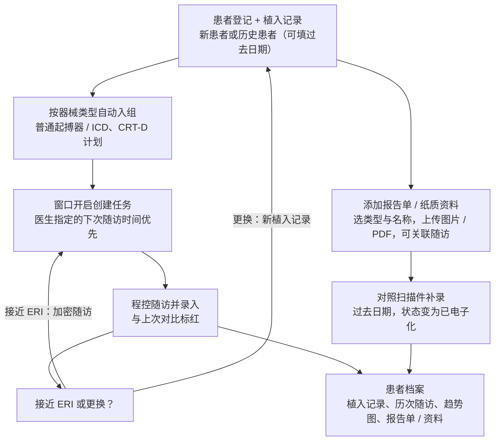
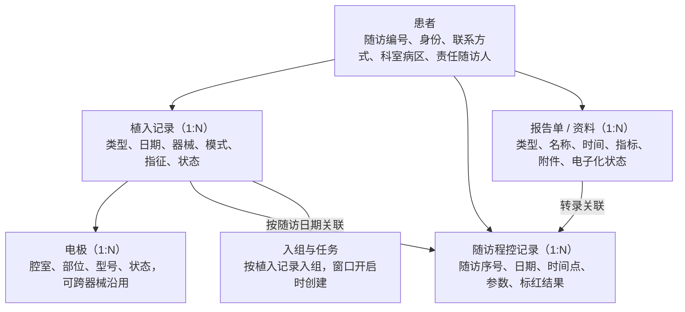
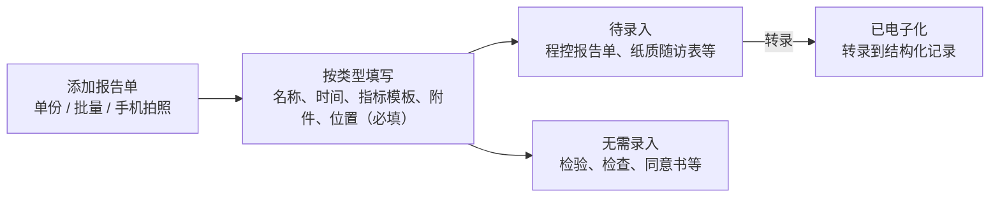

# 医院 C 起搏器术后随访（随访资料电子化）需求规格说明 V0.1

> 转换说明：本文由需求页面“医院 C 需求规格说明 V0.1”于 2026-10-31 转为 Markdown，是交给开发的**唯一需求依据**之一。保留全部需求编号、表格与验收标准；删除了修订记录与讨论过程，末尾只留“决策记录（精简）”。原页面中的交互控件（筛选、切换）已展开为默认的全部内容。凡与仓库现状或其他文档不一致的地方，以 `docs/open-questions.md` 的结论为准，未列出的请先问人。

> 说明：本文大量“沿用医院 A”的能力（计划模板、按需任务、沟通记录、病区隔离、报告单、完整度、首页卡片等），实现时请对照 `hospital-a-spec.md` 的对应编号。附录 A 为 97 个字段的结构，示例均为虚构。

> 定义医院 C 起搏器 / ICD / CRT 术后随访的系统需求：新随访在系统中结构化录入，历史纸质资料拍照扫描归档并逐份手工补录；植入记录一对多以支持更换与升级，录入时与上次随访对比标红，按器械类型的随访计划与按需任务；复用医院 A 与平台底座能力。V0.1：医院已确认 Q01–Q17 与 Q19（Q09 左室参数暂不加；Q12 资料归档按“添加报告单”模式），Q18 暂缓，暂无待确认问题。

## 0. 文档说明

| 项目 | 内容 |
|---|---|
| 版本 | V0.1 初稿，供医院 C 与开发团队评审 |
| 更新日期 | 2026-10-31 |
| 范围 | 患者随访模块在医院 C 的落地：起搏器 / ICD / CRT 术后随访，随访资料电子化（结构化录入 + 纸质资料扫描归档） |
| 上位文档 | 平台底座需求规格说明 V0.3：`docs/requirements/platform-spec.md` |
| 参考文档 | 医院 A 重症冠心病患者随访需求规格说明 V0.3（计划模板、按需任务、沟通记录、病区隔离、附件树、完整度等能力的出处）：`docs/requirements/hospital-a-spec.md` |
| 字段来源 | 医院提供的随访表格：患者登记 21 个字段、随访程控记录 34 个字段、随访节点与填表说明；表格中无患者数据 |
| 现状 | 随访记录目前为纸质，数量未知；新随访改在系统中完成，历史资料手工补录，首期不做 Excel 批量导入 |

> **五个关键设计** 一是“电子化”分两条线：新随访与历史资料都按字段结构化录入，同时纸质原件拍照或扫描后按患者、随访次序、类型、日期归档，每份标注“待录入 / 已电子化”以跟踪补录；二是植入记录一对多，器械更换、升级后历史器械与电极仍保留，随访按日期关联当时的器械；三是补录体验优先：可填过去日期、自动建议随访时间点、对照扫描件分屏录入、连续补录；四是录入时与上次随访对比并标红，首期不发通知；五是复用医院 A 已有能力（计划模板、按需任务、沟通记录、病区隔离、附件树、完整度），只做医院 C 的配置。

### 术语

| 术语 | 含义 |
|---|---|
| 植入记录 | 一次器械植入（含首次、更换、升级、电极修正），一位患者可有多条 |
| 当前器械 | 状态为“在用”的植入记录 |
| 程控记录 | 一次随访的程控参数与检查结果，即原表“随访程控记录”的一行 |
| 补录 | 把历史纸质资料手工录入为结构化随访记录 |
| 报告单 / 资料 | 患者档案中的一份检查、检验、程控报告、纸质随访表、手术记录、同意书或通话记录，含按类型的结构化字段与附件 |
| 纸质资料 / 扫描件 | 拍照或扫描的纸质原件，作为报告单的附件归档 |
| 电子化状态 | 扫描件是否已转录为结构化记录：待录入 / 已电子化 / 无需录入 |
| 标红 | 录入时参数与上次相比超出阈值，在页面上高亮提示 |
| ERI / EOI | 择期更换指征 / 电池耗竭 |
| 随访窗口 | 计划日期前后的一段时间，在此期间完成随访 |

### 优先级定义

| 优先级 | 含义 |
|---|---|
| P0 | 首期上线必须具备 |
| P1 | 首期建议具备，可紧随上线迭代 |
| P2 | 后续规划，或依赖待确认事项 |

### 首期范围

| 内容 | 首期 | 说明 |
|---|---|---|
| 结构化录入：患者登记、植入记录、程控记录、历史补录 | 做 | 第 3–5 章 |
| 报告单 / 纸质资料归档（添加报告单模式、指标模板、关联随访） | 做 | 第 6 章；手机拍照上传为 P1；AI 识别不做 |
| 录入时与上次对比标红、参数趋势图 | 做 | 不发通知 |
| OCR 识别与全文检索 | 不做 | 见附录 B |
| 参数异常预警通知与处理 | 不做 | 见附录 B |
| Excel 批量导入历史数据 | 不做 | 历史资料手工补录 |
| 录入审核 | 不做 | 医生、随访员、护士直接录入 |

### 复用的医院 A 能力

| 能力 | 医院 A 出处 | 医院 C 配置 |
|---|---|---|
| 随访计划模板（计划 → 子计划 → 任务）与版本锁定 | A-FU-016、A-FU-019 | 预置两套器械计划，按器械类型自动入组 |
| 窗口开启时按需创建任务 | A-FU-001 | 窗口宽度按节点设置；医生指定日期可覆盖 |
| 沟通记录、未联系到跟进、失访判定 | A-FU-006、A-FU-024、A-FU-012 | 直接沿用 |
| 历史补录、带入上次值 | A-FU-014、A-FU-015 | 增强为对照扫描件、连续补录、时间点建议 |
| 病区隔离 | A-WARD 系列 | 沿用 A：病区/中心为独立字典，不挂在科室下；数据范围增加“本人负责科室” |
| 附件树（按类型 / 按日期）、预览、下载与删除 | A-ATT-010、A-ATT-005 至 A-ATT-008 | 用于报告单双树浏览与查看器；新增类型表单、名称字典、指标模板与报告单位置 |
| 报告单位置、左栏报告单导航、分类 / 分组条 | A-ATT-002、A-ATT-020、A-ATT-021、A-PAT-020、A-PAT-021 | C-SCAN-010、C-SCAN-020、C-SCAN-021、C-PAT-017、C-PAT-018；锚点另含植入记录与程控分组 |
| 派生字段、条件显示 | A-FLD-004、A-FLD-005 | 按器械类型显示字段组 |
| 数据完整度（基线 / 随访分别计算） | A-DASH-010、A-DASH-011 | C 的基线即患者登记 + 植入记录 |
| 随访率口径 | A-DASH-006 | 按节点统计，入组前节点不计 |
| 节点随访率（平台共用统计） | A-DASH-012 | C-DASH-004 即用此统计，节点取医院 C 的随访计划（术后72小时、1个月、3个月、6个月、1年、常规、ERI期）；入组前窗口已结束的节点不计（Q14）；首页默认显示 |
| 通知（站内信、汇总短信、免打扰） | A-NTF 系列 | 直接沿用，无异常通知 |
| 首页卡片配置（按角色） | A-DASH-013、A-DASH-014 | 直接沿用：C-DASH 各项作为首页卡片纳入卡片目录，医院 C 的租户管理员按角色设置显示哪些卡片及顺序，数据权限不变；用户隐藏 / 显示卡片随 A 为 P1；自由拖拽与自定义指标首期不做 |

## 1. 业务流程概览

新植入或新接诊的患者登记并建立植入记录后自动加入对应器械的随访计划，窗口开启时创建任务；历史患者先建档、上传纸质资料，再逐份对照补录。两条线最终汇入同一份患者档案。

## 2. 数据模型：患者、植入记录与随访

原表把器械信息放在患者登记中，无法表达更换与升级。建议拆成患者、植入记录、电极三层，随访记录同时关联患者与当时的植入记录，纸质资料可关联任意一层。

### 示例：一位患者的器械与随访（虚构）

| 日期 | 事件 | 关联器械 | 来源 |
|---|---|---|---|
| 2018-05-10 | 首次植入双腔起搏器（RA、RV 电极） | 植入 1 | 补录 |
| 2018-06-12 | 第 1 次随访 · 术后1个月 | 植入 1 | 补录（扫描件已电子化） |
| 2025-09-12 | 第 9 次随访 · ERI 状态接近ERI | 植入 1 | 系统内随访 |
| 2026-03-02 | 更换（电池耗竭），沿用 RA、RV 电极 | 植入 2 | 系统内 |
| 2026-04-03 | 第 10 次随访 · 术后1个月（新器械重新起算） | 植入 2 | 系统内随访 |

## 3. 字段字典与配置

把医院表格转换为字段字典：原表 55 个字段，按建议拆分并补充后共 97 个字段，全表见附录 A。

### 字段分组概览

| 分组 | 字段数 | 说明 |
|---|---|---|
| 患者登记（原表） | 21 | 原表；器械与电极字段移入植入记录 |
| 随访程控记录（原表） | 34 | 原表；一次随访一条 |
| 植入记录（建议新增） | 13 | 支持更换与升级（Q01） |
| 电极记录（建议新增） | 6 | 每条植入记录下 RA / RV / LV |
| 随访记录新增字段（建议） | 7 | 囊袋/伤口检查、ICD 充电时间与高压阻抗等 |
| 报告单 / 资料（建议） | 16 | 报告单公共字段、指标与状态 |

### 原表发现的问题与处理

| 问题 | 原表情况 | 建议处理 |
|---|---|---|
| 下次随访时间两种口径 | 下拉为间隔（1个月 … 每3-6个月），而“随访时间点”是节点 | 改为日期 + 间隔快捷按钮（Q05） |
| 并发症两组选项 | 前 46 行含膈肌刺激，后 14 行含气胸；后一组用全角逗号连成一项 | 取并集 12 项（Q06） |
| 囊袋检查无对应列 | 填表说明提到下拉，两张表都没有该列 | 新增囊袋/伤口检查（Q07） |
| 起搏模式两套 | 登记表 9 项含 SSI、CRT-P、CRT-D；程控表 8 项含 AAI-DDD、AAIR-DDDR | 合并为统一字典（Q08） |
| 缺少 CRT 左室参数 | 只有心房、心室两组参数 | 医院确认首期不加，列入附录 B（Q09） |
| 下拉位置错误 | 性别下拉设在“备注”列；随访时间点下拉只设在随访日期列一格 | 按字段名纠正（Q15） |
| 电极部位共用一组 | RA / RV / LV 三列选项相同 | 按腔室过滤（Q15） |
| 下拉只覆盖部分行 | 如 ICD 不恰当治疗只设到第 39 行 | 系统中不存在此问题，无需确认 |

### 按器械条件显示

| 字段组 | 显示条件 |
|---|---|
| 心房参数（阈值、脉宽、P 波、阻抗、起搏比例） | 当前器械有在用的 RA 电极 |
| LV 电极 | 起搏器类型为 CRT-P 或 CRT-D |
| ICD恰当治疗、ICD不恰当治疗、充电时间、高压阻抗 | 起搏器类型为 ICD 或 CRT-D（Q19） |
| AV间期 | 双腔及以上（有 RA 与心室电极） |
| 电极记录 | 无导线起搏器不录电极 |

### 派生字段计算规则

| 字段 | 计算方法 |
|---|---|
| 年龄 | 今天 − 出生日期，取周岁（与原表公式一致）；植入记录另显示植入时年龄 = 植入日期 − 出生日期 |
| 植入时长 | 今天（随访记录中为随访日期）− 当前器械植入日期，显示为“X 年 Y 个月” |
| 随访序号 | 同一患者按随访日期升序编号，从 1 起；补录后自动重排 |
| 接近 ERI 标记 | 最近一次随访 ERI 状态为接近ERI或已达ERI(EOI)，或预计电池寿命 ≤ 1 年（可配置） |
| 参数变化率 | （本次 − 上次）÷ 上次 × 100%，同一电极或同一器械比较 |
| 下次计划随访日期 | 医生填写的下次随访时间优先，否则按计划模板与 ERI 期规则 |
| 随访编号 | 按 C-PAT-003 规则生成 |

### 功能清单

| 编号 | 功能 | 说明 | 优先级 |
|---|---|---|---|
| C-FLD-001 | 字段字典（沿用平台能力） | 沿用医院 A 的字段字典能力（A-FLD-001 至 A-FLD-009）：显示名、数据库列名、类型、单位、范围、必填、选项、排序统一配置；医院 C 的字段见附录 A | P0 |
| C-FLD-002 | 可配置业务字典 | 沿用 A-FLD-012：起搏器类型、品牌、起搏模式、电极植入部位、随访方式、随访时间点、症状、心律失常事件、ICD 恰当 / 不恰当治疗、并发症、囊袋/伤口检查、植入指征、资料类型与名称字典、指标模板（第 6 章）均由租户管理员维护 | P0 |
| C-FLD-003 | 统一起搏模式字典 | 患者登记表与程控记录表两套起搏模式选项合并为一个字典，植入记录与程控记录共用（Q08） | P0 |
| C-FLD-004 | 多选字段 | 症状、心律失常事件、ICD恰当治疗、ICD不恰当治疗、并发症、囊袋/伤口检查为多选；“无”与其他选项互斥；选“其他”须填写说明（Q04） | P0 |
| C-FLD-005 | 按器械条件显示 | 沿用 A-FLD-004：按当前器械的起搏器类型与电极配置显示或隐藏字段组（见本章条件显示表，Q19） | P0 |
| C-FLD-006 | 派生字段 | 沿用 A-FLD-005：年龄、植入时长、随访序号、接近 ERI 标记、参数变化率、下次计划随访日期由系统计算，只读（Q13） | P0 |
| C-FLD-007 | 单位与范围校验 | 程控参数按附录 A 的建议范围做软校验：超出范围黄色提示并要求确认，不阻止保存；格式错误（如非数字）阻止保存；上限频率须大于下限频率 | P0 |
| C-FLD-008 | 新增字段 | 新增囊袋/伤口检查（Q07）、植入类型、设备序列号（Q16）、ICD 充电时间与高压阻抗（Q19）及植入记录、电极记录、报告单相关字段 | P0 |
| C-FLD-009 | 字典变更留痕 | 沿用 A-FLD-009：选项停用后不再出现在下拉中，历史记录中的值保留并照常显示 | P1 |
| C-FLD-010 | 表单顺序与纸质表一致 | 录入表单的字段顺序与分组和医院纸质《随访程控记录》一致，便于对照纸质资料逐项补录；顺序可由租户管理员调整 | P0 |

### 主要页面

1. **字段字典（租户管理员）**：按表分组列出全部字段，编辑显示名、类型、单位、范围、必填、条件显示与排序。
2. **业务字典（租户管理员）**：维护各下拉字典的选项、排序、启用 / 停用；停用选项保留历史值。

### 业务规则与边界情况

- 字段与字典修改只影响之后的录入，已保存的历史值不变。
- 条件显示隐藏的字段不保存值；器械类型变化导致字段被隐藏时，已有的值保留在历史中，表单提示“该器械不适用”。
- 软校验的确认动作记入字段历史（谁确认了超出范围的值）。
- 多选字段在统计时按选项分别计数，一条记录可同时计入多个选项。

### 验收标准

- 录入 VVI 单腔起搏器患者的程控记录时，看不到心房参数与 ICD 治疗字段；录入 CRT-D 患者时全部可见。
- 症状勾选“无”后，其他选项自动取消且不可勾选；勾选“其他”未填说明时不能保存。
- 心室阻抗填写 5000 时出现超出范围提示，确认后可以保存，字段历史中记录确认人。
- 租户管理员停用品牌“其他”后，新登记看不到该选项，已有患者仍显示“其他”。

## 4. 患者与植入记录

覆盖患者登记、历史患者建档、植入记录与电极、器械更换与升级、患者档案与检索；一切操作只在本人可见科室病区内进行。

### 功能清单

| 编号 | 功能 | 说明 | 优先级 |
|---|---|---|---|
| C-PAT-001 | 患者登记 | 录入患者登记信息；最小必填：姓名、性别、出生日期、病历号、科室、病区，并须同时建立第一条植入记录 | P0 |
| C-PAT-002 | 病历号查重 | 沿用 A-PAT-007：病历号本院唯一；姓名 + 出生日期相同时提示可能重复 | P0 |
| C-PAT-003 | 随访编号自动生成 | 按可配置规则自动生成，默认“前缀-建档年份-年内 3 位流水号”，如 105-2026-001；历史患者可手工填写纸质原编号，系统校验唯一（Q10） | P0 |
| C-PAT-004 | 植入记录（一对多） | 每位患者可有多条植入记录：植入类型、日期、起搏器类型、品牌、型号、序列号、起搏模式、植入医院、医生、指征、状态（Q01） | P0 |
| C-PAT-005 | 电极记录 | 每条植入记录下记录 RA / RV / LV 电极的植入部位、型号、日期与状态；无导线起搏器不录电极 | P0 |
| C-PAT-006 | 更换、升级与电极修正 | 在患者档案点“更换 / 升级”新建植入记录：原器械标为已更换，可选择沿用原电极（保留原植入日期）或新植电极，旧电极可标为废弃留置或已拔除 | P0 |
| C-PAT-007 | 当前器械判定 | 状态为“在用”的植入记录即当前器械；随访记录按随访日期自动关联当时在用的器械，补录旧记录时同样按日期匹配 | P0 |
| C-PAT-008 | 历史患者建档 | 为纸质档案中的历史患者建档：允许过去的植入日期，入组时只为今天之后开始的窗口创建任务，之前的节点不算逾期（Q14） | P0 |
| C-PAT-009 | 患者列表与筛选 | 沿用 A-PAT-001、A-PAT-002；增加按起搏器类型、品牌、ERI 状态、植入年份、下次计划随访日期、补录状态筛选 | P0 |
| C-PAT-010 | 患者档案概览 | 顶部显示当前器械、植入时长、最近一次随访的关键参数与标红项、ERI 标记、下次计划随访日期、本患者待录入扫描件数 | P0 |
| C-PAT-011 | 编辑与字段级留痕 | 沿用 A-PAT-005：每个字段的修改记录旧值、新值、修改人、时间、原因 | P0 |
| C-PAT-012 | 敏感字段明文查看 | 沿用 A-PAT-010：姓名、病历号、联系电话默认脱敏、加密存储，明文需敏感权限并记审计 | P0 |
| C-PAT-013 | 高级检索 | 沿用 A-PAT-014：按字段字典组合条件检索，如“当前器械为 ICD 并且 最近一次 ERI 状态为接近ERI” | P1 |
| C-PAT-014 | 导出 | 沿用 A-PAT-009：导出患者、植入记录与随访记录，需审批并记审计 | P1 |
| C-PAT-015 | 删除患者 | 沿用 A-PAT-012：软删除并填写原因，需敏感权限 | P1 |
| C-PAT-016 | 批量指定责任随访人 | 沿用 A-PAT-017 | P1 |
| C-PAT-017 | 基线 / 随访页签左栏：报告单导航 | 沿用 A-PAT-020，展示方式与 A 相同：基线资料页签（患者登记信息 + 植入记录与电极）与随访记录页签（随访 / 程控记录）左栏只做报告单 / 附件导航，列出全部文件与图片，每份带全部位置标签，点标签跳到该位置（位于植入记录的滚动到基线资料页签中该植入记录或其器械信息、电极并定位），缩略图显示在每个位置；随访记录页签按随访记录分组（新的在上）；“未指定位置”组见 C-SCAN-020；平板为“附件（n）”抽屉，手机为底部抽屉 | P0 |
| C-PAT-018 | 分组条（填写进度导航） | 沿用 A-PAT-021，展示方式与 A 相同：基线资料页签顶部吸顶分组条（患者登记各分组、植入记录的器械信息与电极），显示各分组已填 / 应填，未填完为橙色；展开的随访记录顶部为程控分组条（随访概况、症状与检查、电池、起搏阈值与脉宽、感知、阻抗、起搏比例与程控参数、ICD 项目、随访结局，按器械条件显示），显示已填 / 应填与标红数（C-FU-010、C-FU-011）；平板横向滚动，手机下拉选择 | P0 |

### 主要页面

1. **患者列表**：列：随访编号、姓名（脱敏）、性别、年龄、当前器械类型与品牌、植入时长、最近随访日期、下次计划日期、ERI 标记、待录入扫描件数、科室病区。
2. **患者登记**：上半部分为患者信息，下半部分为第一条植入记录与电极；历史患者可直接填写过去日期。
3. **患者档案**：页签：概览、基线资料（患者登记信息 + 植入记录与电极；2026-10-31 用户确认保留，结构同 A 的基线页签，原“植入记录”页签并入）、随访记录（随访 / 程控记录，单独页签）、参数趋势、报告单 / 资料、沟通记录、时间轴、变更历史；基线资料与随访记录两个页签的展示方式与 A 相同：左栏报告单导航（C-PAT-017）、报告单缩略图内联显示在每个所在位置，右侧顶部为分组条（C-PAT-018）。
4. **基线资料页签 · 植入记录部分**：位于患者登记信息下方，按时间列出全部植入记录与电极，当前器械置顶；每条植入记录与其器械信息、电极均可作为报告单位置；操作：更换 / 升级、电极修正、编辑。

### 器械更换流程

1. **点击“更换 / 升级”**：选择植入类型：更换（电池耗竭）、升级（如双腔升级为 CRT-D）、电极修正、其他。
2. **填写新器械**：植入日期、起搏器类型、品牌、型号、序列号、起搏模式；电极逐根选择“沿用”或“新植”。
3. **处理旧器械与电极**：旧器械自动标为已更换；不再使用的电极标为废弃留置或已拔除。
4. **随访计划重新起算**：原入组结束，按新器械类型自动入组，从新植入日期起算（C-FU-007）。

### 关键字段 · 植入类型

| 植入类型 | 含义 | 对随访计划的影响 |
|---|---|---|
| 首次植入 | 患者第一台器械 | 按器械类型入组，从植入日期起算 |
| 更换（电池耗竭） | 同类器械更换脉冲发生器 | 重新起算；ERI 期随访结束 |
| 升级 | 如单腔升级双腔、双腔升级 CRT | 按新器械类型重新入组 |
| 电极修正 | 只更换或调整电极，脉冲发生器不变 | 不重新起算（建议），新电极从修正日期起比较参数 |
| 其他 | 须填写说明 | 由医生选择是否重新起算 |

### 业务规则与边界情况

- 一位患者同一时间只有一条“在用”植入记录；新建更换 / 升级记录时旧记录自动结束，结束日期等于新植入日期。
- 原表“患者登记”中的起搏器类型、品牌、型号、起搏模式、电极植入部位、植入日期、植入医院、植入医生、植入指征移入植入记录；患者登记只保留个人信息、随访方式、责任随访人与备注。
- 补录一条早于当前器械植入日期的随访记录时，系统自动关联当时在用的旧器械，参数对比也只与同一器械 / 同一电极的上一次记录比较。
- 植入日期修改后，未开始的任务按新日期重算，已完成记录不变（沿用 A-FU-011 的做法）。
- 死亡登记后不再创建任务（沿用 A-FU-007）。

### 验收标准

- 患者 2026-03 更换器械后，档案显示两条植入记录，当前器械为新器械；2025 年的随访记录仍关联旧器械。
- 更换时 RV 电极选择“沿用”，新器械下的 RV 电极植入日期显示为原日期；参数趋势图在更换日期处画分隔线，RV 阻抗曲线连续。
- 为 2019 年植入的历史患者建档后，系统只为今天之后开始的窗口创建任务，首页逾期数不增加。
- 同一病历号第二次登记被拒绝并提示已有患者。

## 5. 随访计划、任务与程控记录

随访规则配置为随访计划（沿用医院 A 的模板与版本锁定），按器械类型预置两套；任务在窗口开启时创建；录入时与上次对比标红；历史纸质资料通过补录进入同一张程控记录表。

### 随访节点与窗口（医院已确认，Q03）

| 节点 | 计划日期 | 窗口 | 适用 |
|---|---|---|---|
| 术后72小时/出院前 | 植入日期 + 3 天 | 植入日至植入后 7 天 | 全部；可在计划中关闭并入 1 个月 |
| 术后1个月 | 植入日期 + 1 个月 | 前后 7 天 | 全部 |
| 术后3个月 | 植入日期 + 3 个月 | 前后 14 天 | 全部 |
| 术后6个月 | 植入日期 + 6 个月 | 前后 14 天 | 全部 |
| 术后1年 | 植入日期 + 12 个月 | 前后 30 天 | 全部；医院答复未单列此节点，保留原默认（假设），作为常规随访的第一次 |
| 常规随访（持续循环） | 上次实际随访日期 + 12 个月（可设 6–12） | 前后 30 天 | 普通起搏器（含 CRT-P、希浦、无导线） |
| 常规随访（持续循环） | 上次实际随访日期 + 6 个月（可设 3–6） | 前后 14 天 | ICD、CRT-D（植入或升级为 ICD / CRT-D 后切换） |
| ERI期随访（持续循环） | 上次实际随访日期 + 1 个月（可设 1–3） | 前后 7 天 | 标记接近 ERI 后，至更换器械 |
| 医生指定 | 上一条记录的下次随访时间 | 沿用该节点的窗口宽度 | 覆盖以上默认，只影响下一次 |

### 计划切换触发事件（Q03 已确认）

| 触发事件 | 来源 | 计划变化 | 术后节点是否重新起算 |
|---|---|---|---|
| 首次植入 | 新建植入记录 | 按器械类型入组：普通起搏器计划 / ICD/CRT-D 计划 | 是，从植入日期起算 |
| 植入 ICD 或升级为 ICD / CRT-D | 新增“升级”植入记录 | 原入组结束，转入 ICD/CRT-D 计划（常规每 3–6 个月） | 是，从升级日期起算 |
| 升级为 CRT-P 或其他普通起搏器 | 新增“升级”植入记录 | 转入或留在普通起搏器计划（CRT-P 归普通计划为原默认，假设） | 是，从升级日期起算 |
| 电池更换（同类型） | 新增“更换”植入记录 | 计划类型不变；ERI 期循环结束 | 是（原默认，假设：按更换日期重新走 72 小时至 1 年节点） |
| 电极修正 | 新增“电极修正”植入记录 | 不切换 | 否；新电极从修正日期起参与参数对比 |
| 器械类型更正（录入纠错） | 编辑植入记录的起搏器类型 | 按新类型重新入组，未开始的任务按新计划重算，已完成记录不变 | 否，仍按原植入日期 |
| 接近 ERI | 随访记录 ERI 状态为接近ERI或已达ERI(EOI)，或预计电池寿命 ≤ 1 年 | 切换为 ERI 期循环，每 1–3 个月（默认 1 个月） | 否，从该次随访日期起算 |
| ERI 标记解除 | 后续随访 ERI 状态更正为正常 | 恢复原计划的常规间隔 | 否 |
| 器械取出且未再植入 | 植入记录状态改为已取出 | 结束入组，不再创建任务 | — |
| 医生指定下次随访时间 | 随访记录 | 不改变计划类型，只覆盖下一次任务的计划日期 | 否 |

同时满足多项时，下一次任务日期按“医生指定 → ERI 期循环 → 计划默认”的顺序取值。标为“假设”的三项沿用原默认，医院如有不同要求再调整。

### 异常对比规则（医院已确认，阈值可配置，Q02）

| 规则 | 默认条件 | 适用字段 |
|---|---|---|
| 起搏阈值升高 | 比上次升高＞50%；脉宽不同时注明仅供参考 | 心房、心室起搏阈值 |
| 电极阻抗波动 | 比上次升高或降低＞50%；可另开绝对范围 200–2000 Ω（默认关闭） | 心房、心室阻抗 |
| 感知明显下降 | 比上次下降＞50% | P 波、R 波 |
| 电池接近更换 | ERI 状态为接近ERI或已达ERI(EOI)，或预计电池寿命 ≤ 1 年 | ERI状态、预计电池寿命 |

### 参数趋势图（示意，数字为虚构）

*折线图数据（示意），单位：V*

| 系列 | 第1次 | 第2次 | 第3次 | 第4次 | 第5次 | 第6次 | 第7次 | 第8次 |
|---|---|---|---|---|---|---|---|---|
| 心室起搏阈值（示意） | 0.8 | 0.75 | 0.7 | 0.7 | 0.75 | 0.7 | 1.2 | 0.9 |
| 心房起搏阈值（示意） | 0.6 | 0.6 | 0.55 | 0.6 | 0.6 | 0.65 | 0.6 | 0.6 |

- 标注（第 7 点）：较上次升高 71%，标红

### 功能清单

| 编号 | 功能 | 说明 | 优先级 |
|---|---|---|---|
| C-FU-001 | 随访计划模板（沿用） | 沿用医院 A 的“计划 → 子计划 → 任务”模板与版本锁定（A-FU-016、A-FU-018、A-FU-019）：已发布计划不可改，只能复制出新版本，患者沿用入组时的版本 | P0 |
| C-FU-002 | 预置两套计划 | “普通起搏器术后随访”（单腔、双腔、CRT-P、希浦系统、无导线）与“ICD/CRT-D 术后随访”；节点、间隔与窗口见本章节点表（Q03） | P0 |
| C-FU-003 | 按器械类型自动入组 | 保存植入记录后按“起搏器类型 → 计划”映射自动入组，起算日为植入日期；映射可配置，也可手工改选计划 | P0 |
| C-FU-004 | 按窗口创建任务（按需） | 沿用 A-FU-001：每日定时任务在窗口开始日创建任务，未来节点不预先生成 | P0 |
| C-FU-005 | 医生指定下次随访时间 | 随访记录中填写的“下次随访时间”（日期）覆盖计划默认日期，作为下一次任务的计划日期（不是窗口开始日，已确认），窗口按对应节点的窗口宽度围绕该日期前后展开；未填写时按计划默认（Q05） | P0 |
| C-FU-006 | 接近 ERI 加密随访 | 器械标记为接近 ERI 后，后续节点切换为“ERI期随访”循环（默认每 1 个月，可设 1–3 个月），更换器械后结束 | P0 |
| C-FU-007 | 植入记录变更触发计划切换 | 植入记录新增或变更（首次植入、升级、电池更换、器械类型更正、取出）以及随访中 ERI 标记变化时，按第 5 章“计划切换触发事件”表自动切换计划或循环：升级为 ICD / CRT-D 转入 ICD/CRT-D 计划；首次植入、升级、电池更换从新植入日期重新起算术后节点；电极修正不切换；未完成的旧任务自动终止并记录原因（Q01、Q03） | P0 |
| C-FU-008 | 录入程控记录 | 一次随访一条记录；自动带入随访编号、随访序号、当前器械、随访时间点（来自任务的子计划）、随访医生与随访方式 | P0 |
| C-FU-009 | 按器械条件显示 | 心房参数仅在当前器械有 RA 电极时显示；ICD 治疗、充电时间、高压阻抗仅 ICD、CRT-D（Q19）；AV 间期仅双腔及以上；左室参数首期不加（Q09，见附录 B） | P0 |
| C-FU-010 | 与上次随访对比并标红 | 录入时实时与同一器械 / 同一电极的上一条随访记录（按随访日期）比较，超出阈值的参数标红并显示上次值与变化率；只做页面提示，不发通知（Q02） | P0 |
| C-FU-011 | 异常阈值配置 | 租户管理员配置各规则的开关与阈值，默认值见本章“异常对比规则”表 | P0 |
| C-FU-012 | 参数趋势图 | 患者档案中按随访日期绘制起搏阈值、感知、阻抗、起搏比例、电池电压、AT/AF 负荷的趋势，可按腔室切换；标红点高亮；器械更换处画分隔线 | P0 |
| C-FU-013 | 历史补录 | 沿用 A-FU-014：选择患者后直接新建过去日期的随访记录，不需要任务、不受窗口限制；记录来源标为“补录（纸质）” | P0 |
| C-FU-014 | 补录时建议随访时间点 | 按随访日期距植入日期的天数自动建议随访时间点，如 25–45 天建议“术后1个月”，可改选（规则见本章） | P0 |
| C-FU-015 | 连续补录 | 保存后可“继续补录下一次”：保留患者与器械，清空测量值；支持键盘逐项录入（Tab 跳下一项，回车保存） | P0 |
| C-FU-016 | 带入上次设置 | 沿用 A-FU-015：一键带入上一次的程控设置项（程控起搏模式、上下限频率、AV 间期），测量值不带入，带入的值以浅色标出 | P1 |
| C-FU-017 | 对照扫描件录入 | 分屏：一侧显示扫描件（翻页、缩放、旋转），另一侧为录入表单；保存后该记录自动加入扫描件的位置并变为“已电子化”（C-SCAN-012） | P0 |
| C-FU-018 | 随访序号自动编号 | 按随访日期升序自动编号；补录较早日期的记录后自动重排，内部记录号不变，重排记入变更历史（Q13） | P0 |
| C-FU-019 | 沟通记录与失访 | 沿用 A-FU-006、A-FU-012、A-FU-024：每次联系写沟通记录，未联系到自动跟进，失访候选由医生确认 | P0 |
| C-FU-020 | 任务列表、改派与逾期 | 沿用 A-FU-004、A-FU-009、A-FU-010：我的任务、任务列表、认领与改派、逾期与逾期完成 | P0 |
| C-FU-021 | 暂停、终止与死亡 | 沿用 A-FU-007、A-FU-008 | P0 |
| C-FU-022 | 计划外随访 | 症状就诊、程控调整等直接新建记录，随访时间点选“其他”；不影响后续节点，但填写了下次随访时间时照常覆盖 | P1 |
| C-FU-023 | 患者随访时间轴 | 沿用 A-FU-023：显示植入、更换、各次随访（含补录，单独标识）、下次计划日期与每次的标红项数 | P1 |
| C-FU-024 | 重复记录提示 | 同一患者同一随访日期已有记录时提示，确认后可保存 | P0 |
| C-FU-025 | 远程监测记录 | 随访方式为“远程监测”时使用同一表单人工录入；首期不对接厂商远程监测平台（见附录 B） | P1 |
| C-FU-026 | 已提交记录的修改与删除权限 | 沿用平台权限模型（PLT-PERM-003 按钮权限码、PLT-PERM-007 科室数据范围）：录入与补录无需审核；修改已提交的随访记录需“修改已提交记录”权限，删除随访记录需“删除随访记录”权限，两项分开设置，由租户管理员分配给角色或个人，谁有权限谁可操作，且只限本人数据范围内；修改留字段级历史，删除为软删除、须填原因并记入审计（PLT-AUD-001）（Q17） | P0 |

### 主要页面

1. **我的任务 / 任务列表**：沿用医院 A；列中增加当前器械类型、随访时间点、上次随访标红项数。
2. **随访录入**：从任务进入：表头显示患者、当前器械、植入时长、随访时间点；表单按纸质表顺序分组；标红项显示上次值与变化率；底部填写下次随访时间。
3. **补录历史随访**：从患者档案或扫描件进入：先填随访日期，系统建议随访时间点并匹配器械；可分屏对照扫描件；保存后可继续补录下一次。
4. **参数趋势页签**：折线图 + 下方历次参数表；可切换心房 / 心室、阈值 / 感知 / 阻抗 / 比例、电池。
5. **随访计划（租户管理员）**：沿用医院 A 的计划配置页，预置两套计划与器械类型映射。

### 补录一份纸质随访记录

1. **找到扫描件或患者**：在纸质资料列表筛选“待录入”，或在患者档案点“补录历史随访”。
2. **填写随访日期**：可填过去日期（不早于植入日期、不晚于今天）；系统建议随访时间点并自动关联当时的器械。
3. **对照录入参数**：分屏查看扫描件逐项录入；与上一次（按日期）比较的标红照常显示。
4. **保存**：记录来源为“补录（纸质）”，随访序号按日期重排；扫描件变为“已电子化”。
5. **继续补录下一次**：保留患者与器械，进入同一患者的下一份资料。

### 业务规则与边界情况

- 任务的计划日期优先级：医生在上一条记录填写的下次随访时间 → ERI 期循环 → 计划模板默认；只影响紧接着的下一次任务。
- 下次随访时间早于今天或早于本次随访日期时不能保存；补录的历史记录中填写的下次随访时间只保存，不再生成任务（已过去）。
- 补录记录的随访日期若落在系统中某个未完成任务的窗口内，自动完成该任务（与医院 A 历史补录一致）。
- 参数对比的“上一次”指同一器械（电池类参数）或同一电极（阈值、感知、阻抗）在本次随访日期之前最近的一条记录；没有上一次时不比较；脉宽不同时阈值对比仍显示但注明“脉宽不同，仅供参考”。
- 标红结果随记录保存（哪些字段、变化率），供首页“异常标红记录”使用；修改参数后重新计算。
- 医生、随访员、护士都可录入与补录，首期无审核；修改已提交的记录、删除记录按权限控制：租户管理员把“修改已提交记录”“删除随访记录”两项权限分配给谁，谁就可以操作（Q17）；所有修改留字段级历史，删除为软删除、须填原因并记入审计。
- 未分配“修改已提交记录”权限的用户只能查看已提交记录、修改本人草稿；未分配“删除随访记录”权限的用户看不到删除按钮。
- 补录时建议随访时间点：0–7 天“术后72小时/出院前”，25–45 天“术后1个月”，75–110 天“术后3个月”，150–215 天“术后6个月”，330–400 天“术后1年”，其后“每6-12个月”，器械为接近 ERI 时“ERI期随访”（建议值，可配置）。

### 验收标准

- 上次心室起搏阈值 0.7 V，本次录入 1.2 V（升高 71%），该字段标红并提示“上次 0.7 V（2025-09-12），升高 71%”；未发出任何通知。
- 普通起搏器患者处于常规随访（窗口前后 30 天），医生在本次记录填写下次随访时间 2027-01-15：下一次任务的计划日期为 2027-01-15，窗口为 2026-12-16 至 2027-02-14，系统在窗口开始日 2026-12-16 创建任务，而不是按计划默认的日期。
- 录入 ERI 状态为“接近ERI”后，下一次任务按 ERI 期随访（默认 1 个月后）创建；患者更换器械后恢复按新器械计划。
- 双腔起搏器患者新增“升级”植入记录、类型为 CRT-D 后，原入组结束并转入“ICD/CRT-D 术后随访”，从升级日期重新生成术后72小时、1个月等节点，之后常规随访间隔为 6 个月；同类型电池更换后也从更换日期重新走术后节点，电极修正不改变计划。
- 补录 2021-06 的记录后，该患者原第 3 次及之后的随访序号自动加 1，变更历史中有重排记录。
- 在补录页填写距植入 31 天的随访日期，随访时间点自动建议为“术后1个月”。
- 分屏录入保存后，扫描件状态由“待录入”变为“已电子化”，并可从扫描件跳转到该随访记录。

## 6. 报告单与纸质资料归档

参考竞品的“添加报告单”模式（Q12 已确认）：患者档案中的检查、检验、程控报告、纸质随访表、同意书、通话记录等都作为一份“报告单 / 资料”添加，类型决定表单字段，名称带出指标模板，附件支持图片、PDF 与音频。在竞品基础上增加：可配置的类型与字段集、报告单位置（必填、可多选：基线分组 / 随访记录或程控分组 / 植入记录）、程控报告单直接映射程控字段、电子化状态与补录进度。首期不做 AI 识别（见附录 B）。

### 功能清单

| 编号 | 功能 | 说明 | 优先级 |
|---|---|---|---|
| C-SCAN-001 | 报告单 / 资料页签与添加入口 | 患者档案新增“报告单 / 资料”页签（取代原“纸质资料”页签），点“添加报告单”打开对话框；在基线资料某分组、随访记录（整条或其中程控分组）、植入记录详情中也可直接添加，自动预选该位置（C-SCAN-010）（参考竞品“报告 / 沟通”页签） | P0 |
| C-SCAN-002 | 资料类型与按类型表单 | 类型必填、单选，来自可配置字典；每个类型配置自己的字段集（字段、类型、必填、顺序，沿用 C-FLD-001 字段字典能力），选择类型后表单随之变化；预置 10 类，见本章资料类型表 | P0 |
| C-SCAN-003 | 名称字典 | 每个类型下维护名称字典（如心脏超声、胸部正位片、凝血四项、血常规）；检查、检验类名称必填，其他类型选填 | P0 |
| C-SCAN-004 | 指标模板 | 租户管理员为检查、检验名称配置指标模板（项目名称、代码、参考范围、单位、顺序）；选择名称后自动带出指标行，只需填写结果，可临时增删行；结果超出参考范围显示 ↑ / ↓ | P0 |
| C-SCAN-005 | 程控报告单映射程控字段 | 程控报告单的模板直接对应随访程控记录字段（电池、ERI 状态、各腔室阈值 / 感知 / 阻抗、起搏比例等）；录入即写入映射目标随访记录（须为该报告单的位置之一，有多条时选一条；位置中没有随访记录时选择或新建补录记录并加入位置），报告单不另存一份参数 | P0 |
| C-SCAN-006 | 多附件与格式 | 每份可上传多个文件：图片 JPG、PNG 与 PDF，单个不超过 20 MB、每份最多 50 个（建议值），可调整顺序、旋转、删除；通话记录另可上传音频 m4a、mp3（竞品只支持 m4a，且不支持 PDF） | P0 |
| C-SCAN-007 | 批量上传 | 电脑端一次选择多个文件，可按“每个文件一份”或“合并为一份多页资料”生成报告单；统一设置患者、类型、时间与位置（至少一个）后可逐份调整；显示进度，失败可重试 | P0 |
| C-SCAN-008 | 手机拍照上传（H5） | 电脑端生成一次性二维码（15 分钟有效，绑定当前用户与患者），手机扫码后选择类型与位置（至少一个，下拉选择；从某分组内生成的二维码自动预选）、拍照或选图，可连续多张，直接生成该患者的报告单；手机端不留存文件 | P1 |
| C-SCAN-009 | 待归档区 | 先扫描后标注：未选患者的文件进入待归档区，录入人员逐个指定患者、类型与位置（至少一个）后归档；待归档区同样按科室病区隔离 | P1 |
| C-SCAN-010 | 报告单位置（必填，可多选） | 每份报告单至少指定一个位置，可多个；位置粒度：基线资料页签中患者登记的某个分组、某条随访记录整条或其中某个分组（含电池、起搏阈值与脉宽、感知、阻抗、起搏比例与程控参数、ICD 项目等程控分组）、某条植入记录整条或其中分组（器械信息、电极）；不细到字段；在分组内上传自动预选；报告单在每个位置显示（图片为缩略图），并出现在左栏导航（C-PAT-017）；之后修改见 C-SCAN-020（2026-10-31 由可选关联改为必填） | P0 |
| C-SCAN-011 | 电子化状态 | 每份显示“待录入 / 已电子化 / 无需录入”，默认值按类型设置、名称可覆盖（见资料类型表）；转录到位置中的随访记录后自动变为已电子化；手工改为无需录入须填原因 | P0 |
| C-SCAN-012 | 转录到结构化记录 | 在报告单详情点“转录到结构化记录”：一侧显示图片 / PDF，另一侧打开该报告单位置中的随访记录（多个时选择；没有时新建补录记录并加入位置）表单对照录入；保存后变为已电子化（C-FU-017） | P0 |
| C-SCAN-013 | 双树浏览 | 沿用 A-ATT-010：页签左侧两棵树，按类型（类型 → 名称，带数量）与按时间（日期 → 名称），支持关键词搜索、日期范围、按位置筛选（含“未指定位置”）；右侧显示详情（基本信息、位置标签、指标表、所见 / 诊断、缩略图）及编辑、修改位置、删除 | P0 |
| C-SCAN-014 | 全院报告单列表与检索 | 按患者（姓名、病历号、随访编号）、类型、名称、时间范围、上传日期、上传人、电子化状态、位置（含“未指定位置”）、科室病区筛选，“位置”列多个标签超过 2 个折叠为 +N；关键词可搜索名称、医院、所见、诊断等文字字段；不识别图片内文字（AI 识别见附录 B） | P0 |
| C-SCAN-015 | 全屏查看器 | 沿用 A-ATT-005：图片与 PDF 全屏预览，支持翻页、缩放、旋转、翻转，带用户水印；音频在线播放 | P0 |
| C-SCAN-016 | 下载与删除 | 下载需敏感权限并记审计（沿用 A-ATT-006）；有删除权限的用户可软删除并填写原因（沿用 A-ATT-007） | P0 |
| C-SCAN-017 | 重复文件提示 | 按文件哈希提示同一文件已上传过及其所属患者（仅在可见范围内提示） | P1 |
| C-SCAN-018 | 文件安全校验 | 沿用 A-ATT-008：校验真实文件类型，拒绝可执行文件与不支持的格式 | P1 |
| C-SCAN-019 | 图片增强 | 自动裁边、纠偏、去阴影，便于阅读手机拍摄的照片 | P2 |
| C-SCAN-020 | 修改位置与未指定位置 | 沿用 A-ATT-020：“修改位置”增删位置、至少保留一个，增删写入操作日志；没有位置的报告单归入“未指定位置”（橙色组名），有上传权限者可“指定位置”；程控报告单移除其映射目标随访记录位置后，已写入的参数不清除，电子化状态回到“待录入” | P0 |
| C-SCAN-021 | 模板调整后的位置退回 | 沿用 A-ATT-021：位置按分组固定标识与模板版本保存；随访或植入记录模板调整导致分组不存在时退回到整条记录，记录对应的模板也不再含该锚点时移除位置并提示“原位置已调整”，写入操作日志 | P0 |

### 主要页面

1. **患者档案 · 报告单 / 资料页签**：左侧按类型 / 按时间两棵树（带数量），关键词搜索、日期范围、位置筛选；右侧详情：基本信息、指标表、所见 / 诊断、缩略图、位置标签与电子化状态；按钮：编辑、修改位置、删除、转录到结构化记录、下载。
2. **添加报告单（对话框）**：选类型 → 表单随类型变化 → 选名称自动带出指标模板 → 填写时间、医院与结果 → 上传图片 / PDF / 音频 → 选择位置（必填、可多选的树形选择：基线资料（患者登记分组、植入记录整条或器械信息 / 电极）/ 随访记录整条或程控分组；从分组内打开时已预选）→ 保存。
3. **报告单（全院列表）**：缩略图 + 列：患者（脱敏）、类型、名称、时间、位置（多个标签，超过 2 个折叠为 +N）、电子化状态、上传人、上传时间；顶部筛选；批量操作：改类型、修改位置、标为无需录入。
4. **批量上传**：拖入文件 → 选择患者、类型与时间 → 选择每个文件一份或合并为一份 → 逐份调整 → 提交。
5. **手机上传页（H5）**：扫码后显示患者（脱敏），选择类型与位置（至少一个，下拉选择），拍照或选图，可连续多张，提交后提示成功。
6. **资料类型与模板配置（租户管理员）**：维护资料类型、各类型字段集、名称字典、指标模板（项目名称、代码、参考范围、单位）与默认电子化状态；程控报告单模板逐项选择对应的程控字段。

### 关键字段 · 预置资料类型（可配置）

| 类型 | 主要字段 | 名称字典示例 | 默认电子化状态 | 建议位置 |
|---|---|---|---|---|
| 程控报告单 | 时间、医院、品牌、程控参数（映射程控字段）、附件 | 常规程控、术中测试、ERI 评估 | 待录入 | 第 N 次随访的程控分组（电池、阈值、感知、阻抗、程控参数等） |
| 纸质随访表 | 时间、附件 | 随访程控记录单、患者登记表 | 待录入 | 第 N 次随访 / 患者登记 |
| 植入手术记录 | 时间、医院、手术记录摘要（文本）、附件 | 手术记录、出院小结、起搏器识别卡 | 待录入（出院小结、识别卡默认无需录入） | 植入记录 |
| 心电图/动态心电图 | 时间、医院、测量结果、检查所见、检查诊断、附件 | 常规心电图、动态心电图（Holter） | 无需录入 | 第 N 次随访 |
| 胸片 | 时间、医院、检查部位、检查所见、检查诊断、附件 | 胸部正位片、胸部正侧位片 | 无需录入 | 第 N 次随访 / 植入记录 |
| 心脏超声 | 时间、医院、测量结果、检查所见、检查诊断、附件 | 经胸心脏超声 | 无需录入 | 第 N 次随访 |
| 检验 | 时间、医院、设备仪器、指标结果、附件 | 血常规、凝血四项、肝功能、肾功能、电解质、NT-proBNP | 无需录入 | 第 N 次随访 |
| 知情同意书 | 时间、签署时间、签署地点、附件 | 植入知情同意书、程控知情同意书 | 无需录入 | 植入记录 |
| 通话记录 | 时间、通话内容（文本）、音频（m4a、mp3） | 随访电话、失访追踪 | 无需录入 | 第 N 次随访 |
| 其他 | 时间、说明、附件 | — | 无需录入 | 按内容选择 |

### 关键字段 · 指标模板示例：检验 · 凝血四项（参考范围以本院检验科为准）

| 项目名称 | 代码 | 单位 |
|---|---|---|
| 凝血酶原时间 | PT | s |
| 凝血酶原活动度 | PT% | % |
| 国际标准化比值 | INR | — |
| 活化部分凝血活酶时间 | APTT | s |
| 凝血酶时间 | TT | s |
| 纤维蛋白原 | Fbg | g/L |

### 关键字段 · 程控报告单模板映射示例

| 报告单项目 | 对应程控字段（附录 A） |
|---|---|
| 电池 | 电池电压(V)、ERI状态、预计电池寿命(年) |
| 起搏阈值与脉宽 | 心房起搏阈值(V)、心房脉宽(ms)、心室起搏阈值(V)、心室脉宽(ms) |
| 感知 | 心房感知P波(mV)、心室感知R波(mV) |
| 阻抗 | 心房阻抗(Ω)、心室阻抗(Ω) |
| 起搏比例 | 心房起搏比例(%)、心室起搏比例(%) |
| 程控参数 | 程控起搏模式、下限频率(bpm)、上限频率(bpm)、AV间期(ms) |
| ICD 项目（仅 ICD、CRT-D） | 充电时间(s)、高压阻抗(Ω)、ICD恰当治疗、ICD不恰当治疗 |

### 业务规则与边界情况

- 报告单附件存放在本院独立的对象存储桶，加密存储，预览与下载使用短时有效链接（沿用医院 A）；平台租户视角默认看不到。
- 报告单与患者同样受科室病区隔离，患者转科室病区后随之迁移。
- 类型、名称字典与指标模板的修改只影响之后新建的报告单；已保存的指标行（含当时的参考范围与单位）不变。
- 检验、检查结果超出参考范围只显示 ↑ / ↓，不发通知，也不计入首页“异常标红记录”。
- 程控报告单只是录入入口：参数保存在映射目标随访记录中，报告单显示引用，避免同一参数存两份；位置中没有随访记录时只能保存附件，不能保存参数。
- 通话记录与沟通记录（C-FU-019）是同一条数据：在沟通记录中上传录音，或在报告单中添加通话记录，两处都能看到。由沟通记录录音生成的通话记录，位置默认为该任务对应的随访记录（整条）；没有对应任务时进入“未指定位置”。
- 报告单只按结构化字段与文字字段检索；图片与 PDF 中的文字不可检索。
- 已电子化的报告单被删除或移除其随访记录位置时，状态回到“待录入”，结构化记录不受影响。
- 手机二维码只能使用一次、15 分钟内有效，仅能上传到绑定的患者；手机端需已登录本院账号。
- 补录进度 = 已电子化份数 ÷（已电子化 + 待录入）份数，“无需录入”不计入（Q12）。
- 位置为必填（2026-10-31 由可选改为必填）：上传、批量上传、手机上传、待归档区归档与修改位置都要求至少一个位置，接口按当前模板版本校验锚点；原按单一关联保存的报告单迁移时，原关联随访记录的映射到该记录整条、原关联植入记录的映射到该植入记录整条，其余进入“未指定位置”。历史报告单不安排集中人工补指定，保持在“未指定位置”，直到有上传权限的用户在使用中为其指定位置。

### 验收标准

- 添加报告单选择类型“检验”、名称“凝血四项”，自动带出 PT、PT%、INR、APTT、TT、Fbg 六行及代码、单位、参考范围，只填结果即可保存；按类型树显示“检验 › 凝血四项（1）”。
- 选择类型“程控报告单”、位置选第 3 次随访，录入的电池电压与心室起搏阈值出现在第 3 次随访记录中，报告单变为“已电子化”。
- 一次上传 30 张照片，统一选择患者与“纸质随访表”，把其中 3 张合并为一份 3 页资料，提交后列表显示 28 份。
- 在按时间树中设定 2019-01-01 至 2020-12-31 并筛选“位置：第 2 次随访”，只显示符合条件的报告单，且只限本人可见科室病区。
- 通话记录上传 mp3 与 m4a 音频均成功，可在线播放；上传 wav 提示格式不支持。
- 手机扫码上传的照片直接生成该患者的报告单；二维码过期后扫码提示失效。
- 在第 3 次随访的“起搏阈值与脉宽”分组内添加程控报告单，位置已预选为该分组；再加选“植入记录 #2 · 电极”后，左栏该报告单显示两个位置标签，两处都显示缩略图；不选位置时无法保存。
- 在随访记录页签左栏点某报告单的“植入记录 #2 · 电极”标签，切到基线资料页签并滚动到植入记录 #2 的电极分组，该处显示缩略图；基线资料页签顶部分组条显示患者登记各分组与器械信息、电极的已填 / 应填。
- 修改位置后操作日志出现增删记录；模板删除某程控分组后，原位于该分组的报告单退回到整条随访记录并提示“原位置已调整”。
- 无下载权限的随访员可以全屏预览、旋转、翻转，但看不到下载按钮。
- 添加一份“知情同意书”后，其电子化状态默认为“无需录入”，不计入补录进度。

## 7. 科室病区隔离

每位患者归属一个科室和一个病区；病区/中心沿用医院 A 的独立字典，不挂在科室下（Q11 已确认）。医生、随访员、护士按负责的科室或病区查看数据，隔离由后端统一执行。

### 功能清单

| 编号 | 功能 | 说明 | 优先级 |
|---|---|---|---|
| C-WARD-001 | 科室与病区结构 | 沿用医院 A 模型（Q11 已确认）：科室沿用平台科室树（PLT-ORG-002）；病区/中心沿用 A-WARD-001，为独立的可配置字典（编码、名称、类型、别名、默认责任随访人、状态），不挂在科室下；患者分别归属一个科室和一个病区 | P0 |
| C-WARD-002 | 患者归属 | 每位患者归属一个科室和一个病区；登记时默认为录入人所属科室病区 | P0 |
| C-WARD-003 | 用户负责范围 | 医生、随访员、护士可负责多个科室或病区（沿用 A-WARD-002） | P0 |
| C-WARD-004 | 角色数据范围 | 全院 / 本人负责科室 / 本人负责病区 / 仅本人负责的患者（在 A-WARD-003 基础上增加“本人负责科室”） | P0 |
| C-WARD-005 | 后端强制过滤 | 沿用 A-WARD-004；范围覆盖患者、植入记录、随访记录、任务、扫描件、待归档区、看板、导出、手机上传、全局搜索 | P0 |
| C-WARD-006 | 转科室 / 病区 | 沿用 A-WARD-005；任务与扫描件随患者迁移，保留转科历史 | P0 |
| C-WARD-007 | 租户管理员全院可见 | 沿用 A-WARD-007 | P0 |
| C-WARD-008 | 停用与权限预览 | 沿用 A-WARD-008、A-WARD-009 | P1 |

### 主要页面

1. **病区管理**：病区/中心列表（独立字典，不按科室分组）；成员、患者数、默认责任随访人；停用。
2. **用户管理 · 负责范围**：在平台用户编辑页选择负责科室或病区（多选）。

### 业务规则与边界情况

- 负责某科室即可见归属该科室的全部患者，负责某病区即可见归属该病区的全部患者，两者不存在上下级关系；负责多个科室或病区时取并集；多角色时范围取最宽（与平台底座一致）。
- 随访模块以“科室 + 病区”作为数据范围维度，复用平台科室数据范围（PLT-PERM-007）并叠加医院 A 引入的病区范围类型。
- 病区隔离与字段脱敏叠加生效：能看到患者不代表能看明文。
- 分配或取消负责范围立即生效。

### 验收标准

- 护士只负责心内一病区：患者列表、纸质资料、首页数字都只含心内一病区。
- 负责心内科的科主任可见归属心内科的全部患者，不论这些患者在哪个病区。
- 直接调用接口读取其他病区患者的扫描件，返回无权访问并记入审计。

## 8. 随访通知

沿用医院 A 的通知能力：站内信与汇总短信只发给医护人员，不含患者信息；首期没有参数异常通知。

### 功能清单

| 编号 | 功能 | 说明 | 优先级 |
|---|---|---|---|
| C-NTF-001 | 通知事件 | 沿用 A-NTF-001：窗口开启、即将逾期、已逾期、每日汇总、任务改派、约定回访到时、未联系到跟进、失访候选；首期不含参数异常通知（见附录 B） | P0 |
| C-NTF-002 | 站内信 | 沿用 A-NTF-002，点击进入任务，患者姓名按接收人权限脱敏 | P0 |
| C-NTF-003 | 短信汇总 | 沿用 A-NTF-003：使用平台短信通道（PLT-CFG-005），按人合并，不含患者信息 | P0 |
| C-NTF-004 | 接收人 | 任务负责人（默认责任随访人）；无负责人时发给该病区全部医生、随访员与护士；首期不发给患者（Q11） | P0 |
| C-NTF-005 | 免打扰与频控 | 沿用医院 A 默认值：21:00 至次日 08:00 不发短信，每人每天不超过 3 条，可由租户调整（Q11） | P0 |
| C-NTF-006 | 发送记录 | 沿用 A-NTF-006 | P0 |
| C-NTF-007 | 个人通知偏好 | 沿用 A-NTF-007 | P1 |
| C-NTF-008 | Webhook | 沿用 A-NTF-008：推送任务开启、逾期、随访提交事件，只含事件类型与对象 ID | P1 |

### 主要页面

1. **通知设置（租户管理员）**：沿用医院 A 的通知设置页。

### 业务规则与边界情况

- 通知只发给能看到该患者的人（科室病区范围）。
- ERI 期随访任务与普通任务使用同一套通知事件。

### 验收标准

- 窗口开启当天，责任随访人收到站内信，次日 08:00 后收到一条汇总短信，短信中没有患者姓名。
- 录入标红参数后不产生任何通知。

## 9. 首页 Dashboard

首页由指标卡、任务看板、器械类型分布、随访率、接近 ERI 列表、异常标红记录与补录进度组成，全部按本人可见科室病区统计。以下两图为示意，数字为虚构。

*条形图数据（示意）*

| 项 | 值 |
|---|---|
| 双腔起搏器(DDD)（示意） | 320 人 |
| 单腔起搏器(SSI)（示意） | 180 人 |
| 希浦系统起搏（示意） | 90 人 |
| ICD（示意） | 60 人 |
| CRT-D（示意） | 40 人 |
| 其他类型（示意） | 35 人 |

*图表数据（示意），单位：份*

| 系列 | 26/05 | 26/06 | 26/07 | 26/08 | 26/09 | 26/10 |
|---|---|---|---|---|---|---|
| 已电子化（示意） | 40 | 95 | 160 | 230 | 310 | 380 |
| 待录入（示意） | 520 | 480 | 430 | 380 | 320 | 270 |

### 功能清单

| 编号 | 功能 | 说明 | 优先级 |
|---|---|---|---|
| C-DASH-001 | 指标卡 | 在随访患者数、本月应随访、当前待随访、当前逾期、接近 ERI 器械数、近 30 天含标红参数的记录数、待录入扫描件数 | P0 |
| C-DASH-002 | 器械类型分布 | 按起搏器类型统计在随访患者数，可按品牌拆分 | P0 |
| C-DASH-003 | 任务看板与任务表 | 沿用 A-DASH-003、A-DASH-008：待随访、进行中、逾期、本周完成 | P0 |
| C-DASH-004 | 随访率 | 按随访节点（术后72小时、1个月、3个月、6个月、1年、常规、ERI期）统计；口径沿用 A-DASH-006（分母为窗口已结束的任务，分子含逾期完成）；入组前已过去的节点不计入（Q14） | P0 |
| C-DASH-005 | 接近 ERI 器械列表 | 列出最近一次 ERI 状态为接近ERI或已达ERI(EOI)、或预计电池寿命低于阈值的患者，含器械、最近随访日期、下次计划日期 | P0 |
| C-DASH-006 | 异常标红记录 | 近 N 天（默认 30 天）提交的含标红参数的随访记录，显示标红项目与变化率，点击进入记录；只做查看，不需处理 | P0 |
| C-DASH-007 | 补录进度 | 待录入与已电子化扫描件的数量与比例，可按科室病区、上传人、文档年份查看；另显示补录随访记录条数 | P0 |
| C-DASH-008 | 科室病区筛选 | 沿用 A-DASH-005；全部数字按本人可见范围统计 | P0 |
| C-DASH-009 | 数据完整度 | 沿用 A-DASH-010、A-DASH-011：登记资料完整度与随访资料完整度分别计算；随访资料只统计按器械条件显示后应填的字段 | P1 |
| C-DASH-010 | 医护负责患者数 | 沿用 A-DASH-009 | P1 |

### 主要页面

1. **首页**：指标卡 → 任务看板 → 器械类型分布与随访率并列 → 接近 ERI 列表与异常标红记录并列 → 补录进度。

### 业务规则与边界情况

- 首页所有数字按本人可见科室病区统计，随筛选联动。
- 异常标红记录只用于查看，不产生待办，也不需要“处理”（完整预警见附录 B）。
- 随访率不包含补录记录与计划外随访；补录记录计入完整度与趋势图。

### 验收标准

- 录入一条标红记录后刷新首页，“近 30 天含标红参数的记录数”加 1，列表中出现该记录及标红项。
- 把 10 份待录入扫描件关联到记录后，补录进度比例相应提高。
- 切换到某一病区后，器械类型分布、随访率、接近 ERI 列表都只统计该病区。

## 10. 角色模板与权限点

以下为建议的业务角色模板，租户管理员可复制后调整；敏感权限须先由平台放开。首期无审核角色；修改已提交记录与删除随访记录是两个独立权限点，由租户管理员分配给谁谁就可以操作，预置角色中的分配只是默认值（Q17）。

### 建议角色模板

| 角色 | 数据范围 | 主要权限 | 敏感权限 |
|---|---|---|---|
| 医生 | 本人负责病区 | 患者与植入记录、随访录入与补录、任务、纸质资料上传与预览、首页 | 明文查看（按需分配）；修改已提交记录（默认分配，可调整） |
| 随访员 | 本人负责病区 | 任务、沟通记录、随访录入与补录、纸质资料上传与预览、首页 | 电话明文（每次查看记审计） |
| 护士 | 本人负责病区 | 患者登记、随访录入与补录、纸质资料上传与预览、首页 | 无；修改已提交记录、删除随访记录可由租户管理员按需分配（Q17） |
| 科主任 | 本人负责科室 | 全部查看、首页、转科室病区、发布随访计划 | 导出（须审批） |
| 租户管理员 | 全院（内置） | 全部业务功能 + 字典、字段、计划、阈值、通知、病区 | 按平台放开范围 |

### 权限点

| 权限码 | 说明 | 类别 |
|---|---|---|
| `followup:patient:view` | 查看患者与植入记录（受科室病区范围限制） | 普通 |
| `followup:patient:create` | 患者登记、历史患者建档 | 普通 |
| `followup:patient:edit` | 编辑患者登记信息 | 普通 |
| `followup:implant:edit` | 新增与编辑植入记录、电极，更换 / 升级 | 普通 |
| `followup:patient:transfer` | 转科室 / 病区 | 普通 |
| `followup:patient:plain` | 查看姓名、病历号、电话明文 | 敏感 |
| `followup:patient:export` | 导出 | 敏感 |
| `followup:record:edit` | 录入、补录随访记录与沟通记录，修改本人草稿 | 普通 |
| `followup:record:edit-submitted` | 修改已提交的随访记录（留字段级历史，Q17） | 敏感 |
| `followup:record:delete` | 删除随访记录（软删除、填原因、记入审计，Q17） | 敏感 |
| `followup:patient:delete` | 删除患者（沿用 A-PAT-012） | 敏感 |
| `followup:task:view` | 查看任务与看板 | 普通 |
| `followup:task:assign` | 认领与改派任务 | 普通 |
| `followup:plan:edit` | 维护与发布随访计划、器械类型映射 | 普通 |
| `followup:abnormal:config` | 配置异常对比规则与阈值 | 普通 |
| `followup:scan:upload` | 添加、编辑、预览报告单与纸质资料，上传附件，修改电子化状态 | 普通 |
| `followup:scan:download` | 下载纸质资料（属“原件与附件下载”类） | 敏感 |
| `followup:scan:delete` | 删除报告单与纸质资料（软删除、填原因） | 普通 |
| `followup:scan:config` | 维护资料类型、类型字段集、名称字典与指标模板 | 普通 |
| `followup:ward:edit` | 维护病区与成员 | 普通 |
| `followup:field:edit` | 维护字段字典与业务字典 | 普通 |
| `followup:notice:config` | 维护通知设置 | 普通 |
| `followup:dashboard:view` | 查看首页 | 普通 |

## 11. 非功能与合规补充

在平台底座非功能需求之上，本模块的补充要求如下。

| 编号 | 类别 | 要求 |
|---|---|---|
| C-NFR-001 | 规模 | 纸质资料数量与扫描设备暂不评估（Q18 暂缓，不阻塞）；存储按每份 3 页、每页 2 MB 估算并可在线扩容；列表与看板在常规网络下 2 秒内打开（建议值） |
| C-NFR-002 | 存储方案（建议） | 患者主档、植入记录表、电极表、随访程控记录表（含条件字段）、计划 / 子计划 / 任务表（带版本）、入组表、任务实例表、沟通记录表、纸质资料表与页表、资料-记录关联表、字典表、变更历史表；图片原件与缩略图存对象存储 |
| C-NFR-003 | 加密 | 姓名、病历号、电话应用层加密 + 盲索引，沿用平台密码服务与每租户密钥；对象存储加密 |
| C-NFR-004 | 审计 | 字段修改、明文查看、导出、纸质资料下载与删除、电子化状态手工修改、更换器械、转科室病区、阈值与计划变更全部记入租户审计 |
| C-NFR-005 | 数据隔离 | 医院间按租户库隔离（平台）；医院内按科室病区隔离（本模块），均在后端执行 |
| C-NFR-006 | 手机上传 | H5 页面仅在登录后可用；二维码一次性、15 分钟有效；图片上传前在手机端压缩到长边 2400 像素（建议值） |
| C-NFR-007 | 时间 | 所有日期按北京时间计算窗口与通知；定时任务每天 00:10 创建与刷新任务（建议值） |
| C-NFR-008 | 保留 | 患者、随访与纸质资料在服务期内长期保留，只软删除 |

## 12. 功能清单总表

| 编号 | 功能 | 章节 | 优先级 |
|---|---|---|---|
| C-FLD-001 | 字段字典（沿用平台能力） | 字段字典与配置 | P0 |
| C-FLD-002 | 可配置业务字典 | 字段字典与配置 | P0 |
| C-FLD-003 | 统一起搏模式字典 | 字段字典与配置 | P0 |
| C-FLD-004 | 多选字段 | 字段字典与配置 | P0 |
| C-FLD-005 | 按器械条件显示 | 字段字典与配置 | P0 |
| C-FLD-006 | 派生字段 | 字段字典与配置 | P0 |
| C-FLD-007 | 单位与范围校验 | 字段字典与配置 | P0 |
| C-FLD-008 | 新增字段 | 字段字典与配置 | P0 |
| C-FLD-009 | 字典变更留痕 | 字段字典与配置 | P1 |
| C-FLD-010 | 表单顺序与纸质表一致 | 字段字典与配置 | P0 |
| C-PAT-001 | 患者登记 | 患者与植入记录 | P0 |
| C-PAT-002 | 病历号查重 | 患者与植入记录 | P0 |
| C-PAT-003 | 随访编号自动生成 | 患者与植入记录 | P0 |
| C-PAT-004 | 植入记录（一对多） | 患者与植入记录 | P0 |
| C-PAT-005 | 电极记录 | 患者与植入记录 | P0 |
| C-PAT-006 | 更换、升级与电极修正 | 患者与植入记录 | P0 |
| C-PAT-007 | 当前器械判定 | 患者与植入记录 | P0 |
| C-PAT-008 | 历史患者建档 | 患者与植入记录 | P0 |
| C-PAT-009 | 患者列表与筛选 | 患者与植入记录 | P0 |
| C-PAT-010 | 患者档案概览 | 患者与植入记录 | P0 |
| C-PAT-011 | 编辑与字段级留痕 | 患者与植入记录 | P0 |
| C-PAT-012 | 敏感字段明文查看 | 患者与植入记录 | P0 |
| C-PAT-013 | 高级检索 | 患者与植入记录 | P1 |
| C-PAT-014 | 导出 | 患者与植入记录 | P1 |
| C-PAT-015 | 删除患者 | 患者与植入记录 | P1 |
| C-PAT-016 | 批量指定责任随访人 | 患者与植入记录 | P1 |
| C-PAT-017 | 基线 / 随访页签左栏：报告单导航 | 患者与植入记录 | P0 |
| C-PAT-018 | 分组条（填写进度导航） | 患者与植入记录 | P0 |
| C-FU-001 | 随访计划模板（沿用） | 随访计划、任务与程控记录 | P0 |
| C-FU-002 | 预置两套计划 | 随访计划、任务与程控记录 | P0 |
| C-FU-003 | 按器械类型自动入组 | 随访计划、任务与程控记录 | P0 |
| C-FU-004 | 按窗口创建任务（按需） | 随访计划、任务与程控记录 | P0 |
| C-FU-005 | 医生指定下次随访时间 | 随访计划、任务与程控记录 | P0 |
| C-FU-006 | 接近 ERI 加密随访 | 随访计划、任务与程控记录 | P0 |
| C-FU-007 | 植入记录变更触发计划切换 | 随访计划、任务与程控记录 | P0 |
| C-FU-008 | 录入程控记录 | 随访计划、任务与程控记录 | P0 |
| C-FU-009 | 按器械条件显示 | 随访计划、任务与程控记录 | P0 |
| C-FU-010 | 与上次随访对比并标红 | 随访计划、任务与程控记录 | P0 |
| C-FU-011 | 异常阈值配置 | 随访计划、任务与程控记录 | P0 |
| C-FU-012 | 参数趋势图 | 随访计划、任务与程控记录 | P0 |
| C-FU-013 | 历史补录 | 随访计划、任务与程控记录 | P0 |
| C-FU-014 | 补录时建议随访时间点 | 随访计划、任务与程控记录 | P0 |
| C-FU-015 | 连续补录 | 随访计划、任务与程控记录 | P0 |
| C-FU-016 | 带入上次设置 | 随访计划、任务与程控记录 | P1 |
| C-FU-017 | 对照扫描件录入 | 随访计划、任务与程控记录 | P0 |
| C-FU-018 | 随访序号自动编号 | 随访计划、任务与程控记录 | P0 |
| C-FU-019 | 沟通记录与失访 | 随访计划、任务与程控记录 | P0 |
| C-FU-020 | 任务列表、改派与逾期 | 随访计划、任务与程控记录 | P0 |
| C-FU-021 | 暂停、终止与死亡 | 随访计划、任务与程控记录 | P0 |
| C-FU-022 | 计划外随访 | 随访计划、任务与程控记录 | P1 |
| C-FU-023 | 患者随访时间轴 | 随访计划、任务与程控记录 | P1 |
| C-FU-024 | 重复记录提示 | 随访计划、任务与程控记录 | P0 |
| C-FU-025 | 远程监测记录 | 随访计划、任务与程控记录 | P1 |
| C-FU-026 | 已提交记录的修改与删除权限 | 随访计划、任务与程控记录 | P0 |
| C-SCAN-001 | 报告单 / 资料页签与添加入口 | 报告单与纸质资料归档 | P0 |
| C-SCAN-002 | 资料类型与按类型表单 | 报告单与纸质资料归档 | P0 |
| C-SCAN-003 | 名称字典 | 报告单与纸质资料归档 | P0 |
| C-SCAN-004 | 指标模板 | 报告单与纸质资料归档 | P0 |
| C-SCAN-005 | 程控报告单映射程控字段 | 报告单与纸质资料归档 | P0 |
| C-SCAN-006 | 多附件与格式 | 报告单与纸质资料归档 | P0 |
| C-SCAN-007 | 批量上传 | 报告单与纸质资料归档 | P0 |
| C-SCAN-008 | 手机拍照上传（H5） | 报告单与纸质资料归档 | P1 |
| C-SCAN-009 | 待归档区 | 报告单与纸质资料归档 | P1 |
| C-SCAN-010 | 报告单位置（必填，可多选） | 报告单与纸质资料归档 | P0 |
| C-SCAN-011 | 电子化状态 | 报告单与纸质资料归档 | P0 |
| C-SCAN-012 | 转录到结构化记录 | 报告单与纸质资料归档 | P0 |
| C-SCAN-013 | 双树浏览 | 报告单与纸质资料归档 | P0 |
| C-SCAN-014 | 全院报告单列表与检索 | 报告单与纸质资料归档 | P0 |
| C-SCAN-015 | 全屏查看器 | 报告单与纸质资料归档 | P0 |
| C-SCAN-016 | 下载与删除 | 报告单与纸质资料归档 | P0 |
| C-SCAN-017 | 重复文件提示 | 报告单与纸质资料归档 | P1 |
| C-SCAN-018 | 文件安全校验 | 报告单与纸质资料归档 | P1 |
| C-SCAN-019 | 图片增强 | 报告单与纸质资料归档 | P2 |
| C-SCAN-020 | 修改位置与未指定位置 | 报告单与纸质资料归档 | P0 |
| C-SCAN-021 | 模板调整后的位置退回 | 报告单与纸质资料归档 | P0 |
| C-WARD-001 | 科室与病区结构 | 科室病区隔离 | P0 |
| C-WARD-002 | 患者归属 | 科室病区隔离 | P0 |
| C-WARD-003 | 用户负责范围 | 科室病区隔离 | P0 |
| C-WARD-004 | 角色数据范围 | 科室病区隔离 | P0 |
| C-WARD-005 | 后端强制过滤 | 科室病区隔离 | P0 |
| C-WARD-006 | 转科室 / 病区 | 科室病区隔离 | P0 |
| C-WARD-007 | 租户管理员全院可见 | 科室病区隔离 | P0 |
| C-WARD-008 | 停用与权限预览 | 科室病区隔离 | P1 |
| C-NTF-001 | 通知事件 | 随访通知 | P0 |
| C-NTF-002 | 站内信 | 随访通知 | P0 |
| C-NTF-003 | 短信汇总 | 随访通知 | P0 |
| C-NTF-004 | 接收人 | 随访通知 | P0 |
| C-NTF-005 | 免打扰与频控 | 随访通知 | P0 |
| C-NTF-006 | 发送记录 | 随访通知 | P0 |
| C-NTF-007 | 个人通知偏好 | 随访通知 | P1 |
| C-NTF-008 | Webhook | 随访通知 | P1 |
| C-DASH-001 | 指标卡 | 首页 Dashboard | P0 |
| C-DASH-002 | 器械类型分布 | 首页 Dashboard | P0 |
| C-DASH-003 | 任务看板与任务表 | 首页 Dashboard | P0 |
| C-DASH-004 | 随访率 | 首页 Dashboard | P0 |
| C-DASH-005 | 接近 ERI 器械列表 | 首页 Dashboard | P0 |
| C-DASH-006 | 异常标红记录 | 首页 Dashboard | P0 |
| C-DASH-007 | 补录进度 | 首页 Dashboard | P0 |
| C-DASH-008 | 科室病区筛选 | 首页 Dashboard | P0 |
| C-DASH-009 | 数据完整度 | 首页 Dashboard | P1 |
| C-DASH-010 | 医护负责患者数 | 首页 Dashboard | P1 |

首期共 101 项功能：P0 82 项，P1 18 项，P2 1 项。另有 11 项不纳入首期，见附录 B，不计入以上数字。

## 13. 待确认问题与已确认事项

医院 C 已确认 18 项（Q01–Q17、Q19，其中 Q19 由 Q09 拆出），结论已写入正文；Q18 暂缓，后续再考虑，不阻塞首期。目前没有待确认问题。

### 仍待确认

暂无待确认问题。

### 暂缓事项（不阻塞首期）

| 编号 | 问题 | 状态 | 影响 |
|---|---|---|---|
| Q18 | 纸质资料大约有多少，用什么设备扫描？ | 暂缓：医院暂不答复，后续再考虑，不阻塞首期；存储先按每份 3 页、每页 2 MB 规划并可在线扩容 | 存储、补录进度 |

### 已确认事项

| 编号 | 事项 | 医院确认结论（写入位置） |
|---|---|---|
| Q01 | 器械更换 / 升级的记录方式 | 同意：植入记录一对多，随访按日期关联当时在用的器械，旧器械与电极保留为历史（C-PAT-004 至 C-PAT-007） |
| Q02 | 首期异常提示 | 同意：录入时与上一次随访对比并标红，阈值可配置，不发通知；完整预警见附录 B（C-FU-010、C-FU-011） |
| Q03 | 随访节点与计划切换 | 同意并细化：默认术后72小时、1个月、3个月、6个月，之后每 6–12 个月；植入 ICD、电池更换、升级为 CRT 等植入记录变化触发计划切换，ICD、CRT-D 每 3–6 个月，接近 ERI 每 1–3 个月；医生填写的下次随访时间仍优先。沿用三项原默认作为假设：保留术后1年节点、电池更换重新起算术后节点、CRT-P 走普通计划（第 5 章“计划切换触发事件”、C-FU-007） |
| Q04 | 多选字段 | 同意：症状、心律失常事件、ICD恰当治疗、ICD不恰当治疗、并发症（及囊袋/伤口检查，Q07 已确认）为多选，“无”互斥（C-FLD-004） |
| Q05 | 下次随访时间 | 同意：改为日期字段 + 间隔快捷按钮，覆盖计划默认日期，只影响下一次（C-FU-005） |
| Q06 | 并发症选项 | 同意：两组并集共 12 项，修正全角逗号连写（附录 A） |
| Q09 | CRT 左室参数 | 首期不加左室起搏阈值、左室脉宽、左室阻抗、双室起搏比例，移入附录 B；ICD 专属字段的条件显示拆为 Q19（已确认） |
| Q07 | 囊袋检查字段 | 同意：新增多选“囊袋/伤口检查”（愈合良好 / 红肿 / 渗液 / 血肿 / 皮肤变薄或破溃 / 感染征象 / 其他），术后72小时、1个月默认必填，其余选填（C-FLD-008、附录 A） |
| Q08 | 起搏模式字典合并 | 同意：两套选项合并为一个可配置字典（SSI、VVI、VVIR、AAI、AAIR、DDD、DDDR、AAI-DDD、AAIR-DDDR、CRT-P、CRT-D），植入与程控共用；SSI、CRT-P、CRT-D 按建议暂保留，租户可停用（C-FLD-003、附录 A） |
| Q10 | 随访编号规则 | 同意：系统自动生成、规则可配置（默认“前缀-建档年份-年内 3 位流水号”），前缀由租户配置，不再等待医院说明“105”；病历号同时保留并查重；历史患者可手填纸质原编号（C-PAT-003） |
| Q13 | 派生字段口径 | 同意：年龄按今天计周岁并另显示植入时年龄；植入时长按当前器械；随访序号按随访日期重排；预计电池寿命≤1 年或 ERI 状态非正常即标记接近 ERI（C-FLD-006、C-FU-018） |
| Q14 | 历史节点与补录是否计入随访率 | 同意：入组前窗口已结束的节点不创建任务、不算逾期、不计入随访率；补录记录计入趋势图与完整度、不计入随访率；补录日期落在未完成任务窗口内时自动完成该任务（C-PAT-008、C-DASH-004） |
| Q15 | 原表下拉位置纠正 | 同意：性别、随访时间点下拉按字段名纠正；电极部位按腔室过滤（附录 A） |
| Q16 | 植入记录补充字段 | 同意：植入指征改为可配置字典并保留文字补充；新增必填“植入类型”、选填“设备序列号”；植入医院默认本院（C-FLD-008、附录 A） |
| Q17 | 无审核时谁能修改与删除 | 做成权限配置：录入与补录无需审核；“修改已提交记录”“删除随访记录”为两个独立权限点，租户管理员分配给谁谁就可以操作；删除为软删除、须填原因并记入审计；沿用平台权限模型（C-FU-026、第 10 章权限点与角色模板） |
| Q12 | 纸质资料归档方式 | 同意按竞品“添加报告单”模式设计并改进：可配置类型与字段集、名称字典与指标模板、图片 / PDF / 音频多附件、可关联随访或植入记录、电子化状态与补录进度；AI 识别首期不做（第 6 章、附录 B） |
| Q19 | ICD 专属字段 | 同意：ICD恰当治疗、ICD不恰当治疗及新增的充电时间、高压阻抗仅在器械为 ICD、CRT-D 时显示（C-FU-009、附录 A） |
| Q11 | 通知、首页、隔离 | 沿用医院 A；病区/中心沿用 A 的独立字典、不挂在科室下（沿用 A）；数据范围覆盖科室与病区：全院 / 本人负责科室 / 本人负责病区 / 仅本人负责的患者，多项取并集（第 7、8、9 章） |

## 附录 A. 字段字典全表（97 个字段）

由医院表格解析并按本文建议拆分补充；类型、范围、必填为初步建议，需医院逐项确认。编号前缀为所属分组。

| 编号 | 字段 | 类型 | 取值与说明 |
|---|---|---|---|
| 患者 #1 | 随访编号 | 系统生成·文本 | 默认“前缀-建档年份-3 位流水号”，如 105-2026-001；唯一；规则可配置；历史患者可手填原编号（Q10） |
| 患者 #2 | 姓名 | 文本（敏感） | 必填；默认脱敏，加密存储 |
| 患者 #3 | 性别 | 单选 | 男 / 女；必填；原表下拉误设在“备注”列（Q15） |
| 患者 #4 | 出生日期 | 日期 | 必填 |
| 患者 #5 | 年龄 | 派生·整数 | 单位 岁；派生：今天 − 出生日期，取周岁（与原表公式一致） |
| 患者 #6 | 联系电话 | 文本（敏感） | 默认脱敏，加密存储；可多个，旧号保留（沿用医院 A 联系方式版本） |
| 患者 #7 | 病历号 | 文本（敏感） | 必填；本院唯一，查重 |
| 患者 #8 | 起搏器类型 | 单选 → 植入记录 | 单腔起搏器(SSI) / 双腔起搏器(DDD) / 三腔起搏器(CRT-P) / ICD / CRT-D / 希浦系统起搏(HBP/LBBP) / 无导线起搏器；移入植入记录；决定随访计划与条件显示 |
| 患者 #9 | 品牌 | 单选 → 植入记录 | 美敦力 / 雅培 / 百多力 / 波士顿科学 / 创领心律 / 微创医疗 / 乐普 / 金仕生物 / 其他；移入植入记录 |
| 患者 #10 | 型号 | 文本 → 植入记录 | 移入植入记录 |
| 患者 #11 | 起搏模式 | 单选 → 植入记录 | 统一起搏模式字典（Q08）；植入时设置的模式 |
| 患者 #12 | RA电极植入部位 | 单选 → 电极记录 | 右心耳 / 右房间隔 / 右室心尖 / 右室间隔 / 希氏束 / 左束支 / 冠状静脉窦 / 其他；原表三列共用一组选项；建议按腔室过滤（Q15） |
| 患者 #13 | RV电极植入部位 | 单选 → 电极记录 | 同上；按腔室过滤（Q15） |
| 患者 #14 | LV电极植入部位 | 单选 → 电极记录 | 同上；仅 CRT-P、CRT-D |
| 患者 #15 | 植入日期 | 日期 → 植入记录 | 必填；随访计划起算日；允许过去日期 |
| 患者 #16 | 植入医院 | 文本 → 植入记录 | 默认本院 |
| 患者 #17 | 植入医生 | 引用 → 植入记录 | 本院医生从用户中选择，外院可手填 |
| 患者 #18 | 植入指征 | 字典 + 文本 → 植入记录 | 建议改为可配置字典并保留文字补充（Q16） |
| 患者 #19 | 随访方式 | 单选 | 门诊程控 / 远程监测 / 门诊程控+远程监测；患者默认随访方式，录入时带入 |
| 患者 #20 | 责任随访人 | 引用 | 本科室病区的医生、随访员或护士；任务默认负责人 |
| 患者 #21 | 备注 | 文本 |  |
| 随访 #1 | 随访编号 | 引用 | 关联患者；系统自动带入 |
| 随访 #2 | 随访序号 | 派生·整数 | 按随访日期升序自动编号，补录后重排（Q13） |
| 随访 #3 | 随访日期 | 日期 | 必填；不早于当时器械植入日期、不晚于今天；补录可填过去日期 |
| 随访 #4 | 随访时间点 | 单选 | 术后72小时/出院前 / 术后1个月 / 术后3个月 / 术后6个月 / 术后1年 / 每6-12个月 / ERI期随访 / 其他；必填；任务录入由子计划带入，补录按日期建议；原表下拉只设在一格（Q15） |
| 随访 #5 | 随访医生 | 引用 | 用户；默认当前用户 |
| 随访 #6 | 随访方式 | 单选 | 门诊程控 / 远程监测 / 门诊程控+远程监测；默认取患者随访方式 |
| 随访 #7 | 症状 | 多选 | 无 / 心悸 / 黑蒙 / 晕厥 / 气促 / 乏力 / 胸痛 / 水肿 / 其他；“无”互斥；“其他”须填说明（Q04） |
| 随访 #8 | 心房起搏阈值(V) | 数值 | 单位 V；建议范围 0.1–10.0，2 位小数；有 RA 电极时显示；与上次比较 |
| 随访 #9 | 心房脉宽(ms) | 数值 | 单位 ms；0.03–2.00；有 RA 电极时显示 |
| 随访 #10 | 心房感知P波(mV) | 数值 | 单位 mV；0.1–20.0；有 RA 电极时显示；与上次比较 |
| 随访 #11 | 心房阻抗(Ω) | 整数 | 单位 Ω；100–3000；有 RA 电极时显示；与上次比较 |
| 随访 #12 | 心房起搏比例(%) | 数值 | 单位 %；0–100；有 RA 电极时显示 |
| 随访 #13 | 心室起搏阈值(V) | 数值 | 单位 V；0.1–10.0，2 位小数；与上次比较 |
| 随访 #14 | 心室脉宽(ms) | 数值 | 单位 ms；0.03–2.00 |
| 随访 #15 | 心室感知R波(mV) | 数值 | 单位 mV；0.1–30.0；与上次比较 |
| 随访 #16 | 心室阻抗(Ω) | 整数 | 单位 Ω；100–3000；与上次比较 |
| 随访 #17 | 心室起搏比例(%) | 数值 | 单位 %；0–100 |
| 随访 #18 | 程控起搏模式 | 单选 | 统一起搏模式字典（Q08） |
| 随访 #19 | 下限频率(bpm) | 整数 | 单位 bpm；30–150 |
| 随访 #20 | 上限频率(bpm) | 整数 | 单位 bpm；60–200；须大于下限频率 |
| 随访 #21 | AV间期(ms) | 整数 | 单位 ms；30–350；双腔及以上显示 |
| 随访 #22 | 电池电压(V) | 数值 | 单位 V；0–4.00，2 位小数 |
| 随访 #23 | ERI状态 | 单选 | 正常 / 接近ERI / 已达ERI(EOI)；非“正常”时标红并切换 ERI 期随访 |
| 随访 #24 | 预计电池寿命(年) | 数值 | 单位 年；0–20，1 位小数；低于阈值（默认 1 年）时标记接近 ERI（Q13） |
| 随访 #25 | 磁铁频率(bpm) | 整数 | 单位 bpm；30–120 |
| 随访 #26 | 模式转换次数 | 整数 | ≥ 0；自上次程控以来 |
| 随访 #27 | AT/AF负荷(%) | 数值 | 单位 %；0–100 |
| 随访 #28 | 心律失常事件 | 多选 | 无 / 快房率 / 快室率 / 心房噪音 / 心室噪音；“无”互斥（Q04） |
| 随访 #29 | ICD恰当治疗 | 多选 | 无 / ATP / SHOCK；仅 ICD、CRT-D 显示（Q19） |
| 随访 #30 | ICD不恰当治疗 | 多选 | 无 / 噪音SHOCK / 房颤SHOCK / 室上速误治疗 / T波超感知 / QRS波双计数 / 其他；仅 ICD、CRT-D 显示 |
| 随访 #31 | 并发症 | 多选 | 无 / 囊袋感染 / 电极磨损 / 电极穿孔 / 电极脱位 / 感知不良 / 起搏阈值升高 / 电极阻抗异常 / 囊袋血肿 / 膈肌刺激 / 气胸 / 其他；原表两组选项的并集（Q06） |
| 随访 #32 | 参数调整/处置 | 文本 |  |
| 随访 #33 | 下次随访时间 | 日期 | 快捷：+1 / +2 / +3 / +6 / +12 个月；填写后覆盖计划默认日期（Q05） |
| 随访 #34 | 备注 | 文本 |  |
| 植入 #1 | 植入序号 | 派生·整数 | 第 1 次、第 2 次……；按植入日期排序 |
| 植入 #2 | 植入类型 | 单选 | 首次植入 / 更换（电池耗竭）/ 升级 / 电极修正 / 其他；必填（Q01、Q16） |
| 植入 #3 | 植入日期 | 日期 | 必填 |
| 植入 #4 | 起搏器类型 | 单选 | 见患者登记 #8；必填 |
| 植入 #5 | 品牌 | 单选 | 见患者登记 #9 |
| 植入 #6 | 型号 | 文本 |  |
| 植入 #7 | 设备序列号 | 文本 | 选填（Q16） |
| 植入 #8 | 起搏模式 | 单选 | 统一起搏模式字典 |
| 植入 #9 | 植入医院 | 文本 | 默认本院 |
| 植入 #10 | 植入医生 | 引用 / 文本 |  |
| 植入 #11 | 植入指征 | 字典 + 文本 | 见 Q16 |
| 植入 #12 | 状态 | 枚举·系统 | 在用 / 已更换 / 已取出；同一患者仅一条在用 |
| 植入 #13 | 结束日期与原因 | 日期 + 文本 | 更换时自动填为新植入日期 |
| 电极 #1 | 所属植入记录 | 引用 | 沿用的电极可挂在新植入记录下 |
| 电极 #2 | 腔室 | 单选 | RA / RV / LV；必填 |
| 电极 #3 | 植入部位 | 单选 | 按腔室过滤，见 Q15 |
| 电极 #4 | 电极型号 | 文本 | 选填 |
| 电极 #5 | 电极植入日期 | 日期 | 默认同植入记录；沿用时保留原日期 |
| 电极 #6 | 状态 | 枚举 | 在用 / 废弃留置 / 已拔除 |
| 随访 #1 | 关联植入记录 | 系统 | 按随访日期自动匹配当时在用的器械 |
| 随访 #2 | 记录来源 | 枚举·系统 | 系统内随访 / 补录（纸质） |
| 随访 #3 | 囊袋/伤口检查 | 多选 | 愈合良好 / 红肿 / 渗液 / 血肿 / 皮肤变薄或破溃 / 感染征象 / 其他；“愈合良好”互斥；术后72小时、1个月默认必填（Q07） |
| 随访 #4 | 对应扫描件 | 引用（多个） | 见 C-SCAN-010 |
| 随访 #5 | 录入人、录入时间 | 系统 | 修改另记字段级历史 |
| 随访 #6 | 充电时间(s) | 数值 | 单位 s；0–30，1 位小数；仅 ICD、CRT-D 显示（Q19） |
| 随访 #7 | 高压阻抗(Ω) | 整数 | 单位 Ω；10–200；仅 ICD、CRT-D 显示（Q19） |
| 报告 #1 | 患者 | 引用 | 必填（待归档区除外） |
| 报告 #2 | 类型 | 单选 | 见第 6 章资料类型表（可配置）；必填；决定表单字段集 |
| 报告 #3 | 名称 | 单选 | 按类型的名称字典；检查、检验类必填；带出指标模板 |
| 报告 #4 | 时间 | 日期 | 报告或资料上的日期；必填，用于按时间树与检索 |
| 报告 #5 | 医院 | 文本 | 默认本院 |
| 报告 #6 | 类型专属字段 | 按类型配置 | 如检查部位、检查方法、设备仪器、签署时间、签署地点、通话内容；见第 6 章资料类型表 |
| 报告 #7 | 指标结果 | 表格 | 项目名称、代码、结果、参考范围、单位、↑ / ↓ 标记；选名称后由模板带出 |
| 报告 #8 | 检查所见 | 多行文本 | 检查类显示 |
| 报告 #9 | 检查诊断 | 多行文本 | 检查类显示 |
| 报告 #10 | 附件 | 文件（多个） | JPG、PNG、PDF；通话记录另可 m4a、mp3；页数系统统计 |
| 报告 #11 | 位置 | 子表（至少 1 个） | 基线资料：患者登记分组、植入记录（整条或器械信息、电极）/ 第 N 次随访（整条或程控分组）；每行含锚点标识与模板版本；见 C-SCAN-010、C-SCAN-020、C-SCAN-021 |
| 报告 #12 | 电子化状态 | 枚举 | 待录入 / 已电子化 / 无需录入；按类型给默认值，名称可覆盖 |
| 报告 #13 | 上传方式 | 枚举·系统 | 电脑批量上传 / 手机拍照（H5） |
| 报告 #14 | 上传人、上传时间 | 系统 |  |
| 报告 #15 | 文件哈希 | 系统 | SHA-256；用于完整性校验与重复提示 |
| 报告 #16 | 备注 | 文本 |  |

## 附录 B. 后续规划（首期不做）

以下内容不纳入首期，不计入第 12 章功能清单总表；以后启动时再与医院评审。

| 编号 | 内容 | 说明 | 原因 |
|---|---|---|---|
| — | AI 识别（OCR）与预填 | 识别报告单图片 / PDF 中的文字与指标表，预填报告单字段或随访表单，人工核对后保存；竞品已在添加报告单对话框提供“AI识别”按钮 | 首期不做（医院要求后续再做） |
| — | 扫描件全文检索 | 按图片中的文字检索纸质资料 | 依赖 OCR |
| — | 参数异常预警与通知 | 参数异常时通知责任医生、生成待办并记录处理意见；设计参考医院 A 的预警规则（A-ALR-001 至 A-ALR-007） | 首期只做录入时标红（Q02） |
| — | 跨多次记录的预警规则 | 如连续两次阻抗下降、阈值持续升高等趋势判断 | 依赖预警 |
| — | Excel 批量导入历史数据 | 参照医院 A 的宽表历史数据导入（A-PAT-018） | 首期历史数据手工补录 |
| — | 录入审核 | 录入后由医生审核确认、退回修改 | 首期无审核 |
| — | 厂商远程监测平台对接 | 自动获取远程监测传输的参数与事件 | 首期远程监测结果人工录入（C-FU-025） |
| — | 程控仪报告导入 | 解析程控仪导出的报告文件，自动填入参数 | 格式因厂商而异，后续评估 |
| — | 患者端与患者短信 | 向患者发送随访提醒、患者自填 | 首期只通知医护人员 |
| A-FU-020 | 迁移到计划新版本 | 把在组患者未开始的任务迁移到计划新版本 | 沿用医院 A 的规划 |
| — | CRT 左室参数 | 左室起搏阈值(V)、左室脉宽(ms)、左室阻抗(Ω)、双室起搏比例(%)，仅 CRT-P、CRT-D 显示，参与与上次对比 | 医院确认首期不加（Q09） |

## 决策记录（精简）

| 日期 | 决策 | 写入位置 |
|---|---|---|
| 2026-10-31 | 医院 C 已确认 Q01–Q17、Q19；Q18（纸质资料量与扫描设备）暂缓，不阻塞首期；目前无待确认问题 | 第 13 章 |
| 2026-10-31 | 植入记录一对多，随访按日期关联当时在用器械；植入记录变化（植入 ICD、电池更换、升级 CRT 等）触发计划切换；接近 ERI 走 1–3 个月加密循环 | 第 4、5 章 |
| 2026-10-31 | “下次随访时间”为日期字段 + 间隔快捷按钮，是下一次任务的计划日期，窗口围绕它展开，只影响下一次 | C-FU-005 |
| 2026-10-31 | 首期对比标红（C-FU-010/011），阈值可配置，不发通知 | 第 5 章 |
| 2026-10-31 | 修改已提交记录（`followup:record:edit-submitted`）与删除随访记录（`followup:record:delete`，软删除、填原因、审计）为两个独立权限点；录入与补录无需审核 | C-FU-026、第 10 章 |
| 2026-10-31 | 纸质资料按竞品“添加报告单”模式归档；AI 识别首期不做；C-SCAN-019 图片增强不纳入首期 | 第 6 章、附录 B |
| 2026-10-31 | 报告单位置必填、可多选（C-SCAN-010/020/021），位置含基线资料患者登记分组、植入记录（整条或器械信息、电极）、随访记录（整条或程控分组） | 第 6 章 |
| 2026-10-31 | 保留“基线资料”页签（患者登记 + 植入记录与电极，原“植入记录”页签并入），随访记录单独页签，均沿用 A 的左栏报告单导航与吸顶分组条（C-PAT-017/018） | 第 4 章 |
| 2026-10-31 | 病区 / 中心为独立字典、不挂在科室下；数据范围覆盖科室与病区，多项取并集 | 第 7 章 |
