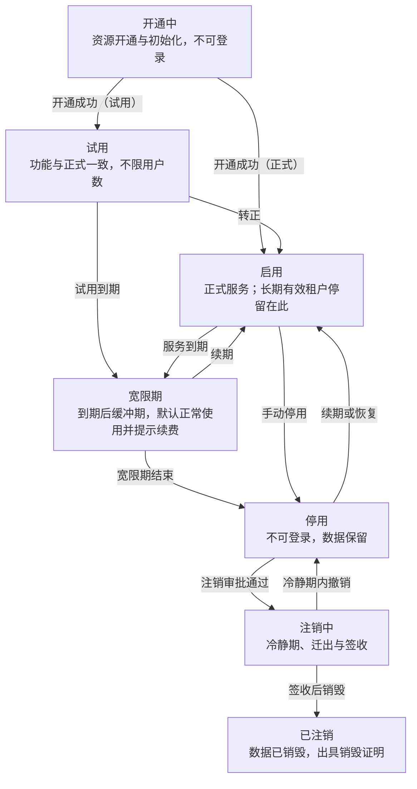

# 平台底座需求规格说明 V0.3

> 转换说明：本文由需求页面“平台底座需求规格说明 V0.3”于 2026-10-31 转为 Markdown，是交给开发的**唯一需求依据**之一。保留全部需求编号、表格与验收标准；删除了修订记录与讨论过程，末尾只留“决策记录（精简）”。原页面中的交互控件（筛选、切换）已展开为默认的全部内容。凡与仓库现状或其他文档不一致的地方，以 `docs/open-questions.md` 的结论为准，未列出的请先问人。

> 定义平台底座（租户、模块、权限、认证、平台租户视角、审计、配置与非功能）的功能需求；已按用户答复更新，标注“已确认”的为确定规则，“建议值”为推荐取值。业务模块需求另行编写。

## 0. 文档说明

| 项目 | 内容 |
|---|---|
| 版本 | V0.3，已并入用户对全部待确认问题的答复 |
| 编写日期 | 2026-10-31 |
| 范围 | 平台底座；不含随访模块（followup，含报告单、电子化等功能开关）及后续模块（如 RCT 随访）的业务功能 |
| 关联文档 | `docs/requirements/tech-plan.md` |
| 部署形态 | 公有云 SaaS；共享应用集群 + 共享数据库实例 + 每院独立 MySQL 库（首期不提供独立实例） |
| 数据归属 | 平台库：租户、模块、菜单与权限资源、授权范围、平台账号与平台角色、视角规则、平台审计；租户库：该院用户、角色、院区科室、租户配置、业务数据与租户审计 |
| 技术栈 | 后端 Spring Boot；前端 Vue3 + Vben Admin（后端下发菜单模式） |

> **底座的三条主线** 一是租户隔离：每家医院一个租户、一个独立库，用户、角色、科室也在该库内，所有请求以令牌中的租户为准；二是三级权限：平台管理员 → 租户管理员 → 医院用户，权限只能逐级收窄；三是平台通过“租户视角”查看医院系统：能否进入、能看哪些租户由平台角色决定，脱敏、设盲、只读由平台管理员配置的视角规则决定，访问记录只存平台侧。

### 术语

| 术语 | 含义 |
|---|---|
| 租户 | 一家医院，对应一个独立 MySQL 库及专属资源 |
| 平台库（控制面） | 存租户、模块、菜单与权限资源、授权范围、平台账号与角色、视角规则、平台审计，不存医院用户与患者数据 |
| 租户库（数据面） | 存该院用户、角色、科室、租户配置、患者、随访、报告单与电子化资料等业务数据及租户审计 |
| 模块 | 可按租户开通的功能包，首批只有随访（followup）；RCT 随访等为后续模块 |
| 功能开关 | 模块内按租户启用的功能（如报告单、补录进度与电子化、植入记录、宽表导入、节点随访率），由平台设置；关闭时对应菜单不进入授权范围、接口返回 403 |
| 授权范围 | 租户已开通模块下的全部菜单与按钮 |
| 可分配范围 | 授权范围中平台允许租户管理员分配给角色的部分 |
| 数据范围 | 角色可见数据的边界，如本科室、本人负责病区、仅本人负责的患者、研究项目 |
| 宽限期 | 服务到期后仍可继续使用的缓冲天数，期间提示续费，结束后自动停用 |
| 租户视角 | 平台账号进入某医院的医院端界面，看到与该院一致的菜单、页面与模块，是平台角色上的一项权限 |
| 视角规则 | 平台管理员按租户、模块、字段、平台角色配置的脱敏、设盲、只读、导出规则 |

### 优先级定义

| 优先级 | 含义 |
|---|---|
| P0 | 首期上线必须具备 |
| P1 | 首期建议具备，可在底座上线后紧随迭代 |
| P2 | 后续规划，或依赖待确认事项 |

## 1. 角色与用户类型

定义账号类型、预置角色与三级权限关系；平台预置四个角色，医院端只内置租户管理员，不设三员分立。

### 功能清单

| 编号 | 功能 | 说明 | 优先级 |
|---|---|---|---|
| PLT-ROLE-001 | 账号类型模型 | 账号分为平台账号与租户账号；平台账号存平台库，租户账号存各自租户库；类型决定登录入口与可授予的角色范围 | P0 |
| PLT-ROLE-002 | 平台预置角色 | 预置平台管理员、实施人员、运维人员、客服支持四个角色及其默认权限（已确认），平台管理员后续可调整 | P0 |
| PLT-ROLE-003 | 平台自定义角色 | 平台管理员可新建平台角色，授权平台端菜单，并配置租户视角权限（第 8 章） | P1 |
| PLT-ROLE-004 | 租户内置角色 | 租户初始化时在租户库生成租户管理员内置角色；不设租户审计员等独立审计角色（已确认） | P0 |
| PLT-ROLE-005 | 业务角色模板 | 业务模块开通时下发角色模板（如随访员、责任医生、研究者、CRC、资料录入员），租户可复制后调整 | P1 |
| PLT-ROLE-006 | 有效权限计算 | 按“已开通模块 ∩ 可分配范围 ∩ 用户角色并集”实时计算菜单、按钮、接口权限 | P0 |

### 主要页面

1. **平台端 · 角色管理**：列出预置与自定义平台角色；预置角色不可删除，权限可调整；可新建角色、授权平台端菜单、配置“租户视角”标签页（第 8 章）、停用、查看持有人。
2. **平台端 · 平台账号管理**：新建平台账号时选择角色并强制绑定手机号（用于双因素认证）；维护负责租户；支持停用、重置密码、解锁。
3. **医院端 · 角色管理**：由租户管理员在授权范围内维护，数据存于本院租户库，见第 6 章。

### 关键字段 · 角色定义

| 角色 | 层级 | 主要职责 | 默认不可做 |
|---|---|---|---|
| 平台管理员 | 平台 | 全部平台权限：租户、模块、菜单与权限资源、授权范围、平台账号与角色、视角规则配置与复核；租户视角内可编辑业务数据 | 删除或修改审计记录；复核自己发起的高敏规则变更 |
| 实施人员 | 平台 | 租户开通、模块开通、菜单与授权范围配置；租户视角内代为配置；业务数据脱敏只读 | 修改视角规则、编辑业务数据、管理平台账号 |
| 运维人员 | 平台 | 查看租户配置、资源状态、日志与在线会话；租户视角仅看配置类 | 查看业务数据、任何配置变更 |
| 客服支持 | 平台 | 在负责租户内进入租户视角排查问题；业务数据脱敏只读；代为重置医院用户密码 | 进入非负责租户、修改配置、编辑业务数据 |
| 租户管理员 | 租户 | 维护本院组织架构、角色、用户、租户配置；可查看业务数据，可给自己分配业务角色（已确认） | 超出可分配范围授权；分配未经平台放开的敏感权限 |
| 医院用户 | 租户 | 按角色使用已开通业务模块（医生、护士、随访员、CRC 等） | 访问未授权的菜单、接口、数据范围 |

### 关键字段 · 账号与角色关键字段

| 字段 | 类型 | 必填 | 说明 |
|---|---|---|---|
| 用户类型 | 由存放位置区分 | — | 平台账号存平台库；租户账号存所在医院的租户库 |
| 所属租户 | — | — | 由所在租户库决定，租户库内的用户表不需要 `tenant_id` |
| 角色 | 多选 | 是 | 平台账号只能选平台角色，租户账号只能选本租户角色 |
| 是否内置 / 预置 | 布尔 | 是 | 租户管理员内置角色不可删改权限；平台预置角色不可删除，权限可由平台管理员调整 |

### 权限点

| 权限码 | 说明 | 归属 |
|---|---|---|
| `platform:role:view` | 查看平台角色 | 平台 |
| `platform:role:edit` | 新建、编辑、停用平台角色 | 平台 |
| `platform:account:view` | 查看平台账号 | 平台 |
| `platform:account:edit` | 新建、编辑、停用平台账号 | 平台 |
| `platform:account:reset` | 重置平台账号密码与解锁 | 平台 |

### 业务规则与边界情况

- 平台账号与租户账号使用不同登录入口，平台账号不能直接登录医院端，只能从平台端进入租户视角，按平台配置的规则查看（第 8 章）；租户账号不能登录平台端。
- 不设三员分立，也不设独立的平台审计员、租户审计员角色；职责分离不强制（已确认）。
- 同一医生在多家医院任职时，在每家医院分别建账号，互不关联，不做跨院统一身份（已确认）。
- 租户管理员不是独立账号体系，而是持有租户管理员内置角色的租户账号；每个租户至少保留一个启用的租户管理员，停用最后一个时系统拒绝。
- 租户管理员可给自己分配业务角色（已确认），同样受可分配范围与敏感权限限制，自我授权单独记入审计。
- 平台管理员至少 2 人（已确认），以满足高敏规则变更与注销的双人复核。
- 角色停用后，持有该角色的用户立即失去对应权限（权限版本号递增）。

## 2. 租户管理

覆盖租户从创建、开通、使用、到期、停用到注销销毁的全生命周期。

> **到期与停用补偿（已确认）** 到期提醒节点、宽限期天数、宽限期是否只读都按租户配置；长期有效的租户不提醒、不进入宽限期。宽限期默认正常使用、只显示续费提示，结束后自动停用。停用期间本应执行的随访任务标记为“停用期间未执行”，恢复后不自动补发，由租户管理员或任务负责人选择补做或关闭。

### 租户状态流转



### 功能清单

| 编号 | 功能 | 说明 | 优先级 |
|---|---|---|---|
| PLT-TEN-001 | 租户列表与检索 | 按名称、编码、状态、到期日筛选，展示已开通模块与用户数 | P0 |
| PLT-TEN-002 | 新建租户向导 | 只有医院名称必填（已确认），其余信息可后补；可同时选择模块、到期设置与首个租户管理员 | P0 |
| PLT-TEN-003 | 资源自动开通 | 在共享数据库实例上创建租户库（utf8mb4）与专属账号、对象存储桶、KMS 主密钥 | P0 |
| PLT-TEN-004 | 数据库初始化 | Flyway 执行底座迁移（含用户、角色、科室等底座表）与已开通模块迁移；写入初始字典与参数 | P0 |
| PLT-TEN-005 | 数据源注册 | 连接信息加密写入平台库，应用热加载，无需重启 | P0 |
| PLT-TEN-006 | 初始化管理员与角色 | 在租户库创建租户管理员内置角色与业务角色模板；首个租户管理员可在开通时填写，也可在启用前补设 | P0 |
| PLT-TEN-007 | 隔离验收 | 冒烟测试与跨租户访问用例（A 的令牌访问 B 的数据必须失败） | P0 |
| PLT-TEN-008 | 开通进度与重试 | 逐步记录开通结果，失败可从失败步骤重试或回收已建资源 | P0 |
| PLT-TEN-009 | 租户信息维护 | 编辑基本信息、联系人、备注 | P0 |
| PLT-TEN-010 | 状态管理 | 试用、启用、宽限期、停用、注销的状态流转，人工变更需填写原因 | P0 |
| PLT-TEN-011 | 到期设置 | 按租户配置到期类型（有到期日 / 长期有效）、提醒节点、宽限期天数、宽限期是否只读（已确认） | P0 |
| PLT-TEN-012 | 到期提醒与自动停用 | 按提醒节点发送提醒；到期进入宽限期，宽限期结束自动停用；长期有效租户不提醒、不进入宽限期 | P0 |
| PLT-TEN-013 | 续期 | 修改到期日或改为长期有效，宽限期或停用中的租户续期后立即恢复启用 | P0 |
| PLT-TEN-014 | 配额管理 | 用户数上限、存储上限，默认不限；设置后达阈值预警与限制 | P2 |
| PLT-TEN-015 | 访问地址 | 租户子域名 `{租户编码}.平台域名`，与统一登录页 + 租户编码两种方式同时支持；不支持医院自定义域名与证书（已确认） | P0 |
| PLT-TEN-016 | 停用处理 | 禁止登录、失效会话、暂停定时任务，数据保留 | P0 |
| PLT-TEN-017 | 停用补偿 | 停用期间到期的随访任务标记为“停用期间未执行”，恢复后由人工选择补做或关闭（已确认） | P0 |
| PLT-TEN-018 | 注销申请与审批 | 注销申请、另一名平台管理员审批、冷静期与撤销 | P1 |
| PLT-TEN-019 | 数据迁出与交付 | 按标准迁出包导出数据、文件与审计日志，加密后限时下载交付，医院签收 | P1 |
| PLT-TEN-020 | 数据销毁与销毁证明 | 删除库、账号、桶与缓存，KMS 密钥计划删除，出具数据销毁证明 | P1 |
| PLT-TEN-021 | 法定保留数据封存 | 需依法或按合同保留的数据单独封存，期满后再按销毁流程处理并出具证明 | P1 |
| PLT-TEN-022 | 租户操作记录 | 租户维度查看开通、状态、到期、模块等全部变更 | P0 |

### 主要页面

1. **租户列表**：筛选、排序；行内显示状态、到期日（长期有效显示“长期”）、已开通模块、用户数；操作：详情、进入租户视角（第 8 章）、停用/启用、续期。
2. **新建租户向导**：第 1 步基本信息（仅医院名称必填，租户编码自动生成可修改）→ 第 2 步模块与到期设置 → 第 3 步首个租户管理员（可跳过，启用前补设）→ 确认提交并进入开通进度页。
3. **开通进度页**：逐步显示资源开通、初始化、注册、账号初始化、隔离验收的状态与失败原因；可重试或放弃并回收资源。
4. **租户详情**：标签页：基本信息、模块、授权范围（第 5 章）、资源信息（脱敏只读）、管理员、到期设置、操作记录。
5. **租户详情 · 到期设置**：到期类型（有到期日 / 长期有效）、试用或服务到期日、提醒节点、宽限期天数、宽限期是否只读；选择长期有效时其余项隐藏。
6. **状态变更对话框**：停用、启用、续期均需二次确认并填写原因，展示影响（在线用户数、进行中任务）。
7. **注销与数据处理页**：发起注销、上传医院书面确认、审批、冷静期倒计时、迁出包生成与下载记录、医院签收、保留数据封存清单、销毁执行与销毁证明下载。

### 开通流程

1. **录入租户**：平台管理员或实施人员填写向导并提交，生成租户编码与开通任务，状态为开通中。
2. **开通资源**：在共享 RDS MySQL 实例创建库与专属账号（仅授予本库权限），创建对象存储桶与 KMS 主密钥。
3. **初始化结构**：Flyway 执行底座与已开通模块的迁移脚本，在租户库建用户、角色、科室等表，写入初始字典与参数。
4. **注册数据源**：连接信息加密写入平台库，通过事件通知各应用副本热注册连接池。
5. **初始化账号权限**：在租户库创建租户管理员与内置角色；已填写首个管理员时，初始密码经短信下发，首次登录强制修改。
6. **隔离验收**：自动执行冒烟与跨租户访问用例，全部通过才允许启用。
7. **启用并通知**：状态置为试用或启用，通知租户管理员，开通记录写入平台审计。

### 到期流程（有到期日的租户）

1. **到期前提醒**：按租户的提醒节点（默认到期前 30、7、1 天，已确认，可按租户调整）向租户管理员与平台负责人发送站内信与短信。
2. **进入宽限期**：到期当天进入宽限期（默认 15 天，已确认，可按租户调整）；默认正常使用，页面顶部显示续费提示；如该租户配置为宽限期只读，则只能查看不能新增修改。
3. **自动停用**：宽限期结束仍未续期，自动转为停用。
4. **续期恢复**：任一阶段续期后立即恢复启用。

### 停用恢复与补偿流程

1. **停用期间**：随访任务生成与通知发送暂停；本应在停用期间执行的任务标记为“停用期间未执行”。
2. **恢复启用**：不自动补发任何通知或任务。
3. **人工处理**：租户管理员可批量处理，任务负责人可处理自己名下的任务：逐条或批量选择“补做”或“关闭”，操作记入审计。

### 注销流程

1. **发起申请**：平台管理员或实施人员发起，填写原因并上传医院书面确认；列出需依法或按合同保留的数据。
2. **审批**：另一名平台管理员审批；通过后状态变为注销中，租户不可登录。
3. **冷静期**：默认 30 天（已确认），期内可撤销并回到停用状态。
4. **生成迁出包**：按标准迁出包结构导出，生成清单与校验和，加密打包。
5. **交付与签收**：限时下载链接发给医院指定联系人，解压密码经短信另行发送；医院校验无误后在线确认并上传签收单。
6. **封存保留数据**：需保留的数据单独加密封存，登记保留期满日。
7. **销毁**：删除租户库与专属账号、对象存储桶、Redis 键，注销连接池，KMS 密钥进入计划删除。
8. **出具销毁证明**：生成数据销毁证明，平台存档并交付医院；状态变为已注销，平台库保留租户档案与平台审计。

### 关键字段 · 租户信息

| 字段 | 类型 | 必填 | 说明 |
|---|---|---|---|
| 租户编码 | 字符串 | 系统生成 | 提交前可修改，全局唯一，小写字母、数字、下划线；创建后不可改，用于库名、桶名、子域名、缓存前缀 |
| 医院名称 | 字符串 | 是 | 医疗机构全称，全平台唯一；唯一必填项（已确认） |
| 简称 | 字符串 | 否 | 用于菜单栏与通知署名 |
| 统一社会信用代码 | 字符串 | 否 |  |
| 机构类型与等级、所在地区 | 字典 | 否 |  |
| 联系人、电话、邮箱 | 字符串 | 否 | 电话加密存储，列表脱敏显示；注销交付时需指定联系人 |
| 已开通模块 | 多选 | 否 | 平台基础模块自动开通 |
| 状态 | 枚举 | 系统 | 开通中 / 试用 / 启用 / 宽限期 / 停用 / 注销中 / 已注销 |
| 合同编号、备注 | 字符串 | 否 |  |
| 创建人、创建时间 | 系统 | — |  |

### 关键字段 · 到期设置（按租户配置，已确认）

| 字段 | 类型 | 必填 | 说明 |
|---|---|---|---|
| 到期类型 | 枚举 | 是（有默认值） | 有到期日 / 长期有效；默认有到期日 |
| 试用到期日 / 服务到期日 | 日期 | 有到期日时必填 | 试用期默认 30 天（已确认，可按租户调整），试用期不限制功能与用户数（已确认） |
| 提醒节点 | 多选（天） | 否 | 默认到期前 30、7、1 天（已确认） |
| 宽限期天数 | 数值 | 否 | 默认 15 天（已确认），可设为 0 |
| 宽限期只读 | 布尔 | 否 | 默认否，即宽限期内正常使用 |

### 关键字段 · 租户资源（数据源）

| 字段 | 类型 | 必填 | 说明 |
|---|---|---|---|
| 数据库实例 | 引用 | 是 | 首期全部为共享实例（已确认）；页面只展示脱敏信息 |
| 库名 | 字符串 | 是 | 按租户编码生成，如 `t_{租户编码}` |
| 专属账号 | 字符串 | 是 | 只授予本库权限；应用账号无 DDL 权限，迁移用单独账号 |
| 账号密码 | 密文 | 是 | KMS 加密或托管在密钥服务，定期轮换，页面不展示 |
| 连接池参数 | 数值 | 是 | 最大连接数等，默认取平台参数 |
| 对象存储桶 | 字符串 | 是 | 每租户独立，服务端加密 |
| KMS 主密钥 ID | 字符串 | 是 | 字段加密与文件加密 |
| Schema 版本 | 字符串 | 系统 | 底座与各模块当前迁移版本 |
| 资源状态 | 枚举 | 系统 | 正常 / 开通失败 / 已销毁 |

### 关键字段 · 标准数据迁出包

| 组成 | 内容 | 格式 |
|---|---|---|
| 结构化数据 | 租户库全部业务表与底座表（用户、角色、科室等） | 每表一份 CSV（UTF-8，含表头），同时提供 JSON |
| 数据字典 | 表、字段、类型、编码值含义、表间关系 | XLSX 或 HTML |
| 原始文件包 | 电子化资料原图、附件、通话录音 | 保持原格式，按原目录结构打包 |
| 审计日志 | 租户操作、登录、数据访问日志及业务稽查轨迹 | CSV / JSON |
| 清单与校验 | 文件列表、每表记录数、每个文件的校验和 | manifest.json，校验和用 SHA-256 |
| 加密与交付 | 整包加密压缩，解压密码经短信另行发送；限时下载链接有效 7 天、最多下载 5 次（已确认） | AES-256 加密包；医院在线确认 + 签收单 |

### 关键字段 · 数据销毁证明

| 字段 | 类型 | 必填 | 说明 |
|---|---|---|---|
| 证明编号 | 字符串 | 系统 |  |
| 租户 | 引用 | 是 |  |
| 销毁范围清单 | 清单 | 是 | 数据库、对象存储、缓存、密钥、备份 |
| 销毁方式 | 文本 | 是 | 如删除库与桶、密钥计划删除、备份到期自然失效 |
| 执行时间、执行人、复核人 | 系统 | 是 | 复核人为另一名平台管理员 |
| 校验结果 | 文本 | 是 | 销毁后检查资源已不存在 |
| 保留数据说明 | 清单 | 否 | 封存的数据范围与保留期满日 |
| 文件 | PDF | 系统 | 平台签章，平台存档并交付医院 |

### 权限点

| 权限码 | 说明 | 归属 |
|---|---|---|
| `platform:tenant:view` | 查看租户列表与详情 | 平台 |
| `platform:tenant:create` | 新建租户、重试开通 | 平台 |
| `platform:tenant:edit` | 编辑租户信息 | 平台 |
| `platform:tenant:status` | 停用、启用租户 | 平台 |
| `platform:tenant:renew` | 续期与修改到期设置 | 平台 |
| `platform:tenant:cancel` | 发起注销与撤销 | 平台 |
| `platform:tenant:cancel:approve` | 审批注销 | 平台 |
| `platform:tenant:export` | 生成与交付迁出包 | 平台 |
| `platform:tenant:destroy` | 执行数据销毁、出具销毁证明 | 平台 |
| `platform:tenant:retain` | 管理封存的保留数据 | 平台 |
| `platform:tenant:resource:view` | 查看资源信息（脱敏） | 平台 |

### 业务规则与边界情况

- 开通过程幂等，每步记录结果；开通失败的租户不可登录、不计入正式租户；放弃开通时按记录回收已建资源。
- 首期全部租户使用共享数据库实例、每院独立库（已确认）；独立实例与实例迁移不在首期范围。
- 长期有效的租户没有到期日，不发提醒、不进入宽限期（已确认）。
- 到期提醒：在租户配置的提醒节点向租户管理员与该租户的平台负责人发送站内信与短信。
- 宽限期：到期后的缓冲期，默认正常使用并在页面顶部显示续费提示；配置为只读时只能查看，不能新增、修改、删除；宽限期结束仍未续期则自动停用（已确认）。
- 停用：全部租户账号不可登录，在线会话立即失效；随访任务生成、通知发送等定时任务暂停；数据完整保留，备份照常；平台仍可进入租户视角排障。
- 停用补偿：停用期间本应执行的随访任务标记为“停用期间未执行”；恢复后不自动补发，由租户管理员或任务负责人选择补做或关闭（已确认）；具体任务类型的处理由业务模块实现，底座提供停用时段与状态标记。
- 注销须医院书面确认与另一名平台管理员审批；冷静期内可撤销，回到停用。
- 迁出包交付后须医院确认校验无误并签收，才能进入销毁；下载链接过期或次数用完可重新生成，每次生成与下载均记录。
- 需依法或按合同保留的数据（如 RCT 资料、审计日志）在销毁前单独封存：独立加密存储、单独密钥，访问须两名平台管理员同意；保留期满后按销毁流程处理并补充出具销毁证明。
- KMS 密钥进入计划删除后，残留在云备份中的数据无法解密；云备份按保留期自然过期，销毁证明中注明。
- 设置了用户数上限时，达到上限禁止新建或启用用户；设置了存储上限时，用量达 80%（建议值）预警，达到上限禁止上传。

## 3. 模块管理

业务模块以可插拔方式按租户开通，接口层与网关双重校验，未开通模块的接口直接返回 403。

> **首期不做套餐（已确认）** 套餐是把若干模块和配额打包成一个可售卖的规格（例如基础版、专业版），开租户时选套餐即可自动带出模块与配额，通常与计费挂钩。首期不做套餐和计费，直接按租户勾选开通模块，到期按租户整体管理；套餐与模块级有效期列为后续规划。

### 功能清单

| 编号 | 功能 | 说明 | 优先级 |
|---|---|---|---|
| PLT-MOD-001 | 模块目录 | 展示模块编码、名称、说明、版本、依赖、菜单清单、权限码清单、配置项 | P0 |
| PLT-MOD-002 | 模块注册同步 | 模块随发版自动注册到目录，平台端只维护展示信息与上下架 | P0 |
| PLT-MOD-003 | 模块版本记录 | 记录功能版本、数据库迁移版本与变更说明 | P0 |
| PLT-MOD-004 | 按租户开通模块 | 执行该模块迁移、菜单进入授权范围、初始化配置与角色模板 | P0 |
| PLT-MOD-005 | 按租户关闭模块 | 影响评估、收回菜单与接口、停止定时任务，数据保留 | P0 |
| PLT-MOD-006 | 依赖校验 | 开通或关闭时校验模块间依赖 | P1 |
| PLT-MOD-007 | 租户模块版本与灰度升级 | 发版时按租户批次执行迁移，查看各租户版本与失败情况 | P1 |
| PLT-MOD-008 | 模块级配置 | 每租户的模块参数（如随访默认渠道），默认取模块定义 | P1 |
| PLT-MOD-009 | 模块开通记录 | 开通、关闭、升级的操作记录 | P0 |
| PLT-MOD-010 | 套餐与计费（后续规划） | 模块组合与配额打包、按套餐或模块计费；首期不做（已确认） | P2 |
| PLT-MOD-011 | 模块级有效期（后续规划） | 模块单独到期；首期到期按租户整体管理（已确认） | P2 |

### 主要页面

1. **模块目录**：列表展示首批模块：平台基础（必选）、随访 `followup`（已确认：医院 A、B、C 共用这一个模块，字段差异由各院表单模板承担，报告单、补录进度与电子化、植入记录、宽表导入等差异由模块内功能开关承担）；RCT 随访 `rct` 等为后续模块，首期不登记，原拟的 `archive` 不再单建；详情含版本历史、菜单与权限码清单、依赖。
2. **租户详情 · 模块**：查看各模块开通状态与版本；开通、关闭；关闭前展示影响评估。
3. **升级批次**：发版后按租户分批执行迁移，展示每个租户的迁移进度、失败原因与重试。

### 开通与关闭流程

1. **选择模块**：校验依赖与租户状态。
2. **执行迁移**：仅对该租户库执行该模块迁移脚本；失败则模块状态为开通失败并告警。
3. **下发授权范围**：模块菜单与按钮加入租户授权范围，可分配范围取模块模板默认项（敏感权限除外）。
4. **初始化**：写入模块配置默认值与业务角色模板，通知租户管理员为角色授权。
5. **关闭**：展示影响（进行中任务、项目数）→ 二次确认并填写原因 → 收回菜单、接口返回 403、定时任务停止 → 数据保留。

### 关键字段 · 模块目录

| 字段 | 类型 | 必填 | 说明 |
|---|---|---|---|
| 模块编码 `module_code` | 字符串 | 是 | 如 `followup`（首期）、`rct`（后续），不可修改 |
| 名称与说明 | 字符串 | 是 | 平台端可维护 |
| 是否基础模块 | 布尔 | 是 | 基础模块必选不可关闭 |
| 功能版本 / 迁移版本 | 字符串 | 系统 | 随发版注册 |
| 依赖模块 | 多选 | 否 |  |
| 菜单清单、权限码清单、配置项 | 清单 | 系统 | 随发版注册 |
| 上架状态 | 枚举 | 是 | 上架 / 下架；下架后不能再被新开通 |

### 关键字段 · 租户模块开通

| 字段 | 类型 | 必填 | 说明 |
|---|---|---|---|
| 租户、模块 | 引用 | 是 | 联合唯一，存平台库 |
| 状态 | 枚举 | 是 | 开通中 / 已开通 / 开通失败 / 维护中 / 已关闭 |
| 当前迁移版本 | 字符串 | 系统 |  |
| 开通时间、关闭时间、操作人、原因 | 系统 | — |  |

### 权限点

| 权限码 | 说明 | 归属 |
|---|---|---|
| `platform:module:view` | 查看模块目录 | 平台 |
| `platform:module:edit` | 维护模块展示信息与上下架 | 平台 |
| `platform:tenant:module:open` | 为租户开通模块 | 平台 |
| `platform:tenant:module:close` | 为租户关闭模块 | 平台 |
| `platform:upgrade:execute` | 执行与重试升级批次 | 平台 |

### 业务规则与边界情况

- 首期不做套餐与计费，只按租户开关模块；到期按租户整体管理（已确认）。
- 模块由代码定义并随发版注册，平台端不能在页面上新建可运行模块。
- 关闭模块不删表、不删数据；重新开通时执行增量迁移，原数据恢复可见。
- 关闭后租户库中角色对该模块的授权保留但不生效，重新开通后自动恢复（已确认）。
- 关闭 RCT 模块不需要额外审批，与其他模块一样走影响评估与二次确认（已确认）。
- 所有租户运行同一应用版本；“模块版本”指功能版本与数据库结构版本。某租户迁移失败时该模块进入维护中并告警，不影响其他租户。
- MySQL 的 DDL 不能随事务回滚，迁移脚本须可重入并先在预发环境验证。

## 4. 菜单与权限资源管理

统一管理菜单、按钮、接口、数据范围和字段四类权限资源，并按 Vben 后端模式下发。菜单与资源定义在平台库，角色授权在各租户库。

### 功能清单

| 编号 | 功能 | 说明 | 优先级 |
|---|---|---|---|
| PLT-PERM-001 | 全局菜单树 | 平台端、医院端两棵菜单树，维护目录、菜单、按钮，存平台库 | P0 |
| PLT-PERM-002 | 菜单归属模块 | 每个菜单与按钮必须归属一个模块 | P0 |
| PLT-PERM-003 | 按钮权限码 | 按钮绑定权限码，前端控制显示，接口同码校验 | P0 |
| PLT-PERM-004 | 接口资源登记 | 启动时扫描接口注解自动登记“接口 → 权限码 → 模块”，可标记公共接口、审计级别、敏感级别 | P0 |
| PLT-PERM-005 | Vben 路由下发 | 按租户与角色生成菜单树，字段对应 Vben 路由 name、path、component、meta | P0 |
| PLT-PERM-006 | 权限码下发 | 登录后返回当前用户权限码列表 | P0 |
| PLT-PERM-007 | 数据范围类型 | 全部 / 本院区 / 本科室 / 本科室及下级 / 仅本人 / 自定义科室；另增本人负责病区 / 本人负责科室 / 仅本人负责的患者，用于患者类数据（已确认，对应医院 A、C 的病区隔离） | P0 |
| PLT-PERM-008 | 研究项目数据范围 | 按项目成员制控制，底座提供扩展点，规则由 RCT 模块实现 | P0 |
| PLT-PERM-009 | 字段级权限 | 敏感字段按角色可见、脱敏、隐藏、只读；设盲字段由 RCT 项目角色控制 | P1 |
| PLT-PERM-010 | 权限变更生效 | 权限版本号递增，前端收到特定错误码后重新拉取菜单与权限码 | P0 |
| PLT-PERM-011 | 菜单清单同步 | 模块发版时比对差异，新增、变更、下线项经平台确认后生效 | P1 |
| PLT-PERM-012 | 资源变更记录 | 菜单、接口、字段资源的变更历史与导出 | P2 |

### 主要页面

1. **菜单管理**：切换平台端或医院端菜单树；新增目录、菜单、按钮，设置所属模块、路由字段、权限码、排序、隐藏；停用或删除。
2. **接口资源**：展示自动登记的接口，按模块与权限码筛选；可标记公共接口、审计级别、敏感级别；未绑定权限码的接口高亮。
3. **字段资源与策略**：按资源对象列出敏感字段，设置敏感分级、默认策略与脱敏规则。

### 菜单下发与接口校验

1. **拉取菜单**：登录后前端以后端权限模式（`accessMode: 'backend'`）请求菜单树，后端用平台库的菜单与授权范围、租户库的角色授权计算有效权限。
2. **视图映射**：前端用 `import.meta.glob` 预收集视图并按 component 匹配；未开通模块拿不到路由。
3. **按钮控制**：权限码存入 access store，按钮用权限指令或 `hasAccessByCodes` 控制。
4. **接口校验链**：登录态 → 租户状态 → 模块开通（`@RequireModule`）→ 权限码 → 数据范围 → 字段策略，任一不通过即拒绝。
5. **变更生效**：权限变更后令牌中的权限版本号失效，前端收到特定错误码后重新拉取。

### 关键字段 · 菜单资源

| 字段 | 类型 | 必填 | 说明 |
|---|---|---|---|
| 菜单 ID、上级 ID | ID | 是 | 树形结构 |
| 类型 | 枚举 | 是 | 目录 / 菜单 / 按钮 |
| 所属端 | 枚举 | 是 | 平台端 / 医院端 |
| 所属模块 `module_code` | 引用 | 是 |  |
| 标题 | 字符串 | 是 | 是否多语言待确认 |
| 路由名 name、路径 path | 字符串 | 菜单必填 | 对应 Vben 路由 |
| 组件 component | 字符串 | 菜单必填 | 前端视图路径，同步时校验存在 |
| 权限码 `perm_code` | 字符串 | 按钮必填 | 全局唯一 |
| 是否敏感权限 | 布尔 | 是 | 敏感权限默认不可分配，见第 5 章 |
| 图标、排序、隐藏、缓存 | — | 否 | 对应 Vben meta |
| 状态 | 枚举 | 是 | 启用 / 停用 |

### 关键字段 · 接口资源

| 字段 | 类型 | 必填 | 说明 |
|---|---|---|---|
| 请求方法与路径模式 | 字符串 | 是 | 如 `GET /api/followup/tasks` |
| 权限码 | 字符串 | 非公共接口必填 |  |
| 所属模块 | 引用 | 是 |  |
| 是否公共接口 | 布尔 | 是 | 登录即可访问，如个人中心 |
| 审计级别 | 枚举 | 是 | 不记录 / 记录操作 / 记录数据访问 |
| 敏感级别 | 枚举 | 是 | 普通 / 敏感（涉及患者身份信息） |
| 动作类型 | 枚举 | 是 | 查询 / 写入 / 导出，用于租户视角只读与导出控制 |

### 关键字段 · 数据范围类型

| 范围 | 含义 |
|---|---|
| 全部 | 本租户全部数据 |
| 本院区 | 用户所属院区下全部科室的数据 |
| 本科室 | 用户主科室与兼职科室的数据 |
| 本科室及下级 | 含所有下级科室 |
| 仅本人 | 本人创建或本人负责的数据 |
| 自定义科室 | 角色上勾选的指定科室 |
| 本人负责病区（已确认） | 患者所属病区在用户“负责病区”中的患者及其全部子数据；病区取自租户的“病区/中心”字典，独立于科室树；未分配病区的用户看不到患者 |
| 本人负责科室（已确认） | 患者所属科室在用户“负责科室”中的患者及其全部子数据；负责科室单独分配，不等同于用户的主科室与兼职科室 |
| 仅本人负责的患者（已确认） | 责任医生为本人，或有任务负责人为本人的患者及其全部子数据 |
| 研究项目 | 本人作为成员的研究项目数据，项目内角色另行控制 |

### 关键字段 · 字段策略

| 字段 | 类型 | 必填 | 说明 |
|---|---|---|---|
| 资源对象 | 引用 | 是 | 如患者、受试者 |
| 字段 | 字符串 | 是 | 如手机号、身份证号、住址、病历号 |
| 敏感分级 | 枚举 | 是 | 一般 / 敏感 / 高度敏感 |
| 默认策略 | 枚举 | 是 | 可见 / 脱敏 / 隐藏 / 只读 |
| 脱敏规则 | 字符串 | 脱敏时必填 | 如手机号保留前 3 位与后 4 位 |

### 权限点

| 权限码 | 说明 | 归属 |
|---|---|---|
| `platform:menu:view` | 查看菜单树 | 平台 |
| `platform:menu:edit` | 维护菜单与按钮 | 平台 |
| `platform:api:view` | 查看接口资源 | 平台 |
| `platform:api:edit` | 标记接口属性 | 平台 |
| `platform:field:edit` | 维护字段资源与默认策略 | 平台 |

### 业务规则与边界情况

- 权限码格式为 `{模块}:{资源}:{动作}`，全局唯一，创建后不可改，如 `followup:task:assign`、`followup:scan:download`；后续模块同理，如 `rct:crf:sign`。
- 平台端菜单不能授权给租户角色，医院端菜单不能授权给平台角色；平台账号在租户视角中看到的医院端菜单来自视角权限（第 8 章），不是角色授权。
- 接口默认拒绝：医院端非公共接口未绑定权限码的一律不可访问；公共接口须显式标记。
- 前端隐藏只是体验层，一切以后端校验为准。
- 医院端多角色合并（已确认）：菜单、按钮、数据范围取并集；同一字段的字段策略取最宽松（可编辑 > 可见 > 脱敏 > 隐藏），因为角色是叠加授权；但查看敏感字段明文须角色持有对应的明文查看权限，该权限属于敏感权限（第 5 章），默认不可分配；设盲字段只按 RCT 项目角色判断，不参与合并。
- 平台租户视角的合并规则与医院端不同：范围取并集，同一字段取更严（第 8 章，已确认）。
- 数据范围由数据权限拦截器在 SQL 层自动追加条件，业务代码不得绕过。
- 患者类数据（已确认）：“本人负责病区”“本人负责科室”“仅本人负责的患者”按患者判断，患者的随访记录、任务、报告单等子数据跟随患者；多个角色或多个条件取并集，病区与科室条件之间是“或”；分配或取消负责病区、负责科室立即生效（权限版本号递增）。
- 删除菜单为软删除：从平台库的授权范围中移除，并异步清理各租户库中的角色授权，逐租户记录清理结果。
- 同步时新增的菜单项按模块模板决定是否默认进入可分配范围，须平台确认后对租户生效。

## 5. 租户管理员授权范围

平台决定租户管理员能分配什么，租户管理员决定每个角色得到什么；敏感权限默认不可分配。

```text
用户最终权限 = 医院已开通模块 ∩ 平台允许租户管理员分配的范围 ∩ 用户全部角色权限的并集
```

### 功能清单

| 编号 | 功能 | 说明 | 优先级 |
|---|---|---|---|
| PLT-SCOPE-001 | 租户授权范围 | 由已开通模块自动生成的菜单与按钮集合，随模块开通与关闭变化 | P0 |
| PLT-SCOPE-002 | 可分配范围配置 | 平台在授权范围内勾选租户管理员可分配给角色的菜单与按钮 | P0 |
| PLT-SCOPE-003 | 授权范围模板 | 按模块预置默认可分配项 | P1 |
| PLT-SCOPE-004 | 敏感权限管控 | 敏感权限清单（见下表）默认不可分配，平台按租户单独放开 | P0 |
| PLT-SCOPE-005 | 变更影响分析 | 缩小范围前展示将被移除的角色权限与受影响用户数 | P0 |
| PLT-SCOPE-006 | 自动收回 | 范围缩小后自动从租户库角色中移除超出项并刷新用户权限 | P0 |
| PLT-SCOPE-007 | 数据范围与字段策略上限 | 限制租户管理员可设置的最宽数据范围与字段策略（后续规划） | P2 |
| PLT-SCOPE-008 | 授权范围变更记录 | 记录每次变更的操作人、前后差异、原因 | P0 |

### 主要页面

1. **租户详情 · 授权范围**：按模块展示菜单与按钮树，每项三种状态：未开通（不可选）、已开通未放开、可分配；敏感项带标记，放开时需填写原因。保存前弹出影响分析。
2. **授权范围模板**：按模块维护默认可分配项与敏感项清单。

### 范围变更流程

1. **调整勾选**：平台管理员或实施人员调整某租户的可分配范围。
2. **影响分析**：系统列出受影响的角色、权限码与用户数。
3. **确认保存**：填写原因后保存，写入变更记录。
4. **自动收回**：从租户库角色中移除超出项，相关用户权限版本号递增。
5. **通知**：站内信通知租户管理员变更内容。

### 关键字段 · 权限集合层次

| 层次 | 内容 | 维护者 | 存放 |
|---|---|---|---|
| 已开通模块 | 租户开通的模块 | 平台（第 3 章） | 平台库 |
| 租户授权范围 | 已开通模块下的全部菜单与按钮 | 系统自动生成 | 平台库 |
| 可分配范围 | 授权范围中允许租户管理员分配的部分 | 平台管理员、实施人员 | 平台库 |
| 角色权限 | 可分配范围中被授予该角色的部分 | 租户管理员 | 租户库 |
| 用户最终权限 | 用户全部角色权限的并集，再与上两层求交 | 系统实时计算 | 缓存 |

### 关键字段 · 默认不可分配的敏感权限（已确认，共 9 项，其中 RCT 揭盲、锁库 2 项随后续 rct 模块生效；平台管理员后续可调整）

| 敏感权限 | 示例权限码 | 说明 |
|---|---|---|
| 敏感字段明文查看 | `followup:patient:plain` | 查看证件号、手机号、住址等原值 |
| 患者与业务数据导出 | `followup:patient:export` | 含批量导出；后续模块的导出权限（如 `rct:data:export`）同样归入此类 |
| 删除业务数据 | `followup:record:delete` | 患者、随访记录等 |
| 原件与附件下载 | `followup:scan:download` | 报告单与电子化资料原件、通话录音 |
| RCT 揭盲（后续模块示例） | `rct:blind:unblind` | 首期不登记；rct 模块开发时生效，含紧急揭盲，具体规则由 RCT 模块定义 |
| RCT 锁库与解锁（后续模块示例） | `rct:db:lock` | 首期不登记；rct 模块开发时生效 |
| 审计日志导出 | `tenant:audit:export` | 租户管理员本人导出无需审批；分配给普通用户须平台放开，且每次导出由租户管理员审批（第 9 章） |
| 用户导出 | `tenant:user:export` | 含手机号等个人信息 |
| 批量群发通知 | `followup:notice:batch` | 短信成本与骚扰风险 |

### 关键字段 · 可分配范围

| 字段 | 类型 | 必填 | 说明 |
|---|---|---|---|
| 租户 | 引用 | 是 |  |
| 菜单或按钮 | 引用 | 是 | 必须属于该租户授权范围 |
| 是否可分配 | 布尔 | 是 |  |
| 是否敏感 | 布尔 | 系统 | 取自权限资源 |
| 设置人、设置时间、原因 | 系统 | — | 放开敏感权限时原因必填 |

### 权限点

| 权限码 | 说明 | 归属 |
|---|---|---|
| `platform:tenant:scope:view` | 查看租户授权范围 | 平台 |
| `platform:tenant:scope:edit` | 配置可分配范围（含放开敏感权限） | 平台 |
| `platform:scope:template:edit` | 维护授权范围模板与敏感项 | 平台 |

### 业务规则与边界情况

- 可分配范围必须是租户授权范围的子集；模块关闭时自动收缩。
- 租户管理员保存角色时，后端逐项校验权限码是否在可分配范围内，超出即拒绝，不只靠前端置灰。
- 敏感权限默认不在可分配范围内，平台按租户单独放开并记录原因；清单可由平台管理员增减。
- 租户管理员可查看业务数据、可给自己分配业务角色（已确认）；自我分配同样受可分配范围与敏感权限限制，并单独记审计。
- 租户管理员内置的组织、用户、角色管理权限属于平台基础模块固定能力，不受可分配范围限制。
- 范围缩小立即生效；范围扩大不自动授予任何角色。

## 6. 组织架构、角色与用户

租户管理员在本院租户库内维护院区、科室、角色和用户，各院数据完全隔离，数据范围依赖此处的组织结构。

### 功能清单

| 编号 | 功能 | 说明 | 优先级 |
|---|---|---|---|
| PLT-ORG-001 | 院区管理 | 新增、编辑、停用院区，单院区医院可隐藏院区层级 | P0 |
| PLT-ORG-002 | 科室树管理 | 院区下多级科室，科室类型、负责人、排序、停用 | P0 |
| PLT-ORG-003 | 科室导入与同步 | Excel 批量导入；从 HIS 同步科室（接口待确认） | P1 |
| PLT-ORG-004 | 角色管理 | 新建、编辑、复制、停用角色，配置菜单按钮、数据范围、字段策略 | P0 |
| PLT-ORG-005 | 角色模板应用 | 从模块下发的角色模板复制生成自定义角色 | P1 |
| PLT-ORG-006 | 用户管理 | 新建、编辑、停用、启用、离职，分配科室与角色 | P0 |
| PLT-ORG-007 | 用户批量导入 | Excel 导入，逐行校验并返回错误清单 | P1 |
| PLT-ORG-008 | 重置密码与解锁 | 租户管理员为用户重置密码、解除锁定 | P0 |
| PLT-ORG-009 | 用户权限预览 | 展示用户最终菜单、按钮、数据范围及来源角色 | P1 |
| PLT-ORG-010 | 用户数配额校验 | 设置了用户数上限时，新建与启用用户时校验 | P2 |
| PLT-ORG-011 | 个人中心 | 修改密码、换绑手机号、查看本人登录记录与在线会话 | P0 |
| PLT-ORG-012 | 用户与组织选择器 | 供业务模块选择用户、科室（如研究项目成员、责任医生） | P0 |
| PLT-ORG-013 | 组织与用户变更事件 | 离职、调岗、停用时发出事件，供业务模块转交待办 | P1 |

### 主要页面

1. **组织架构**：左侧院区与科室树，右侧科室详情；支持新增、编辑、拖拽排序、停用、批量导入。
2. **角色管理**：角色列表；编辑页分菜单按钮（仅显示可分配范围）、数据范围、字段策略、成员四个标签页。
3. **用户管理**：按科室与状态筛选；新建、编辑、停用、离职、重置密码、解锁、分配角色、导入、导出（导出为敏感权限）。
4. **用户权限预览**：展示最终权限与来源角色，便于排查“为什么看不到某菜单”。
5. **个人中心**：基本信息、安全设置、登录记录、在线会话。

### 新建用户流程

1. **填写信息**：账号、姓名、工号、手机号、主科室、角色。
2. **校验**：账号与手机号在本租户库内唯一；角色在可分配范围内。
3. **下发初始凭据**：系统生成随机初始密码经短信下发，或由用户首次短信登录后设置密码。
4. **首次登录**：强制修改密码，记录审计。

### 关键字段 · 院区与科室（租户库）

| 字段 | 类型 | 必填 | 说明 |
|---|---|---|---|
| 编码 | 字符串 | 是 | 租户内唯一，创建后不可改 |
| 名称 | 字符串 | 是 |  |
| 上级科室、所属院区 | 引用 | 科室必填 |  |
| 科室类型 | 字典 | 否 | 临床 / 医技 / 职能 / 随访中心等 |
| 负责人 | 引用 | 否 |  |
| HIS 科室编码 | 字符串 | 否 | 与院内系统映射 |
| 排序、状态 | — | 是 | 启用 / 停用 |

### 关键字段 · 用户（租户库）

| 字段 | 类型 | 必填 | 说明 |
|---|---|---|---|
| 登录账号 | 字符串 | 是 | 租户内唯一，创建后不可改；不同医院可以重名 |
| 姓名、工号 | 字符串 | 姓名必填 | 工号预留用于后续单点登录映射 |
| 手机号 | 密文 + 盲索引 | 是 | 租户内唯一，用于短信登录与双因素；同一手机号可在多家医院分别使用 |
| 邮箱 | 字符串 | 否 |  |
| 主科室、兼职科室 | 引用 | 主科室必填 | 决定科室数据范围 |
| 负责病区、负责科室 | 多选引用 | 否 | 决定“本人负责病区”“本人负责科室”范围（已确认）；可负责多个 |
| 岗位、职称 | 字典 | 否 |  |
| 角色 | 多选 | 是 |  |
| 状态 | 枚举 | 是 | 启用 / 停用 / 锁定 / 离职 |
| 账号有效期 | 日期 | 否 | 临时人员（如进修、实习、外部监查）到期自动停用 |
| 最近登录时间、密码更新时间 | 系统 | — |  |

### 关键字段 · 角色（租户库）

| 字段 | 类型 | 必填 | 说明 |
|---|---|---|---|
| 角色编码、名称 | 字符串 | 是 | 租户内唯一 |
| 类型 | 枚举 | 是 | 内置 / 模板复制 / 自定义 |
| 菜单与按钮 | 多选 | 否 | 必须在可分配范围内 |
| 数据范围 | 枚举 + 科室 | 是 | 见第 4 章；负责病区、负责科室按用户设置，不在角色上勾选 |
| 字段策略 | 清单 | 否 | 未配置时取默认策略 |
| 状态 | 枚举 | 是 | 启用 / 停用 |

### 权限点

| 权限码 | 说明 | 归属 |
|---|---|---|
| `tenant:org:view` | 查看组织架构 | 租户 |
| `tenant:org:edit` | 维护院区与科室 | 租户 |
| `tenant:role:view` | 查看角色 | 租户 |
| `tenant:role:edit` | 维护角色与授权 | 租户 |
| `tenant:user:view` | 查看用户 | 租户 |
| `tenant:user:edit` | 新建、编辑、停用、离职用户 | 租户 |
| `tenant:user:reset` | 重置密码与解锁 | 租户 |
| `tenant:user:import` | 批量导入用户 | 租户 |
| `tenant:user:export` | 导出用户（敏感） | 租户 |

### 业务规则与边界情况

- 用户、角色、角色授权、院区与科室数据存于各自医院的租户库，租户之间完全隔离（已确认）；平台库只存平台账号与平台角色。
- 同一医生在每家医院都是独立用户，账号、密码、角色互不关联（已确认）。
- 用户不做物理删除，只能停用或离职，以保证审计与稽查轨迹可追溯；禁止共用账号。
- 科室下有用户或被业务数据引用时不可删除，只能停用；停用科室不出现在选择器中。
- 内置角色不可删除、不可修改权限；租户管理员不能停用最后一个租户管理员。
- 离职或停用用户立即下线；其名下待办由业务模块订阅事件后转交。
- 平台账号可在租户视角中代为重置医院用户密码（第 8 章），新密码只经短信发给用户本人。
- 导入时任一行失败不影响其他行，返回失败行与原因。

## 7. 登录认证

医院端与平台端分入口登录；医院端先识别租户，再到该院租户库校验账号，登录后只以令牌中的租户为准。

### 功能清单

| 编号 | 功能 | 说明 | 优先级 |
|---|---|---|---|
| PLT-AUTH-001 | 账号密码登录 | 账号 + 密码 + 图形验证码（失败达阈值后出现） | P0 |
| PLT-AUTH-002 | 短信验证码登录 | 已绑定手机号 + 短信验证码；短信通道与签名主体为平台（已确认） | P0 |
| PLT-AUTH-003 | 双因素认证 | 密码 + 短信或 OTP；平台账号强制，租户按角色配置 | P0 |
| PLT-AUTH-004 | 登录时识别租户 | 租户子域名优先，其次统一登录页输入租户编码；识别后路由到该租户库校验账号 | P0 |
| PLT-AUTH-005 | 平台端独立登录 | 平台后台使用独立域名，不限制来源 IP 或 VPN（已确认），强制双因素 | P0 |
| PLT-AUTH-006 | 密码策略 | 长度、复杂度、有效期、历史密码，平台设下限，租户可加严 | P0 |
| PLT-AUTH-007 | 失败锁定 | 连续失败触发图形验证码与锁定，管理员可解锁 | P0 |
| PLT-AUTH-008 | 会话管理 | 令牌签发与刷新、空闲超时、绝对超时、并发会话策略 | P0 |
| PLT-AUTH-009 | 强制下线 | 管理员查看在线用户并强制下线 | P1 |
| PLT-AUTH-010 | 首次登录改密 | 初始密码或重置后首次登录强制修改 | P0 |
| PLT-AUTH-011 | 忘记密码 | 通过绑定手机号验证后重置 | P1 |
| PLT-AUTH-012 | 敏感操作二次认证 | 供业务模块调用（如导出、电子签名前重新验证身份） | P1 |
| PLT-AUTH-013 | 统一身份认证（预留） | 首期不对接医院统一身份认证，预留 OAuth2/OIDC、CAS 接入点（已确认） | P2 |

### 主要页面

1. **医院端登录页**：通过租户子域名访问时直接展示该院名称与 Logo；通过统一登录页访问时先输入租户编码（可记住上次输入）；账号密码与短信验证码两种方式切换。
2. **平台端登录页**：独立域名，账号密码通过后强制第二因素。
3. **首次登录改密、忘记密码**：按密码策略实时提示规则是否满足。
4. **租户安全策略**：租户管理员在平台下限之上调整密码策略、双因素范围、会话超时、是否单端登录。
5. **在线用户**：列出在线会话（账号、IP、登录时间），可强制下线。

### 医院端登录流程

1. **识别租户**：按访问的租户子域名匹配租户；统一登录页下取输入的租户编码。
2. **校验租户状态**：查平台库：开通中、停用、注销中、已注销均拒绝登录；宽限期允许登录并提示续费，配置为只读时只读。
3. **路由到租户库**：取该租户的数据源，后续账号校验在该院租户库内完成。
4. **校验账号**：账号状态、有效期、锁定状态。
5. **校验凭据**：密码或短信验证码；失败计数。
6. **第二因素**：按策略要求短信或 OTP。
7. **签发令牌**：令牌含 tenantId、userId、权限版本号；后续请求只信任令牌，不信任前端自带的租户头。
8. **记录与加载**：登录日志写入租户库，前端拉取菜单与权限码。

### 关键字段 · 安全策略参数（参考等保三级常见做法，已确认）

| 参数 | 取值 | 说明 |
|---|---|---|
| 密码最小长度 | 8 位 | 租户可加长 |
| 字符类别 | 大写、小写、数字、特殊字符至少 3 类 | 不得包含账号 |
| 密码有效期 | 90 天 | 到期前 7 天提醒，到期强制修改 |
| 历史密码 | 不得与最近 5 次相同 |  |
| 初始密码与重置后密码 | 随机生成，经短信下发 | 首次登录强制修改 |
| 触发图形验证码 | 连续失败 3 次 |  |
| 锁定 | 连续失败 5 次，锁定 30 分钟 | 管理员可提前解锁 |
| 短信验证码 | 6 位数字，有效期 5 分钟 | 输错 5 次失效 |
| 短信重发间隔 / 每日上限 | 60 秒 / 同一手机号 10 次 | 同时按 IP 限流 |
| 访问令牌有效期 | 30 分钟，可刷新 |  |
| 空闲超时 | 医院端 30 分钟；平台端 15 分钟（含租户视角会话） | 租户可将医院端设得更短 |
| 绝对会话时长 | 12 小时 | 到时重新登录 |
| 并发会话 | 默认允许同一账号多端登录 | 管理员可改为单端登录：新登录使旧会话下线 |

### 权限点

| 权限码 | 说明 | 归属 |
|---|---|---|
| `platform:security:edit` | 设置平台级安全策略下限 | 平台 |
| `tenant:security:edit` | 设置本租户安全策略 | 租户 |
| `tenant:session:view` | 查看在线用户 | 租户 |
| `tenant:session:kick` | 强制下线 | 租户 |

### 业务规则与边界情况

- 登录失败统一提示“账号或密码错误”，租户编码不存在时也给出统一提示，不暴露账号或租户是否存在。
- 每家医院账号独立，不提供跨租户按手机号查找账号的登录方式。
- 租户不可用时提示“机构服务暂不可用，请联系管理员”。
- 平台账号强制双因素；租户管理员等管理类账号建议强制双因素（等保三级对管理类账号要求两种以上鉴别方式组合）。
- 租户策略只能比平台下限更严。
- 修改或重置密码后，该账号其他会话全部失效。
- 短信登录要求手机号已绑定且在租户内唯一；短信通道与签名主体为平台（已确认）。
- 统一身份认证指医院已有的统一登录系统（员工用一个院内账号登录各系统）。首期不对接（已确认）；认证层预留 OAuth2/OIDC、CAS 接入点，按工号映射账号，接入后仍受租户状态、账号状态和权限计算约束。

## 8. 平台租户视角（查看租户系统内容）

平台账号从租户列表进入某医院的“租户视角”，看到与该院一致的菜单、页面与模块。能否进入、可见范围、租户范围由平台角色决定；脱敏、设盲、只读由平台管理员配置的视角规则决定，医院不参与设置与审批。

> **取消医院审批** 原“业务数据访问审批”（医院审批）章节已删除：既然脱敏、设盲、只读全部由平台规则决定，逐次申请就没有审批方。对放宽权限的风险，改为在规则层面控制：将字段改为明文、取消设盲、取消只读或允许导出时，须另一名平台管理员复核（PLT-VIEW-014，已确认）；每次访问仍完整记入平台审计。

```text
平台账号看到的效果 = 平台角色视角权限（能否进入、可见范围、租户范围）∩ 命中的视角规则（字段 > 模块 > 租户 > 全局默认）
```

### 功能清单

| 编号 | 功能 | 说明 | 优先级 |
|---|---|---|---|
| PLT-VIEW-001 | 进入租户视角 | 在租户列表或详情选择医院后进入，选择查看目的并填写说明，生成视角会话 | P0 |
| PLT-VIEW-002 | 与租户一致的菜单与页面 | 按该租户已开通模块与授权范围生成医院端菜单树，页面、模块与租户个性化与该院一致 | P0 |
| PLT-VIEW-003 | 视角标识与一键退出 | 顶部固定横幅显示“租户视角：租户名称”、会话号、剩余时长与退出按钮；页面水印含平台账号与会话号 | P0 |
| PLT-VIEW-004 | 视角会话时长 | 单次会话 2 小时（已确认），空闲 15 分钟自动退出（已确认）；到时可重新进入 | P0 |
| PLT-VIEW-005 | 平台角色视角权限 | 平台管理员在平台角色上配置：能否进入、可见范围、租户范围、能否代为配置及资源范围、能否代重置医院用户密码、能否编辑业务数据 | P0 |
| PLT-VIEW-006 | 负责租户分配 | 为平台账号分配负责的医院；租户范围为“负责的租户”的角色只能进入这些租户 | P0 |
| PLT-VIEW-007 | 视角规则配置 | 平台管理员按租户、模块、字段、平台角色配置脱敏、设盲、只读、导出规则，无需医院参与 | P0 |
| PLT-VIEW-008 | 默认规则 | 系统初始默认：敏感字段脱敏、原件附件隐藏、RCT 设盲字段设盲、禁止导出；平台管理员可调整（已确认） | P0 |
| PLT-VIEW-009 | 规则优先级与效果预览 | 按“字段 > 模块 > 租户 > 全局默认”匹配；可选择平台角色 + 租户预览某页面、某字段的最终效果 | P0 |
| PLT-VIEW-010 | 脱敏执行 | 命中脱敏规则的字段在后端返回前按脱敏规则处理，前端不接收原值 | P0 |
| PLT-VIEW-011 | 设盲执行 | 命中设盲规则的字段（默认含 RCT 分组、随机表、揭盲信息）接口不返回，页面显示“已设盲” | P0 |
| PLT-VIEW-012 | 只读执行 | 命中只读规则的资源，其新增、修改、删除与批量接口对视角令牌拒绝；导出、打印、下载按规则单独控制 | P0 |
| PLT-VIEW-013 | 代为配置操作 | 有权限的角色在视角中代医院修改配置类资源；资源范围未配置时默认全部配置类资源（已确认）；二次确认并填写原因 | P1 |
| PLT-VIEW-014 | 高敏规则变更复核 | 将字段改为明文、取消设盲、取消只读或允许导出的规则，须另一名平台管理员复核通过后生效（已确认） | P1 |
| PLT-VIEW-015 | 规则版本与变更记录 | 规则每次变更生成版本，记录变更人、前后值与复核人，可回滚 | P1 |
| PLT-VIEW-016 | 视角审计（仅平台侧） | 记录进入与退出、每个页面、每次数据查询（对象与条数）、被拒操作、代为操作与编辑前后值，存平台审计库，医院不可查看 | P0 |
| PLT-VIEW-017 | 代为重置医院用户密码 | 有权限的角色在视角中为医院用户重置密码，新密码经短信发给用户本人（已确认） | P1 |
| PLT-VIEW-018 | 编辑业务数据 | 作为可分配权限开放（已确认），默认仅平台管理员持有；需同时命中“可编辑”规则，全程记录前后值 | P1 |

### 主要页面

1. **平台端 · 租户列表与详情**：账号所属平台角色允许进入且该租户在角色租户范围内时，显示“进入租户视角”；点击后弹窗选择目的（排障、配置核对、培训支持、其他）并填写说明。
2. **租户视角界面**：复用医院端同一套 Vben 页面；顶部固定横幅与一键退出；全页水印；按生效规则显示脱敏值、“已设盲”占位；只读资源不渲染写操作按钮，禁止导出时不渲染导出、打印、下载按钮；用户管理页对有权限者显示“代为重置密码”。
3. **平台端 · 平台角色管理 ·“租户视角”标签页**：平台管理员为每个平台角色配置：可进入租户视角（开 / 关）、可见范围、租户范围（全部 / 负责的租户 / 指定租户）、可代为配置及资源范围、可代重置医院用户密码、可编辑业务数据；保存后持有该角色的账号即时生效。
4. **平台端 · 平台账号管理 · 负责租户**：为账号多选负责的租户，支持按租户反查负责人。
5. **平台端 · 视角规则配置**：左侧为规则层级（全局默认 / 租户 / 模块 / 字段），右侧为规则列表；每条规则选择适用的平台角色，设置可见性（明文 / 脱敏 / 设盲 / 隐藏）、操作（只读 / 可编辑）、是否允许导出；提供效果预览与版本记录；高敏变更进入待复核。
6. **平台端 · 审计中心 · 租户视角记录**：视角会话列表（平台账号、租户、目的、起止时间、结束方式）→ 明细（页面、查询、被拒操作、代为配置、代重置密码、业务数据编辑前后值）；仅平台侧可见。

### 租户视角流程

1. **选择租户**：校验账号的平台角色视角权限、租户范围与租户状态（已注销不可进入），填写目的与说明。
2. **生成视角会话**：签发视角令牌：平台账号 ID、平台角色、tenantId、会话号、生效规则版本；不借用任何医院用户身份。
3. **加载租户界面**：按该租户已开通模块下发医院端菜单；按角色可见范围隐藏业务菜单（仅配置类时）；显示视角横幅。
4. **按规则浏览**：每次请求按“平台角色 + 租户 + 模块 + 字段”匹配规则，后端完成脱敏、设盲与只读拦截后返回。
5. **代为操作（如有权限）**：代为配置、代重置密码或编辑业务数据，二次确认并填写原因，记录写入平台审计库。
6. **退出**：一键退出、2 小时到时、空闲 15 分钟或权限变更，视角令牌立即失效，回到平台端；会话摘要写入平台审计。

### 规则配置流程

1. **选择层级与对象**：全局默认，或指定租户、模块、字段。
2. **选择平台角色**：全部平台角色或指定角色。
3. **设置效果**：可见性、操作、是否允许导出。
4. **预览**：选择角色与租户，查看页面与字段的最终效果。
5. **复核与生效**：普通变更即时生效；高敏变更经另一名平台管理员复核后生效；进行中的会话在下一次请求时按新规则执行。

### 关键字段 · 默认视角规则（系统初始默认，平台管理员可调整，已确认）

| 内容类别 | 范围示例 | 初始默认 |
|---|---|---|
| 配置类 | 租户信息、已开通模块与版本、菜单与授权范围、角色及权限、用户账号列表、组织架构、系统参数与字典、通知模板、个性化、操作与登录日志 | 可见、只读；用户手机号与证件号脱敏 |
| 业务数据 | 患者、随访计划与记录、问卷答卷、报告单与电子化资料目录与结构化结果（均属 followup 模块）；后续模块数据（如 RCT 项目与 CRF）按同一规则 | 可见、只读；平台管理员角色预置一条“可编辑”规则 |
| 敏感字段 | 姓名、证件号、手机号、住址、病历号等 | 脱敏 |
| 原件与附件 | 电子化资料原图、附件、通话录音 | 隐藏（不可预览） |
| RCT 设盲字段（后续 rct 模块） | 分组、随机表、揭盲信息 | 设盲（接口不返回） |
| 导出、打印、下载 | 全部内容 | 禁止 |

### 关键字段 · 预置平台角色的默认视角权限（已确认，平台管理员后续可调整）

| 角色 | 可进入 | 可见范围 | 租户范围 | 代为配置 | 代重置医院用户密码 | 编辑业务数据 |
|---|---|---|---|---|---|---|
| 平台管理员 | 是 | 配置类 + 业务数据 | 全部 | 是（全部资源） | 是 | 是 |
| 实施人员 | 是 | 配置类 + 业务数据（脱敏只读） | 全部 | 是（全部资源） | 否 | 否 |
| 运维人员 | 是 | 仅配置类（含日志、会话） | 全部 | 否 | 否 | 否 |
| 客服支持 | 是 | 配置类 + 业务数据（脱敏只读） | 负责的租户 | 否 | 是 | 否 |

### 关键字段 · 视角规则

| 字段 | 类型 | 必填 | 说明 |
|---|---|---|---|
| 规则编号、名称 | 字符串 | 是 |  |
| 层级 | 枚举 | 是 | 全局默认 / 租户 / 模块 / 字段 |
| 租户 | 引用 | 否 | 空表示全部租户 |
| 模块 | 引用 | 否 | 空表示全部模块 |
| 资源对象与字段 | 引用 | 否 | 取自第 4 章字段资源 |
| 适用平台角色 | 多选 | 是 | 全部或指定角色 |
| 可见性 | 枚举 | 是 | 明文 / 脱敏 / 设盲 / 隐藏 |
| 脱敏规则 | 引用 | 脱敏时必填 | 沿用第 4 章脱敏规则 |
| 操作 | 枚举 | 是 | 只读 / 可编辑 |
| 允许导出 | 布尔 | 是 | 默认否 |
| 状态 | 枚举 | 系统 | 待复核 / 生效 / 停用 |
| 版本、变更人、复核人、时间 | 系统 | 是 |  |

### 关键字段 · 平台角色视角权限

| 字段 | 类型 | 必填 | 说明 |
|---|---|---|---|
| 可进入租户视角 | 布尔 | 是 | 关闭时不显示“进入租户视角” |
| 可见范围 | 枚举 | 是 | 仅配置类 / 配置类 + 业务数据 |
| 租户范围 | 枚举 | 是 | 全部 / 负责的租户 / 指定租户 |
| 指定租户 | 多选 | 否 | 租户范围为“指定租户”时必填 |
| 可代为配置 | 布尔 | 是 |  |
| 代为配置资源范围 | 多选 | 否 | 未配置时为全部配置类资源（已确认） |
| 可代重置医院用户密码 | 布尔 | 是 |  |
| 可编辑业务数据 | 布尔 | 是 | 默认仅平台管理员为是；生效还须命中“可编辑”规则 |
| 账号负责租户 | 多选 | 否 | 维护在平台账号上，租户范围为“负责的租户”时生效 |

### 关键字段 · 视角会话

| 字段 | 类型 | 必填 | 说明 |
|---|---|---|---|
| 会话号 | 字符串 | 系统 | 贯穿审计与水印 |
| 平台账号、平台角色、租户 | 引用 | 是 |  |
| 目的、说明 | 字典 + 文本 | 是 |  |
| 生效规则版本 | 字符串 | 系统 |  |
| 开始、结束时间 | 时间 | 系统 | 单次最长 2 小时 |
| 结束方式 | 枚举 | 系统 | 主动退出 / 到时 / 空闲超时 / 权限变更 |
| 页面数、查询次数、被拒次数、代为操作次数 | 数值 | 系统 | 会话摘要 |

### 权限点

| 权限码 | 说明 | 归属 |
|---|---|---|
| `platform:view:enter` | 进入租户视角并查看配置类内容 | 平台 |
| `platform:view:business` | 在租户视角中按规则查看业务数据 | 平台 |
| `platform:view:config:operate` | 在租户视角中代为配置 | 平台 |
| `platform:view:user:reset` | 在租户视角中代为重置医院用户密码 | 平台 |
| `platform:view:business:edit` | 在租户视角中编辑业务数据（默认仅平台管理员） | 平台 |
| `platform:view:grant:edit` | 配置平台角色的视角权限与账号负责租户 | 平台 |
| `platform:view:rule:view` | 查看视角规则与版本记录 | 平台 |
| `platform:view:rule:edit` | 新建、修改、停用视角规则 | 平台 |
| `platform:view:rule:review` | 复核高敏规则变更 | 平台 |
| `platform:view:session:view` | 查看全部租户视角会话记录 | 平台 |

### 业务规则与边界情况

- 租户视角是平台角色上的一项权限，由平台管理员配置。一个账号有多个平台角色时，能否进入、可见范围与租户范围按各角色取并集（已确认）。
- 高敏规则变更（字段改为明文、取消设盲、取消只读、允许导出）须由发起人以外的另一名平台管理员复核通过后才生效，复核前规则保持原状（已确认）。
- 脱敏、设盲、只读全部由平台管理员通过视角规则配置，医院不参与设置、不参与审批。
- 规则匹配按“字段 > 模块 > 租户 > 全局默认”，越具体越优先；同一字段命中多条规则（如账号有多个平台角色）时按更严的那条执行：隐藏 > 设盲 > 脱敏 > 明文，只读 > 可编辑，禁止导出 > 允许导出（已确认）。
- 编辑业务数据须同时满足：角色持有 `platform:view:business:edit`，且命中操作为“可编辑”的规则；任一不满足即只读。
- 平台在租户视角中编辑业务数据时，业务模块的稽查轨迹（如 RCT）中修改人只显示“平台支持人员 + 会话号”，不显示平台账号与姓名；完整记录（账号、前后值、原因）只存平台审计侧（已确认）。
- 平台账号在视角中始终以自身身份访问，不借用、不模拟任何医院用户账号。
- 视角菜单等于该租户已开通模块的医院端菜单，不受该院任何角色影响；可见范围为“仅配置类”时隐藏业务菜单。
- 脱敏与设盲在后端执行，前端不接收原值；规则变更后进行中的会话在下一次请求时按新规则执行。
- 代为配置不得给任何平台账号授予租户权限；代重置密码时平台账号看不到新密码，新密码只经短信发给用户本人，用户首次登录强制修改（已确认允许）。
- 平台访问记录（视角会话、页面、查询、被拒操作、代为操作、业务数据编辑前后值）只存平台审计库，医院端不提供查看入口，也不通知医院；医院只看到数据与配置的当前结果。
- 负责关系或平台角色视角权限变更即时生效，进行中的会话被结束。
- 同一平台账号同时只能有一个视角会话，切换租户须先退出。
- 停用、宽限期、注销中租户可进入视角排障；已注销租户不可进入。
- 平台查看医院数据的规则暂不在服务合同或委托处理协议中单独约定（已确认）。

## 9. 审计日志

覆盖操作、登录、数据访问和平台访问（租户视角）四类日志，只追加、防篡改、长期留存、导出需审批；平台访问记录只存平台侧。

### 功能清单

| 编号 | 功能 | 说明 | 优先级 |
|---|---|---|---|
| PLT-AUD-001 | 操作日志 | 增删改、配置变更、权限变更、状态变更 | P0 |
| PLT-AUD-002 | 登录日志 | 登录成功与失败、登出、锁定、解锁、强制下线、令牌刷新异常 | P0 |
| PLT-AUD-003 | 数据访问日志 | 查看敏感明文、导出、打印、下载、批量查询 | P0 |
| PLT-AUD-004 | 平台访问日志 | 租户视角会话、页面、查询、被拒操作、代为操作、业务数据编辑及视角规则变更（第 8 章）；仅存平台侧 | P0 |
| PLT-AUD-005 | 日志查询 | 按时间、租户、用户、类型、模块、对象、结果、IP、traceId 组合查询 | P0 |
| PLT-AUD-006 | 日志详情 | 展示变更前后值对比（敏感值为摘要） | P0 |
| PLT-AUD-007 | 日志导出与审批 | 异步导出；平台账号导出由平台管理员审批；租户管理员本人导出无需审批，租户普通用户导出由租户管理员审批（已确认）；文件加水印，导出本身被记录 | P1 |
| PLT-AUD-008 | 防篡改 | 只追加存储 + SHA-256 哈希链，或写入 WORM 对象存储 | P0 |
| PLT-AUD-009 | 完整性校验 | 定期校验哈希链，断链告警 | P1 |
| PLT-AUD-010 | 长期留存与归档 | 审计日志长期留存，在线保留 1 年后转归档存储（已确认） | P0 |
| PLT-AUD-011 | 日志只读 | 任何角色只能查看，无修改与删除接口 | P0 |
| PLT-AUD-012 | 安全告警 | 异常登录、批量导出、权限变更、平台访问实时告警 | P1 |

### 主要页面

1. **平台端 · 审计中心**：标签页：平台操作日志、平台登录日志、租户视角记录、视角规则变更记录、租户控制面日志（租户、模块、授权范围等配置变更）。
2. **医院端 · 审计中心**：标签页：操作日志、登录日志、数据访问日志；不含平台访问记录。
3. **日志详情**：字段明细与前后值对比，链接到同一 traceId 的其他日志。
4. **导出任务**：提交导出申请 → 审批（租户管理员本人导出跳过此步）→ 生成文件 → 限时下载。

### 关键字段 · 通用日志字段

| 字段 | 类型 | 必填 | 说明 |
|---|---|---|---|
| 日志 ID、时间 | 系统 | 是 | 服务器时间，NTP 同步 |
| 租户 | 引用 | 租户日志必填 |  |
| 用户 ID、账号、姓名、用户类型 | 系统 | 是 |  |
| IP、终端信息 | 字符串 | 是 |  |
| 模块、操作类型 | 枚举 | 是 |  |
| 对象类型、对象 ID | 字符串 | 否 | 不记录患者姓名等明文 |
| 操作描述 | 字符串 | 是 |  |
| 变更前后值 | JSON | 否 | 敏感字段只存摘要或密文 |
| 结果、失败原因 | 枚举 + 字符串 | 是 |  |
| traceId | 字符串 | 是 | 关联链路追踪 |
| 视角会话号 | 字符串 | 否 | 平台账号在租户视角中访问时必填 |
| 本条哈希、前序哈希 | 字符串 | 系统 | SHA-256 哈希链（经密码服务组件计算，算法可替换） |

### 关键字段 · 扩展字段

| 日志类型 | 扩展字段 |
|---|---|
| 登录日志 | 登录方式、租户识别方式、第二因素结果、失败原因、会话 ID |
| 数据访问日志 | 访问方式（查看明文 / 导出 / 打印 / 下载）、涉及记录数、查询条件摘要、导出文件哈希 |
| 导出申请 | 申请人、导出范围、审批人、审批意见、文件哈希、下载记录 |

### 权限点

| 权限码 | 说明 | 归属 |
|---|---|---|
| `platform:audit:view` | 查看平台审计日志 | 平台 |
| `platform:audit:export` | 申请导出平台审计日志 | 平台 |
| `platform:audit:export:approve` | 审批平台审计导出（平台管理员） | 平台 |
| `tenant:audit:view` | 查看本租户审计日志 | 租户 |
| `tenant:audit:export` | 申请导出本租户审计日志（敏感） | 租户 |
| `tenant:audit:export:approve` | 审批本租户普通用户的审计导出（租户管理员） | 租户 |

### 业务规则与边界情况

- 日志不可修改、不可删除，包括平台管理员在内的任何角色都没有删除接口。
- 租户业务操作、登录与数据访问日志存于租户库只追加表并集中归档；平台账号可在租户视角中按权限只读查看（日志不含敏感明文）。
- 平台账号在租户视角中产生的全部记录只写平台审计库，不写入租户库，医院端不可查看；持有 `platform:audit:view` 或 `platform:view:session:view` 的平台角色可查（预置给平台管理员、运维人员）。
- 审计日志与 RCT 稽查轨迹长期留存（已确认）；在线保留 1 年后转归档存储，归档数据可按需恢复查询（已确认）；RCT 稽查轨迹由 RCT 模块管理，底座审计不替代。
- 导出审批（已确认）：平台账号导出由平台管理员审批，申请人不能审批自己的申请；租户管理员本人导出无需审批，也不需平台审批，但照常记录导出日志；租户普通用户导出由租户管理员审批。
- 数据库运维人员经堡垒机直连租户库的记录暂不并入平台审计，由堡垒机自身留存（已确认）。
- 日志中不出现完整证件号、手机号等敏感信息。
- 日志写入异步不阻塞业务，失败重试并告警；登录、权限变更、租户视角与视角规则变更等关键安全事件须保证不丢失。
- 单次查询时间跨度不超过 3 个月，导出下载链接有效期 24 小时（建议值）。

## 10. 系统配置

字典、参数、通知模板按“平台定义、租户在范围内覆盖”的方式管理；首期通知渠道为短信、站内信、Webhook；租户个性化限于名称、Logo、背景与预设主题色。

### 功能清单

| 编号 | 功能 | 说明 | 优先级 |
|---|---|---|---|
| PLT-CFG-001 | 平台字典 | 全局字典类型与字典项（如性别、证件类型、科室类型） | P0 |
| PLT-CFG-002 | 租户字典 | 继承平台字典，可新增租户自有项或停用平台项 | P1 |
| PLT-CFG-003 | 系统参数 | 平台级参数，标记是否允许租户覆盖及取值范围 | P0 |
| PLT-CFG-004 | 租户参数 | 租户在允许范围内覆盖参数 | P1 |
| PLT-CFG-005 | 通知渠道 | 首期为短信（平台通道与签名）、站内信、Webhook（已确认） | P0 |
| PLT-CFG-006 | 通知模板 | 平台内置模板与租户自定义模板，变量占位符 | P1 |
| PLT-CFG-007 | Webhook 配置 | 平台或租户配置回调地址与订阅事件，签名校验、失败重试、投递记录 | P1 |
| PLT-CFG-008 | 租户个性化 | 显示名称、Logo、登录页背景、主题色（仅系统预设）、版权信息；不支持自定义域名与证书（已确认） | P0 |
| PLT-CFG-009 | 系统公告 | 平台向全部或指定租户发布公告 | P2 |
| PLT-CFG-010 | 文件上传配置 | 文件大小与类型白名单 | P1 |
| PLT-CFG-011 | 配置生效与记录 | 保存后刷新缓存即时生效，记录变更 | P0 |

### 主要页面

1. **平台端 · 字典管理**：字典类型列表与字典项维护。
2. **平台端 · 系统参数**：参数列表，编辑值、是否允许租户覆盖、取值范围。
3. **平台端 · 通知模板与渠道**：维护内置模板、短信通道配置、平台级 Webhook，查看外部审核状态。
4. **医院端 · 机构设置**：个性化（名称、Logo、背景、预设主题色）、租户参数、租户字典、租户通知模板、租户 Webhook。
5. **Webhook 投递记录**：按事件、状态筛选；查看请求与响应摘要，失败可手动重投。

### 关键字段 · 系统参数

| 字段 | 类型 | 必填 | 说明 |
|---|---|---|---|
| 参数键 | 字符串 | 是 | 全局唯一，不可修改 |
| 名称、说明 | 字符串 | 是 |  |
| 值类型 | 枚举 | 是 | 文本 / 数值 / 布尔 / 枚举 / JSON |
| 平台值 | — | 是 |  |
| 层级 | 枚举 | 是 | 平台锁定 / 租户可覆盖 |
| 取值范围 | — | 可覆盖时必填 | 租户值不得超出 |

### 关键字段 · 通知模板

| 字段 | 类型 | 必填 | 说明 |
|---|---|---|---|
| 模板编码、名称 | 字符串 | 是 |  |
| 归属 | 枚举 | 是 | 平台内置 / 租户自定义 |
| 渠道 | 枚举 | 是 | 短信 / 站内信 / Webhook |
| 场景 | 字典 | 是 | 如登录验证码、初始密码、到期提醒 |
| 内容 | 文本 | 是 | 变量写作 `${变量名}` |
| 外部模板 ID、审核状态 | 字符串 | 短信必填 | 短信需经通道方审核 |
| 状态 | 枚举 | 是 | 启用 / 停用 |

### 关键字段 · Webhook

| 字段 | 类型 | 必填 | 说明 |
|---|---|---|---|
| 名称 | 字符串 | 是 |  |
| 归属 | 枚举 | 是 | 平台 / 租户 |
| 回调地址 | URL | 是 | 仅 HTTPS |
| 订阅事件 | 多选 | 是 | 如随访任务到期、问卷提交、租户到期提醒 |
| 签名密钥 | 密文 | 系统生成 | 请求带时间戳与签名（HMAC-SHA256） |
| 重试策略 | — | 系统 | 失败重试 3 次，间隔递增（建议值） |
| 状态 | 枚举 | 是 | 启用 / 停用 |

### 关键字段 · 租户个性化

| 字段 | 类型 | 必填 | 说明 |
|---|---|---|---|
| 显示名称 | 字符串 | 是 | 默认取医院名称 |
| Logo | 图片 | 否 | PNG 或 SVG，不超过 1 MB（建议值） |
| 登录页背景 | 图片 | 否 | 未配置使用平台默认 |
| 主题色 | 枚举 | 否 | 只能从系统预设色板中选择（已确认） |
| 版权与备案信息 | 字符串 | 否 | 显示在登录页底部 |

### 权限点

| 权限码 | 说明 | 归属 |
|---|---|---|
| `platform:dict:edit` | 维护平台字典 | 平台 |
| `platform:param:edit` | 维护系统参数 | 平台 |
| `platform:notice:edit` | 维护通知渠道与内置模板 | 平台 |
| `platform:webhook:edit` | 维护平台级 Webhook | 平台 |
| `tenant:dict:edit` | 维护租户字典 | 租户 |
| `tenant:param:edit` | 覆盖租户参数 | 租户 |
| `tenant:notice:edit` | 维护租户通知模板 | 租户 |
| `tenant:webhook:edit` | 维护租户 Webhook | 租户 |
| `tenant:brand:edit` | 维护租户个性化 | 租户 |

### 业务规则与边界情况

- 字典编码与参数键创建后不可改；租户不能删除或修改平台字典项，只能停用。
- 平台内置的安全类模板（验证码、初始密码）租户不可修改。
- 短信通道与签名主体为平台（已确认）；通知内容不得包含诊断、检查结果等敏感信息（建议）。
- Webhook 只推送事件类型与对象 ID，不推送患者明文；接收方按需回调接口拉取，拉取同样受权限控制。
- 不支持医院自定义域名与证书，统一使用平台域名与平台证书（已确认）。
- 配置变更即时生效并写操作日志；参数被锁定后租户已覆盖的值失效并提示。
- 个性化素材存于该租户对象存储桶，登录页加载前通过租户识别结果获取。

## 11. 非功能需求

> **密码应用与密评（已决定）** 首期使用国际算法，暂不使用国密；密码应用架构按密评要求设计（NFR-CRY-001 至 007），密评后续再补。密评通常要求使用国密算法，因此开展密评前须通过密码服务组件切换为 SM2/SM3/SM4、启用国密 TLS，并批量重加密存量数据，这一步列为后续规划。

> **可用性指标的白话说明** 99.9% 可用性：约等于每月停机不超过 43 分钟。RPO（恢复点目标）：出事故时最多丢失多长时间的数据，5 分钟即最多丢失事故前 5 分钟内的数据。RTO（恢复时间目标）：出事故后多久恢复服务，4 小时即最迟 4 小时内恢复可用。

| 编号 | 类别 | 需求 | 指标或要求 |
|---|---|---|---|
| NFR-CAP-001 | 容量 | 用户规模 | 首期全部用户约 30 人；暂不设专项性能指标（已确认），应用保持无状态、可水平扩展 |
| NFR-CAP-002 | 容量 | 租户间资源互不影响 | 每租户连接池上限、按租户限流，单租户大查询不影响其他租户 |
| NFR-AVL-001 | 可用性 | 服务可用性 | 99.9%（已确认），约等于每月停机不超过 43 分钟 |
| NFR-AVL-002 | 可用性 | RPO / RTO | RPO 不超过 5 分钟、RTO 不超过 4 小时（已确认） |
| NFR-AVL-003 | 可用性 | 高可用部署 | K8s 跨两个及以上可用区；RDS MySQL 主备跨可用区自动切换 |
| NFR-AVL-004 | 可用性 | 备份与恢复 | 每日全量 + binlog，备份保留 30 天；支持单租户恢复与迁出；每半年恢复演练（建议值） |
| NFR-AVL-005 | 可用性 | 发布 | 滚动发布不停机；数据库迁移按租户灰度 |
| NFR-SEC-001 | 安全 | 传输加密 | 全链路 TLS 1.2 及以上；首期使用国际算法，暂不启用国密 TLS（已决定） |
| NFR-SEC-002 | 安全 | 存储加密 | 敏感字段应用层 AES-256-GCM 加密 + 盲索引（HMAC-SHA256），每租户独立密钥；云盘、对象存储与备份加密（AES-256） |
| NFR-SEC-003 | 安全 | 租户隔离 | 每院独立库 + 专属账号；用户、角色、科室均在租户库；跨租户自动化用例纳入 CI，跨租户拦截次数非零即告警 |
| NFR-SEC-004 | 安全 | 访问控制 | 接口默认拒绝，后端统一校验 |
| NFR-SEC-005 | 安全 | 日志脱敏 | 应用日志禁止输出完整证件号与手机号 |
| NFR-SEC-006 | 安全 | 安全测试 | 上线前渗透测试，依赖与镜像漏洞扫描纳入流水线 |
| NFR-SEC-007 | 安全 | 平台后台访问 | 独立域名、强制双因素；不限制来源 IP 或 VPN（已确认）；运维经堡垒机 |
| NFR-SEC-008 | 安全 | 租户视角规则执行 | 脱敏、设盲、只读、导出规则在后端统一执行，前端不接收原值；纳入自动化测试 |
| NFR-SEC-009 | 安全 | 平台访问记录隔离 | 租户视角记录只存平台审计库，租户库与医院端接口不可读取 |
| NFR-CMP-001 | 合规 | 等保 2.0 三级 | 本平台整体按等保 2.0 三级定级与建设（已确认） |
| NFR-CMP-002 | 合规 | 个人信息保护 | 数据境内存储、个人信息保护影响评估；平台查看规则暂不在合同中单独约定（已确认） |
| NFR-CMP-003 | 合规 | 日志留存 | 审计日志与 RCT 稽查轨迹长期留存（已确认） |
| NFR-CMP-004 | 合规 | 商用密码与密评 | 按密评要求设计密码应用架构，首期使用国际算法、暂不用国密，密评后续再补（已决定）；密评通常要求使用国密算法，开展密评前须通过密码服务组件切换为 SM2/SM3/SM4 并启用国密 TLS（后续规划） |
| NFR-CRY-001 | 密码应用 | 首期算法 | 字段与存储加密 AES-256-GCM；签名 RSA 或 ECC（密钥长度建议 RSA 3072 位及以上、ECC P-256，建议值）；哈希与完整性 SHA-256 / HMAC-SHA256；密码存储 bcrypt 或 Argon2；传输 TLS 1.2+（已决定） |
| NFR-CRY-002 | 密码应用 | 可替换的密码服务组件 | 加解密、签名验签、哈希与 HMAC、密钥管理统一封装，业务代码不直接调用算法库；算法可配置；密文、签名、哈希值均带算法标识与密钥版本；支持后续平滑切换为国密，并按租户后台批量重加密存量数据、重算盲索引，切换期间新旧算法并存可读 |
| NFR-CRY-003 | 密码应用 | 密钥分级与租户隔离 | 根密钥由云 KMS 托管且不出 KMS → 每租户一把主密钥 → 数据密钥（信封加密，密文形式存储）；租户间密钥不共用；平台与租户、业务加密与签名密钥分开 |
| NFR-CRY-004 | 密码应用 | 密钥轮换 | 主密钥每年轮换一次（建议值），泄露或人员变动时立即轮换；新数据用新版本，旧密文按版本解密并可后台重加密；注销租户时密钥计划删除 |
| NFR-CRY-005 | 密码应用 | 密钥操作审计 | 密钥生成、使用、轮换、停用、销毁全部记入审计；密钥管理操作须两名平台管理员参与（建议值）；密钥明文不进入日志与应用配置 |
| NFR-CRY-006 | 密码应用 | 关键数据完整性 | 审计日志哈希链、迁出包校验和、权限与视角规则等关键配置的 HMAC 完整性校验、Webhook 请求签名，均经密码服务组件计算 |
| NFR-CRY-007 | 密码应用 | 身份鉴别 | 口令 bcrypt 或 Argon2 加盐存储；令牌用 RSA 或 ECC 签名；平台账号与管理类账号双因素（建议值）；鉴别流程同样经密码服务组件，便于后续切换国密 |
| NFR-CMP-005 | 合规 | RCT 相关要求 | 由 RCT 模块需求覆盖；底座提供审计、二次认证能力 |
| NFR-OPS-001 | 可运维 | 可观测性 | 指标、日志、链路均带 tenantId，可按租户查看 |
| NFR-OPS-002 | 可扩展 | 新增模块 | 按模块注册机制接入，不修改底座代码 |
| NFR-UX-001 | 兼容性 | 浏览器与分辨率 | Chrome、Edge、Firefox、Safari 最新两个主版本（已确认）；1366×768 及以上（建议值）；暂不考虑信创（已确认） |

合规条款仅为通用要求，不构成法律意见，具体以医院信息科、合规部门及测评机构意见为准。

## 12. 全局功能清单总表

| 编号 | 功能 | 模块 | 优先级 |
|---|---|---|---|
| PLT-ROLE-001 | 账号类型模型 | 角色与用户类型 | P0 |
| PLT-ROLE-002 | 平台预置角色 | 角色与用户类型 | P0 |
| PLT-ROLE-003 | 平台自定义角色 | 角色与用户类型 | P1 |
| PLT-ROLE-004 | 租户内置角色 | 角色与用户类型 | P0 |
| PLT-ROLE-005 | 业务角色模板 | 角色与用户类型 | P1 |
| PLT-ROLE-006 | 有效权限计算 | 角色与用户类型 | P0 |
| PLT-TEN-001 | 租户列表与检索 | 租户管理 | P0 |
| PLT-TEN-002 | 新建租户向导 | 租户管理 | P0 |
| PLT-TEN-003 | 资源自动开通 | 租户管理 | P0 |
| PLT-TEN-004 | 数据库初始化 | 租户管理 | P0 |
| PLT-TEN-005 | 数据源注册 | 租户管理 | P0 |
| PLT-TEN-006 | 初始化管理员与角色 | 租户管理 | P0 |
| PLT-TEN-007 | 隔离验收 | 租户管理 | P0 |
| PLT-TEN-008 | 开通进度与重试 | 租户管理 | P0 |
| PLT-TEN-009 | 租户信息维护 | 租户管理 | P0 |
| PLT-TEN-010 | 状态管理 | 租户管理 | P0 |
| PLT-TEN-011 | 到期设置 | 租户管理 | P0 |
| PLT-TEN-012 | 到期提醒与自动停用 | 租户管理 | P0 |
| PLT-TEN-013 | 续期 | 租户管理 | P0 |
| PLT-TEN-014 | 配额管理 | 租户管理 | P2 |
| PLT-TEN-015 | 访问地址 | 租户管理 | P0 |
| PLT-TEN-016 | 停用处理 | 租户管理 | P0 |
| PLT-TEN-017 | 停用补偿 | 租户管理 | P0 |
| PLT-TEN-018 | 注销申请与审批 | 租户管理 | P1 |
| PLT-TEN-019 | 数据迁出与交付 | 租户管理 | P1 |
| PLT-TEN-020 | 数据销毁与销毁证明 | 租户管理 | P1 |
| PLT-TEN-021 | 法定保留数据封存 | 租户管理 | P1 |
| PLT-TEN-022 | 租户操作记录 | 租户管理 | P0 |
| PLT-MOD-001 | 模块目录 | 模块管理 | P0 |
| PLT-MOD-002 | 模块注册同步 | 模块管理 | P0 |
| PLT-MOD-003 | 模块版本记录 | 模块管理 | P0 |
| PLT-MOD-004 | 按租户开通模块 | 模块管理 | P0 |
| PLT-MOD-005 | 按租户关闭模块 | 模块管理 | P0 |
| PLT-MOD-006 | 依赖校验 | 模块管理 | P1 |
| PLT-MOD-007 | 租户模块版本与灰度升级 | 模块管理 | P1 |
| PLT-MOD-008 | 模块级配置 | 模块管理 | P1 |
| PLT-MOD-009 | 模块开通记录 | 模块管理 | P0 |
| PLT-MOD-010 | 套餐与计费（后续规划） | 模块管理 | P2 |
| PLT-MOD-011 | 模块级有效期（后续规划） | 模块管理 | P2 |
| PLT-PERM-001 | 全局菜单树 | 菜单与权限资源 | P0 |
| PLT-PERM-002 | 菜单归属模块 | 菜单与权限资源 | P0 |
| PLT-PERM-003 | 按钮权限码 | 菜单与权限资源 | P0 |
| PLT-PERM-004 | 接口资源登记 | 菜单与权限资源 | P0 |
| PLT-PERM-005 | Vben 路由下发 | 菜单与权限资源 | P0 |
| PLT-PERM-006 | 权限码下发 | 菜单与权限资源 | P0 |
| PLT-PERM-007 | 数据范围类型 | 菜单与权限资源 | P0 |
| PLT-PERM-008 | 研究项目数据范围 | 菜单与权限资源 | P0 |
| PLT-PERM-009 | 字段级权限 | 菜单与权限资源 | P1 |
| PLT-PERM-010 | 权限变更生效 | 菜单与权限资源 | P0 |
| PLT-PERM-011 | 菜单清单同步 | 菜单与权限资源 | P1 |
| PLT-PERM-012 | 资源变更记录 | 菜单与权限资源 | P2 |
| PLT-SCOPE-001 | 租户授权范围 | 租户管理员授权范围 | P0 |
| PLT-SCOPE-002 | 可分配范围配置 | 租户管理员授权范围 | P0 |
| PLT-SCOPE-003 | 授权范围模板 | 租户管理员授权范围 | P1 |
| PLT-SCOPE-004 | 敏感权限管控 | 租户管理员授权范围 | P0 |
| PLT-SCOPE-005 | 变更影响分析 | 租户管理员授权范围 | P0 |
| PLT-SCOPE-006 | 自动收回 | 租户管理员授权范围 | P0 |
| PLT-SCOPE-007 | 数据范围与字段策略上限 | 租户管理员授权范围 | P2 |
| PLT-SCOPE-008 | 授权范围变更记录 | 租户管理员授权范围 | P0 |
| PLT-ORG-001 | 院区管理 | 组织、角色与用户 | P0 |
| PLT-ORG-002 | 科室树管理 | 组织、角色与用户 | P0 |
| PLT-ORG-003 | 科室导入与同步 | 组织、角色与用户 | P1 |
| PLT-ORG-004 | 角色管理 | 组织、角色与用户 | P0 |
| PLT-ORG-005 | 角色模板应用 | 组织、角色与用户 | P1 |
| PLT-ORG-006 | 用户管理 | 组织、角色与用户 | P0 |
| PLT-ORG-007 | 用户批量导入 | 组织、角色与用户 | P1 |
| PLT-ORG-008 | 重置密码与解锁 | 组织、角色与用户 | P0 |
| PLT-ORG-009 | 用户权限预览 | 组织、角色与用户 | P1 |
| PLT-ORG-010 | 用户数配额校验 | 组织、角色与用户 | P2 |
| PLT-ORG-011 | 个人中心 | 组织、角色与用户 | P0 |
| PLT-ORG-012 | 用户与组织选择器 | 组织、角色与用户 | P0 |
| PLT-ORG-013 | 组织与用户变更事件 | 组织、角色与用户 | P1 |
| PLT-AUTH-001 | 账号密码登录 | 登录认证 | P0 |
| PLT-AUTH-002 | 短信验证码登录 | 登录认证 | P0 |
| PLT-AUTH-003 | 双因素认证 | 登录认证 | P0 |
| PLT-AUTH-004 | 登录时识别租户 | 登录认证 | P0 |
| PLT-AUTH-005 | 平台端独立登录 | 登录认证 | P0 |
| PLT-AUTH-006 | 密码策略 | 登录认证 | P0 |
| PLT-AUTH-007 | 失败锁定 | 登录认证 | P0 |
| PLT-AUTH-008 | 会话管理 | 登录认证 | P0 |
| PLT-AUTH-009 | 强制下线 | 登录认证 | P1 |
| PLT-AUTH-010 | 首次登录改密 | 登录认证 | P0 |
| PLT-AUTH-011 | 忘记密码 | 登录认证 | P1 |
| PLT-AUTH-012 | 敏感操作二次认证 | 登录认证 | P1 |
| PLT-AUTH-013 | 统一身份认证（预留） | 登录认证 | P2 |
| PLT-VIEW-001 | 进入租户视角 | 平台租户视角 | P0 |
| PLT-VIEW-002 | 与租户一致的菜单与页面 | 平台租户视角 | P0 |
| PLT-VIEW-003 | 视角标识与一键退出 | 平台租户视角 | P0 |
| PLT-VIEW-004 | 视角会话时长 | 平台租户视角 | P0 |
| PLT-VIEW-005 | 平台角色视角权限 | 平台租户视角 | P0 |
| PLT-VIEW-006 | 负责租户分配 | 平台租户视角 | P0 |
| PLT-VIEW-007 | 视角规则配置 | 平台租户视角 | P0 |
| PLT-VIEW-008 | 默认规则 | 平台租户视角 | P0 |
| PLT-VIEW-009 | 规则优先级与效果预览 | 平台租户视角 | P0 |
| PLT-VIEW-010 | 脱敏执行 | 平台租户视角 | P0 |
| PLT-VIEW-011 | 设盲执行 | 平台租户视角 | P0 |
| PLT-VIEW-012 | 只读执行 | 平台租户视角 | P0 |
| PLT-VIEW-013 | 代为配置操作 | 平台租户视角 | P1 |
| PLT-VIEW-014 | 高敏规则变更复核 | 平台租户视角 | P1 |
| PLT-VIEW-015 | 规则版本与变更记录 | 平台租户视角 | P1 |
| PLT-VIEW-016 | 视角审计（仅平台侧） | 平台租户视角 | P0 |
| PLT-VIEW-017 | 代为重置医院用户密码 | 平台租户视角 | P1 |
| PLT-VIEW-018 | 编辑业务数据 | 平台租户视角 | P1 |
| PLT-AUD-001 | 操作日志 | 审计日志 | P0 |
| PLT-AUD-002 | 登录日志 | 审计日志 | P0 |
| PLT-AUD-003 | 数据访问日志 | 审计日志 | P0 |
| PLT-AUD-004 | 平台访问日志 | 审计日志 | P0 |
| PLT-AUD-005 | 日志查询 | 审计日志 | P0 |
| PLT-AUD-006 | 日志详情 | 审计日志 | P0 |
| PLT-AUD-007 | 日志导出与审批 | 审计日志 | P1 |
| PLT-AUD-008 | 防篡改 | 审计日志 | P0 |
| PLT-AUD-009 | 完整性校验 | 审计日志 | P1 |
| PLT-AUD-010 | 长期留存与归档 | 审计日志 | P0 |
| PLT-AUD-011 | 日志只读 | 审计日志 | P0 |
| PLT-AUD-012 | 安全告警 | 审计日志 | P1 |
| PLT-CFG-001 | 平台字典 | 系统配置 | P0 |
| PLT-CFG-002 | 租户字典 | 系统配置 | P1 |
| PLT-CFG-003 | 系统参数 | 系统配置 | P0 |
| PLT-CFG-004 | 租户参数 | 系统配置 | P1 |
| PLT-CFG-005 | 通知渠道 | 系统配置 | P0 |
| PLT-CFG-006 | 通知模板 | 系统配置 | P1 |
| PLT-CFG-007 | Webhook 配置 | 系统配置 | P1 |
| PLT-CFG-008 | 租户个性化 | 系统配置 | P0 |
| PLT-CFG-009 | 系统公告 | 系统配置 | P2 |
| PLT-CFG-010 | 文件上传配置 | 系统配置 | P1 |
| PLT-CFG-011 | 配置生效与记录 | 系统配置 | P0 |

共 126 项功能，其中 P0 85 项；非功能需求 31 项见第 11 章。

## 13. 待确认问题清单

当前没有待确认事项；已答复的项已在正文标为“已确认”或“已决定”。最近一项决定：密评后续再补、首期暂不使用国密（见第 11 章）。

## 决策记录（精简）

| 日期 | 决策 | 写入位置 |
|---|---|---|
| 2026-10-31 | 全部待确认问题已答复并写入正文，目前无待确认事项 | 第 13 章 |
| 2026-10-31 | 用户、角色、科室数据在各租户库；登录先识别租户（子域名或租户编码）再到租户库校验 | 第 3、6、7 章 |
| 2026-10-31 | 首期用国际算法，统一封装为可替换密码服务；开展密评前再切国密（后续规划） | 第 11 章 |
| 2026-10-31 | 首期全部共享数据库实例、每院独立库；不支持医院自定义域名与证书 | 第 2 章 |
| 2026-10-31 | PLT-PERM-007 改名“数据范围类型”，增加本人负责病区 / 本人负责科室 / 仅本人负责的患者 | 第 4 章 |
| 2026-10-31 | 首批模块为平台基础 + `followup`；rct 为后续模块、archive 不单建；敏感权限 `archive:file:download` 改为 `followup:scan:download` | 第 3、5 章 |
