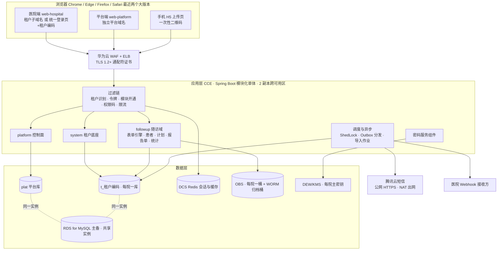
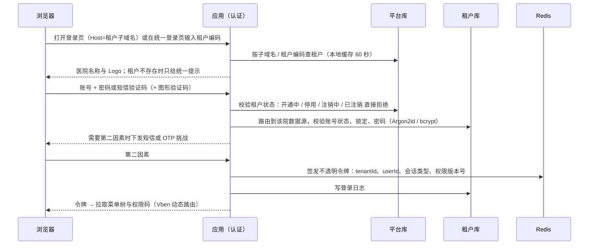
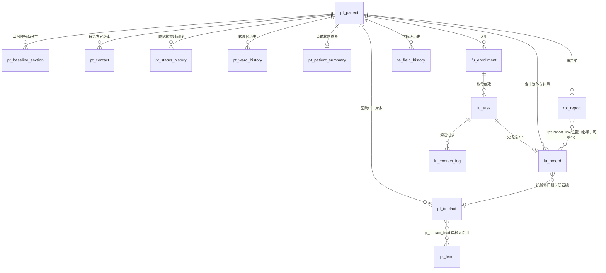
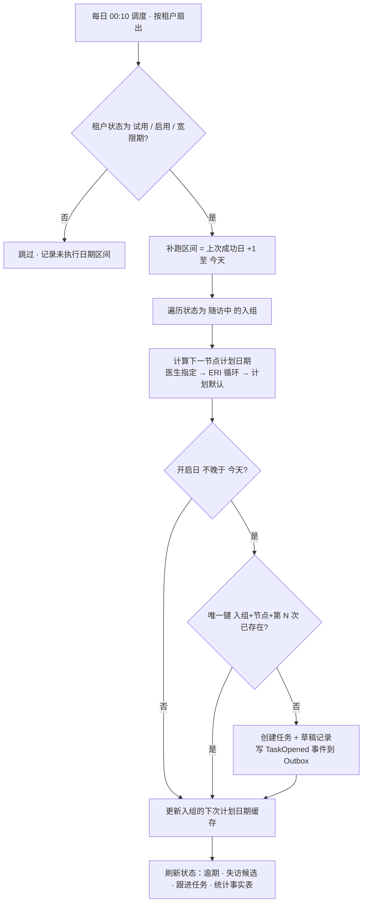
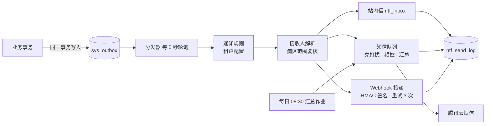
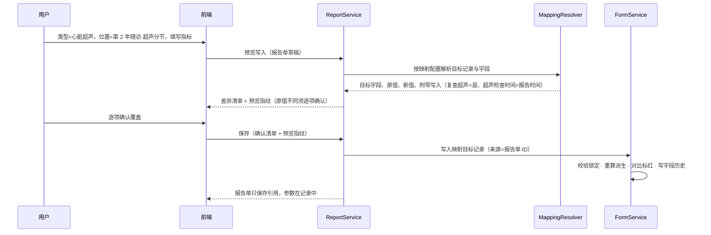
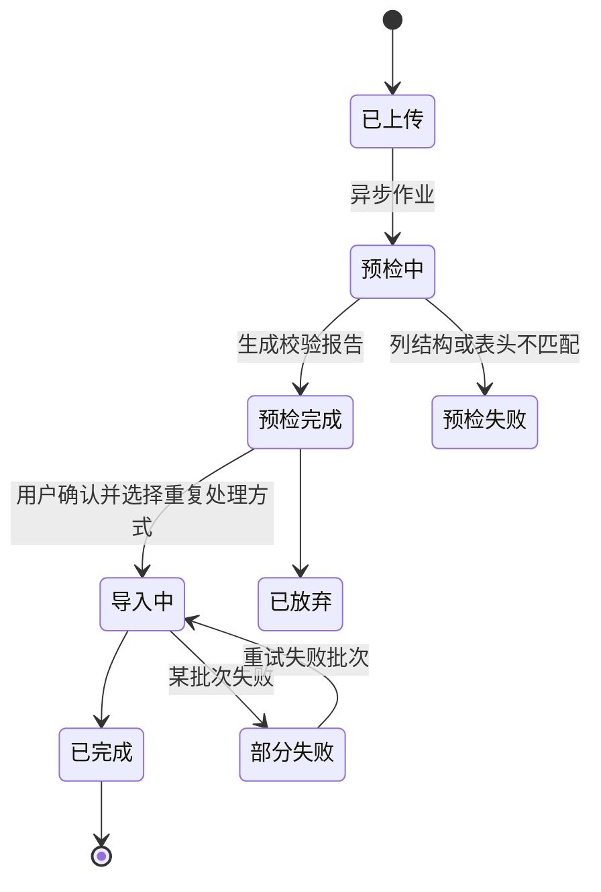

# 整体技术方案 V0.2

> 转换说明：本文由需求页面“整体技术方案 V0.2”于 2026-10-31 转为 Markdown，是交给开发的**唯一需求依据**之一。保留全部需求编号、表格与验收标准；删除了修订记录与讨论过程，末尾只留“决策记录（精简）”。原页面中的交互控件（筛选、切换）已展开为默认的全部内容。凡与仓库现状或其他文档不一致的地方，以 `docs/open-questions.md` 的结论为准，未列出的请先问人。

> **与仓库现状的对应（转换时补充，2026-10-31）**：① 后端 Maven 模块名按 `docs/adr/0001-m0-engineering-skeleton.md` 改为 `crdp-server / crdp-framework / crdp-platform / crdp-system / crdp-form / crdp-followup`（本文中的 `fu-*` 模块名即对应这些模块）；平台库名为 `crdp_platform`，租户库名 `t_{租户编码}`；表名前缀（`plt_`、`sys_`、`fu_`、`pt_`、`rpt_`、`fe_` 等）不变。② 前端外壳已改为官方 Vben Admin 5.7.0，仅 Ant Design Vue（ADR 0002，OQ-01 已关闭）。不要再引入其他 UI 库应用。③ 报告单位置表统一叫 `rpt_report_link`（线框页曾写作 `report_link`）。

> 临床科研数据一体化平台（公有云多租户 SaaS 架构）：Spring Boot 模块化单体 + Vue3/Vben Admin + MySQL（共享实例、每院一库）。V0.2 按平台底座 V0.3、医院 A V0.3（含第 14 章医院 B）、医院 C V0.1 需求同步：用户/角色/科室归租户库，首期国际算法并为密评预留，登录先识别医院；新增字段字典与表单引擎、患者模型、计划引擎、通知、病区隔离、报告单、对比标红、宽表导入、统计与首页、平台视角/审计/备份、工程结构、表清单与开发 Epic。补充：部署在华为云华北-北京四，审计归档 OBS WORM 至少 15 年，腾讯云短信，按 1 产品 + 1 测试 + 2 全栈重排约 45 周工期。已确认：RDS for MySQL 8.0；只建一个随访模块（做法 1）；病毒扫描首期不做；不购 DRS；A 在 UAT 后约 W35 上线（2026-10-31 因 E24、E25 顺延，原 W32），等保测评后做；审计归档不做异地 WORM 副本；数据范围增加负责病区、负责科室、仅本人负责的患者；C 的下次随访时间作为计划日期；录音为 MP3，浏览器原生播放、不转码。目前无待确认技术问题。

## 0. 文档说明

| 项目 | 内容 |
|---|---|
| 版本 | V0.2（V0.1 为初稿，无版本号） |
| 更新日期 | 2026-10-31 |
| 需求依据 · 平台底座 | 平台底座需求规格说明 V0.3：`docs/requirements/platform-spec.md` |
| 需求依据 · 医院 A / B | 医院 A 重症冠心病患者随访需求规格说明 V0.3（第 14 章为医院 B 配置差异）：`docs/requirements/hospital-a-spec.md` |
| 需求依据 · 医院 C | 医院 C 起搏器术后随访（随访资料电子化）需求规格说明 V0.1：`docs/requirements/hospital-c-spec.md` |
| 前提 | 公有云部署；全平台约 30 名用户，不设专项性能指标；主流浏览器，不考虑信创；等保三级；可用性 99.9%，区域内 RPO 5 分钟（区域级 RPO 不保证，已确认），RTO 4 小时；审计在线 1 年后归档；目前没有代码仓库与脚手架 |
| 读者 | 架构、后端、前端、测试、运维；可直接拆分为开发任务（第 16 章） |

## 1. 结论速览与关键决策

> **一句话方案** 部署在华为云华北-北京四：单一 Spring Boot 模块化单体（CCE，2 副本跨可用区）+ 一个 RDS for MySQL 主备实例（平台库 + 每院一个数据库）+ DCS Redis + OBS + DEW/KMS，短信走腾讯云短信。三家医院共用同一套随访域代码，差异全部落在租户配置：字段字典、计划模板、报告单类型与映射、对比规则、首页卡片、功能开关。用户约 30 人，所以首期不引入消息队列、搜索引擎、工作流引擎和微服务，用“事务外发箱 + 定时调度”保证可靠，部署和等保测评的组件都更少。

| 决策 | 结论 | 理由 |
|---|---|---|
| 云与区域 | 华为云华北-北京四（cn-north-4）；RDS、OBS、HSS 能力已按官方文档核实，其余服务购买前确认规格 | 用户已确定；组件映射与核实记录见第 2 章 |
| 应用形态 | 模块化单体，单一可部署包，按 Maven 模块与包边界分域 | 30 名用户，无性能压力；单体便于事务一致与等保测评；模块边界保留，以后可拆 |
| 租户隔离 | 首期一个共享 RDS 实例，每院一个数据库 t_{租户编码}，每院独立数据库账号 | 底座 V0.3 定稿；库级隔离满足医院数据不混放，成本低；以后可把单院迁到独立实例 |
| 平台库 / 租户库 | 平台库只放控制面；医院的用户、角色、院区科室、配置、业务数据和租户审计都在租户库，租户库表不带 tenant_id | 修正 V0.1 把 sys_user、sys_role 放平台库的错误；与底座 PLT-TEN-004 一致 |
| 登录 | 先识别医院：租户子域名优先，统一登录页输入租户编码为备选；平台端独立域名 | 账号只在本院库中唯一；请求的租户以令牌为准，并校验与子域名一致 |
| 密码算法 | 首期 AES-256-GCM、HMAC-SHA256、SHA-256、ECDSA P-256 / RSA-3072、Argon2id，TLS 1.2+；密文带算法与密钥版本 | 首期不用国密；通过可替换的密码服务组件为将来密评切换 SM2/3/4 预留 |
| 动态字段存储 | JSON 文档：按表单或分类一行，值放 JSON 列；参与业务逻辑的字段和敏感字段提升为实体列；字段级历史单独成表 | 5000 名患者、数百字段的数据量下 JSON 查询足够快；不需要租户级 DDL；比 EAV 好写统计和检索（第 6 章） |
| 随访任务 | 按需创建：每日调度在“提醒开始日与窗口开始日中较早的一天”创建任务；建档时窗口已过的节点按租户策略补建“补录”任务或跳过 | 与 A、B、C 三份需求一致；可表达长期循环与按上次实际随访滚动 |
| 事件与通知 | 事务外发箱（Outbox）+ 分发器；站内信、平台短信（汇总、免打扰、频控）、Webhook（HMAC-SHA256） | 不引入 MQ，消息不丢失、可重试、可审计 |
| 数据范围 | MyBatis 拦截器统一追加病区 / 科室 / 本人条件，未声明范围的受控表查询默认拒绝 | 需求要求所有列表、看板、导出、通知都在后端隔离 |
| 统计 | 实时查询，配合写入时维护的“节点随访事实表”和每条记录的完整度结果；不建离线汇总库 | 数据量小，口径要求“按当前数据实时计算”；事实表解决“窗口开始日仍符合条件”的分母口径 |
| 报告单 | 平台通用能力，A、C 共用一套表与代码；类型、字段集、名称字典、指标模板、字段映射、格式与大小按租户配置 | A-ATT-018 与 C-SCAN 要求同一机制 |
| 不做 | OCR、DICOM、RCT（随机化、盲法、质疑）、预警、患者端、微信或外呼对接、信创适配；上传文件病毒扫描（已确认移到后续版本） | 三份需求均列为首期不做；病毒扫描为用户决定 |

## 2. 总体架构与技术选型

浏览器经 WAF 与负载均衡进入同一个应用。过滤链先识别租户与令牌，再路由到平台控制面、租户底座或随访域；调度与异步作业在同一个应用中由分布式锁保证单实例执行。所有租户库都在同一个 RDS 实例上。



### 技术选型

| 层 | 选型 | 说明 |
|---|---|---|
| 后端 | JDK 21、Spring Boot 3.x、Spring Security 6、MyBatis-Plus | MyBatis 拦截器实现数据范围与审计字段 |
| 多数据源 | 自研数据源注册表（AbstractRoutingDataSource + 每院一个 HikariCP 池） | 开通时热注册，不需要重启；每池最大 5 连接即可 |
| 数据库迁移 | Flyway：平台库一套脚本，租户库按“底座 + 模块”分目录 | 按租户逐库执行，可灰度（第 15 章） |
| 数据库 | 华为云 RDS for MySQL 8.0 主备实例（跨可用区） | 已确认 8.0（官方建议新应用选 8.0）；本地开发与 CI 也用 MySQL 8.0 |
| 缓存与会话 | 华为云 DCS Redis（主备） | 令牌、权限版本号、一次性二维码、限流计数；不是数据源，丢失只需重新登录 |
| 调度 | Spring Scheduling + ShedLock（锁表在平台库） | 每日任务生成、状态刷新、通知汇总、审计封存与归档 |
| 异步 | 事务外发箱表 + 进程内线程池 | 首期不引入 MQ；导入与导出作业有作业表、进度与重试 |
| 对象存储 | 华为云 OBS（OBS Java SDK），每院一个业务桶，SSE-KMS 加密，开启版本控制；审计归档单独一个 WORM 桶 | 报告单文件、录音、导入文件、导出文件；审计归档见第 14 章 |
| 密钥 | 华为云 DEW：KMS 每院一个主密钥做信封加密；凭据管理保存数据库账号与腾讯云短信密钥 | 见第 4 章 |
| Excel | Apache POI 流式读取（事件模型）+ FastExcel 写出 | 761 列 × 5000 行的宽表可流式处理 |
| 文件识别与安全 | Apache Tika 识别真实类型并按白名单放行；录音以 MP3 为主，浏览器原生播放，不转码（已确认）；病毒扫描首期不做（第 10 章） | 拦截伪装扩展名与可执行文件；MP3 主流浏览器都能直接播放，省去 ffmpeg |
| 前端 | Vue 3 + Vben Admin v5（建议 Ant Design Vue 版本）、pdf.js、docx-preview | monorepo：医院端、平台端、表单引擎渲染器（第 15 章）；主色 #3A75FF 用于内容区主题变量，侧栏与顶栏保持 Vben 默认 |
| 可观测 | 华为云 LTS 日志 + 云监控 CES / Prometheus 指标 + 告警；链路追踪可选 | 日志中不得出现敏感字段明文 |
| 交付 | Git 仓库 + CI（单测、依赖与镜像漏洞扫描、SAST）+ 容器镜像 + IaC | 目前没有仓库，作为 Epic E01 |

### 部署

| 组件 | 部署方式 | 可用性 |
|---|---|---|
| 应用 | CCE 集群，2 个工作节点分布在 2 个可用区；应用 2 副本（备选：2 台 ECS + Docker Compose） | 滚动发布、就绪探针；单节点故障不影响服务 |
| 入口 | ELB（独享型）+ WAF；主域名已有，申请 *.主域名 通配符证书挂在 ELB | ELB 跨可用区 |
| RDS for MySQL | 一个主备实例（跨可用区），平台库与全部租户库 | 主备自动切换；数据增长后可把大院迁到独立实例 |
| DCS Redis | 主备实例 | 故障只影响登录态 |
| OBS | 业务桶每院一个（多可用区、SSE-KMS、版本控制、跨区域复制）；审计归档桶单可用区 + WORM（第 14 章） | 业务桶跨区域复制到备用区域（OBS 跨区域复制的目标区域本次未核实） |
| DEW / KMS | 每院一个主密钥；凭据管理 | 托管服务 |
| 主机安全与运维 | HSS（每个节点装 Agent，首期用于入侵检测、漏洞与基线检查，不开展病毒查杀任务）、CBH 云堡垒机、LTS、CES、NAT 网关 + 固定 EIP | 等保主机防护、运维审计；NAT 用于出网调用腾讯云短信 |
| 短信 | 腾讯云短信 API，公网 HTTPS 调用，平台统一账号、签名与模板 | 跨云调用；短信内容不含患者信息；失败重试并写发送记录 |
| 环境 | 开发、测试（含 UAT）、生产三套；生产数据不出生产环境 | 测试环境只用虚构数据 |

CCE、ELB、WAF、DCS、DEW、CBH、LTS、CES、NAT 是华为云常用服务，本次没有逐项核实北京四的规格与价格，购买前在控制台确认。

### 华为云能力核实记录（2026-10-31，官方文档）

| 能力 | 核实结论 | 来源 |
|---|---|---|
| RDS 版本 | 单机、主备、集群版均列有 8.4、8.0、5.7；官方建议新应用选 8.0；版本以实际环境为准。已确认选 8.0，北京四 8.4 的可购状态不再需要核实 | support.huaweicloud.com/productdesc-rds-mysql/zh-cn_topic_0043898356.html |
| RDS Binlog 与时间点恢复 | 自动备份不能关闭；实例每 5 分钟或达到一定数据量上传一次 Binlog 增量备份，不能自定义；保留 1–732 天；时间点恢复 = 最近全量 + 回放 Binlog | support.huaweicloud.com/usermanual-rds-mysql/rds_08_0047.html、rds_08_0004.html、rds_08_0008.html |
| RDS 库表级时间点恢复 | 恢复为带时间戳的新库新表；库表名不能含中文和点；含 JSON 虚拟列或生成列的表不能恢复 | support.huaweicloud.com/usermanual-rds-mysql/rds_05_0036.html |
| RDS 跨区域备份 | 北京四可备份到上海一、广州、贵阳一、中国-香港；全量与 Binlog 都可同步，保留 1–1825 天；需提交工单开通；异步复制，官方说明不保证及时性、不提供 SLA，建议用 DRS；加密备份不支持跨区域；目标区域存储 0.00025 元/GB/小时，跨区流量 0.5 元/GB | support.huaweicloud.com/usermanual-rds-mysql/rds_08_0045.html |
| OBS WORM | 桶级与对象级，只有合规模式；保留 1–100 年，只能延长；开启后不能关闭并强制多版本；WORM 桶不能作为跨区域复制源；分段上传合并后才受保护，追加写返回 403；生命周期不能删除受保护对象但可以转换存储类别；销户或欠费超期会删除数据 | support.huaweicloud.com/usermanual-obs/obs_03_0716.html、obs_03_0718.html、obs_03_081703.html |
| OBS 归档与生命周期 | 可由标准转低频、归档、深度归档；归档与深度归档不支持多可用区；最低存储时间：低频 30 天、归档 90 天、深度归档 180 天 | support.huaweicloud.com/usermanual-obs/obs_41_0072.html |
| OBS 内容扫描 | OBS 本身不扫描对象内容，没有上传即查毒的接口 | www.huaweicloud.com/product/obs/security.html |
| 内容审核 Moderation | 识别涉黄、涉政、暴恐、广告等违规内容，不是恶意文件检测；文档审核接口已于 2025-08-30 下线；北京四有接入点 | support.huaweicloud.com/api-moderation/moderation_03_0020.html |
| HSS 病毒查杀 | Agent 扫描主机或容器节点上的目录，任务方式（立即、稍后、周期），API 可建任务并按文件路径或 SHA-256 查结果；专业版、企业版、旗舰版、容器版、网页防篡改版可无限次扫描；基础版或未开 HSS 按次付费（公测，单价以售卖页为准，每月 2 次免费）；各版本单价：未核实 | support.huaweicloud.com/usermanual-hss2.0/hss_01_0586.html、price-hss2.0/hss_02_0006.html、api-hss2.0/CreateAntiVirusTask.html |
| 华为乾坤云沙箱 | 北向 API 提交文件做静态与动态检测，单文件 ≤ 50 MB，只有商用套餐支持北向接口；样本保留：安全 3 天、恶意 6 个月；价格与部署区域：未核实 | support.huaweicloud.com/qiankunbpr-qiankuncs/qiankuncs_css_01_005.html、moredocuments-qiankuncs/qiankuncs_moredoc_specifications_0022.html |

### 与 V0.1 相比删除的组件

- Elasticsearch：患者检索用盲索引精确匹配与 SQL 条件即可，数据量小。
- RocketMQ / Kafka：由事务外发箱替代。
- Flowable 工作流：首期只有导出审批与平台视角授权审批，用状态机表实现。
- OCR 识别服务、DICOM、微信与外呼对接：三份需求都列为首期不做。
- 每院独立实例：首期共享实例、每院一库。

## 3. 多租户、数据库划分与登录

### 平台库与租户库的数据归属

| 库 | 存放内容 | 不存放 |
|---|---|---|
| 平台库 plat | 租户档案、租户状态与到期、资源登记（数据源、桶、密钥 ID）、模块目录与开通记录、菜单与接口资源、授权范围与敏感权限放开、平台账号与平台角色、租户视角授权与规则、平台审计、平台字典与参数、短信模板、配置模板、升级批次、调度锁 | 任何医院的用户、角色、科室、患者与业务数据 |
| 租户库 t_{租户编码} | 本院院区与科室、病区、用户、角色及授权、字典与参数覆盖、个性化、字段字典与表单配置、随访计划、患者与随访业务数据、报告单元数据、通知设置与发送记录、Webhook 配置、导入导出作业、统计事实表、租户审计 | 其他医院的任何数据；表上不设 tenant_id |

### 数据源路由

1. **开通时建库与账号**：在共享实例上创建 t_{租户编码} 与两个账号：运行账号只有该库的 DML 权限（审计表只有 INSERT、SELECT），迁移账号有 DDL 权限、只给 Flyway 用。
2. **热注册数据源**：数据源注册表从平台库读取连接信息（密码由 KMS 解密），为该院建一个 HikariCP 池并注册，不需要重启；停用租户时注销连接池。
3. **请求路由**：过滤链从令牌取 tenantId 写入 TenantContext；路由数据源按 TenantContext 选择连接；没有租户上下文时访问租户库直接抛错。
4. **异步与调度**：作业按租户扇出，每个租户在独立的 TenantContext 中执行；Outbox 与作业表都在各自的租户库中。
5. **隔离验收**：自动化用例：用 A 院令牌访问 B 院对象 ID 必须返回“不存在”；静态扫描确保租户库 Mapper 不会出现跨库限定名。

### 登录流程（先识别医院）



- 租户识别：访问 {租户编码}.平台域名 时由 Host 头确定医院；访问统一登录页时先输入租户编码；首期不支持医院自定义域名（底座 PLT-TEN-010）。需要 *.平台域名 通配符证书。
- 平台端使用独立域名与独立登录，平台账号存平台库；平台账号不能登录医院端，医院账号也不能登录平台端。
- 令牌：随机 256 位不透明令牌存 Redis（键含 tenantId），载荷为 tenantId、userId、会话类型（医院 / 平台 / 租户视角 / 手机上传）与权限版本号；角色或负责病区变化时权限版本号递增，下一次请求即重新加载权限。
- 防串租户：请求所带令牌的 tenantId 与 Host 子域名不一致时拒绝；租户编码不存在、账号不存在、密码错误都返回同一提示，并对租户编码试探限流。
- 密码与锁定策略、二次验证、会话超时、单点或多点登录按底座认证章节执行，策略参数存租户库，平台给默认值。

### 租户开通编排

1. **登记租户**：平台库写租户档案，状态“开通中”。
2. **创建资源**：建库与账号、对象存储桶（服务端加密、版本控制）、KMS 主密钥；资源 ID 写入平台库。
3. **迁移结构**：Flyway 执行底座脚本与已开通模块的脚本。
4. **导入配置**：可选：从配置模板导入（第 6 章），如医院 B 由医院 A 的模板初始化。
5. **初始化管理员**：创建内置租户管理员角色与首个管理员账号，首次登录强制改密。
6. **启用**：注册数据源，状态改为“试用”或“启用”；每一步可重入，失败可从断点重试，整个过程写平台审计。

## 4. 安全与密码应用

首期按等保三级建设，使用国际通用算法，不使用国密。所有加解密、签名、摘要都只能通过密码服务组件调用，业务代码不直接调用算法库，以便将来密评时整体切换到国密。

### 首期算法与将来切换

| 用途 | 首期算法 | 密评后切换（预留） |
|---|---|---|
| 敏感字段加密（姓名、病案号 / 病历号、电话） | AES-256-GCM，每院数据密钥，信封加密 | SM4-GCM，后台重加密作业 |
| 精确检索盲索引 | HMAC-SHA256（规范化后计算，独立密钥） | HMAC-SM3，双列并存后切换 |
| 文件与审计完整性 | SHA-256；审计链值用 HMAC-SHA256 | SM3 / HMAC-SM3 |
| 签名（Webhook、导出水印码） | HMAC-SHA256；需要非对称时用 ECDSA P-256 或 RSA-3072 | SM2 |
| 口令存储 | Argon2id（或 bcrypt cost ≥ 12） | 按测评要求确定 |
| 传输 | TLS 1.2+，禁用弱套件，HSTS | 国密 TLCP 双证书（需网关支持） |

### 密码服务组件

- 接口：encrypt(用途, 明文)、decrypt(密文)、blindIndex(用途, 值)、digest、sign / verify；用途决定使用哪把数据密钥。
- 密文格式：版本 · 算法 ID · 密钥版本 · IV · 密文 · 认证标签，Base64 存入 VARBINARY / VARCHAR 列；解密按密文中的算法 ID 选择实现，因此新旧算法可以并存。
- 密钥分级：KMS 中每院一个主密钥 → 按用途的数据密钥（字段、盲索引、文件、审计）以密文形式存租户库，运行时解密后只在内存缓存；数据密钥每年轮换，旧版本保留用于解密。
- 切换路径：新增算法实现 → 新数据写新算法 → 后台作业分批重加密并重算盲索引（双列）→ 校验后删除旧列与旧密钥版本。
- MyBatis TypeHandler 负责透明加解密；日志、异常、导出预览中统一脱敏。

### 等保三级主要落地点

| 控制点 | 落地措施 |
|---|---|
| 身份鉴别 | 口令复杂度与有效期、登录失败锁定、二次验证（短信 / OTP）、会话超时与强制下线 |
| 访问控制 | 最小权限；敏感权限默认不可分配，由平台放开；后端统一鉴权与数据范围 |
| 安全审计 | 登录、操作、数据访问、明文查看、导出、下载全部审计；只追加、哈希链防篡改；在线 1 年后归档到 OBS WORM 桶，归档后至少保留 15 年 |
| 数据保密与完整 | 传输 TLS；敏感字段应用层加密；文件服务端加密与 SHA-256 校验 |
| 恶意代码防范 | 首期：上传文件真实类型白名单、拒绝可执行文件、脚本、启用宏的 Office 文件与压缩包，大小与数量限制；HSS 主机入侵检测。上传病毒扫描移到后续版本，测评时该项可能被判为部分符合（第 10 章残余风险） |
| 入侵防范 | WAF、云安全组最小开放、依赖与镜像漏洞扫描、定期渗透测试；Webhook 地址禁止内网与回环地址（防 SSRF） |
| 备份恢复 | 见第 14 章 |
| 管理制度 | 运维通过 CBH 云堡垒机；生产数据库禁止直连；生产数据不进开发测试环境 |

## 5. 权限、数据范围与字段策略

### 权限校验链

1. **模块开通**：接口所属模块未对该院开通时返回 403 并提示联系平台。
2. **权限码**：接口资源登记在平台库，带权限码与动作类型（查询 / 写入 / 导出 / 下载）；有效权限 = 已开通模块 ∩ 平台允许分配范围 ∩ 用户全部角色权限的并集。
3. **数据范围**：MyBatis 拦截器追加范围条件（见下）；按 ID 访问越权对象时按“不存在”处理并写审计。
4. **字段策略**：返回前按字段策略脱敏或隐藏；明文必须持有对应敏感权限（如 followup:patient:plain），每次查看写审计。

### 数据范围类型（已确认，与底座 PLT-PERM-007 一致）

| 范围 | 来源 | 条件 |
|---|---|---|
| 全部病区 / 全院 | A、C；租户管理员内置 | 不追加条件 |
| 本人负责病区 | A-WARD-003、C-WARD-004、PLT-PERM-007 | p.ward_id IN（用户负责病区） |
| 本人负责科室 | C-WARD-004、PLT-PERM-007 | p.dept_id IN（用户负责科室） |
| 仅本人负责的患者 | A、C、PLT-PERM-007 | p.responsible_user_id = 本人，或任务负责人 = 本人 |
| 底座通用范围 | PLT-PERM-007 | 全部 / 本院区 / 本科室 / 本科室及下级 / 仅本人 / 自定义科室，用于非患者类数据 |

多个角色的范围取并集（任一角色为“全部”即不过滤），与底座多角色合并规则一致。病区是独立字典，不挂在科室树下，所以“科室”和“病区”两个条件之间是“或”的关系。平台租户视角不受病区限制，但仍受视角规则约束（第 14 章）。

### 拦截器实现

- 受控表登记：患者及其所有子表（基线、随访记录、任务、沟通记录、报告单、植入记录、导入行、统计事实表）在注册表中声明“归属患者”。
- Mapper 方法标注 @DataScope(resource = ...)；拦截器用 JSqlParser 改写 SQL，子表统一追加 EXISTS 子查询关联 pt_patient，转病区时只改患者一行，子表无需同步。
- 默认拒绝：查询受控表但没有范围上下文的 SQL 直接抛错；确需全院查询的（如调度作业）必须标注 @IgnoreScope 并写明原因，代码评审检查。
- 统计、导出、导入、通知接收人复核、全局搜索、高级检索都走同一套范围服务，不另写一套过滤。
- 范围结果（可见病区、科室 ID 集合）按用户与权限版本号缓存在 Redis。

```text
-- 原查询（Mapper 上标注 @DataScope(resource = "patient")）
SELECT * FROM fu_task t WHERE t.status = 'OVERDUE';

-- 拦截器改写后（用户：负责病区 3、7；另有一个角色为“仅本人负责的患者”）
SELECT * FROM fu_task t WHERE t.status = 'OVERDUE'
  AND EXISTS (
    SELECT 1 FROM pt_patient p
    WHERE p.id = t.patient_id AND p.deleted = 0
      AND ( p.ward_id IN (3, 7)
            OR p.responsible_user_id = :uid
            OR t.assignee_id = :uid )
  );
```

### 字段策略合并与明文

| 场景 | 规则 |
|---|---|
| 医院用户多角色 | 同一字段取最宽：可编辑 > 可见 > 脱敏 > 隐藏；但看明文必须持有对应敏感权限，否则仍按脱敏返回 |
| 病区隔离与脱敏叠加 | 能看到某病区患者不代表能看明文 |
| 明文查看（已确认 2026-10-31） | 单独接口按字段返回明文，写租户审计（随访员看电话明文也每次记审计）。前端点击后原地确认即显示，不再输入密码；60 秒后自动恢复脱敏，明文不进本地草稿与缓存 |
| 平台租户视角 | 规则按 字段 > 模块 > 租户 > 全局 匹配，冲突时取更严；在后端完成脱敏，只写平台审计 |
| 实现 | Jackson 序列化器读取当前请求的字段策略；列表、详情、导出、站内信共用同一套 |

## 6. 字段字典与表单引擎

医院 A 有 266 个字段（基线 212 个，分 8 类；随访 54 个），医院 C 约 97 个字段（患者登记、程控记录、植入、电极、报告单）；医院 B 首期与 A 相同，以后可通过字段字典新增。字段字典驱动录入表单、校验、条件显示、派生计算、导入、高级检索、完整度与对比规则，是三家医院共用的核心能力。

### 存储方案对比（MySQL）

| 维度 | JSON 文档（推荐） | EAV（一值一行） | 按表单生成物理表 |
|---|---|---|---|
| 新增或调整字段 | 只改元数据，不需要 DDL | 只改元数据 | 每院单独 DDL；MySQL DDL 不能回滚，运行账号无 DDL 权限 |
| 各院字段不同 | 天然支持 | 天然支持 | 每院表结构不同，迁移脚本按院分叉 |
| 高级检索（任意字段 AND / OR） | JSON_EXTRACT 生成参数化条件，单表即可 | 每个条件一次自连接或子查询，SQL 复杂 | 最简单 |
| 统计与导出 | 单表扫描；5000 名患者的规模可以接受 | 需要行转列，761 列宽表导出很重 | 最简单 |
| 类型与约束 | 由元数据和应用层保证 | 值列只能是字符串或多列，类型弱 | 数据库强类型 |
| 字段级历史 | 单独的历史表 | 可天然记录 | 单独的历史表 |
| 数据量（A，10 年） | 基线 5000 × 8 行，随访约 5 万行 | 约 100 万 + 270 万行 | 多张宽表 |

| 推荐 JSON 文档的理由 | 需要接受的代价与对策 |
|---|---|
| 数据量小：约 5000 名患者，每年新增有限；按年随访约 5 万条，单表扫描与 JSON 解析预计在百毫秒到秒级（上线前压测确认）。 | 数据库层没有强类型：写入只能经 FormService，按元数据做类型、范围与选项校验；禁止绕过服务直接写 JSON。 |
| 医院 A、C 的字段完全不同，B 以后还会自行新增字段；JSON 不需要每院维护不同的表结构，也不需要应用持有 DDL 权限。 | 热门字段检索慢时，可为个别字段加虚拟生成列与索引（如随访 EF），不改变存储模型。 |
| 基线按分类分节保存，正好对应 8 个页签分别暂存，也避开了 MySQL 单行 200 多列的行长限制（A-NFR-002 提到的问题）。 | BI 或科研取数需要宽表：提供按表单定义生成的只读视图或导出，不让外部直接读 JSON。 |
| 统计主要依赖任务、事实表与完整度结果列，真正需要解析 JSON 的只有高级检索、趋势与下钻，频率低。 |  |

### 混合存储规则

| 字段类别 | 存储位置 | 例子 |
|---|---|---|
| 敏感字段 | 实体表的加密列 + 盲索引列，不进 JSON | 姓名、病案号 / 病历号、电话 |
| 系统绑定字段（计划、隔离、统计要用） | 实体表的普通列；字段字典中标注为“列存储” | 出院日期、手术日期、入院日期、植入日期、起搏器类型、病区、责任医生、是否死亡、随访日期 |
| 其他业务字段 | 所属记录的 data JSON 列 | 基线 8 类、随访分类 9、程控参数、报告单类型专属字段 |
| 字段附加信息 | 同一记录的 data_meta JSON 列 | 手工录入标记、字段备注（如导入时“6颈动脉内剥”的文字部分）、超出范围的确认人 |

JSON 键使用系统生成的稳定 ASCII 键（如 f019），不直接用医院的中文列名，避免 JSON 路径转义问题；字典中的“字段编码 / 数据库列名”保留为导入、导出与对外名称，创建后不可改。值的编码：是否与单选存选项编码（整数），多选存编码数组，数值存数字（小数位由元数据规定），日期存 YYYY-MM-DD，日期时间存 YYYY-MM-DDTHH:mm，“数值 × 2”存长、宽两个数值的对象。

### 元数据模型

| 表 | 内容 |
|---|---|
| fe_form | 表单定义：编码（基线、年度随访、程控记录、植入记录、报告单类型字段集等）、分类 / 分节（各有稳定锚点键，模板改版不变，供报告单位置与分类条使用）、字段顺序与分组，版本号；表单引擎按分类 / 分节返回已填 / 应填（条件不显示的字段不计入） |
| fe_field | 字段：键、字段编码、显示名、分类、类型、单位、取值校验范围（硬）、提示范围（软）、必填、条件显示与条件必填、敏感标记、存储方式、派生定义、帮助文字、状态 |
| fe_option_set / fe_option | 选项集与选项：编码、显示文字、顺序、停用、序数（用于“返流加重 ≥ 2 级”）、互斥（“无”）、需要补充说明（“其他”）、别名（导入匹配） |
| fe_rule | 跨字段校验，如出院日期 ≥ 手术日期、上限频率 > 下限频率 |
| fe_field_history | 字段级历史：记录类型与 ID、字段、旧值、新值、来源（用户 / 系统重算 / 导入 / 报告单 / 平台支持）、触发字段、原因、操作人、时间 |
| cfg_dict / cfg_dict_item | 业务字典：患者类型、术者、品牌、起搏模式、植入指征等；平台字典为默认，租户可覆盖 |

### 条件显示与条件必填

条件使用与高级检索相同的 JSON 条件树（all / any 嵌套），操作数可以是本表单字段，也可以是上下文变量（如医院 C 的当前器械类型、是否有在用 RA 电极）。前端实时求值决定显示；后端提交时再求值一次：被隐藏字段的值清空，清空动作写入字段历史；完整度只把实际显示的必填字段计入分母。

```text
{
  "visibleWhen": { "all": [ { "field": "f215", "op": "eq", "value": 1 } ] },
  "requiredWhen": { "all": [ { "field": "f215", "op": "eq", "value": 1 } ] }
}
// 医院 C：按当前器械显示
{
  "visibleWhen": { "any": [
    { "ctx": "device.type", "op": "in", "value": ["ICD", "CRT-D"] }
  ] }
}
```

### 派生字段

| 计算函数（内置库） | 使用方 | 规则 |
|---|---|---|
| DAYS_INCLUSIVE(起, 止) | A 术后住院天数 | 出院 − 手术 + 1，出院 ≥ 手术才计算 |
| MINUTES_BETWEEN(起, 止) | A 手术时长 min | 向下取整到分钟 |
| HOURS_BETWEEN_1DP(起, 止) | A ICU 时间 h | 保留 1 位小数，如 160 小时 54 分 → 160.9 |
| BMI(体重 kg, 身高 cm) | A BMI | kg ÷ (cm ÷ 100)²，保留 1 位小数 |
| AGE_YEARS(出生, 参考日) | A 手术年龄；C 年龄、植入时年龄 | 周岁 |
| SUM(...) | A 桥血管数量 | 动脉桥 + 静脉桥 |
| YEARS_SINCE / DURATION_YM | A 随访年限；C 植入时长 | 不设上限；C 显示“X 年 Y 个月” |
| CHANGE_PCT(本次, 上次) | C 参数变化率 | 同一电极或同一器械比较 |

- 首期只用内置函数加参数，不开放任意脚本；函数库在 Java 与 TypeScript 各实现一份，用同一组“标准用例”（取自需求验收标准）做一致性测试。
- 依赖图由派生定义自动生成；来源字段变化时按拓扑顺序重算，前端实时显示，后端保存时再算一遍并以后端结果为准。
- 派生字段默认只读；来源缺失时允许手工录入，data_meta 标记“手工录入”；来源补齐后自动改为计算值并写历史。
- 重算写入字段历史，来源为“系统重算”，并记录触发字段；导入时同样重算，与表中原值不一致时进校验报告的警告。

### 配置模板（A-FLD-014）

配置模板是一个带版本的配置包：从源租户导出配置表，存平台库与对象存储；开通新租户时导入，只复制配置、不复制数据。医院 B 由医院 A 的模板初始化，之后各自修改互不影响。

| 类别 | 包含 | 处理方式 |
|---|---|---|
| 复制 | 字段字典与表单、患者类型字典、报告单类型 / 字段集 / 名称字典 / 指标模板 / 映射、统计口径参数、首页卡片目录与角色布局、角色模板与权限、通知设置、对比规则、计划模板、功能开关 | 导入时重新分配 ID 并重写引用；角色权限与新租户的可分配范围取交集 |
| 只复制结构 | 术者、病区 / 中心 | 保留字典定义，不带取值 |
| 不复制 | 患者、基线、随访记录与任务、沟通记录、报告单与文件、审计、用户账号 | 配置表在注册表中显式标注，未标注的表一律不导出 |

导出前做敏感信息检查：配置中引用用户的字段（如病区默认负责人）一律置空。

### 服务器自动保存与版本冲突（已确认 2026-10-31）

随访表单和基线分节录入时，前端每 2 分钟把改动保存到服务器；另有本地草稿（每 30 秒和离开字段时存 IndexedDB，不存明文查看结果）。需求编号：NFR-SAVE-001 自动保存、NFR-SAVE-002 离线与同步、NFR-SAVE-003 版本冲突。

| 项 | 规则 |
|---|---|
| 接口 | PUT /records/{id}/draft（基线为 /baseline/{patientId}/sections/{code}/draft），请求带 baseVersion 和变更字段；只在有新改动时发送 |
| 草稿语义 | 写入记录的草稿状态，任务变“进行中”；不触发提交校验、对比标红通知、下次任务生成和统计写入；不写字段历史（提交或保存修改时才写） |
| 乐观锁 | 记录带 version；baseVersion 与当前不一致返回 409，附更新人、更新时间和两边不同的字段；提交接口同样校验版本 |
| 前端冲突处理 | 收到 409 后暂停自动保存，提示用户选“保留我的并覆盖”（带新版本号重发，写审计）或“载入服务器版本”（自己的改动另存本机副本）；不做字段级自动合并 |
| 离线 | 请求失败或断网时只存本地草稿，状态栏显示“离线”；恢复后立即同步一次；离线时不能提交 |
| 提示 | 表单顶部显示“已自动保存 HH:mm”“有改动待同步”“离线”“版本冲突”；“暂存”按钮保留，用于立即保存 |
| 范围与审计 | 已提交或只读的记录不自动保存；自动保存不逐次写审计，覆盖他人版本、提交和修改已提交记录照常写审计 |

## 7. 患者数据模型

按“什么时候产生”分层：一次性的基线、每个随访节点一条的随访记录、按版本保存的联系方式，再汇总出“当前状态”；医院 C 再增加植入记录与电极两层。纠错走字段历史，病情变化走新的随访记录，两者不混在一起。



| 表 | 粒度 | 要点 |
|---|---|---|
| pt_patient | 每名患者一行 | 加密的姓名、病案号 / 病历号与盲索引（病案号唯一）、性别、出生日期、科室、病区、责任医生、随访状态、原系统编号、随访编号（C）、系统绑定日期、软删除标记 |
| pt_baseline_section | 每名患者每个分类一行 | data / data_meta JSON、版本号（乐观锁）、分节完整度结果；页签分别暂存互不冲突 |
| pt_baseline_lock | 每名患者一行 | 锁定人与时间；锁定后修改须有锁定权限先解锁并填原因（A-PAT-006） |
| pt_contact | 每个号码一个版本 | 电话加密 + 盲索引、生效日期、来源（哪次随访）、是否已加微信；沟通记录引用具体版本，换号不改历史 |
| pt_status_history | 每次状态变化一行 | 随访中 / 已暂停 / 已死亡 / 已终止 / 失访 / 随访结束及生效日期；统计判断“窗口开始日是否仍符合条件”的依据 |
| pt_ward_history | 每次转病区一行 | 原病区、新病区、原因、操作人 |
| pt_patient_summary | 每名患者一行 | 当前状态摘要：最近随访日期、关键指标（A 最近 EF，C 当前器械与最近参数）、终点事件是否发生过、下次计划日期；每次提交后重算，不可直接修改 |
| fu_record | 每次随访一行 | 类型（年度 / 节点 / 计划外 / 补录 / 历史导入 / 历史未随访）、所属任务与入组、节点与第 N 次、随访年度、计划日期、窗口、实际随访日期、关联器械（C）、data / data_meta JSON、完整度、标红结果、状态（草稿 / 已提交）、来源 |
| pt_implant（C） | 每次植入一行 | 植入类型、日期、起搏器类型、品牌、型号、序列号、起搏模式、医院、医生、指征、状态（在用 / 已更换 / 已取出）、结束日期与原因 |
| pt_lead / pt_implant_lead（C） | 每根电极一行 + 关联表 | 腔室、部位、型号、植入日期、状态；电极可被新器械沿用，保留原植入日期 |

### 关键规则的实现

- 字段级历史：FormService 保存时逐字段比较旧值与新值，同一事务写 fe_field_history；敏感字段的历史值同样加密存储。
- 基线锁定：锁定后的分节拒绝写入（含报告单映射写入与导入更新），解锁需要 followup:patient:lock 并填写原因，解锁与再次锁定都写审计。
- 一条节点只能有一条有效记录：fu_record 对“入组 + 节点 + 第 N 次”建唯一约束（计划外记录不受约束）。
- 医院 C 同一患者只能有一条在用器械：用生成列（在用时为 1，否则为 NULL）与 patient_id 建唯一索引；新建更换 / 升级记录时同一事务结束旧记录。
- 医院 C 随访记录按随访日期匹配当时在用的器械（植入日期 ≤ 随访日期 < 结束日期），补录旧记录同样匹配；条件显示的器械上下文取自匹配到的器械。
- 医院 C 随访序号按随访日期重排：在患者行上加锁后重新编号，内部记录 ID 不变，重排写字段历史。
- 删除一律软删除并填原因；患者与随访数据服务期内长期保留。

## 8. 随访计划引擎

计划 → 子计划（节点）→ 任务三层。计划发布后不可修改，只能复制出新版本；患者入组时固定所用版本。任务不预先生成，每日调度在开启日创建，因此长期循环、不设结束年度的计划不会积累大量未来任务。

### 模型

| 表 | 内容 |
|---|---|
| fu_plan | 计划编码、名称、版本号、状态（未发布 / 已发布 / 随访中 / 已暂停 / 已停用）、起算字段（出院日期 / 手术日期 / 建档日期 / 植入日期）、管理周期 |
| fu_plan_node | 节点（子计划）参数，见下表 |
| fu_plan_mapping（C） | 起搏器类型 → 计划的映射，可配置 |
| fu_switch_rule（C） | 计划切换规则：触发事件、条件、动作（见本章后文） |
| fu_enrollment | 入组：患者、计划版本、起算日期快照、模式（常规 / ERI 期）、状态、暂停区间、下次计划日期与开启日缓存 |
| fu_task | 任务实例：入组、节点、第 N 次、计划日期、窗口、开启日、创建方式（正常 / 补录 / 暂停期间未执行 / 停用期间未执行 / 跟进 / 临时）、状态、负责人 |
| st_node_occurrence | 节点随访事实表（第 13 章），统计用 |

| 节点参数 | 取值 | 说明 |
|---|---|---|
| 重复方式 | 固定次数 / 持续循环（周期） | 固定次数完成后患者在该计划中“随访结束” |
| 基准 | 计划起算日期 / 上次实际随访日期 | C 的常规随访按上次实际随访日期滚动 |
| 偏移 | 数值 + 单位（天 / 周 / 月 / 年） | 按月或年加时遇月末自动取当月最后一天 |
| 提醒提前量 | 天 / 周 / 月 | A 7 天；B 3 个月节点 2 周、1 年以后 1 个月 |
| 窗口 | 窗口前、窗口后，可不对称 | C 术后 72 小时：计划日期 = 植入 + 3 天，窗口前 3 天、后 4 天 |
| 任务类型 | 电话随访 + 表单 / 站内提醒 |  |
| 负责人类型 | 责任医生 / 病区默认负责人 | 都没有时进入病区待认领池 |
| 启用条件 | 入组模式（常规 / ERI 期） | C：ERI 期循环节点只在 ERI 模式下生效，常规节点同时暂停 |
| 入组前已过窗口 | 补建“补录”任务 / 跳过 | A、B 补建（Q44）；C 跳过（C 的 Q14）；作为计划参数，不写死 |

### 日期计算

```text
计划日期 = 基准日期 + 偏移 + （N − 1）× 周期
```

```text
开启日 = min（计划日期 − 提醒提前量，计划日期 − 窗口前）
```

全部日期按北京时间（Asia/Shanghai）用 LocalDate 计算。窗口开启前提交的记录标“已完成（窗口前完成）”；窗口结束仍未完成为“逾期”；“待开始”只是计算出的显示状态，不落库。

| 验算（取自需求验收） | 输入 | 结果 |
|---|---|---|
| 医院 A 年度随访 | 出院 2025-03-15，+1 年，提前 7 天，窗口 ±7 天 | 计划日期 2026-03-15，开启日 2026-03-08 |
| 医院 B 3 个月节点 | 手术 2026-03-01，+3 个月，提前 2 周，窗口 ±14 天 | 计划日期 2026-06-01，开启日 2026-05-18，窗口至 06-15 |
| 医院 B 1 年节点 | 手术 2026-03-01，+1 年，提前 1 个月，窗口 ±1 个月 | 计划日期 2027-03-01，开启日 2027-02-01 |
| 医院 B 术后第 1 / 3 / 5 天 | 出院建档 2026-03-08，窗口均已结束 | 建档当天创建 3 个“补录”任务，不进逾期、不发通知 |

### 每日调度



- 幂等：任务对“入组 + 节点 + 第 N 次”建唯一约束，重复执行不会重复创建。
- 补跑：每个租户记录上次成功执行日；服务中断后自动补跑缺失的日期区间。
- 停用补偿：租户停用期间不创建任务、不发通知；恢复后，停用期间开启并已结束窗口的节点创建为“停用期间未执行”。
- 暂停补偿：患者或计划恢复时，暂停期间到期的节点创建为“暂停期间未执行”，由医生选择补做或关闭（A 的 Q32）。
- 起算日期变更：重新计算下次计划日期；已创建、尚未有任何联系记录的任务重新计算窗口，已完成记录不变。
- 执行时间：00:10 创建与刷新（A-NFR-006 建议值），08:30 发提醒与汇总；一个租户失败不影响其他租户，失败告警。

### 下一次计划日期的优先级（医院 C）

1. 医生在上一条记录中填写的“下次随访时间”（已确认）：作为下一次任务的计划日期，窗口按对应节点的窗口前、窗口后宽度围绕它展开，开启日与创建时机照常按计划规则计算，只影响紧接着的一次。例：普通起搏器常规随访（窗口 ±30 天）填 2027-01-15，则计划日期 2027-01-15，窗口 2026-12-16 至 2027-02-14；窗口开始日已过时，下一次每日调度即创建任务。
2. ERI 期循环：入组模式为 ERI 时，按上次实际随访日期 + 1 个月（可设 1–3 个月）。
3. 计划模板默认节点。

### 植入记录事件触发计划切换（医院 C）

| 事件 | 动作 | 术后节点是否重新起算 |
|---|---|---|
| 首次植入 | 按器械类型映射入组 | 是，从植入日期起算 |
| 升级为 ICD / CRT-D | 结束原入组，转入 ICD/CRT-D 计划 | 是，从升级日期起算 |
| 升级为普通起搏器（含 CRT-P） | 转入或留在普通起搏器计划 | 是 |
| 同类型电池更换 | 计划不变，结束 ERI 期循环 | 是（需求中标为假设） |
| 电极修正 | 不切换 | 否 |
| 器械类型更正（纠错） | 按新类型重新入组，未开始任务按新计划重算 | 否，仍按原植入日期 |
| 接近 ERI / ERI 解除 | 入组模式切换为 ERI 期 / 恢复常规 | 否 |
| 器械取出且未再植入 | 结束入组 | — |

实现：保存植入记录或随访记录时发布领域事件（ImplantCreated、ImplantTypeCorrected、ImplantRemoved、EriFlagChanged），计划切换处理器在同一事务内按 fu_switch_rule 执行：结束旧入组、终止未完成的旧任务并记录原因、创建新入组、立即计算下一节点。规则是配置数据，随配置模板复制。

### 其他规则

- 自动入组：A 出院登记后加入预置计划，出院状态为死亡的不加入；C 保存植入记录后按映射入组。
- C 补录的历史记录日期落在某个未完成任务的窗口内时，自动完成该任务。
- 死亡、终止、失访后不再创建后续任务；固定次数计划完成后为“随访结束”。
- 已发布计划的节点表只读（应用层校验 + 只读视图），修改只能“复制为新版本”；在组患者迁移到新版本首期不做（A 的 Q31）。

## 9. 沟通记录、失访与通知

### 沟通记录与失访规则

每次联系写一条 fu_contact_log：时间、方式、拨打的联系方式版本、结果（已联系 / 未联系到 / 号码错误 / 拒访 / 家属代答 / 告知已故）、约定下次联系时间、备注、录音。录音文件与“通话记录”报告单是同一个文件对象，删除任一处两处同时删除。

| 规则（租户参数） | 医院 A 默认 | 实现 |
|---|---|---|
| 失访候选 | 窗口内不同日期连续 3 次“未联系到 / 号码错误”且窗口已结束 | 每日状态刷新时判定，标“失访候选”，医生确认后任务为失访 |
| 患者失访提示 | 连续 2 个年度失访 | 确认失访时检查，提示把患者状态改为失访 |
| 未联系到跟进 | 次日生成跟进任务，每个窗口最多 5 次 | 写沟通记录时创建，计数存任务上 |
| 拒访 | 不计入失访，改走移出计划 | 提示操作，不自动移出 |
| 告知已故 | 进入死亡登记 | 患者状态改为已死亡，后续不再创建任务 |

### 事件驱动的通知



| 事件 | 默认触发 | 默认渠道 |
|---|---|---|
| 窗口预告 | 开启前 7 天，可按节点关闭（B 术后第 1 / 3 / 5 天默认关闭） | 站内信 |
| 提醒开始（任务开启） | 开启日 08:30；与窗口开启同一天时合并 | 站内信 |
| 窗口开启 | 窗口开始日 08:30 | 站内信 |
| 即将逾期 | 窗口结束前 2 天 | 站内信 |
| 已逾期 | 窗口结束次日 08:30，可抄送病区负责人 | 站内信 + 短信 |
| 每日汇总 | 每天 08:30，有待办才发 | 短信 + 站内信 |
| 任务改派 / 约定回访到时 / 未联系到跟进 / 失访候选 | 即时或次日 08:30 | 站内信 |
| Webhook 事件 | 任务开启、逾期、随访提交、患者死亡 | Webhook |

- 接收人：任务负责人；没有负责人时发给该病区全部医生与随访员（C 还包括护士）；发送前按病区范围复核，已不负责该病区的人不再收到；首期不发给患者。
- 短信：通过腾讯云短信发送，使用平台统一账号、签名与平台审核过的模板；应用经 NAT 网关固定 EIP 出网，HTTPS 调用短信 API，密钥存 DEW 凭据管理，腾讯云子账号只授予发短信权限；内容只含数量与登录提示，不含姓名、病案号、电话、诊断；同一接收人同一天合并为汇总；21:00–08:00 不发、顺延到 08:00 后；每人每天不超过 3 条（建议值，可配置）。
- 站内信：可列出患者，姓名按接收人权限脱敏；点击进入时再次校验范围。
- Webhook：只接受 HTTPS，禁止内网与回环地址；载荷只有事件类型与对象 ID；请求头带时间戳与 HMAC-SHA256 签名；失败重试 3 次（退避），全部写发送记录。
- 租户停用期间、计划或患者暂停期间不发送相应通知；所有通知写 ntf_send_log，失败可重试。

## 10. 报告单与资料（A、C 共用）

报告单是平台通用能力：同一套表、接口与页面，差异全部在租户配置。A 预置 10 类资料并用心脏超声映射写入超声字段；C 预置 10 类资料，用程控报告单映射写入程控记录，并启用电子化状态、补录进度与待归档区。

### 配置与数据表

| 表 | 内容 |
|---|---|
| rpt_type | 资料类型：编码、名称、字段集（引用 fe_form）、默认电子化状态、允许格式与大小、排序、启停 |
| rpt_name | 名称字典：所属类型、名称、绑定的指标模板、电子化状态覆盖 |
| rpt_indicator_tpl / rpt_indicator_item | 指标模板：项目名称、代码、参考范围（可按性别区分）、单位、顺序 |
| rpt_mapping / rpt_mapping_item | 报告单 → 结构化字段映射：目标（基线某时相 / 年度随访 / 程控记录）、项目代码 → 字段键、附带写入（如复查超声 = 是、超声检查时间 = 报告时间） |
| rpt_report | 报告单：患者（待归档时为空）、类型、名称、报告时间、医院、类型专属字段 JSON、所见与结论、电子化状态、上传方式、状态 |
| rpt_report_link | 报告单位置（2026-10-31 改）：报告单 ID、link_type（baseline / followup_record，C 另有 implant_record）、link_record_id（基线为空）、anchor_type（category / section / 空 = 整条记录）、anchor_key、anchor_template_version；报告单 + 位置唯一；一份报告单至少 1 个位置、可多个；没有位置的报告单归入“未指定位置”；增删位置写操作日志。字段级位置不支持。通话记录与沟通记录的关联（A-ATT-017）单独存放，不算位置 |
| rpt_indicator_value | 指标结果：项目、结果、单位、参考范围快照、↑ / ↓；有映射的类型不在此存参数，只引用记录 |
| file_object / rpt_report_file | 文件：对象键、原文件名、识别出的真实类型、大小、SHA-256、页数、缩略图键、上传人；一份报告单多个文件 |

### 映射写入



- 写入统一经 FormService：校验基线锁定、重算派生字段、计算对比标红、写字段历史（来源 = 该报告单）。
- 保存时校验预览指纹：预览之后目标字段被别人改过，要求重新确认。
- 同一记录（基线同一时相）只能有一份报告单作为映射来源，用唯一约束保证；修改位置或删除报告单不清除已写入的值。映射目标与位置分开：映射决定写入哪些字段，位置决定报告单显示在哪里。
- 位置校验：anchor_key 必须存在于该记录当前模板版本；在页内上传时预选当前分类 / 记录 / 分节，手机上传（H5）同样须选位置。模板调整后由作业退回：分节 → 所属分类或整条记录 → 移除并提示“原位置已调整”，均写操作日志。
- 历史数据迁移：原按年关联的报告单落到该年随访记录整条；原关联基线的进入“未指定位置”，不安排集中人工补指定，保持在该组直到有上传权限的用户指定；C 原关联植入记录的落到该植入记录整条。录音生成的通话记录默认位于该任务对应的随访记录整条，没有对应任务时进入“未指定位置”。
- 映射到基线时报告时间不得晚于出院日期。检验报告单首期只存指标结果，不写入基线。

### 文件处理

| 环节 | 做法 |
|---|---|
| 上传 | 前端直传到应用（不直传对象存储），便于校验；单文件与每份数量上限按租户配置（A：20 MB、10 个，录音 50 MB；C：20 MB、50 个） |
| 校验 | Tika 识别真实类型，与租户允许格式比对；只放行租户允许的格式（图片、PDF、DOCX、XLSX、音频），拒绝可执行文件、脚本、启用宏的 Office 文件（docm、xlsm 等）与压缩包；扩展名与真实类型不一致时拒绝；首期不做病毒扫描；计算 SHA-256（C 用于重复提示，只在可见范围内提示） |
| 存储 | 对象键 t/{租户}/rpt/{年}/{月}/{随机 ID}；每院一桶，服务端 KMS 加密 |
| 派生文件 | 只生成图片缩略图；录音不转码、不另存副本（已确认：录音为 MP3，浏览器原生播放） |
| 预览 | 经应用代理按流返回、不缓存；页面平铺可见水印“姓名（账号）· 医院名称 · 预览时间（精确到分钟）”，不可关闭，水印层被删改时重绘；每次预览写审计（用户、租户、文件、时间、IP）；PDF 用 pdf.js，DOCX 用 docx-preview，XLSX 只能下载；音频用浏览器原生 audio 播放（MP3 为主，M4A、WAV 浏览器也能直接播放；A 规格中保留的 AMR 浏览器不能播放，只能下载） |
| 下载 | 需要 followup:scan:download（敏感权限），生成 5 分钟有效的签名链接，每次写审计 |
| 手机上传（H5） | 电脑端生成一次性令牌二维码，15 分钟有效，绑定用户与患者，只能调用上传接口；手机端须选报告单位置（二维码带入电脑端当前位置作为预选）；C 要求手机端已登录本院账号 |

已确认：接受预览可被截屏的风险，以可见水印（用户、时间、租户）加审计作为威慑与追溯手段。

### 病毒扫描：首期不做，后续版本参考

已确认：首期不做上传文件病毒扫描，列入后续版本待办。首期只保留 Tika 真实类型白名单与大小、数量限制。下表是为后续版本保留的方案对比。

| 方案 | 工作方式 | 资源与费用 | 运维 | 是否适合上传校验 |
|---|---|---|---|---|
| 自建 ClamAV（clamd 独立服务） | 上传时应用把文件流经 INSTREAM 发给 clamd，同步返回结果，通过后再写 OBS | 官方建议至少 3 GiB 内存、推荐 4 GiB；签名加载约 1.2 GiB，并发重载时约翻倍（可设 ConcurrentDatabaseReload no，代价是重载期间扫描暂停）；约 1 vCPU；软件免费 | freshclam 每天更新签名（需出网或自建签名镜像），监控签名更新时间，跟进版本升级 | 适合：同步、文件不出平台；对新型威胁检出较弱 |
| 华为云 HSS 病毒查杀 | Agent 扫描节点上的目录，任务方式，API 建任务、按路径或 SHA-256 查结果 | 专业版及以上（含容器版）不限次数；否则按次付费（公测价）；版本单价未核实 | 托管，运维最少 | 不适合作为上传前置检查：文件要先落到节点目录再异步扫描，结果延迟；不扫描 OBS 对象。等保主机防护本来就需要 |
| 华为乾坤云沙箱 | 北向 API 提交文件，静态 + 动态检测 | 需商用套餐；价格与区域未核实 | 托管 | 不建议：文件会离开平台，恶意样本保留 6 个月，涉及患者资料外传；单文件 ≤ 50 MB |
| 内容审核 Moderation | 识别违规内容 | — | — | 不适用：不是恶意文件检测 |

后续版本建议：自建 ClamAV 同步扫描（CCE 上单独部署，扫描不可用时上传返回“稍后重试”，不放行），并用已记录的 SHA-256 对存量文件补扫；HSS 病毒查杀作为主机层补充；不用云沙箱。预估约 1.5 开发人周，另需 1 个 3–4 GiB 内存的副本。

- 残余风险 1：带恶意代码的 PDF、DOCX 或图片可能存入 OBS，被有下载权限的用户在本机打开时触发。缓解：下载是敏感权限且每次审计；预览在浏览器内用 pdf.js、docx-preview 渲染，不调用本地程序；建议医院终端安装杀毒软件。
- 残余风险 2：等保三级测评中“恶意代码防范”可能判为部分符合。缓解：在测评材料中说明类型白名单、HSS 主机防护和后续版本计划；如测评机构要求整改，按上面的后续方案约 1.5 人周补上，可放在 M6 整改窗口。
- 残余风险 3：上线扫描前已存入的文件没有扫描记录。缓解：后续版本上线时按 SHA-256 对存量文件一次性补扫，命中的文件隔离并通知平台。

### A 与 C 的配置差异

| 配置项 | 医院 A | 医院 C |
|---|---|---|
| 预置类型 | 心脏超声、冠脉造影、心电图、胸片 / CT、检验、出院小结、手术记录、知情同意书、通话记录、其他 | 程控报告单、纸质随访表、植入手术记录、心电图 / 动态心电图、胸片、心脏超声、检验、知情同意书、通话记录、其他 |
| 字段映射 | 心脏超声 → 基线超声（术前最后一次 / 出院前最后一次）或年度随访超声字段 | 程控报告单 → 程控记录字段（电池、ERI、阈值、感知、阻抗、比例、程控参数、ICD 项目） |
| 报告单位置（必填，可多选） | 基线分类、随访记录（整条或分节）；通话记录另可关联沟通记录 | 基线资料（患者登记分组、植入记录整条或器械信息、电极）、随访记录（整条或程控分组）；C 患者档案保留基线资料页签（患者登记 + 植入记录），与随访记录页签沿用 A 的左栏导航、内联缩略图与吸顶分组条 |
| 电子化状态与补录进度 | 不启用 | 启用：待录入 / 已电子化 / 无需录入 |
| 待归档区 | 不启用 | 启用（P1） |
| 格式 | PDF、JPG、PNG、DOCX、XLSX；录音以 MP3 为主，另接受 M4A、WAV（AMR 仅保存与下载，不在线播放） | JPG、PNG、PDF；录音以 mp3 为主，另接受 m4a |

## 11. 录入时对比标红规则引擎

录入或补录时，把本次值与“上一次”比较，异常值标红并显示上次值与变化；只在表单内提示，不发通知、不产生待办。规则是租户配置（A 的 Q41、C 的 Q02 为默认值），每条可开关、调阈值。

| 规则类型 | 参数 | 默认规则示例 |
|---|---|---|
| 差值下降 / 上升 | 字段、方向、阈值（绝对值） | A：EF 下降 ≥ 10 个百分点；LVDd 增加 ≥ 5 mm |
| 变化率 | 字段、方向、百分比 | C：起搏阈值升高 > 50%；阻抗升高或降低 > 50%；感知下降 > 50% |
| 序数升级 | 字段（选项带序数）、级数，或达到某级 | A：返流程度升高 ≥ 2 级，或达到中量 / 大量 |
| 新发事件 | 事件字段、日期字段 | A：本次为“是 / 有”且日期晚于上一次随访，如再住院、再血运重建、心梗 |
| 由否变是 | 字段 | A：新发心室血栓；A：本次“是否死亡”= 是 |
| 超出提示范围 | 字段字典的提示范围 | A：EF < 40%、LVDd > 60 mm、LA > 45 mm |
| 取值命中 | 字段、取值集合或阈值 | C：ERI 状态非正常或预计电池寿命 ≤ 1 年 |

- “上一次”的取法是规则参数：A 取上一条已提交的年度随访记录（B 含节点记录），没有时对比基线指定字段（如出院前最后一次 EF）；C 按同一器械（电池类）或同一电极（阈值、感知、阻抗）取随访日期之前最近一条；计划外随访与草稿不作对比对象。
- 附加说明：C 脉宽不同时阈值对比仍显示，注明“脉宽不同，仅供参考”。
- 规则定义以 JSON 下发到前端实时求值；后端保存时用同一组规则再算一次，结果存 fu_record.highlight（C 首页“异常标红记录”使用）。
- 补录了一条更早的记录后，排在它之后的记录的“上一次”会变化，后台作业重算这些记录的标红结果。
- 规则引擎与派生函数库一样，Java 与 TypeScript 两份实现共用标准用例。

## 12. 宽表 Excel 导入

医院 A 约 5000 名历史患者在一张宽表中：9 个前置列 + 212 个基线列 + 54 列 × N 组随访（样例 761 列，N = 10，组数不限）。另提供“基线”“随访记录”两张表的长表模板，两种格式共用同一个导入引擎，只是版面适配器不同。医院 C 首期不做 Excel 导入。



1. **上传**：文件加密存入对象存储，建 imp_job（状态、进度、操作人、选项）；需要 followup:patient:import，且只能导入本人可见病区。
2. **识别版面**：校验列数为 9 + 212 + 54 × N；表头按字段字典的显示名与别名匹配；不匹配直接预检失败并给出差异列。
3. **流式解析与转换**：POI 事件模型逐行读取，单元格一律按文本读入再转换（见下表），每行写入暂存表 imp_row（行号、解析结果 JSON、问题列表）。
4. **校验**：按字段字典做类型、范围、选项、必填与跨字段校验；按盲索引查病案号重复；病区值按病区字典与别名映射；派生字段重算并与原值比对。
5. **校验报告**：列出行号、列（含 Excel 列字母）、原值、原因、级别（错误 / 警告），并生成在原文件上标色与批注的 Excel 供下载；预检不写业务表。
6. **确认提交**：用户选择重复患者“更新 / 跳过”；按每批约 200 名患者一个事务写入，失败批次可单独重试；更新写字段历史，来源为“导入”。
7. **生成随访数据**：有数据的随访组生成“历史导入”的年度记录；已经结束、没有数据的年度生成“历史未随访”；不为未来年度创建任务，当前窗口由每日调度处理；按规则自动入组。

| 单元格情况 | 处理（A 规格已确认） |
|---|---|
| N/A、空白 | 空值 |
| yyyymmdd、yyyymmddHHMM | 解析为日期、日期时间；非法日期报错 |
| 是否类字段填“0/1” | 暂按空值导入，列入报告供人工复核（Q36） |
| 编码字段填“编码 + 文字”，如“6颈动脉内剥” | 取编码 6，文字存入该字段备注（data_meta）或“特殊情况备注”（Q37） |
| 派生字段有原值 | 以重算结果为准，不一致的列为警告 |
| “数据完整度”等原表统计列 | 不导入，由系统重新计算 |

同一租户同一时间只允许一个导入作业运行；作业在独立线程池执行，按批次记录进度，服务重启后可从最后完成的批次继续。导出走同样的作业框架，需要审批（非租户管理员）、加水印并写审计。

## 13. 统计与首页

决策：实时查询，不建离线汇总库。原因：数据量小，需求要求“按当前数据实时计算”，而且所有数字都要按本人可见病区过滤，预先汇总很难兼顾。真正难的是随访率的分母（“窗口开始日仍符合条件”），因此在写入时维护两类结构化结果，看板只做聚合。

### 写入时维护的统计结构

| 结构 | 粒度与字段 | 何时维护 |
|---|---|---|
| st_node_occurrence 节点随访事实表 | 每个入组的每个节点的第 N 次一行：计划、版本、节点、第 N 次、随访年度、计划日期、窗口、队列年份、是否应随访及原因、任务 ID、记录 ID、是否已随访、完成方式（窗口内 / 逾期 / 补录 / 历史导入 / 窗口前）、是否失访、随访时是否确认死亡 | 任务创建或窗口结束时写入；提交、删除记录，补录，状态变化，死亡日期修正时重算该患者的相关行 |
| 完整度结果列 | 每个基线分节、每条随访记录：已填必填数、应填必填数（只计实际显示的字段） | FormService 保存时计算 |
| st_missing_field | 记录 ID、字段键 | 同上；用于“最常缺失字段”与下钻 |
| fu_record.highlight | 标红字段与变化率 | 保存时计算；用于 C 的异常标红记录 |

### 口径到查询的对应

| 指标 | 数据来源 | 说明 |
|---|---|---|
| 每年随访率 / 节点随访率 | st_node_occurrence | 应随访 = 窗口已结束且应随访；已随访含逾期完成、补录、历史导入（A、B）；C 入组前已过的节点不计、无任务的补录记录不计（C 的 Q14），作为租户统计参数 |
| 窗口内完成率（参考） | st_node_occurrence | 实际随访日期在窗口内（含首尾） |
| 基线资料完整度 | 基线分节完整度列 | 单个患者 = 已填 ÷ 应填（分类 1–8）；汇总取平均值与中位数，可按分类拆分 |
| 随访资料完整度 | 随访记录完整度列 | 只计已提交的年度记录；单个患者取平均；按随访年度分布 |
| 指标卡、趋势图、任务看板 | pt_patient、fu_task、pt_patient_summary | 直接 SQL 聚合 |
| C：器械分布、接近 ERI、补录进度 | pt_implant、pt_patient_summary、rpt_report | 补录进度 = 已电子化 ÷（已电子化 + 待录入） |

年度节点的数字与每年随访率共用同一查询，保证 A-DASH-006 与 A-DASH-012 在同一筛选下一致。病区筛选取患者当前病区。看板接口可按“用户 + 权限版本号 + 筛选条件”缓存 60 秒。

### 首页卡片目录与按角色配置

- 卡片目录在代码中登记：编码、名称、宽度（整行 / 半行）、所需权限码、所需功能开关（如 C 的接近 ERI 列表需要启用植入功能）、默认是否显示。A、B、C 的卡片都在同一目录中。
- dash_role_layout（角色、卡片、显示、顺序、允许用户隐藏）由租户管理员配置；dash_user_pref 记录用户隐藏的卡片（P1）。
- 合并规则：多角色时显示各角色允许卡片的并集，顺序取第一个已配置布局的角色，其余排后；都没配置时用默认布局；没有对应权限的卡片即使配置了也不显示。
- 每张卡片是独立接口，统一经过数据范围；配置只决定显示与顺序，不放宽权限。首页布局随配置模板复制。

## 14. 平台租户视角、审计与备份

### 平台租户视角

- 授权：平台账号按授权进入某院，会话类型为“租户视角”，最长 2 小时、空闲 15 分钟超时；页面顶部常驻提示条与水印。
- 规则：按 字段 > 模块 > 租户 > 全局 匹配，冲突取更严；规则带版本号，会话开始时固定版本；高敏规则变更需要双人复核。
- 执行点：接口资源的动作类型决定是否允许（写入、导出、下载默认拒绝）；字段在后端脱敏；报告单内容默认不可见；不受病区限制。
- 留痕：只写平台审计（平台库）；如允许修改业务数据，租户侧字段历史中的修改人显示“平台支持人员 + 会话号”。
- 前端复用医院端应用：用视角令牌打开医院端页面，菜单按视角规则裁剪。

### 审计

| 项目 | 设计 |
|---|---|
| 范围 | 登录、操作、数据访问、明文查看、导出、下载、配置变更、平台操作；租户审计在租户库，平台审计在平台库 |
| 写入 | 与业务同一事务插入（数据量很小）；运行账号对审计表只有 INSERT 与 SELECT 权限，没有修改和删除接口 |
| 防篡改 | 每分钟由封存作业按序号计算链值：链值 = HMAC-SHA256（审计密钥，上一链值 ‖ 规范化记录），写入只追加的 aud_seal 表；校验作业每日验链并告警 |
| 字段历史 | fe_field_history 属于业务数据，长期在线供“变更记录”页使用；审计中另记一条操作摘要 |
| 分区 | 审计表按月分区 |
| 归档 | 超过 12 个月的分区导出为压缩 JSONL + 清单（行数、首尾序号、链值），用单次 PUT 写入审计归档桶（避免分段上传在合并前不受保护），校验后由归档专用账号删除该分区 |
| 归档桶与保留 | 单独一个单可用区 OBS 桶，开启桶级 WORM（合规模式）默认保留 15 年，写入时同时设对象级保留期 = 归档日 + 15 年；生命周期 30 天后转归档存储、180 天后转深度归档（WORM 允许转换存储类别）；保留期只能延长，到期后默认不自动删除 |
| 异地副本（已确认：不做） | 首期不做异地 / 跨区域 WORM 副本，只保留北京四一份。残余风险：单区域或该可用区故障时，审计归档暂时不可读，极端情况下可能丢失；近 1 年在线审计仍在 RDS 中，随 RDS 跨区域备份。如测评或监管要求整改：WORM 桶不能作为跨区域复制源，可由归档作业同时写一份到备用区域（如上海一）的同配置 WORM 桶，再补传历史归档 |
| 风险 | 账号销户或欠费超期会删除 WORM 数据：平台账号需设余额告警与专人负责续费 |
| 查询与恢复 | 在线 1 年直接查；更早的按需先取回（归档与深度归档需要恢复时间），再导入只读恢复表 |

### 备份、容灾与可用性

| 措施 | 覆盖的故障 | 目标 |
|---|---|---|
| RDS 主备跨可用区 | 单机或单可用区故障 | RPO 约 0，分钟级自动切换 |
| RDS 自动全量 + Binlog 增量备份，保留 30 天（可设 1–732 天） | 误操作、逻辑损坏、实例丢失 | Binlog 每 5 分钟或达到一定数据量上传一次（官方机制，不可自定义），区域内 RPO ≤ 5 分钟；实例级时间点恢复 |
| 单院恢复 | 单个医院需要回滚而不影响其他医院 | 实例级时间点恢复到新实例 → 导出该院库 → 导入新库 → 切换数据源注册表。不用库表级恢复：它不支持含生成列的表，本方案在热门 JSON 字段和 pt_implant 唯一约束上用了生成列 |
| 每院每日逻辑备份（mydumper，应用侧加密，存 OBS） | 补充手段 | 不依赖 RDS 恢复流程，可直接导入单院 |
| RDS 跨区域备份（北京四 → 上海一）+ IaC 重建 | 整个区域不可用 | RTO 4 小时内在备用区域重建并恢复（需演练确认）；跨区域备份为异步、官方不保证及时性和 SLA，区域级 RPO 不保证，以演练实测记录。已确认接受这一点，不购买 DRS 灾备。注意：RDS 加密备份不支持跨区域，敏感字段已在应用层加密 |
| OBS 业务桶版本控制 + 跨区域复制；审计归档 WORM（只在北京四，不做异地副本，已确认） | 文件误删、区域故障 | 与数据库恢复时间点对齐 |
| Redis | 丢失 | 用户重新登录，不影响数据 |
| 恢复演练 | — | 每半年一次，记录实测 RPO / RTO |

99.9% 可用性的保障：应用 2 副本跨可用区、负载均衡健康检查、滚动发布；数据库迁移采用“先扩后收”保证新旧版本兼容；定时作业由 ShedLock 保证单实例执行并在节点故障时转移；按租户灰度升级。

## 15. 工程结构与表清单

### 后端模块与包结构

```text
fu-server/                 启动装配（单一可部署包，profile 区分 web / worker）
fu-framework/
  tenant/                  TenantContext、数据源注册表、开通编排、Flyway 多库迁移
  security/                认证、令牌、权限码校验、会话、二次验证
  crypto/                  CryptoService、KeyProvider(KMS)、密文格式、盲索引、重加密作业
  datascope/               @DataScope、MyBatis 拦截器、默认拒绝扫描
  fieldpolicy/             字段策略合并、脱敏序列化、明文查看
  audit/                   审计写入、哈希链封存、归档
  outbox/                  事务外发箱、分发器
  notify/                  站内信、短信、Webhook 适配器
  storage/                 对象存储、上传校验、预览代理、缩略图
  job/                     调度（ShedLock）、异步作业框架、进度
  excel/                   流式读写、批注版校验报告
fu-platform/               租户、模块、菜单与接口资源、授权范围、平台账号、租户视角、配置模板
fu-system/                 院区科室、用户、角色、字典、参数、通知模板、Webhook、品牌
fu-form/                   字段元数据、条件 DSL、校验、派生计算库、字段历史、配置包
fu-followup/
  patient/  implant/  ward/  plan/  task/  contact/
  report/   compare/  importer/  stats/  dashboard/  notice/
每个子域内：api（Controller/DTO）· app（应用服务）· domain（实体/规则）· infra（Mapper/适配器）
```

- 依赖方向：fu-followup → fu-form → fu-framework；fu-platform 与 fu-system 只依赖 fu-framework；子域之间只通过应用服务接口或领域事件通信。
- Flyway 目录：db/platform、db/tenant/base、db/tenant/followup；脚本只能新增不能修改，CI 校验。
- 模块目录：采用做法 1（已确认），见下一节。

### 模块目录：做法 1（已确认）

底座模块目录只登记一个业务模块“随访”（followup）。医院 A、B、C 开通的是同一个模块、同一套代码；各院差异分两层承担：字段由每院自己的表单模板决定，功能由每院的功能开关决定。rct、archive 首期不登记。

| 问题 | 做法 1 的处理 |
|---|---|
| A 和 C 字段不同怎么办 | 字段不写在代码里，而是每院租户库中的表单模板（字段字典 fe_form、fe_field、选项集与规则，第 6 章）。A 配 266 个字段，C 配 97 个字段，互不影响；B 由 A 的配置模板复制后再增删。表单页面由表单引擎按模板渲染，数据存 JSON，所以加字段不改表结构、不发版 |
| 参与业务逻辑的字段 | 计划引擎、统计用到的关键数据（患者状态与死亡日期、植入日期与器械等）存在 followup 模块的固定表（pt_patient、pt_status_history、pt_implant 等，第 7 章）；表单中的日期类锚点字段（如 A 的出院日期）由计划模板按字段编码引用。各院只配置显示名称、是否必填和所在分组 |
| 各院功能不同怎么办 | 用功能开关。开关由平台端在开通或变更时设置（租户管理员不能改），关闭时对应菜单不进入授权范围、接口返回 403、定时作业跳过 |
| 权限码 | 全部用 followup 前缀，如 followup:report:*、followup:scan:*、followup:implant:*，与 A、C 需求一致 |

| 功能开关 | 内容 | A | B | C |
|---|---|---|---|---|
| 报告单 | 报告单类型、上传、浏览、映射写入、手机上传 | 开 | 按需 | 开 |
| 宽表导入 | 历史数据宽表或长表导入 | 开 | 按需 | 按需 |
| 节点随访率 | 首页与统计中的节点随访率口径 | 开 | 开 | 开 |
| 补录进度 | 纸质资料电子化状态、补录进度、待归档区 | 关 | 关 | 开 |
| 植入记录 | 植入与电极、器械上下文条件显示、计划映射与切换 | 关 | 关 | 开 |
| ERI 循环 | 接近 ERI 的循环随访与列表 | 关 | 关 | 开 |
| 对比标红 | 与上一次记录对比并标红 | 开 | 按需 | 按需 |

开关清单最终以三份需求为准，表中“按需”由各院配置决定。如果以后真有独立的 RCT 业务，再在模块目录中新增 rct 模块；首期不建。

### 前端（Vben Admin v5 monorepo）

| 包 | 内容 |
|---|---|
| apps/web-hospital | 医院端：底座管理、随访各页面；支持租户视角令牌 |
| apps/web-platform | 平台端：租户、模块、授权范围、平台账号、视角、配置模板、平台审计 |
| apps/mobile-upload | 手机 H5 拍照上传页（须选位置，扫码时预选电脑端当前位置） |
| packages/form-engine | 按字段元数据渲染表单：分组、条件显示、派生实时计算、校验、标红；输出分类 / 分节锚点与已填 / 应填，供吸顶分类条 / 分组条和报告单左栏导航跳转 |
| packages/rules | 条件 DSL、派生函数库、对比规则的 TypeScript 实现与共享标准用例 |
| packages/viewer | 全屏查看器（图片、PDF、DOCX、音频，水印） |
| packages/api | 接口类型与请求封装，由后端 OpenAPI 生成 |

### 平板与手机录入（响应式，已确认 2026-10-31）

主流尺寸的平板和手机都要能录入，不只是查看。做法：在 apps/web-hospital 里对关键页面做响应式，不另建 H5 应用。Vben Admin v5 布局已有移动端模式（isMobile 时侧边菜单收进抽屉，可关闭多标签页），但页面内的表格、表单、弹窗是按桌面设计的，要逐页改。另建 H5 需要再做一套表单引擎渲染器、权限菜单和测试，工作量约翻倍，两套表单也容易不一致。需求编号：NFR-RESP-001 断点与布局、NFR-RESP-002 关键页面、NFR-RESP-003 拍照上传。交互细节见线框页“响应式适配”一节。

| 项 | 做法 |
|---|---|
| 断点 | ≥ 1280 px 桌面；768–1279 px 平板（菜单收成图标栏）；＜ 768 px 手机（抽屉菜单、不显示多标签页）。封装 useBreakpoint，与 Vben 的 isMobile 对齐 |
| 表单引擎 | packages/form-engine 渲染器增加平板（单列、标签 120 px）和手机（单列、标签在上、输入框字号 16 px、数值字段弹数字键盘）布局；吸顶分类条 / 分组条（已填 / 应填，未填完橙色）平板横向滚动、手机改为下拉选择；报告单左栏导航改为抽屉；底部固定操作栏 |
| 关键页面 | 患者列表、患者详情、随访表单、随访工作台 / 我的任务、报告单上传与查看；医院 C 的植入记录与参数趋势随 M5 做。手机上表格改卡片 |
| 不适配的页面 | 字段字典、计划配置、导入、统计配置、系统设置和平台端只保证桌面；手机打开时提示“请在电脑或平板上操作” |
| 拍照上传 | 页内调相机（input type=file、accept=image/*、capture=environment），可连拍多页；前端压缩到长边 ≤ 2560 px、转 JPEG（含 HEIC）、去 EXIF 定位；进度与重试。服务端白名单与大小限制不变。apps/mobile-upload 扫码上传保留（电脑录入、手机拍照） |
| 兼容范围 | iOS Safari（近两个大版本）、安卓 Chrome 与主流厂商浏览器、微信内置浏览器、iPad 与主流安卓平板；具体真机矩阵由测试与医院常用设备确定 |
| 安全 | 与桌面相同的登录、会话超时、权限和脱敏；报告单查看保留水印；本地草稿在退出登录时清除 |

### 租户库表清单（概要）

| 分组 | 表 | 说明 |
|---|---|---|
| 组织与权限 | sys_org、sys_dept、sys_user、sys_user_dept、sys_role、sys_user_role、sys_role_menu、sys_role_scope、sys_role_field_policy、sys_user_ward、sys_user_dept_scope | 院区科室、用户、角色、负责病区 / 科室 |
| 配置 | cfg_dict、cfg_dict_item、cfg_param、cfg_feature、cfg_notice_rule、cfg_webhook、cfg_brand、dash_role_layout、dash_user_pref | 字典、参数、功能开关、通知、首页 |
| 表单引擎 | fe_form、fe_field、fe_option_set、fe_option、fe_rule、fe_field_history | 第 6 章 |
| 病区 | ward、ward_alias | 病区 / 中心字典，独立于科室 |
| 患者 | pt_patient、pt_baseline_section、pt_baseline_lock、pt_contact、pt_status_history、pt_ward_history、pt_patient_summary | 第 7 章 |
| 植入（C） | pt_implant、pt_lead、pt_implant_lead | 功能开关控制 |
| 计划与任务 | fu_plan、fu_plan_node、fu_plan_mapping、fu_switch_rule、fu_enrollment、fu_task、fu_record、fu_contact_log、fu_saved_filter | 第 8、9 章 |
| 报告单 | rpt_type、rpt_name、rpt_indicator_tpl、rpt_indicator_item、rpt_mapping、rpt_mapping_item、rpt_report、rpt_report_link、rpt_indicator_value、rpt_report_file、file_object | 第 10 章 |
| 对比规则 | cmp_rule | 第 11 章 |
| 导入导出 | imp_job、imp_row、exp_job、exp_approval | 第 12 章 |
| 通知 | sys_outbox、ntf_inbox、ntf_send_log、ntf_user_pref | 第 9 章 |
| 统计 | st_node_occurrence、st_missing_field | 第 13 章 |
| 审计 | aud_log（按月分区）、aud_seal、aud_login_log | 第 14 章 |
| 作业 | job_tenant_run | 每租户调度执行记录与补跑 |

### 平台库表清单（概要）

plt_tenant、plt_tenant_domain、plt_tenant_resource、plt_tenant_status_log、plt_module、plt_tenant_module、plt_menu、plt_api_resource、plt_field_resource、plt_assignable_scope、plt_sensitive_grant、plt_account、plt_role、plt_account_role、plt_view_grant、plt_view_rule、plt_view_session、plt_audit_log、plt_audit_seal、plt_dict、plt_param、plt_sms_template、plt_config_template、plt_upgrade_batch、shedlock。

## 16. 开发阶段、里程碑与 Epic

团队：1 名产品（兼需求与配置）、1 名测试、2 名全栈开发，使用 AI 辅助开发。上线顺序 A → B → C。周次从开工周 W1 起算，不含缓冲。

| 里程碑 | 周次（工期） | 包含 Epic | 分工重点 | 完成标准 |
|---|---|---|---|---|
| M0 工程就绪 | W1–W2（2 周） | E01 | 两名开发共建脚手架；测试搭用例与缺陷流程；产品开通华为云账号、提交等保定级备案准备 | 仓库、CI/CD、CCE 开发与测试环境、IaC 可用，Hello 接口跑通多租户路由 |
| M1 平台底座 | W3–W11（9 周） | E02–E08 | 开发 1：多租户内核、密码服务、认证、审计；开发 2：Vben 集成、平台控制面与租户底座页面、数据范围；测试：租户隔离与权限自动化用例 | 能开通租户、医院端与平台端登录、角色菜单与权限码、数据范围与脱敏、审计链生效 |
| M2 随访核心 | W12–W22（11 周） | E09–E11、E13–E15、E24（基础）、E25 | 开发 1：计划引擎、通知、文件服务；开发 2：表单引擎渲染器、患者档案与工作台；产品：A 的 266 个字段开始录入 | 医院 A 能出院登记、录入基线、自动入组、按日生成任务、沟通记录、收到通知 |
| M3 医院 A 首期 | W23–W35（13 周：开发 10 周 + UAT 与导入演练 3 周） | E12、E16–E20、E23（A）、E24（页面） | 开发 1：导入、对比规则、平台视角；开发 2：报告单与查看器、统计与首页；测试：导入数据核对、全量回归；W32–W35 渗透测试与高危修复、恢复演练 | 报告单、对比标红、宽表导入演练（约 5000 名患者）、统计与首页、平台视角；UAT 通过、渗透高危清零、恢复演练达标；W36（2027-07-19 当周）医院 A 正式上线（正式数据导入后） |
| M4 医院 B | W36–W38（3 周：W36–W37 为 A 上线保障与 B 配置验收，W38 B 上线） | E23（B） | 以配置为主，开发同时保障 A 上线后运行与问题修复 | 由 A 的配置模板初始化；预置以手术日期起算的计划；补录任务与节点随访率验收通过；W38（2027-08-02 当周）医院 B 上线 |
| M5 医院 C | W38–W45（8 周：开发 6 周 W38–W43 + UAT 2 周 W44–W45；W38 与 M4 重叠，B 上线周开始 C 开发） | E21、E23（C） | 开发 1：植入、计划切换、ERI；开发 2：电子化、待归档区、C 首页卡片与趋势图；产品：C 的 97 个字段与两套计划 | 植入记录、计划切换、ERI 循环、补录与电子化、C 首页卡片验收通过；基线资料（患者登记 + 植入记录）与随访记录页签的报告单位置与导航验收通过 |
| M6 上线后等保测评 | W39–W46，B 上线后开始，与 M5 并行（现场测评 W39–W43，由 6 周压缩为 5 周、须与测评机构确认；整改 W44、复测 W45、备案 W46；开工即签测评机构，具体窗口以机构排期为准） | E22 | 测试与产品配合测评机构；开发每周预留约 1 天整改 | 等保三级测评通过并报备案公安机关；C 在 M5 验收且测评通过后约 W46 上线 |

- 总计约 46 周（约 10.5 个月）；加 15% 缓冲与春节假期后约 12 个月。若 2026-11-16 开工（均未含缓冲，北京时间）：A 约 W36（2027-07-19 ~ 07-23）上线，B 约 W38（2027-08-02 ~ 08-06），C 约 W46（2027-09-27 ~ 10-01，10-01 起国庆假期）；2026-10-31 用户先因 E24、E25 将 A 从 W32 顺延至 W35，同日又因报告单位置与详情页导航接受顺延至 W36。渗透测试 W32–W35（2027-06-21 ~ 07-16），在 A 上线前；等保现场测评 W39–W43（2027-08-09 ~ 09-10），在 B 上线后，整改 W44、复测 W45，备案 W46 前后完成。
- AI 辅助按 CRUD、页面、单测、迁移脚本提速约 20–30% 估算；需求澄清、联调、导入数据清洗、UAT 与测评不按提速估算。
- 关键路径：E02 → E07 → E11 → E14 → E15 → E19。表单引擎与计划引擎风险最大，M2 末未完成则 M3 整体顺延。
- 每个里程碑最后一周留给测试回归与缺陷修复；测试一人时，回归以自动化接口用例为主、页面用例为辅。
- 已确认 A 在 UAT 后约 W36 上线（原 W32，2026-10-31 两次顺延）、不等测评。合规风险：《网络安全等级保护条例（征求意见稿）》第二十二条要求新建第三级网络通过等级测评后方可投入运行（征求意见稿尚未正式施行，但常被作为检查依据）；医院 A 的信息科、主管部门检查或合同也可能要求先测评。缓解：上线前完成定级备案（M0 启动）、渗透测试高危清零和恢复演练；按三级要求建设并留存自查记录；与医院 A 书面确认先上线后测评及测评时间表；测评发现的问题（如恶意代码防范、密码应用）在 M6 整改。来源：secrss.com/articles/3541。

| Epic · 预估（开发人周） | 内容（可直接拆为开发任务） | 依赖 |
|---|---|---|
| E01 工程脚手架 · 3 | Git 仓库、Maven 多模块、Vben monorepo、代码规范、CI（单测、SAST、依赖与镜像扫描）、容器化、IaC、三套环境 | — |
| E02 多租户内核 · 3 | TenantContext、数据源注册表与热注册、Flyway 多库迁移与灰度、开通编排（可重入）、隔离自动化用例 | E01 |
| E03 密码服务 · 2 | CryptoService、KMS 信封加密、密文格式、TypeHandler、盲索引、密钥轮换与重加密作业 | E01 |
| E04 认证 · 3 | 子域名与租户编码识别、医院端与平台端登录、二次验证、密码与锁定策略、不透明令牌、强制下线、权限版本号 | E02、E03 |
| E05 平台控制面 · 2.5 | 租户生命周期与到期宽限停用、模块目录与开通、菜单与接口资源登记、可分配范围与敏感权限放开 | E02 |
| E06 租户底座 · 3.5 | 院区科室、用户（导入）、角色与授权、权限计算与下发、Vben 动态路由、字典与参数覆盖、个性化 | E04、E05 |
| E07 数据范围与字段策略 · 2.5 | @DataScope 拦截器、默认拒绝扫描、病区与科室范围、字段策略合并、脱敏序列化、明文接口与审计 | E06 |
| E08 审计 · 1.5 | 审计写入、哈希链封存与验链、按月分区与归档、导出审批状态机 | E02、E03 |
| E09 通知中心 · 2.5 | Outbox 与分发器、站内信、腾讯云短信适配（模板、汇总、免打扰、频控）、Webhook（签名、重试、SSRF 防护）、发送记录 | E02 |
| E10 文件服务 · 1.5 | 上传与真实类型白名单、大小与数量限制、对象存储、缩略图、预览代理与水印、签名下载与审计 | E02、E03 |
| E11 表单引擎 · 4.8 | 字段元数据与管理页、JSON 存储与 FormService、条件 DSL、校验、派生函数库（Java + TS + 标准用例）、字段历史、前端渲染器、分类 / 分节锚点与已填 / 应填 | E07 |
| E12 配置模板 · 2 | 配置表注册、导出与导入、ID 重映射、包含与排除规则、敏感信息检查 | E11、E14、E16 |
| E13 患者域 · 3.3 | 出院登记与查重、基线分节与锁定、吸顶分类条 / 分组条、联系方式版本、状态历史、当前状态摘要、档案概览与时间轴、高级检索与保存的筛选、批量入组与指定医生、转病区、导出 | E11 |
| E14 计划引擎 · 3.5 | 计划 / 节点 / 版本与配置页、日期计算、每日调度与补跑、建档补录策略、暂停与停用补偿、起算日期变更重算 | E13 |
| E15 任务与沟通 · 2.5 | 任务列表与随访工作台、认领改派、沟通记录、失访规则、未联系到跟进、计划外随访与历史补录 | E14、E09 |
| E16 报告单 · 5.5 | 类型 / 名称 / 指标模板 / 映射配置、添加报告单与批量上传、双树浏览、全院列表（位置列）、查看器、映射写入、通话记录联动、手机上传（须选位置）、报告单位置模型与修改位置、基线 / 随访页签左栏报告单导航、模板调整位置退回 | E10、E11 |
| E17 对比标红 · 2 | 规则模型与配置页、上一次记录解析、前后端求值、结果持久化与重算 | E11、E15 |
| E18 导入 · 3.2 | 宽表与长表版面适配、流式解析、暂存与校验、批注版校验报告、分批提交、历史记录生成、历史报告单位置迁移 | E13、E14 |
| E19 统计与首页 · 3 | 节点随访事实表、完整度结果与缺失字段、指标卡、趋势、看板与任务表、每年与节点随访率、完整度卡片、卡片目录与按角色布局、医护负责患者数 | E14、E15 |
| E20 平台租户视角 · 2 | 授权与会话、规则匹配与双人复核、执行点、平台审计、医院端视角模式 | E07、E08 |
| E21 医院 C 扩展 · 12.3 | 植入与电极、器械上下文条件显示、计划映射与切换规则、ERI 模式、医生指定下次时间、随访序号重排、参数趋势图、电子化状态与补录进度、待归档区、C 首页卡片、基线资料（患者登记分组、植入记录）与随访程控分组位置锚点 | E14、E16、E19 |
| E22 运维与合规 · 4（分散在各阶段） | 监控告警、备份与单院恢复脚本、跨区域恢复演练、渗透测试、等保测评整改 | 全部 |
| E23 租户上线 · 开发 2 + 产品配置 | A：266 个字段与配置录入、导入演练；B：模板初始化与预置计划；C：97 个字段、两套计划、报告单配置 | 按里程碑 |
| E24 平板与手机录入（新增，已确认）· 4.1 | 断点与移动端布局、表单渲染器响应式（M2）；患者列表、患者详情、工作台、拍照上传与移动端查看器、真机兼容修复（M3）；C 页签（M5）。另测试 3 人天、产品 1.5 人天 | E11、E13、E15、E16 |
| E25 服务器自动保存（新增，已确认）· 0.9 | 草稿接口与乐观锁、前端 2 分钟定时、保存提示、离线同步与冲突提示（M2）。另测试 1.5 人天 | E11 |

> **用户决定（2026-10-31）：E24、E25 全部保留，接受 A 上线顺延（当时的 W35 方案，已被下条决定取代）** E24、E25 共开发 +25 人天，任务按原里程碑保留不移动，改为延长 M2、M3 窗口。重排后：M2 W12–W22，开发 101.5 / 110 人天（92%）；M3 W23–W34，121.5 / 120（101%）；M4 W35–W36，13.5 / 20；M5 W36–W44，70 / 79（89%）；M6 W37–W45；A 上线前 330 / 340（97%）。上线：A W35（2027-07-12～07-16，原 W32），B W36（2027-07-19～07-23，原 W35），C W45（2027-09-20～09-24）不变。渗透测试 W31–W34，仍在 A 上线前；等保现场测评 W37–W42，在 B 上线后，整改 W43、复测 W44。剩余风险：M3 约满载，A UAT 缺陷修复与恢复演练的收尾可能落在 W35 与 A 切换同周；M2 回归与验收受 M1 收尾影响可能到 W23；春节未扣除。任务明细见《临床科研数据一体化平台 · 开发任务拆分 V0.1》。

> **用户决定（2026-10-31）：报告单位置与详情页导航全部保留，接受顺延，A W36、B W38、C W46** 报告单位置必填多选（rpt_report_link 锚点模型、修改位置、未指定位置、模板调整退回、历史迁移）、基线 / 随访页签左栏报告单导航、吸顶分类条 / 分组条与表单锚点，开发 +13 人天（E11 +1.5、E13 +1.5、E16 +7.5、E18 +1、E21 +1.5），另测试 +2，已有任务不移动。里程碑重排：M3 W23–W35（13 周，开发 130 / 130 人天，100%），M4 W36–W38（13.5 / 30），M5 W38–W45（8 周，71.5 / 69，104%），M6 W39–W46；A 上线前 341.5 / 350（98%）。上线（北京时间）：A W36（2027-07-19 ~ 07-23），B W38（2027-08-02 ~ 08-06），C W46（2027-09-27 ~ 10-01）。渗透测试 W32–W35，在 A 上线前；等保现场测评 W39–W43（由 6 周压缩为 5 周），在 B 上线后，整改 W44、复测 W45、备案 W46。剩余风险：M5 超载约 2.5 人天，C UAT 修复落到 C 切换周；A UAT 修复与恢复演练收尾落在 A 切换周 W36；测评窗口压缩须与测评机构确认；复测到 C 上线无缓冲且 C 上线周遇国庆；春节未扣除。详见开发任务拆分页顶部说明。

## 17. 待确认技术问题

目前没有待确认的技术问题，已确认事项见下。

### 已确认（2026-10-31）

- 云与区域：华为云华北-北京四（组件映射与核实记录见第 2 章）。
- 审计归档：归档后至少保留 15 年，OBS 归档存储 + 合规模式 WORM（第 14 章）。
- 团队：1 名产品、1 名测试、2 名全栈开发，AI 辅助开发；上线顺序 A → B → C（第 16 章）。
- 主域名已有；短信服务商为腾讯云短信，接受跨云调用（第 9 章）。
- 报告单预览：接受截屏风险，采用可见水印（用户、时间、租户）+ 审计（第 10 章）。
- 病毒扫描：首期不做，移到后续版本；首期保留真实类型白名单与大小限制，残余风险见第 10 章。
- 模块目录：采用做法 1，只登记一个“随访”模块，A 与 C 的字段差异由每院表单模板承担，功能差异由功能开关承担，rct、archive 首期不建（第 15 章；底座文档已同步）。
- 区域级容灾：接受 RDS 跨区域备份异步、区域级 RPO 无保证（以演练实测记录），不购 DRS；区域内 RPO ≤ 5 分钟不变（第 14 章）。
- 医院 A 上线：UAT 后约 W36 上线（2026-10-31 因 E24、E25 由 W32 顺延至 W35，同日因报告单位置与详情页导航再顺延至 W36），不等等保测评；测评在 B 上线后 W39–W46 进行，合规风险见第 16 章。
- 数据库：RDS for MySQL 8.0（第 2 章）。
- 审计归档异地副本：不做异地 / 跨区域 WORM 副本，只保留北京四一份，需要时再整改（第 14 章）。
- 数据范围：增加“本人负责病区”“本人负责科室”“仅本人负责的患者”，底座 PLT-PERM-007 已同步（第 5 章）。
- 医院 C 下次随访时间：作为下一次任务的计划日期，窗口按节点宽度围绕它展开（第 7 章）；医院 C 规格验收已同步。
- 通话录音：MP3，浏览器原生播放，不转码、不另存 M4A（第 10 章）。
- 自动保存：随访表单每 2 分钟自动保存到服务器（草稿，不是提交），版本号乐观锁，冲突时提示用户，离线先存本机（第 6 章，E25）。
- 查看明文：不再输入密码，保留确认、审计和 60 秒自动恢复脱敏（第 5 章）。
- 平板与手机：主流尺寸都能录入；在同一个 Vben 医院端做响应式，断点 768 / 1280，5 个关键页面适配，管理页只保证桌面（第 15 章，E24）。2026-10-31 决定全部保留、接受 A 顺延至 W35（同日因报告单位置需求再顺延至 W36），里程碑已重排（第 16 章）。

## 决策记录（精简）

| 日期 | 决策 | 影响章节 |
|---|---|---|
| 2026-10-31 | 用户、角色、院区科室下沉到各租户库；平台库只留平台账号、角色、租户、模块、菜单与接口资源 | 第 3、5 章 |
| 2026-10-31 | 首期用国际算法（AES-256-GCM、HMAC-SHA256 盲索引、Argon2id、TLS 1.2+），全部经可替换的 `CryptoService`；国密与密评列入后续 | 第 4 章 |
| 2026-10-31 | 共享 RDS for MySQL 8.0 实例、每院独立库；不支持医院自定义域名与证书 | 第 2、3 章 |
| 2026-10-31 | 华为云华北-北京四；OBS 每院前缀隔离 + 审计归档桶合规模式 WORM ≥ 15 年，只保留北京四一份，不做跨区域 WORM 副本 | 第 2、14 章 |
| 2026-10-31 | 区域级容灾接受 RDS 跨区域备份异步、区域级 RPO 无保证；区域内 RPO ≤ 5 分钟 | 第 14 章 |
| 2026-10-31 | 短信用腾讯云短信（跨云调用）；不引入 MQ、ES、工作流引擎，用 Outbox + 定时调度 | 第 2、9 章 |
| 2026-10-31 | 病毒扫描首期不做，只保留 Tika 真实类型白名单与大小、数量限制 | 第 10 章 |
| 2026-10-31 | 报告单预览接受截屏风险，用可见水印（姓名（账号）· 医院名称 · 时间到分钟）+ 审计；下载需权限、短时签名链接、写审计 | 第 10 章 |
| 2026-10-31 | 模块目录采用做法 1：底座只登记业务模块 `followup`，A/B/C 差异由每院表单模板与功能开关承担 | 第 15 章 |
| 2026-10-31 | 数据范围增加“本人负责病区 / 本人负责科室 / 仅本人负责的患者”，多角色取并集，病区与科室 OR | 第 5 章 |
| 2026-10-31 | 医院 C 的“下次随访时间”是下一次任务的计划日期，窗口围绕它展开 | 第 8 章 |
| 2026-10-31 | 随访表单每 2 分钟自动保存草稿到服务器（版本号乐观锁、409 冲突、离线后同步）；查看明文不再输密码，保留确认、审计与 60 秒自动恢复脱敏 | 第 5、6 章 |
| 2026-10-31 | 主流平板与手机可录入：在同一个医院端做响应式（断点 768 / 1280），只对 5 个关键页面适配，不另建 H5 | 第 15 章 |
| 2026-10-31 | 报告单位置必填、可多选，粒度为基线分类 / 随访记录整条 / 随访分节（C 另含植入记录整条或器械信息、电极），不细到字段；`rpt_report_link` 为位置表 | 第 6、10、15 章 |
| 2026-10-31 | C 患者档案保留“基线资料”页签（患者登记 + 植入记录与电极），随访记录单独页签，两者沿用 A 的左栏报告单导航与吸顶分组条 | 第 10 章 |
| 2026-10-31 | 里程碑最终排期：A 上线 W36（2027-07-19 当周）、B W38（2027-08-02 当周）、C W46（2027-09-27 当周）；渗透测试 W32–W35；等保现场测评 W39–W43、整改 W44、复测 W45、备案 W46 | 第 16 章 |
| 2026-10-31 | 产品名称统一为“临床科研数据一体化平台”（slug：crdp） | 全文 |
